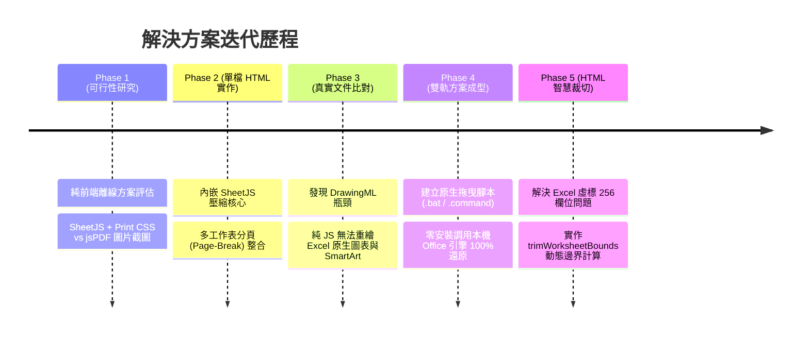
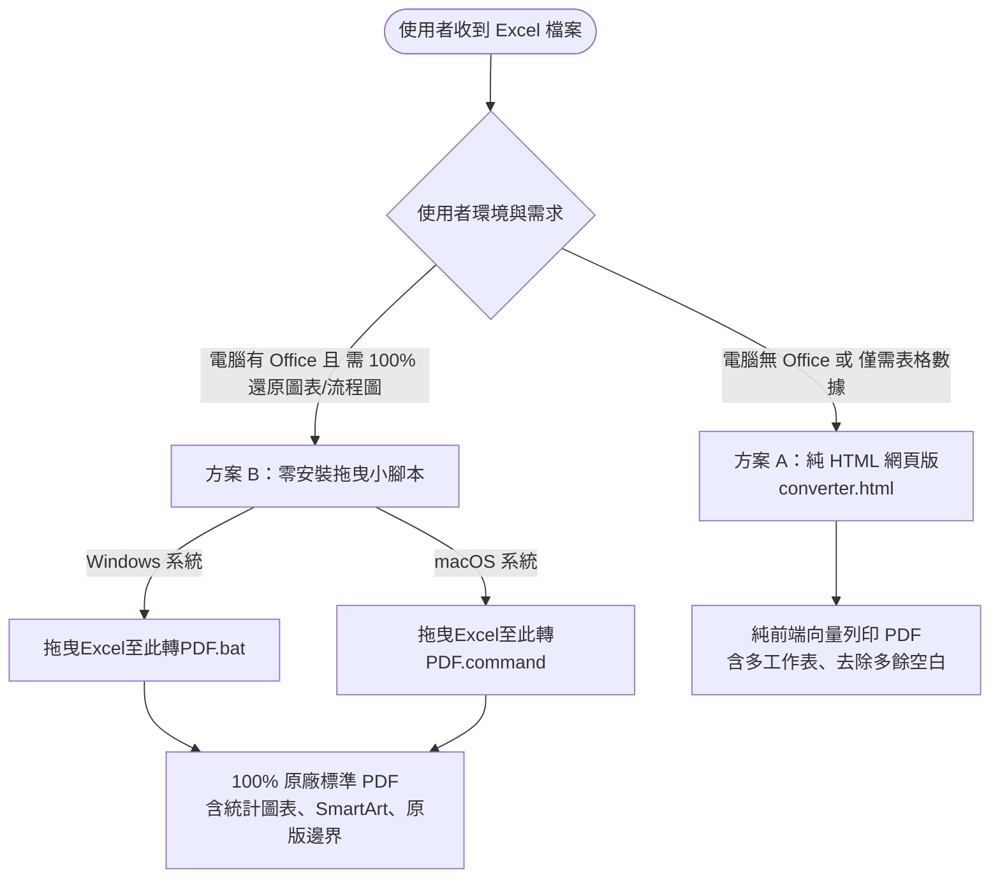

# Excel 轉 PDF 離線工具集 (XLSX to PDF Toolkit)

[](https://github.com/lushinshang/1150830_xlsx_to_pdf)

本專案提供一套**完全不需連網（100% Offline）**、**零安裝（No-Install）**且**免系統管理員權限（Zero Admin Rights）**的 Excel (`.xlsx` / `.xls`) 轉換 PDF 完整解決方案。

> 📄 **文件站**：雙擊開啟 [`index.html`](index.html) 有專案介紹首頁，並連結到 [`manual.html`](manual.html)（使用手冊）、[`security-report.html`](security-report.html)（資安檢測報告）、[`spec.html`](spec.html)（系統規格文件），以及 Windows（`.zip`，內含 `.bat`）/ macOS（`.command`）的下載按鈕。

---

## 📖 目錄 (Table of Contents)
- [1. 專案背景與核心挑戰](#1-專案背景與核心挑戰)
- [2. 開發演進歷程與架構決策 (Development Journey)](#2-開發演進歷程與架構決策-development-journey)
- [3. 雙軌架構對照 (Dual-Track Architecture)](#3-雙軌架構對照-dual-track-architecture)
- [4. 專案檔案結構 (File Structure)](#4-專案檔案結構-file-structure)
- [5. 詳細使用手冊 (Usage Guide)](#5-詳細使用手冊-usage-guide)
- [6. 技術深度細節與 AI 開發者指引 (Technical Deep Dive for AI & Engineers)](#6-技術深度細節與-ai-開發者指引-technical-deep-dive-for-ai--engineers)

---

## 1. 專案背景與核心挑戰

### 核心痛點
在許多企業、機構或醫院等嚴格資安管制環境下：
1. **無法連網上傳**：機密試算表資料不得上傳至外部雲端轉換服務。
2. **無安裝權限**：終端使用者（User）沒有本機管理員權限，無法安裝 Python、Node.js 或 LibreOffice 等第三方轉檔軟體。
3. **複雜圖表需求**：Excel 檔案中常包含**統計圖表 (Charts)** 與 **SmartArt 流程圖 (DrawingML)**，一般純文字/表格解析器會遺漏這些元素。

---

## 2. 開發演進歷程與架構決策 (Development Journey)



### 階段一：純前端單檔 HTML 可行性研究
- **方案 A (推薦)**：內嵌 SheetJS + 動態 DOM 表格 + 瀏覽器向量列印 (`window.print()`)。
- **方案 B**：SheetJS + html2canvas + jsPDF 截圖直接下載。
- **結論**：方案 A 產出之 PDF 具備向量文字、檔案小（< 300KB）、完美支援繁體中文（免打包肥大字型），作為 Web 端基礎。

### 階段二：多分頁一次合併轉存 (Multi-Sheet Support)
- **問題**：初始版本僅能預覽列印單一 Sheet。
- **改進**：實作「📑 全部工作表」模式，遍歷所有活頁簿，在工作表之間注入 CSS `page-break-before: always; break-before: page;`，實現 16 頁一鍵連續分頁輸出。

### 階段三：標準文件深層比對與 DrawingML 瓶頸突破
- **對比基準**：比對真實公文指標文件（含 BMI 統計圖表與 PDCA 改善流程方塊）。
- **關鍵發現**：
  1. Excel 的圖表 (`xl/charts/chartX.xml`) 與 SmartArt (`xl/diagrams/drawingX.xml`) 屬於微軟專屬 DrawingML 語言。
  2. 純前端開源庫（SheetJS Community 等）僅解析儲存格資料，無法重繪向量圖表與流程圖。
  3. **WASM 評估**：LibreOffice WASM 體積超過 100MB，且在直接雙擊本地檔案（`file://`）環境下，因缺乏伺服器 `COOP/COEP` 安全標頭，`SharedArrayBuffer` 會被瀏覽器直接阻斷。

### 階段四：原生零安裝雙軌架構誕生 (Native Dual-Track)
- 為在「**零安裝、免管理員權限**」前提下達到 100% 原生圖表還原：
  - **Windows**：開發 `拖曳Excel至此轉PDF.bat`，透過 Windows 內建 PowerShell 調用系統已有的 `Excel.Application` COM 物件，秒速無頭匯出。
  - **macOS**：開發 `拖曳Excel至此轉PDF.command`，透過 macOS 內建 Python3 / AppleScript 調用本機 Excel 原生匯出。
- **驗證成果**：產出之 PDF 頁數、尺寸、BMI 圖表、PDCA「少量多餐」流程圖 **100% 完整還原**，檔案體積大幅最佳化（從 625KB 降至 251KB）。

### 階段五：HTML 智慧邊界裁切 (Smart Bounds Trimming)
- **問題**：部分 Excel 檔案因內部殘留格式，宣告了 `A1:IV73`（達 256 欄），導致 HTML 產生數百個無效空白 `<td>` 儲存格，排版變形。
- **改進**：在 `converter.html` 內嵌 `trimWorksheetBounds()` 演算法，動態掃描所有含值儲存格與合併儲存格，重新計算最小外接矩形（Bounding Box），自動剔除右側與下方的大量無效空白。

---

## 3. 雙軌架構對照 (Dual-Track Architecture)



| 比較項目 | 方案 A：純離線單檔 HTML (`converter.html`) | 方案 B：零安裝原生腳本 (`.bat` / `.command`) |
| :--- | :--- | :--- |
| **載體型態** | 單一 `.html` 檔案（約 970 KB） | 單一 `.bat` (3 KB) / `.command` (2 KB) |
| **執行環境** | 任何瀏覽器（Chrome, Edge, Safari...） | Windows (內建 PowerShell) 或 macOS (內建環境) |
| **安裝/權限** | **零安裝、免管理員權限** | **零安裝、免管理員權限**（利用現有 Office） |
| **聯網需求** | **100% 完全不聯網** | **100% 完全不聯網** |
| **表格/數值** |  100% 向量文字支援（可搜尋、可複製） |  100% 支援 |
| **空白行列修剪** |  **支援（自動去除未使用的多餘空白格子）** |  支援（遵循 Excel 原廠列印區域） |
| **多工作表整合** |  支援（自動於工作表間強制換頁） |  支援（整本活頁簿原生分頁匯出） |
| **統計圖表 (Charts)**| ❌ 限制（純 JS 無法解析 DrawingML） |  **100% 完美還原** |
| **流程圖 (SmartArt)**| ❌ 限制（純 JS 無法解析 DrawingML） |  **100% 完美還原** |

---

## 4. 專案檔案結構 (File Structure)

```text
1150830_xlsx_to_pdf/
├── index.html                  # 專案入口頁：介紹、功能說明，連結下方所有文件與下載
├── converter.html               # 方案 A：純離線單檔 HTML 轉換工具（內嵌 SheetJS 壓縮核心）
├── manual.html                  # 使用者操作手冊（三種轉檔方式）
├── security-report.html         # 資安檢測結果報告
├── spec.html                    # 系統規格文件（含流程圖與架構圖）
├── 拖曳Excel至此轉PDF.bat        # 方案 B (Windows)：單檔原生拖曳轉檔批次檔（調用 Excel COM）
├── 拖曳Excel至此轉PDF_Windows版.zip  # 上述 .bat 的下載打包（避免瀏覽器/SmartScreen 直接攔截 .bat 下載）
├── 拖曳Excel至此轉PDF.command    # 方案 B (macOS)：單檔原生拖曳轉檔腳本（調用 AppleScript）
└── README.md                   # 本技術文件與開發記錄說明書
```

---

## 5. 詳細使用手冊 (Usage Guide)

> 非技術使用者也可以直接雙擊開啟 `index.html`，網頁上有專案介紹、三份文件（`manual.html` 使用手冊、`security-report.html` 資安檢測報告、`spec.html` 系統規格文件）的連結，以及 Windows（`.zip`，內含 `.bat`）/ macOS（`.command`）的下載按鈕。

### 方案 A：使用純 HTML 網頁版 (`converter.html`)
1. 直接以任一瀏覽器雙擊開啟 `converter.html`。
2. 將 Excel 檔案（`.xlsx` / `.xls` / `.csv`）拖曳至網頁放置區。
3. 系統將自動修剪無效空白，並預設載入「**📑 全部工作表**」。
4. 點選「🖨️ 列印 / 另存為 PDF」，在瀏覽器列印對話框中選擇「另存為 PDF」即可完成。

### 方案 B-1：Windows 使用者 (`拖曳Excel至此轉PDF.bat`)
1. 下載 `拖曳Excel至此轉PDF_Windows版.zip`，**解壓縮**後得到 `拖曳Excel至此轉PDF.bat`，放置於桌面或放有 Excel 的資料夾。若執行時跳出 SmartScreen「Windows 已保護您的電腦」提示，點「其他資訊」→「仍要執行」即可（這是對不常見下載的正常警示，非病毒偵測）。
2. **選取一個或多個 Excel 檔案，直接拖曳放到該 `.bat` 圖示上方**。
3. 系統將在背景靜默調用 Excel 原生引擎，自動於同目錄產出標準 PDF。
4. 若不拖曳、直接雙擊執行，且當前目錄找不到任何 Excel 檔案，會自動跳出 Windows 檔案總管的「開啟檔案」對話框讓你選檔（可一次選多個）。

### 方案 B-2：macOS 使用者 (`拖曳Excel至此轉PDF.command`)
1. 雙擊執行 `拖曳Excel至此轉PDF.command`（會自動轉換同目錄下的 Excel 檔案）。
2. 系統將調用 macOS Excel 原生引擎，於同目錄產出標準 PDF。
3. 若當前目錄找不到任何 Excel 檔案，會自動跳出 Finder 的「選擇檔案」對話框讓你選檔（可一次選多個）。

---

## 6. 技術深度細節與 AI 開發者指引 (Technical Deep Dive for AI & Engineers)

若未來的 AI 助理或工程師接手維護本專案，請注意以下核心實作邏輯：

### 1. `converter.html` 智慧空白修剪邏輯 (`trimWorksheetBounds`)
```javascript
function trimWorksheetBounds(ws) {
  if (!ws || !ws['!ref']) return ws;
  let minR = Infinity, maxR = -1;
  let minC = Infinity, maxC = -1;

  for (let key in ws) {
    if (key.startsWith('!')) continue;
    let cell = ws[key];
    if (cell && cell.v !== undefined && cell.v !== null && String(cell.v).trim() !== '') {
      let decode = XLSX.utils.decode_cell(key);
      if (decode.r < minR) minR = decode.r;
      if (decode.r > maxR) maxR = decode.r;
      if (decode.c < minC) minC = decode.c;
      if (decode.c > maxC) maxC = decode.c;
    }
  }

  if (maxR !== -1 && maxC !== -1) {
    // 包含合併儲存格範圍
    if (ws['!merges']) {
      ws['!merges'].forEach(m => {
        if (m.s.r <= maxR && m.s.c <= maxC) {
          if (m.e.r > maxR) maxR = m.e.r;
          if (m.e.c > maxC) maxC = m.e.c;
        }
      });
    }
    minR = Math.min(minR, 0);
    minC = Math.min(minC, 0);
    ws['!ref'] = XLSX.utils.encode_range({
      s: { r: minR, c: minC },
      e: { r: maxR, c: maxC }
    });
  }
  return ws;
}
```
- **核心原理**：遍歷工作表非 meta 鍵值，動態計算最小/最大行與列，重寫 `ws['!ref']`，阻止 `XLSX.utils.sheet_to_html` 產生無效的 `<td>` 節點。

### 2. `拖曳Excel至此轉PDF.bat` Windows COM 自動化核心
```powershell
$excel = New-Object -ComObject Excel.Application
$excel.Visible = $false
$excel.DisplayAlerts = $false
$wb = $excel.Workbooks.Open((Resolve-Path $arg).Path)
$wb.ExportAsFixedFormat(0, $pdfPath) # 0 = xlTypePDF
$wb.Close($false)
$excel.Quit()
[System.Runtime.Interopservices.Marshal]::ReleaseComObject($excel) | Out-Null
```
- **核心原理**：利用 Windows 內建 COM 自動化介面，調用本機 Office 的 `ExportAsFixedFormat` 原生匯出，完美相容所有 Office 版本，不需任何外部相依套件。

### 3. 多工作表列印分頁 CSS 控制
```css
@media print {
  .sheet-section:not(:first-child) {
    page-break-before: always !important;
    break-before: page !important;
  }
  thead {
    display: table-header-group; /* 表頭跨頁自動重複 */
  }
  tr {
    page-break-inside: avoid;    /* 防止表格列在換頁處被切斷 */
    break-inside: avoid;
  }
}
```
