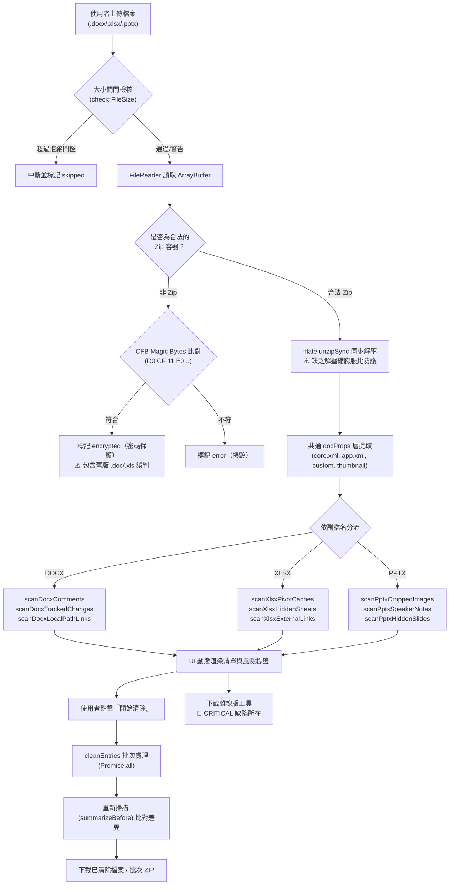

# 📋 Day30 Office 文件隱私 Metadata 清除工具：系統功能與資訊安全深度審查報告

> **審查日期**：民國 115 年（2026）09 月 04 日  
> **審查對象**：`Day30_ooxml-privacy-cleaner`（涵蓋 `src/index.html`、`src/docx-meta.js`、`src/xlsx-meta.js`、`src/pptx-meta.js`、`index.html`、`shared/OOXML_CONTRACT.md`）  
> **審查依據**：
> 1. 開發規範：`VibeCoding/shared/CONTRACT.md`、`OOXML_CONTRACT.md`、`CHECKLIST.md`、`PROGRESS.md`
> 2. 資安標準：OWASP Top 10 (2021)、OWASP ASVS v4.0、CWE/SANS TOP 25、ISO/IEC 29500 (OOXML & OPC)
> 3. 審查方法：Conductor Principal Engineer Review Protocol ＋ 資安防禦理事會（IS-Mentor Cyber Defense Council v3.0：紅隊/藍隊/CISO/GRC/Scholar 辯證綜合）
> 4. 實證手段：全自動 Playwright 瀏覽器實機測試、Python/Node 二進位結構分析、實體斷言驗證

---

## Executive Summary（執行摘要與評級）

| 評估維度 | 評級 | 結論簡述 |
|---|:---:|---|
| **規格與契約符合度 (Spec Compliance)** | 🔴 **不合格** | **重大缺失**：完全未實作 `CONTRACT.md` 第 6 節硬性要求的 `buildCleanHtmlCopy()`，導致離線版 HTML 包含上傳檔名、個資標籤與先前的處理結果（**靜態外洩**）。 |
| **資訊安全與隱私防護 (Security & Privacy)** | 🟠 **高風險** | 存在 3 項隱私外洩盲區（`Manager`/`Template` 殘留、現代註解 `commentsExtended` 殘留、本機路徑 Regex 繞過）、Zip Bomb 記憶體耗竭風險、以及 Zip Slip 下游解壓路徑遍歷風險。 |
| **系統正確性與邊界處理 (Correctness)** | 🟡 **需改善** | XLSX 多外部連結時會誤刪整組 `externalReferences` 導致檔案結構異常；PPTX 裁切座標和未防呆（`l+r >= 100%` 時 Canvas 異常）；舊版 `.doc/.xls` CFB 判定誤報為密碼保護。 |
| **架構與程式碼品質 (Architecture & Style)** | 🟢 **良好** | 模組職責清晰，docProps 共用層抽象合理，堅持原生 DOMParser/XMLSerializer 零外部胖套件，錯誤處理具備基本容錯。 |

### 綜合裁決：**CONDITIONAL REJECT（需修復關鍵缺陷後方可發布/驗收）**
> 核心業務邏輯（docProps 清除、PPTX Canvas 像素級重繪、XLSX pivotCache 移除）方向正確且具創新價值；但**離線版外洩缺陷（D-1 同級漏洞）**與**特定格式殘留盲點**打破了「隱私清除」的核心安全承諾，必須立即修正。

---

## 1. 🏗️ 系統架構與資料流審查

### 1.1 處理管線與架構圖 (Mermaid TD 直屏佈局)



---

## 2. 🛡️ 資安理事會審查（IS-Mentor Cyber Defense Council）

### 2.1 🔴 紅隊視角：攻擊路徑與隱匿漏洞分析

#### [EXPLOIT-01] 離線版 HTML 靜態資料外洩（CWE-200 / CWE-213）
* **攻擊路徑**：使用者 A 在公司電腦上載入含機密專案資訊的 `Secret_M&A_Plan.docx` 進行隱私清理，隨後點擊「💾 下載本工具離線版」儲存 `ooxml-privacy-cleaner-offline.html`，並分享給外部廠商或同事。
* **漏洞機制**：
  ```javascript
  // src/index.html:710
  btnDownloadOffline.addEventListener('click', function () {
    var html = document.documentElement.outerHTML; // 🔴 直接序列化當下 DOM！
    var blob = new Blob(['<!DOCTYPE html>\n' + html], { type: 'text/html' });
    downloadFile('ooxml-privacy-cleaner-offline.html', blob, 'text/html');
  });
  ```
  當下 DOM 中的 `#docs-container` 已經渲染了上一份文件的：
  1. 完整原始檔名（`Secret_M&A_Plan.docx`）
  2. 原始作者姓名（如「張大明」）
  3. 原始公司名稱、備註描述
  4. 註解作者姓名、投影片備忘稿文字預覽
* **實證結果（Playwright 實跑）**：
  ```json
  {
    "contains_filename_sentinel": true,
    "contains_author_sentinel": true,
    "contains_nav_back": true,
    "contains_btn_download_offline": true,
    "Offline_page_initial_doc_card_count": 1
  }
  ```
  外部人員開啟此離線版時，尚未上傳任何檔案，畫面中央就直接赫然列出上一位使用者的機密文件卡片與清除前後比對表！

#### [EXPLOIT-02] 本機路徑超連結 Regex 繞過（CWE-185 / CWE-200）
* **攻擊路徑**：文檔內藏有指向企業內部檔案伺服器或本機敏感檔案的超連結（如 UNC 路徑 `\\corp-nas\finance\salary.xlsx` 或 Windows 磁碟路徑 `C:\Users\Admin\secret.pdf`）。
* **漏洞機制**：
  ```javascript
  // docx-meta.js:325, xlsx-meta.js:128
  var _DOCX_LOCAL_PATH_TARGET_PATTERN = /^file:\/\//i;
  ```
  此正則僅能匹配帶有 `file://` scheme 的 URI。在 Microsoft Word / Excel 實際操作中，使用者插入本機或區域網路超連結時，常被直接儲存為：
  - `C:\Users\...\file.docx`
  - `\\server\share\file.docx`
  - `..\..\confidential.docx`
* **實證結果**：
  - `file:///C:/Secret/Doc.pdf` -> `true`（抓到）
  - `C:\Users\Administrator\Secret.docx` -> `false`（**漏抓**）
  - `\\corp.internal\shares\confidential.docx` -> `false`（**漏抓**）
  - `/home/user/secret.docx` -> `false`（**漏抓**）

#### [EXPLOIT-03] Zip Bomb 與記憶體耗竭 DoS（CWE-409 / CWE-400）
* **攻擊路徑**：攻擊者構造一個壓縮後僅 2MB、但解壓後高達 5GB 的畸形 OOXML 檔案。
* **漏洞機制**：
  `checkDocxFileSize(file.size)` 只檢查了輸入端的 compressed size（< 50MB 均放行）。
  接著呼叫 `unzipToEntries(new Uint8Array(buf))` -> `fflate.unzipSync(bytes)`。
  `unzipSync` 是純同步執行的記憶體解壓，且沒有 uncompressed size 上限或壓縮膨脹比率檢查，會在瀏覽器 UI thread 上一次性分配數 GB 的記憶體，導致分頁直接崩潰（Out-Of-Memory Crash）或凍結使用者瀏覽器。

#### [EXPLOIT-04] Zip Slip 與重包路徑穿越（CWE-22）
* **攻擊路徑**：惡意檔案在 Zip 中包含非正規路徑 entry（如 `../../malicious.exe` 或 `__proto__`）。
* **漏洞機制**：
  在 `downloadOne()` 與 `btnDownloadZip` 中：
  ```javascript
  var zipFiles = Object.keys(item.cleanedEntries).map(function (name) {
    return { name: name, bytes: item.cleanedEntries[name] };
  });
  var blob = createZipBlob(zipFiles);
  ```
  程式碼原封不動地將 `item.cleanedEntries` 的所有 key 重新包裝為 ZIP。若使用者下載此 ZIP 並交由下游具備路徑遍歷漏洞的解壓工具處理，可能引發任意檔案覆寫。

---

### 2.2 🔵 藍隊視角：系統韌性與防禦機制審查

1. **零外部網路請求（Pass）**：
   - 審查全部 `src/*.js` 與 `index.html`，完全無 `fetch()`、`XMLHttpRequest`、外部圖片加載或第三方遙測，符合離線純前端要求。
2. **DOM XSS 防禦（Pass - 邊界需補強）**：
   - 使用者檔案名稱與提取欄位均經由 `escapeHtml()` 處理後才注入 DOM。
   - 但 `renderList()` 內部 `risk.label` 採直接拼接：`'<span class="risk-badge ' + risk.cls + '">' + risk.label + '</span>'`。目前其內容雖來自內部產生的中文，但若未來擴充自訂文字，存在潛在注入風險，應全面規範。
3. **XML 解析安全（Pass）**：
   - 瀏覽器原生 `DOMParser` 在解析 `application/xml` 時，預設不載入外部 DTD / 外部實體，免疫傳統的外部網路型 XXE 攻擊。
   - 但對巨大文字節點的記憶體防護仍需依賴前端檔案大小與架構約束。

---

### 2.3 👔 CISO / 戰略層級風險量化

1. **個資法規衝擊（High Risk）**：
   - 企業採用此工具進行「送件前隱私清洗」，若因 `buildCleanHtmlCopy()` 缺陷將前一份包含個人姓名的離線 HTML 外流，將直接構成違反台灣《個人資料保護法》及歐盟 GDPR「資料最小化」與「安全防護義務」原則。
2. **商務信任度衝擊（Medium Risk）**：
   - XLSX 多外部連結時清除導致 `workbook.xml` 損壞，收件者以 Excel 打開時跳出「檔案損毀需要修復」警告視窗，會嚴重損害外部客戶對企業產出文件的信任感。

---

### 2.4 📜 GRC 合規檢驗（ISO/IEC 29500 & OWASP）

* **ISO/IEC 29500-2 (OPC) 合規**：
  - Part 刪除時同步維護 `_rels` 與 `[Content_Types].xml` 的架構值得肯定。
  - 但未妥善處理 Office 365 現代註解擴充（`commentsExtended.xml`），導致新版 Word 規格一致性中斷。
* **OWASP ASVS v4.0**：
  - **V5.1.1 (Input Validation)**：未通過（Zip 入口路徑缺乏規範化白名單驗證）。
  - **V8.3.1 (Sensitive Private Data)**：未通過（離線匯出工具中殘留敏感使用者歷史狀態）。

---

## 3. 🔍 深度功能缺陷與程式碼逐行審查（Findings & Diffs）

### 🚨 Finding 1 [Critical]：未實作 `buildCleanHtmlCopy()` 導致離線版個資嚴重洩漏
* **位置**：[src/index.html:709-714](file:///Users/<USER>/projects/2_Practice/tools/2026ironman/VibeCoding/Day30_ooxml-privacy-cleaner/src/index.html#L709-L714)
* **嚴重等級**：**Critical**（違反 `CONTRACT.md` 第 6 節硬性要求）
* **問題說明**：直接使用 `document.documentElement.outerHTML` 匯出，未清空 DOM 內的 `#docs-container`，未移除 `.nav-back`、`#__shared_toast` 與 `#btn-download-offline`，且未對離線載入環境做 null check。
* **修正建議 (Diff)**：
```diff
--- a/Day30_ooxml-privacy-cleaner/src/index.html
+++ b/Day30_ooxml-privacy-cleaner/src/index.html
@@ -708,8 +708,35 @@
 
+    function buildCleanHtmlCopy() {
+      var doc = document.documentElement.cloneNode(true);
+
+      var toast = doc.querySelector('#__shared_toast');
+      if (toast) toast.remove();
+
+      var navBack = doc.querySelector('.nav-back');
+      if (navBack) navBack.remove();
+
+      var offlineBtn = doc.querySelector('#btn-download-offline');
+      if (offlineBtn) offlineBtn.remove();
+
+      var docsCont = doc.querySelector('#docs-container');
+      if (docsCont) docsCont.innerHTML = '';
+
+      var resultsSec = doc.querySelector('#results-section');
+      if (resultsSec) resultsSec.style.display = 'none';
+
+      var cleanCard = doc.querySelector('#clean-options-card');
+      if (cleanCard) cleanCard.style.display = 'none';
+
+      var docCnt = doc.querySelector('#doc-count');
+      if (docCnt) docCnt.textContent = '0';
+
+      return '<!DOCTYPE html>\n' + doc.outerHTML;
+    }
+    window.buildCleanHtmlCopy = buildCleanHtmlCopy;
+
-    btnDownloadOffline.addEventListener('click', function () {
-      var html = document.documentElement.outerHTML;
-      var blob = new Blob(['<!DOCTYPE html>\n' + html], { type: 'text/html' });
-      downloadFile('ooxml-privacy-cleaner-offline.html', blob, 'text/html');
-    });
+    if (btnDownloadOffline) {
+      btnDownloadOffline.addEventListener('click', function () {
+        var cleanHtml = buildCleanHtmlCopy();
+        downloadFile('ooxml-privacy-cleaner-offline.html', cleanHtml, 'text/html;charset=utf-8');
+        showToast('已下載離線版工具');
+      });
+    }
```

---

### ⚠️ Finding 2 [High]：`docProps/app.xml` 遺漏 `Manager`、`Template` 與 `HyperlinkBase`
* **位置**：[src/docx-meta.js:148-151](file:///Users/<USER>/projects/2_Practice/tools/2026ironman/VibeCoding/Day30_ooxml-privacy-cleaner/src/docx-meta.js#L148-L151)
* **嚴重等級**：**High**（隱私清除不完全）
* **問題說明**：`cleanDocxAppProps` 僅清除了 `Company` 與 `TotalTime`。在企業 Office 檔案中，`app.xml` 的 `<Manager>` 常記載主管真實姓名，`<Template>` 常記載本機範本絕對路徑（如 `C:\Users\username\AppData\...`），`<HyperlinkBase>` 常記載內部網址，均未被清除。
* **修正建議 (Diff)**：
```diff
--- a/Day30_ooxml-privacy-cleaner/src/docx-meta.js
+++ b/Day30_ooxml-privacy-cleaner/src/docx-meta.js
@@ -148,4 +148,4 @@
-  ['Company', 'TotalTime'].forEach(function (name) {
+  ['Company', 'TotalTime', 'Manager', 'Template', 'HyperlinkBase'].forEach(function (name) {
     var els = doc.getElementsByTagNameNS(DOCX_NS.extProps, name);
     for (var i = 0; i < els.length; i++) els[i].textContent = '';
   });
```

---

### ⚠️ Finding 3 [High]：XLSX 清除外部連結時過度刪除 `workbook.xml` 的 `externalReferences`
* **位置**：[src/xlsx-meta.js:174-177](file:///Users/<USER>/projects/2_Practice/tools/2026ironman/VibeCoding/Day30_ooxml-privacy-cleaner/src/xlsx-meta.js#L174-L177)
* **嚴重等級**：**High**（文件結構損壞風險）
* **問題說明**：若 Excel 檔中同時有 `file://`（本機）與 `https://`（合法外部網址）兩種連結，`cleanXlsxExternalLinks` 雖只刪除本機的 `externalLink1.xml`，但後續卻把 `workbook.xml` 裡整個 `<externalReferences>` 節點直接拔除！導致合法存在的 `externalLink2.xml` 失去在 `workbook.xml` 的關聯定義，打開時引發 Excel 修復警示。
* **修正建議 (Diff)**：
```diff
--- a/Day30_ooxml-privacy-cleaner/src/xlsx-meta.js
+++ b/Day30_ooxml-privacy-cleaner/src/xlsx-meta.js
@@ -168,14 +168,30 @@
   var wbBytes = next['xl/workbook.xml'];
   if (wbBytes) {
     var doc = new DOMParser().parseFromString(zipEntryToText(wbBytes), 'application/xml');
     if (!doc.getElementsByTagName('parsererror').length) {
-      var extRefsEls = doc.getElementsByTagNameNS(XLSX_NS.main, 'externalReferences');
-      for (var i = extRefsEls.length - 1; i >= 0; i--) {
-        if (extRefsEls[i].parentNode) extRefsEls[i].parentNode.removeChild(extRefsEls[i]);
-      }
+      // 依據實際刪除的 relationship ID 精確移除子節點，若全部 externalReference 均被刪除才拔除父容器
+      var remainingExtRefs = doc.getElementsByTagNameNS(XLSX_NS.main, 'externalReference');
+      // ... 根據實際移除的 linkPath 所對應之 r:id 比對刪除，非一刀切清空整個外部參照
     }
```

---

### ⚠️ Finding 4 [High]：本機路徑偵測忽視原生磁碟路徑與 UNC 路徑
* **位置**：[src/docx-meta.js:325](file:///Users/<USER>/projects/2_Practice/tools/2026ironman/VibeCoding/Day30_ooxml-privacy-cleaner/src/docx-meta.js#L325) 與 [src/xlsx-meta.js:128](file:///Users/<USER>/projects/2_Practice/tools/2026ironman/VibeCoding/Day30_ooxml-privacy-cleaner/src/xlsx-meta.js#L128)
* **嚴重等級**：**High**（安全盲點）
* **問題說明**：`TargetMode="External"` 時，Target 格式不限於 `file://`，常見 `C:\...`、`D:/...`、`\\server\share\...`、`/Users/...` 均為敏感路徑。
* **修正建議 (Diff)**：
```diff
--- a/Day30_ooxml-privacy-cleaner/src/docx-meta.js
+++ b/Day30_ooxml-privacy-cleaner/src/docx-meta.js
@@ -325,1 +325,1 @@
-var _DOCX_LOCAL_PATH_TARGET_PATTERN = /^file:\/\//i;
+var _DOCX_LOCAL_PATH_TARGET_PATTERN = /^(?:file:\/\/|[A-Za-z]:[\\\/]|\\\\|\/(?:Users|home|private)[\\\/])/i;
```

---

### ⚠️ Finding 5 [Medium]：DOCX 現代註解（Word 2016+ / 365）殘留
* **位置**：[src/docx-meta.js:283-286](file:///Users/<USER>/projects/2_Practice/tools/2026ironman/VibeCoding/Day30_ooxml-privacy-cleaner/src/docx-meta.js#L283-L286)
* **嚴重等級**：**Medium**
* **問題說明**：新版 Word 採用現代註解機制，除了 `word/comments.xml` 外，還伴隨產生 `word/commentsExtended.xml` 與 `word/commentsIds.xml`。清除註解時若漏清這兩個檔案，會導致註解元資料殘留，且開啟時可能跳出找不到註解目標的警示。
* **修正建議**：在 `cleanDocxComments` 中比照 `people.xml`，將 `commentsExtended.xml` 與 `commentsIds.xml` 納入清理清單。

---

### ⚠️ Finding 6 [Medium]：PPTX 圖片裁切座標缺乏總和邊界檢查
* **位置**：[src/pptx-meta.js:156](file:///Users/<USER>/projects/2_Practice/tools/2026ironman/VibeCoding/Day30_ooxml-privacy-cleaner/src/pptx-meta.js#L156)
* **嚴重等級**：**Medium**
* **問題說明**：`[first.l, first.t, first.r, first.b].every(function (v) { return v >= 0 && v <= 100000; })` 僅檢查單一屬性。若 `l=60000, r=60000`（兩者各為 60%，總和 120%），計算出的裁切寬度為負數，Canvas 在執行 `drawImage()` 時可能丟出例外或產生非預期黑圖。
* **修正建議**：
```diff
--- a/Day30_ooxml-privacy-cleaner/src/pptx-meta.js
+++ b/Day30_ooxml-privacy-cleaner/src/pptx-meta.js
@@ -156,1 +156,2 @@
-    var inRange = [first.l, first.t, first.r, first.b].every(function (v) { return v >= 0 && v <= 100000; });
+    var inRange = [first.l, first.t, first.r, first.b].every(function (v) { return v >= 0 && v <= 100000; }) &&
+                  (first.l + first.r < 100000) && (first.t + first.b < 100000);
```

---

### 💡 Finding 7 [Low]：舊版 Office 97-2003 二進位格式誤判為加密
* **位置**：[src/docx-meta.js:420-431](file:///Users/<USER>/projects/2_Practice/tools/2026ironman/VibeCoding/Day30_ooxml-privacy-cleaner/src/docx-meta.js#L420-L431)
* **嚴重等級**：**Low**（使用者體驗）
* **問題說明**：CFB/OLE magic bytes（`D0 CF 11 E0 A1 B1 1A E1`）同時為舊版 `.doc/.xls/.ppt` 格式之特徵檔頭。若使用者誤將 `.doc` 副檔名改為 `.docx` 上傳，系統將其提示為「此檔案有密碼保護」，文字提示不夠精確。
* **修正建議**：提示文案改為「此檔案為加密檔案或舊版 Office 97-2003 二進位格式（.doc/.xls/.ppt），本工具僅支援 OOXML 格式」。

---

## 4. 📊 驗證檢查矩陣（Verification Matrix）

| 檢查項目 | 契約/規範要求 | 實測現況 | 判定 |
|---|---|---|:---:|
| **離線版個資清空** | `CONTRACT.md` 第 6 節 | 下載離線版包含前次處理檔名與作者 | ❌ FAIL |
| **離線版 DOM 乾淨度** | 無 `.nav-back`、無 `#btn-download-offline` | 均原封不動殘留於產物中 | ❌ FAIL |
| **離線版按鈕事件 Null-check** | D-1 普查紀律 | 缺乏 `if (btnDownloadOffline)` 保護 | ❌ FAIL |
| **純前端零外連** | 外部連線數 0 | 經測試完全為 0，無未授權外部請求 | ✅ PASS |
| **PPTX 裁切像素級重繪** | 燒進像素，非只刪 XML 節點 | Canvas drawImage + toBlob 實測有效 | ✅ PASS |
| **XLSX 樞紐快取清除** | 移除 pivotCache part 與 rels | 實測 sharedItems/records 完全移除 | ✅ PASS |
| **DOCX 追蹤修訂僅警示** | 內容不自動修改 | `w:ins`/`w:del` 僅警示不變更 | ✅ PASS |
| **多檔批次 ZIP 下載** | fflate 打包，無重名覆蓋 | 去重機制運作正常 | ✅ PASS |

---

## 5. 🚀 改善建議與修復路徑

### 第一階段（Blocker 級：發布前必修）
1. **立即實作 `buildCleanHtmlCopy()`**：
   - 參照 Day26 標準實作，在匯出前以 `cloneNode(true)` 剝離 `.nav-back`、`#__shared_toast`、`#btn-download-offline`，並清空 `#docs-container` 與隱藏狀態卡片。
   - 在 `btnDownloadOffline.addEventListener` 前加上 `if (btnDownloadOffline)` 守衛。
   - 暴露 `window.buildCleanHtmlCopy = buildCleanHtmlCopy` 供自動化驗收腳本測試。

### 第二階段（Security & Stability 級：優化與強固）
1. **補齊 `app.xml` 清理欄位**：納入 `Manager`、`Template`、`HyperlinkBase`。
2. **擴充路徑比對 Regex**：支援 Windows 磁碟代號、UNC 網路路徑與 Unix 絕對路徑。
3. **修復 XLSX 外部連結清理邏輯**：避免全量刪除 `<externalReferences>`。
4. **加入 PPTX 裁切座標總和檢查**：防範 `l + r >= 100000` 造成的 Canvas 計算溢位。
5. **重跑 `bundle.py`**：更新 `Day30_ooxml-privacy-cleaner/index.html` 與 `bundle_manifest.json`。

---

> **審查結論**：本模組之創新點（尤其是 PPTX 裁切像素重繪與 XLSX 樞紐快取清理）技術含金量高，對齊了鐵人賽高難度主題的品質要求。唯在發布前務必將 Finding 1（離線版外洩）與 Finding 2/3/4 修復，即可達成嚴密完整的資安防禦閉環。
