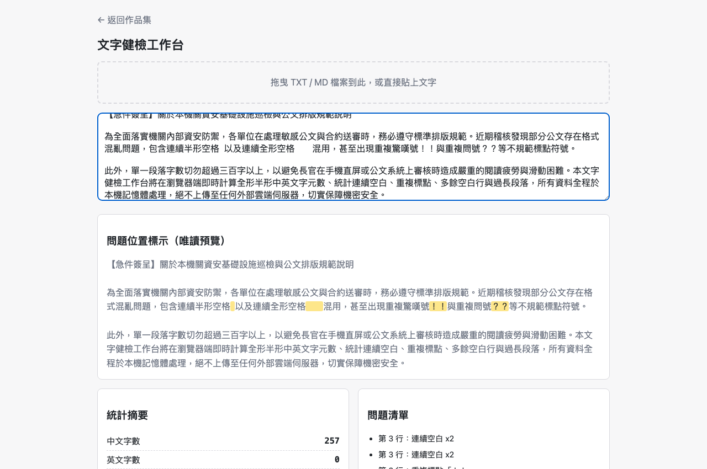

# Day01｜文字健檢工作台：一個不想裝環境、也不想顧伺服器的工程師的解法

   

👉 [Demo 連結](https://lushinshang.github.io/2026ironman/VibeCoding/Day01_text-health-check/index.html)（GitHub Pages 待設定上線，本機直接用瀏覽器開 `index.html` 就能用，不用裝任何東西）


---

## 🏢 一、情境：長官丟來一份 20 頁公告，要我 10 分鐘挑出格式問題

我是阿星，先講講我為什麼會走到「做一個單一 HTML 小工具」這條路。

那天長官丟給我一份 20 頁的公告草稿，只講了一句：「幫我看看格式有沒有問題，過長段落、連續空白、重複標點都要挑出來，10 分鐘後要用。」

我盯著那份 Word 檔看了幾秒，第一個念頭其實不是「這題怎麼寫」，而是「我該用什麼工具做這件事，才不會之後每次都要重來一次」。

老實說，寫個 Python 腳本或 Node 小程式，5 分鐘就能解決眼前這題。但我沒有選這條路，原因很單純：**換一台電腦，我就要重裝一次環境、重裝一次套件，麻煩到爆。** 公司電腦、家裡電腦、朋友借我的電腦，每台狀態都不一樣，我不想每次都重新來一遍「裝 Python、裝套件、測環境」這套流程。

那架個網頁服務放上雲端總行了吧？也不行。架伺服器意味著我要顧伺服器：開 port、防 DDoS、擋 SQL injection、擋 SSRF，還要煩惱誰能連進來、資料存在哪裡、要不要加密。這些後續維護成本，對一個「順手做出來給自己和同事用」的小工具來說，完全不成比例地重。

那 10 分鐘我怎麼撐過去的，說出來不怕丟臉：肉眼一行一行掃過去，土法煉鋼手動抓漏。長官滿意收走草稿，但我知道這種苦工不可能天天靠人力硬撐——**我要做一個工具，而且這個工具最好不用裝、不用架、丟到哪都能用。**

## 💡 二、想法：單一 HTML，不是為了斷網，是因為我懶得管環境和伺服器

想清楚需求之後，我腦中冒出的答案其實只有一個：**單一 HTML 檔案。**

為什麼？拆開來講三個理由：

1. **零安裝**：只要有瀏覽器就能開，不管是 Windows、Mac，還是那台跑了八年的老電腦，雙擊就能用，不用裝任何東西。
2. **超可攜**：一個檔案，丟進 USB、傳到公用資料夾、用即時通訊軟體傳給同事，走到哪、用到哪，不用交代對方「先裝一下 Python」。
3. **攻擊面小到不行**：沒有後端，就沒有資料庫可以外洩；沒有伺服器，就沒有伺服器漏洞可以打。只要我確保這支程式「不會偷偷發外部連線、不會把資料洩漏出去」，資安審查基本上是最乾淨、最好過關的一種型態。

這個念頭不是憑空冒出來的。之前我做過一批類似的公文小工具（先叫它 v1），做到後面幾支就撐不住了。不是沒時間，是回頭看程式碼時倒抽一口氣：`downloadFile()` 和 `downloadJson()` 兩支函式名字不同、簽名不同，做的事幾乎一模一樣；`showToast()` 這個彈出提示訊息的函式，在四個檔案裡幾乎逐字複製貼上，其中一個檔案 timeout 寫 `1800ms`，其他三個是 `2200ms`——沒人記得改對，也沒人發現不一致。

**才幾支工具就已經歪成這樣，而且每支單獨看都「能動」，根本沒人會發現**。如果這次也放任每支工具各寫一份彈窗邏輯、一份下載邏輯，情況只會更糟。

開工前，我沒有把需求整包丟給 AI 一次生完，而是分成四道指令，一步一步把認知鎖死。第一道，先攔住 AI 別急著寫程式：

> 「規劃文字健檢工具，抓過長段落、連續空白、重複標點。注意事項：先提供判定規則，讓我審查假設條件，認知對齊後再開發。」

AI 沒有直接吐程式碼，而是先丟回一份假設清單——「過長段落」抓了 500 字、「連續空白」只算半形空白、「重複標點」把「！？」相鄰也算成重複。這份清單我沒有照單全收，直接下第二道指令，把模糊字眼逼成能寫進 `if` 的具體數字：

> 「過長段落律定300字，參數化，以利後續修改，限定同一字元重複標點。」

這句話拆開來看是兩件事：**數字要定案**（300 字，不是 AI 原本猜的 500，而且要參數化，方便以後隨時調）；**判定條件要收窄**（要「同一個字元」連續出現才算重複標點，「！？」相鄰其實是正常的語氣收尾，不是打字打錯）。再加上前面確認過的全形空白、Tab 混用也要算進連續空白，四條規則就此拍板：

- 過長段落：單段（不含換行）超過 **300 字**觸發，數字寫成參數，之後想改隨時改
- 連續空白：同一行內**連續 2 個以上**空白字元觸發，半形、全形、Tab 混用都算
- 中英文比例：中文字元數 ÷（中文字元數 + 英文單字數）× 100，四捨五入取整數
- 重複標點：**同一個字元**連續出現 2 次以上才算，「！？」相鄰不算，那是正常語氣

規則對齊之後，才輪到第三道指令，交代「怎麼開發」——不准重複造輪子，也不能東一支西一支散裝：

> 「規則部分你我認知已對齊，為避免重複開發，請用reuse概念整理共用性函式或設定；另為了可攜帶到各個環境都可使用，目標為單一HTML，請模擬程式專家協助開發。」

AI 照這道指令，把兩層地基動了起來：

**共用層**（`shared/*.js` + `base.css` + `scripts/bundle.py`）：六支模組把重複邏輯收成統一寫法——`showToast(msg, ms)` 彈提示訊息、`debounce(fn, ms)` 防抖、`downloadFile(filename, content, mime)` 下載檔案、`copyToClipboard(text)` 複製到剪貼簿、`setupDropZone(dropEl, onText, opts)` 拖曳上傳、`escapeHtml(s)` 跳脫 HTML。這些函式的用法寫進 `shared/CONTRACT.md`，之後任何一支工具要加新行為，只能加參數，不能改掉舊參數原本的意思。`bundle.py` 在我家裡電腦上跑組建，把這些模組的原始碼直接貼進每支工具的 `<script>` 標籤裡——執行時不做任何 import，維持「單一檔案、不用連網」這個承諾，這樣工具才帶得走。

**產品層**：文字健檢的統計邏輯本身不難，難的是把長官那句口頭模糊需求逼成精確數字，這件事前面三道指令已經處理完。判定流程大致是這樣：

```text
輸入文字變更
   ↓ debounce 150ms
computeStats 統計核心
   ↓
逐行/逐段掃描判定
 ├ 同行空白≥2？
 ├ 同字元標點≥2？
 ├ 連續空白行≥2？
 └ 單段字數>300？
   ↓（命中）
escapeHtml 後包 mark
   ↓
渲染高亮預覽+清單
```

另外一個決定是：要在畫面上把問題位置標出來，得用 `innerHTML` 才能呈現高亮片段（純文字辦不到）。之前的工具都只用 `textContent`，沒踩過這條線。這次改用 `innerHTML`，代價是要立下一條硬規矩：**所有要放進 `innerHTML` 的內容，一律先過 `escapeHtml()`**。這條規則直接寫進 `tasks.md`，當成獨立的驗收項目，不是嘴上講講而已。

## ⚔️ 三、過程：真實驗收抓到 7 個洞，離線版裡還藏著一個「幽靈元素」

這題本身的統計邏輯沒什麼好爭的，四條規則定案後基本一次到位。真正出包的地方是**時序問題**：這支工具是在共用層修正「之前」就先做完的，用的是舊版的拖曳上傳模組和舊版的組建腳本。

共用層是之後所有工具都要靠的地基，我不放心只靠自己肉眼複查，所以下了第四道指令，找另一個模型來交叉檢查：

> 「另外呼叫一個subagent，使用適當的模型，對已完成的程式實施功能測試與資訊安全測試。與主agent相互搭配，直到all pass才算過關。」

這次獨立驗收判定「部分通過」，一次抓到 **7 個問題**，而且這些問題會擴散到之後每一支工具，不是這一題單獨的事：拖曳上傳的檔案類型限制預設是全部放行（原本講好是白名單，方向反了）、某個模式下如果檔名帶連字號會產出語法錯誤的程式碼卻不會報錯（要打開瀏覽器才會炸）、彈窗提示訊息注入的元素會被一起打包進離線版產物、授權聲明只寫進 HTML 註解裡沒有顯示在畫面上、某個轉譯模式預設用了不安全的寫法、組建設定裡的檔案路徑可以用 `../` 跳出目錄範圍。

Day01 這支工具因為原本就有明確限制檔案類型、也沒有用到外部資源，7 個問題裡有 5 個不影響這題，但**第 3 項——彈窗提示元素殘留在離線版裡——這題正好中獎**，因為 Day01 用的是修正前的舊版共用層。

> ⚠️ **這個坑陰險在哪：彈窗提示是動態產生的元素，如果整個操作過程裡沒有真的觸發過一次提示，這個元素根本不存在，測起來會「看起來完全正常」。只有先真的跳出一次提示、再下載離線版，才會踩到。**

而「下載離線版」這個功能本來就是設計來分享出去的——如果哪天有人把這份健檢結果轉發給別的單位，殘留在裡面的 DOM 節點就是一條看不見的資訊外洩管道。

**返工的原則很簡單：先證明舊行為真的有洞，才動手修，不是先改再驗。** 另一個模型給的報告我沒有照單全收，自己在瀏覽器裡複驗一次。先讓工具真的跳出一次提示訊息，下載離線版，再打開開發者工具的 Console，對下載回來的檔案跑：

```js
document.getElementById('__shared_toast')
```

跑出來不是 `null`，那個提示元素確實還殘留在裡面。為了保險，再從檔案本身補一刀確認不是瀏覽器快取搞的鬼：

```bash
grep -o '__shared_toast[^"]*"[^>]*' offline_copy.html
```

同樣抓到殘留。證實是真的之後才動手改，做法很直接——不再只清空屬性，直接把整個節點從畫面上移除。

同一輪還挖到共用層另一個坑：把資料塞進 `<script>` 標籤時，如果資料裡剛好出現 `</script>` 這幾個字，瀏覽器的 HTML 解析器不管上下文，看到就直接把標籤關掉，資料被腰斬，殘餘內容變成頁面上看得到的文字。這個坑更陰險的地方是——把同一段程式碼抽出來單獨拿去跑會完全正常，因為程式語法本身合法，只有真的丟進瀏覽器才會出問題。修法是組建腳本一偵測到這種危險字串就直接中止並報錯，不嘗試自動修補；另一種模式則是把這些特殊字元先跳脫掉。

## 📦 四、結果：純前端單一 HTML，實機驗收過，隨身帶著走

用修正版共用模組重建之後，我在家裡電腦逐項實際跑過一遍（不是看程式碼用猜的）：

- 拖一個 `.exe` 進去 → 走錯誤處理分支，不會被當成文字載入
- 先觸發一次提示訊息，再下載離線版 → 打開產物確認**沒有**殘留的提示元素、**沒有**多餘的導覽按鈕、**沒有**剛才輸入的字串
- 即時統計與四項偵測 → 正常運作
- 瀏覽器 Console → 無錯誤
- 網路面板 → 全程 **0 個**對外連線請求

**沒測到的部分老實講**：複製到剪貼簿的成功路徑沒測到，因為我用的無頭瀏覽器環境沒有剪貼簿權限，走的是失敗分支。這點當下就記下來了，沒有假裝測過。驗收清單依這個標準逐條自測，全部通過。

**這支工具是什麼**：貼上文字，或拖曳 `.txt` / `.md` 檔案進去，等 150 毫秒後就會即時顯示中文字數、英文字數、行數、段落數、中英比例，並標示出連續空白、重複標點、多餘空白行、過長段落這四種問題，附高亮預覽、一鍵複製摘要、下載結果、下載這支工具的離線版。

驗完的隔天，我把這支只有 893 行、網路面板實測 0 個對外請求的單一 `index.html`，走公司正常的檔案審查流程（掃毒 + 讓 IT 看過原始碼確認沒有可疑的對外連線字串）之後，直接複製到公司電腦，瀏覽器雙擊開啟——不用裝任何東西、不用連任何伺服器，就這樣開始用了。這也是我覺得這條路走對的地方：**做工具的時候在自己的電腦上盡量發揮，做完之後帶著一個乾乾淨淨、幾乎沒有攻擊面的檔案到處用。**

**桌面截圖**（示範資料是一份純中文的公文範本，踩到連續空白與重複標點兩種問題；過長段落與中英比例這次沒踩到門檻，想驗證的話可以自己貼一段超過 300 字或中英夾雜的文字進去試試）：



畫面右側問題清單列出「第 3 行：連續空白 x2」，同一行的重複驚嘆號、問號也一併命中，輸入區與唯讀預覽同步用 `<mark>` 標示對應片段。

**手機版截圖**（375×812）：


兩張截圖是用**本機獨立開的瀏覽器實例**拍的，不是共用的自動化工具實例——這是踩過坑才學到的教訓：如果用共用瀏覽器實例，同時有別的任務在背景跑，彼此會互相切換頁籤，讀到的畫面內容可能是別人的，而且**不會跳出任何錯誤**，看起來一切正常，實際上截到的可能是別題的畫面。後續全系列都改用獨立實例拍照，就是為了避開這個陷阱。

產物：`Day01_text-health-check/index.html`（893 行，用 `scripts/bundle.py` 組建，頂端有 6 段標明來源的註解與雜湊值）；原始模板：`src/index.html`（648 行）+ `src/bundle.json`；GitHub Pages 待設定上線。

文章草稿與截圖做完後，還有一關：**發文前的品質複驗**。這關對 Day01 是零改動，但複驗不是走過場——實際跑了關鍵字檢查確認沒有 AI 味用詞、流程圖全數重新驗證、截圖真的打開來確認裡面是示範資料而不是空白畫面、真實帳號資訊零洩漏、Demo 連結實測有效。驗收不能只驗程式碼，連文章本身都要有人拿著清單重跑一遍。

## ☕ 五、感想與明日伏筆：這邊剛解決，隔壁同仁又哭了

今天沒做出什麼特別聰明的工具，做的是一套讓工具能隨手帶著走、不用架伺服器、不用裝環境的底子。共用層獨立驗收一次抓到 7 個問題，提示元素殘留只是其中一個——要是沒被抓出來，這支工具表面上完全正常，使用者根本感覺不出差異，但只要共用模組被下一支工具繼承下去，同樣的問題就會被複製一次。先蓋好地基、再找碴驗地基，比做完之後才發現同一個洞在好幾支工具裡都存在，便宜太多了。

另外那句沒有數字的口頭需求也給我一個提醒：**規格裡沒有數字，就代表「想法還沒說清楚」**。把它逼成一組能寫進 `if` 的固定數字，是這一題花最多腦力的地方，不是統計邏輯本身。

公文格式健檢過關，長官滿意地點頭。下午我正想喘口氣，隔壁座位的同仁就端著螢幕衝過來：「阿星，長官叫我用內網 AI 幫忙摘要會議紀錄，結果 AI 吐了一大堆 `###`、粗體星號、清單符號，我全部原封不動貼進簽呈，長官以為我在用暗號罵他！你有辦法處理嗎？」

我看著他螢幕上那一片 `###` 和星號，愣了兩秒，只回了一句：「先別慌，你螢幕借我看一下，晚點我帶個東西給你。」（XD）
