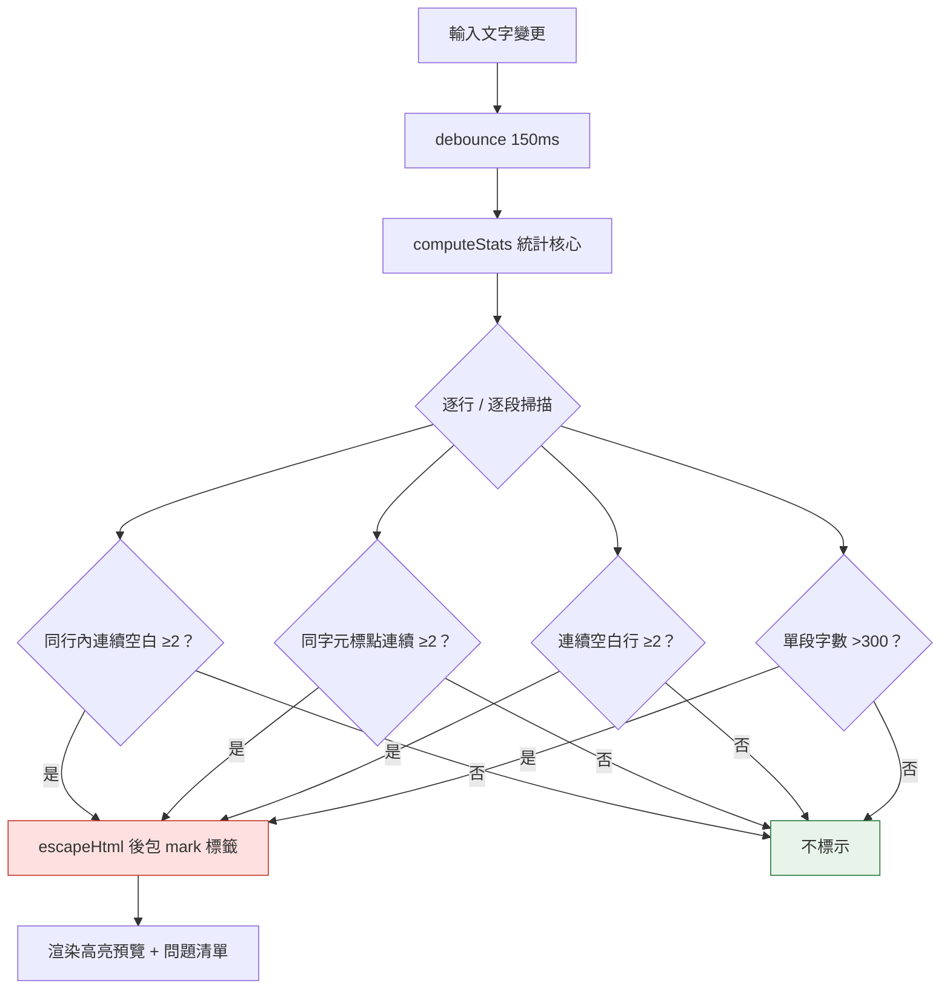
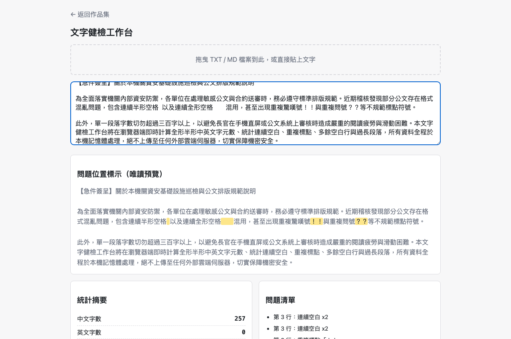
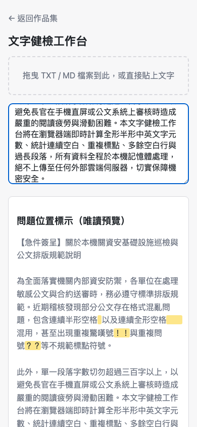

# Day01｜文字健檢工作台：第一天沒有做工具，做了一座地基

   

👉 [Demo 連結](https://<GITHUB_USER>.github.io/2026ironman/VibeCoding/Day01_text-health-check/index.html)（GitHub Pages，實測 `curl -sI` 回 `HTTP/2 200`）

## 目錄

- [情境](#情境)
- [解題思路](#解題思路)
- [資源](#資源)
- [Vibe 過程](#vibe-過程)
- [產品](#產品)
- [心得與反思](#心得與反思)

---

## 情境

這個系列去年（v1）做過 9 題就停了。停下來的原因不是沒空，是回頭檢查程式碼時發現一件事：`downloadFile()` 和 `downloadJson()` 兩支函式，名字不同、簽名也不同，但做的事情幾乎一樣；`showToast()` 在四個檔案裡幾乎逐字相同，但有一個檔案的 timeout 寫 1800ms，其他三個是 2200ms。

9 題，就已經 drift 成這樣。這次要做 32 題（Day01–Day33，外加收尾），如果每題都各自寫一份 toast、一份下載邏輯，drift 只會更嚴重，而且不會有人發現——因為每個檔案單獨看都「能動」。

所以今天沒有先寫「文字健檢」這個工具本身，而是先確認一件更基本的事：往後 32 題要共用的模組，介面要先鎖死，而且要有一支腳本把它們正確地塞進單一 HTML 檔案裡，不能破壞「下載下來、斷網也能用」這個承諾。

文字健檢工作台是第一個要吃到這套基礎設施的產品——公文、投稿、公告這類文件常有字數與格式要求（過長段落、連續空白、重複標點），人工抓這些問題很容易漏看，但這題本身的邏輯並不難。難的是怎麼確保「地基」是穩的。

## 解題思路

先把要蓋的東西拆成兩層：

**共用層**（`shared/*.js` + `base.css` + `scripts/bundle.py`）：六支模組把 v1 觀察到的重複邏輯收斂成單一簽名——`showToast(msg, ms)`、`debounce(fn, ms)`、`downloadFile(filename, content, mime)`、`copyToClipboard(text)`、`setupDropZone(dropEl, onText, opts)`、`escapeHtml(s)`。簽名寫進 `shared/CONTRACT.md`，往後任何一題要加新行為只能加參數，不能改既有參數的意義。`bundle.py` 負責在 build time 把這些模組的原始碼直接貼進各題的 ``。HTML 解析器在 `<script>` 標籤內看到 `</script` 就會直接關閉標籤，資料被腰斬，殘餘內容變成頁面上可見的文字。這個坑陰險在於——把同一段 JS 抽出來單獨丟給 Node 執行會通過，因為 JS 語法本身完全合法；只有放進真正的 HTML parser 或瀏覽器裡才看得出問題。`bundle.py` 因此在 `raw_js` 模式下，只要偵測到內容含 `</script` 就直接中止並報錯，不嘗試自動修補；`json_string` 模式則對字面量做跳脫處理。Day01 這題本身沒有外部 ASSET，沒有踩到這個坑，但它是共用層的既有防線，之後 Day04（OpenCC 詞典）、Day07（jsdiff）會真正用到。

## 產品

**這是什麼**：貼上文字或拖曳 `.txt` / `.md` 檔案，即時（150ms debounce）顯示中文字數、英文字數、總字元數、行數、段落數、中英文比例、標點與空白統計，並標示連續空白、重複標點、多餘空白行、過長段落四種問題，附高亮預覽、複製摘要、下載結果、下載本工具離線版。

**桌面截圖**（示範資料同時涵蓋中英文混合統計、連續空白、重複標點、過長段落四種效果）：

畫面右側問題清單可見「第 3 行：連續空白 x2」「第 5 行：重複標點『！！』『？？』」「第 4 段：段落過長（343 字）」，輸入區與唯讀預覽同步用 `<mark>` 標示對應片段。

**手機版截圖**（375×812）：

**產出檔案**：

- 產物：`VibeCoding/Day01_text-health-check/index.html`（803 行，`scripts/bundle.py` 建置，頂端含 6 個 `BUNDLED` 註解與 sha256）
- 原始模板：`src/index.html`（648 行）+ `src/bundle.json`
- 部署：GitHub Pages，實測連結見文首

## 心得與反思

回扣系列的四層對齊框架：

- **想 ↔ 表達**：proposal 草稿一開始寫「過長段落，例如 300 字」，這是「想法還沒說清楚」的典型症狀——「例如」代表寫的人自己也還沒決定這是不是真的門檻。把它改成可據以實作的固定數字（連同其他三個判定規則），是把腦中模糊的「差不多這樣就好」逼成一句可以直接寫進 `if` 的話。這一步沒做，兩個實作者（或兩次 AI 對話）很可能做出兩種不同的產品。
- **AI 規劃 ↔ 腦中藍圖**：這裡沒有明顯落差——統計核心直接移植 v1 已驗證的邏輯，四個判定規則定案後，AI 規劃出來的 tasks.md 與最初設想的功能範圍一致，沒有被加料也沒有被削減。
- **規格 ↔ 實際產品**：這是今天真正踩到的一層。`CONTRACT.md` 第 6 節寫明離線版產物不能含使用者資料，第一版實作在「靜態欄位」這件事上做對了，但漏掉「動態注入的 DOM 元素」這個邊界；第一次驗收沒抓到（因為要先觸發 toast 才會踩到），是返工時先驗證舊版本的真實行為，才確認風險不是紙上談兵。規格寫得再清楚，實作覆蓋不到規格暗示的所有邊界情況，一樣會漏。

今天沒有做出一個「更聰明」的工具，做的是一套「往後 32 題都要遵守的邊界」。地基階段的對齊落差不會馬上死當——`__shared_toast` 這個洞如果沒被抓出來，Day01 表面上完全正常，使用者也感覺不出差異——但它會在往後每一題重複用同一套共用模組時被放大或被繼承。先蓋地基、再驗地基，比做完 32 題才回頭發現同一個洞被複製了 32 次要便宜得多。
