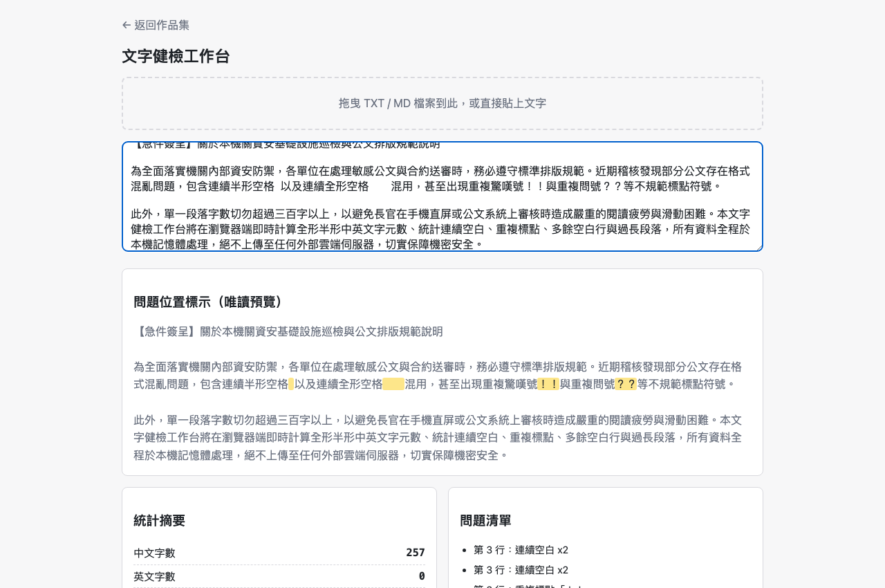

# Day01｜文字健檢工作台：孤島辦公室裡打的第一根地基

   

👉 [Demo 連結](https://<GITHUB_USER>.github.io/2026ironman/VibeCoding/Day01_text-health-check/index.html)（GitHub Pages，實測 `curl -sI` 回 `HTTP/2 200`）


---

## 🏢 一、情境：在孤島辦公室裡，被長官丟來20頁公告的下午

先講一下我坐的這台電腦。**沒有 Admin 權限**，裝不了 Python、裝不了 Node，DLP 資安系統盯著每一個外連請求，防火牆把外網擋得一乾二淨。唯一沒被鎖住的自由之窗，是每台作業系統都內建、永遠沒人敢禁用的——瀏覽器。

第一天報到，長官丟來一份 20 頁的公告草稿，只講了一句：「幫我看看格式有沒有問題，過長段落、連續空白、重複標點都要挑出來，10 分鐘後要用。」

我盯著那份 Word 檔看了幾秒，腦中冒出的不是「這題怎麼寫」，而是「這系列要做 32 題，如果每題都是這樣土法煉鋼一次寫完，30 天後我會親手做出一座屎山」。

## 💡 二、想法：第一天沒有做工具，我先打了地基

這個念頭不是空穴來風。去年這系列做過一版（v1），做到第 9 題就停了。停下來不是沒時間，是回頭看程式碼時倒抽一口氣：`downloadFile()` 和 `downloadJson()` 兩支函式名字不同、簽名不同，做的事幾乎一模一樣；`showToast()` 在四個檔案裡幾乎逐字複製，但其中一個檔案 timeout 寫 `1800ms`，其他三個是 `2200ms`。

==9 題就已經 drift 成這樣，而且每個檔案單獨看都「能動」，沒有人會發現==。這次要做 32 題，如果放任每題各寫一份 toast、一份下載邏輯，drift 只會更誇張。

所以今天沒有先寫「文字健檢」本身，先蓋兩層地基：

**共用層**（`shared/*.js` + `base.css` + `scripts/bundle.py`）：六支模組把 v1 的重複邏輯收斂成單一簽名——`showToast(msg, ms)`、`debounce(fn, ms)`、`downloadFile(filename, content, mime)`、`copyToClipboard(text)`、`setupDropZone(dropEl, onText, opts)`、`escapeHtml(s)`。這些簽名寫進 `shared/CONTRACT.md`，之後任何一題要加行為只能加參數，不能改既有參數的意義。`bundle.py` 在 build time 把這些模組原始碼直接貼進各題的 `<script>` 標籤——runtime 不做 import，維持「下載下來、斷網也能用」這個**單檔離線**承諾。

**產品層**：文字健檢的統計核心不難，難的是把模糊的規格逼成精確數字。proposal 草稿原本寫的是：

> 「過長段落，例如 300 字」

**「例如」兩個字在規格裡就是地雷**——代表寫的人自己都還沒決定這是不是真的門檻。如果直接照這句話開工，兩次對話（或兩個人）很可能寫出兩種完全不同的判定邏輯。所以我把四條規則全部逼成能直接寫進 `if` 的數字：

- 過長段落：單段（不含換行）超過 **300 字**觸發，MVP 不開放調整
- 連續空白：同一行內**連續 ≥2 個**空白字元觸發，半形、全形 `U+3000`、Tab 混用也算
- 中英文比例：`中文字元數 / (中文字元數 + 英文單字數) × 100`，四捨五入取整數
- 重複標點：**同一字元**連續出現 ≥2 次才算，「！？」相鄰不算

判定流程用 iThome 排版友善的文字塊畫出來大概是這樣：

```text
輸入文字變更
   ↓ debounce 150ms
computeStats 統計核心
   ↓
逐行/逐段掃描判定
 ├ 同行空白≥2？
 ├ 同字元標點≥2？
 ├ 連續空白行≥2？
 └ 單段字數>300？
   ↓（命中）
escapeHtml 後包 mark
   ↓
渲染高亮預覽+清單
```

另一個決定是「問題位置標示」得用 `innerHTML` 才能呈現高亮片段（純文字辦不到），v1 全程只用 `textContent`，沒踩過這條線。這次改用 `innerHTML`，代價是必須明確約定：**所有進 `innerHTML` 的內容一律先過 `escapeHtml()`**，這條規則直接寫進 `tasks.md` 當獨立驗收項，不是嘴巴講講。

## ⚔️ 三、過程：真實人機對撞——抓出藏在離線版裡的幽靈 ID

這題本身的統計邏輯沒什麼好交鋒的，四條規則定案之後基本一次到位。真正的破綻出在**時序**：Day01 是在共用層修正完成「之前」就先做完的，用的是舊版 `io-dropzone.js` 和舊版 `bundle.py`。

後來共用層跑了一次獨立驗收（另派一個 fresh agent 專門找碴），抓到一個看起來很小、實際上很陰險的洞：`buildCleanHtmlCopy()`——就是「下載本工具離線版」那個功能——只清掉了 toast 元素的 `textContent` 和 `className`，但 `id="__shared_toast"` 這個屬性**還留在 DOM 裡**，會被整段序列化進離線版 HTML 檔案。

> ⚠️ ==這個洞陰險在哪：`showToast()` 是動態注入的元素，如果整個操作過程沒有觸發過任何一次 toast，這個元素根本不存在，清理函式測起來會「看起來完全正常」。只有先觸發一次 toast、再下載離線版，才會踩到這個坑。==

而「下載離線版」這個產物本來就是設計來分享出去的——如果哪天這是一份公文健檢結果要轉發給別的單位，殘留的 DOM 節點就是一條看不見的洩漏路徑。

我沒有憑程式碼「感覺應該清乾淨了」就結案，是先回頭在舊版行為上**實測一次**，確認這個風險不是理論推演：舊版 `buildCleanHtmlCopy()` 產物打開來看，`#__shared_toast` 的 `id` 屬性確實還在。證實是真的之後才動手改，做法很直接——不再只清屬性，直接把整個節點移除。

同一輪還挖到共用層另一個獨立坑：`JSON.stringify()` 或 `json.dumps()` 都不會跳脫 `</script>`。HTML 解析器在 `<script>` 標籤裡看到 `</script`，不管上下文，直接關掉標籤，資料被腰斬，殘餘內容變成頁面上可見的文字。這坑更陰險的地方是——把同一段 JS 抽出來丟給 Node 單獨跑會通過，因為 JS 語法本身完全合法，只有真正丟進瀏覽器或 HTML parser 才看得出問題。修法是 `bundle.py` 在 `raw_js` 模式下，只要偵測到 `</script` 就直接中止並報錯，不嘗試自動修補；`json_string` 模式則對字面量做跳脫。Day01 這題沒有外部 ASSET，沒踩到這個坑，但這是共用層要守住的既有防線，之後 Day04（OpenCC 詞典）、Day07（jsdiff）都會真的用到。

## 📦 四、結果：純前端單檔 HTML，離線實機驗收

用修正版共用模組重建之後，逐項實跑（不是看程式碼猜）：

- `.exe` 拖進去 → 走 `onError` 分支，不載入內容
- 先觸發一次 toast，再下載離線版 → 打開產物確認**無** toast 元素、**無** `.nav-back`、**無**剛才輸入的字串
- 即時統計與四項偵測 → 正常
- console → 無錯誤
- Network 面板 → 全程 **0** 個對外請求

**未驗證項目老實講**：`copyToClipboard()` 的成功路徑沒測到，因為 headless 環境沒有剪貼簿權限，走的是失敗分支。這點當下就記下來了，不假裝測過。

**這是什麼**：貼上文字或拖曳 `.txt` / `.md` 檔案，150ms debounce 後即時顯示中文字數、英文字數、行數、段落數、中英比例，並標示連續空白、重複標點、多餘空白行、過長段落四種問題，附高亮預覽、複製摘要、下載結果、下載本工具離線版。

**桌面截圖**（示範資料同時涵蓋中英混合統計、連續空白、重複標點、過長段落）：



畫面右側問題清單會列出「第 3 行：連續空白 x2」「第 5 行：重複標點『！！』『？？』」「第 4 段：段落過長（343 字）」，輸入區與唯讀預覽同步用 `<mark>` 標示對應片段。

**手機版截圖**（375×812）：


產物：`Day01_text-health-check/index.html`（803 行，`scripts/bundle.py` 建置，頂端含 6 個 `BUNDLED` 註解與 sha256）；原始模板：`src/index.html`（648 行）+ `src/bundle.json`；部署 GitHub Pages，連結見文首，已實測回 `HTTP/2 200`。

## ☕ 五、感想與明日伏筆：危機剛解，隔壁同仁又哭了

今天沒做出什麼特別聰明的工具，做的是一套**往後 32 題都要遵守的邊界**。`__shared_toast` 這個洞要是沒被抓出來，Day01 表面上完全正常，使用者根本感覺不出差異——但它會在往後每一題重複用同一套共用模組時被放大或被繼承。先蓋地基、再驗地基，比做完 32 題才回頭發現同一個洞被複製了 32 次，便宜太多了。

另外那句「過長段落，例如 300 字」也給我一個提醒：==規格裡出現「例如」，就是「想法還沒說清楚」的症狀==。把它逼成一個能寫進 `if` 的固定數字，是這一題花最多腦力的地方，不是統計邏輯本身。

公文格式健檢過關，長官滿意地點頭。下午我正想喘口氣，隔壁座位的同仁就端著螢幕衝過來：「林工，長官叫我用內網 AI 幫忙摘要會議紀錄，結果 AI 吐了一大堆 `###`、粗體星號、清單符號，我全部原封不動貼進簽呈，長官以為我在用暗號罵他！救我！」

……好，看來明天的地基工程要蓋一台「AI 文字脫水機」了。
