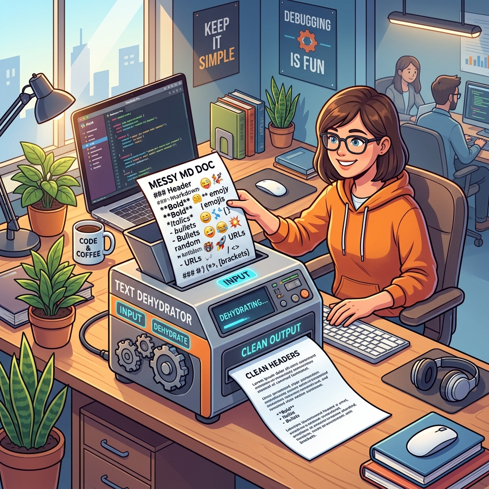
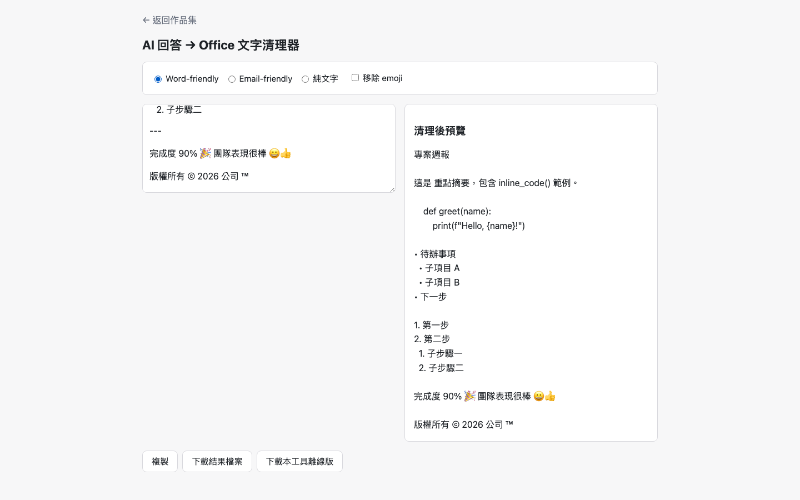
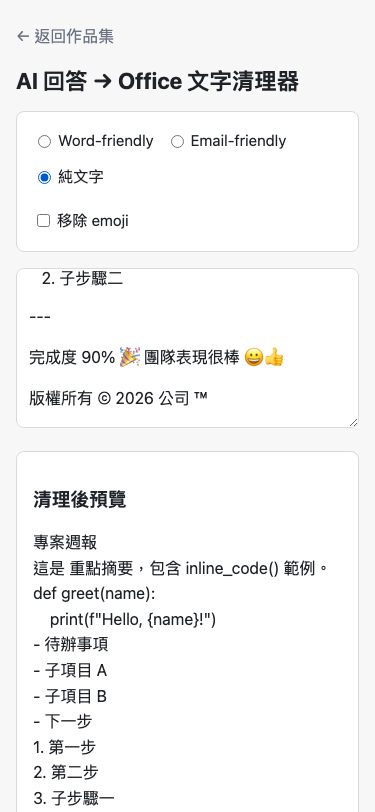

# Day02｜AI 回答文字脫水機：規格寫的技術假設，是實測抓包才發現是錯的

   

👉 [Demo 連結](https://lushinshang.github.io/2026ironman/VibeCoding/Day02_ai-text-cleaner/index.html)（GitHub Pages 待設定上線，本機直接用瀏覽器開 `index.html` 就能用，不用裝任何東西）



---

## 🏢 一、情境：同仁被內網 AI 摘要整慘，長官以為他在用暗號罵人

Day01 那支文字健檢工具交出去沒多久，隔壁座位的同仁就跑來找我，臉色很難看。

他把內網 AI 生的會議摘要直接複製貼進 Word，想稍微排個版就發給主管。結果貼過去的東西長這樣：`## 決議事項`、`**請於本週五前完成**`、一堆 `- ` 開頭的清單符號、還有幾顆表情符號卡在句子中間。Word 不認得 Markdown 語法，那些 `#`、`*`、`-` 全部原封不動印在畫面上。

長官收到，回了他一句冷冰冰的話：「這是在跟我用暗號罵人嗎？」

同仁苦笑跟我說：「我知道問題出在哪，可是我每次都要手動一個個刪 `#`、刪 `**`、刪 `-`，刪到眼睛快脫窗，而且刪一刪還會不小心誤刪到內容本身。」他頓了一下：「阿星，這個有辦法用工具處理嗎？」

這題目其實比 Day01 更貼近日常——現在幾乎每個人手邊都有 AI 幫忙寫東西，但 AI 吐出來的格式是給 Markdown 渲染器看的，不是給公文、Word 或 Email 看的。這中間關鍵的那一步「文字脫水」，沒人做。

## 💡 二、想法：還是單一 HTML，不想架伺服器、不想每台電腦裝環境

Day01 那套架構理由在這題一樣成立，而且更成立。這工具要能直接丟給隔壁同仁用，他的電腦我不會去動手腳裝環境，不架伺服器就不用維護、也不用擔心裝相依套件裝到一半出包；丟一個 HTML 檔給他雙擊就能開，比教他 `npm install` 省事十倍；而且沒有後端，攻擊面小到資安審查基本上不太會刁難。唯一合理的交付型態就是單一 HTML 檔案。

這題的需求乍看只有八點：清 heading、清 code fence、統一清單、選擇性去 emoji、整理空白行、三種輸出模式、即時預覽、一鍵複製。看起來一個下午能收工。

但這次我學乖了，不讓 AI 一收到需求就開始隨意寫邏輯。第一道指令先把認知鎖死：

> 「規劃文字清理脫水工具，清理 heading、粗體、清單符號、emoji 與多餘空白行。注意事項：先提供判定規則，讓我審查假設條件，認知對齊後再開發。」

AI 沒有直接吐程式碼，而是先抓出 Markdown 語法會污染的元素，丟回一份假設清單，其中一條寫著「移除所有非文字符號與 emoji」。我審查這份假設時，正好想起同仁那份會議摘要裡，公司系統名稱旁邊常常掛著 `®` 或 `™`，直覺判斷「emoji 是圖形符號，`©®™` 是商標標示，性質不一樣，清理時不該被一起清掉」。於是下了第二道指令，把兩個最容易吵架的模糊地帶釘死：

> 「三種模式律定清楚，參數化。判定條件收窄，code fence 內部內容保留，emoji 排除商標符號。」

第一條是**code fence 裡面是範例代碼**，不管前後怎麼清理，裡面的內容本身一個字都不能少，只能移除外圍標記。第二條就是那個 `©®™` 排除規則——當時我和 AI 都覺得這樣「認知已經對齊」，兩人心裡的假設是「emoji 是圖形，商標符號是文字元素，Unicode 規範應該分得清楚」。這個假設後來在實測階段被狠狠打臉，過程那段會講。

架構決策延續 Day01 定調的老規矩：單一 HTML、共用函式、不架伺服器也不裝環境，這裡不重講一次。三種輸出模式（Word-friendly／Email-friendly／純文字）最後定案成一張九列規則表，逐項寫清楚各自怎麼處理 heading、粗體斜體、行內代碼、code fence、清單、分隔線、空白行、emoji。整體處理流程長這樣：

```text
  貼上 AI 回答文字
        ↓
    選輸出模式
   ┌───┬───┬───┐
  Word Email 純文字
   └───┴───┴───┘
        ↓
  套共通清理規則
  (heading/粗體/
   分隔線/emoji)
        ↓
  即時預覽(150ms)
        ↓
    複製或下載
```

## ⚔️ 三、過程：規格自己以為想得很周全，實測才發現自己打自己臉

規則對齊、程式寫完之後，交給一個沒有血緣關係的 subagent 做交叉驗證，功能測試跟資安測試一起打，all pass 才算真正收工。

過程中踩了兩個坑，第一個坑就是那條「emoji 排除商標符號」的規則，表面上看起來對齊得很周全，實際上根本沒人驗證過技術假設。

proposal.md 定案時寫了這句話：「emoji 以 Unicode `Extended_Pictographic` 屬性為準，但 `©®™` 不算 emoji 要保留。」這句話讀起來很直覺——`©®™` 看起來就不是圖形化 emoji，我跟 AI 都覺得這樣寫已經萬無一失。問題是沒人真的去查證 `Extended_Pictographic` 這個屬性底下到底包含哪些字元，實作時用 Node 直接跑一次才知道：

```
© true    ® true    ™ true    😀 true
```

`\p{Extended_Pictographic}` **確實會 match `©®™`**！如果照規格字面去寫，勾選移除 emoji 時 `©®™` 被一起清掉——直接跟同一份規格裡「`©®™` 要保留」那句話打架，規格自己內部先矛盾了。當初那個「emoji 是圖形，商標是文字，Unicode 應該分得清楚」的直覺判斷，方向是對的，但沒有人去查證 Unicode 規範是不是真的這樣分。緊急加上明確碼位排除清單（`U+00A9`／`U+00AE`／`U+2122`），在 `Extended_Pictographic` 判定之外再檢查一次，命中就強制保留，才把這個矛盾解掉。這才是真正的「規格自以為對齊好了，結果被 Unicode 規範狠狠打臉」。

第二個坑是驗證「複製到剪貼簿」功能時踩到的環境陷阱，而且這個坑吃掉的時間比想像中多得多。原本想用 `clipboard.readText()` 讀回剪貼簿內容來比對是否複製成功，結果這個 API 會觸發瀏覽器的權限提示彈窗。自動化測試環境沒有人會去按那個彈窗，於是**一路卡住約 30 分鐘**，而且不會報錯，就只是不回來，站在旁邊看著進度條完全不知道發生什麼事。

解法是改攔**寫入端**：monkey-patch `navigator.clipboard.writeText`，把傳進去的參數存起來直接比對，不去讀剪貼簿。同理，測下載內容也要攔 `window.Blob` constructor，不要用 `fetch(blob:URL)`，那個一樣會卡死。

還有一個純環境層的陷阱跟這題本身無關，但差點連累它：背景 agent 在跑的期間電腦進入休眠，API 連線被中斷。同一批派出去的幾個背景任務裡，這支剛好撐過休眠完成、10 條 task 全過，commit 進去了；同時間背景跑的其他任務就沒這麼幸運，被休眠腰斬，什麼產出都沒留下，得重派。算是撿到的僥倖，不是設計出來的可靠性。

## 📦 四、結果：Word-friendly 桌面截圖 vs 純文字手機截圖，巢狀編號一眼看出差異

驗收用同一份示範文字，裡面塞滿 heading、粗體、行內代碼、code fence、巢狀清單、分隔線、emoji、以及那三個惹禍的 `©®™`，分別跑三種模式對照。

Word-friendly 模式（保留巢狀縮排、bullet 用 `•`、子層編號各自從 1 開始）：



純文字模式（手機直屏、清單拉平為單層、bullet 統一 `-`、編號整體連續重新編）：



兩張截圖可以直接對照同一段「1. 第一步 → 2. 第二步 → 1. 子步驟一 → 2. 子步驟二」：Word-friendly 模式維持巢狀縮排與分層編號，純文字模式拉平成連續的 `1. 2. 3. 4.`。這兩張截圖都沒勾選「移除 emoji」，所以 `©`、`™` 沒被動到不算意外；真正驗證 emoji 規則不會誤刪 `©®™` 的，是前面那段 Node 一行指令實測，不是這兩張圖。

拍這兩張圖也不是隨手截的。前一題（Day01）就吃過共用分頁互踩的虧，這次改用本機獨立瀏覽器實例分別開視窗拍照，避免同一個瀏覽器分頁狀態互相污染，桌面版跟手機版各自乾乾淨淨。

## ☕ 五、感想與明日伏筆：格式乾淨了，長官又有新意見

這題最大的收穫，是規格文件裡任何帶著技術假設的句子（尤其是「應該」「照理說不算」這種語氣），都值得在動手寫邏輯之前，先花十秒鐘用一行程式碼實測，而不是等到最後靠使用者回報才發現規格自己打自己臉。就算下指令的人當下的直覺是對的，也不代表底層規範真的支援這個直覺——認知對齊沒有跑完一輪就結束這回事，規格寫的東西一樣要拿去測一次。

工具交出去之後，隔壁同仁很開心，拿去脫水了幾份摘要，貼進 Word 果然乾乾淨淨，再也沒有暗號了。

結果過沒多久他又摸過來，這次不是抱怨符號，而是抓著頭說：「阿星，長官看過後又皺眉了，說符號是乾淨了，但怎麼通篇都是『基本上』、『其實』、『總體而言』這種廢話？能不能順便挑出來？」

我借過他螢幕看了一眼那份摘要，確實，每兩句話就塞一個「基本上」。只能苦笑：「好，看來明天要想辦法對付這些冗言贅字了（XD）。」
