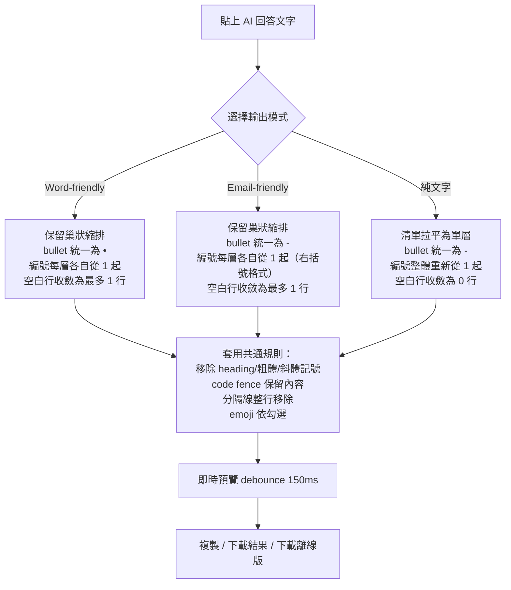
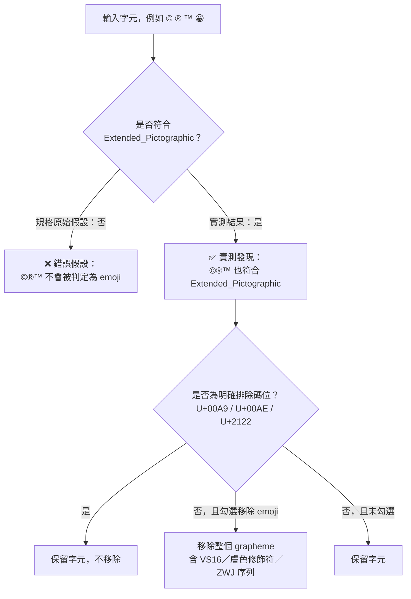
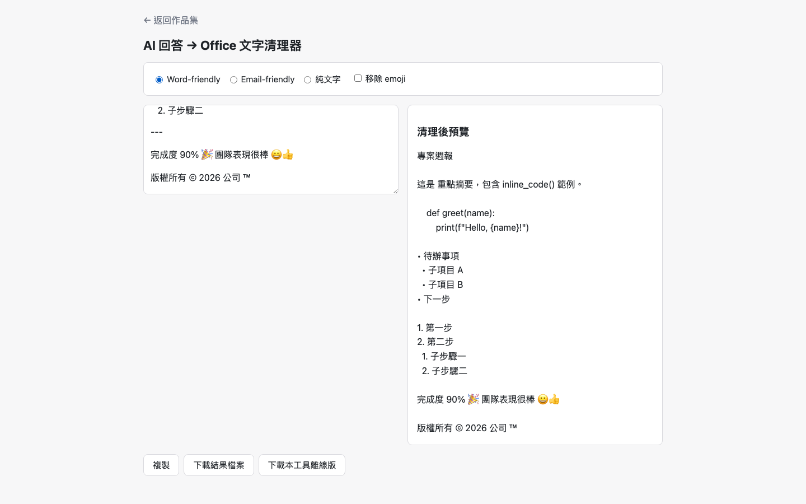
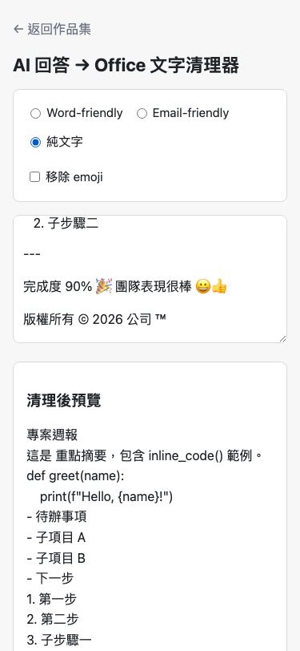

# Day02：AI 回答 → Office 文字清理器——規格寫錯了，是實測抓出來的

`#PRD` `#SDD` `#Unicode` `#正規表達式` `#Vibe-Coding`

👉 目錄：[情境](#情境) · [解題思路](#解題思路) · [資源](#資源) · [Vibe-過程](#vibe-過程) · [產品](#產品) · [心得與反思](#心得與反思)

---

## 情境

PRD 06 的需求清單只有八行：移除 heading 符號、清 code fence、統一 bullet 與編號、選擇性移除 emoji、整理空白行、三種輸出模式、即時預覽、一鍵複製。

看起來是一個下午就能寫完的小工具。實際進到規格拆解階段，光是把這八行需求攤開檢查，就冒出至少六個 PRD 沒定義、兩個實作者可能做出完全不同結果的判斷點：

- code fence 裡的內容要不要保留？
- 純文字模式「空白行收斂為 0 行」是整篇黏成一行，還是每行文字都留著、只清掉空白行本身？
- emoji 判定範圍含不含 `©®™`？
- 巢狀有序清單，子層編號要不要延續父層？
- 三種模式（Word-friendly / Email-friendly / 純文字）各自具體行為是什麼？

這題最後花的時間，規格判斷比寫程式多。而其中一條規格判斷，還是錯的——是實測才抓出來，不是靠讀文件想出來的。

## 解題思路

先把 PRD 的每一句話拆成「PRD 明訂」與「PRD 沒寫、需要自己定案」兩類，逐條寫進 `sdd/ai-text-cleaner/proposal.md`，附上判斷理由。這樣後續驗收時，每一行清理邏輯都能回頭追到「這是 PRD 說的」還是「這是我補的判斷，理由在這」。

三種模式的差異最後定案成一張九列規則表（heading／粗體斜體／行內代碼／code fence／無序清單／有序清單／分隔線／空白行／emoji），逐項寫清楚三種模式各自怎麼處理，不是三個模糊的名詞。



驗收條件明寫「實質句子內容不應因格式清理而遺失」，這句話反過來限制了很多判斷：code fence 裡的範例指令不能整段砍掉，只能拿掉 fence 記號與語言標籤；純文字模式的空白行收斂，也只能清掉「當作分隔用的空白行」，不能把段落黏在一起或漏字。

## 資源

- PRD 基線：`VibeCoding/2026-ironman-vibecoding-30-prd.md` PRD 06
- 規格與判斷紀錄：`sdd/ai-text-cleaner/proposal.md`、`sdd/ai-text-cleaner/tasks.md`
- 共用模組：`shared/ui-debounce.js`（debounce）、`shared/io-clipboard.js`（複製）、`shared/io-download.js`（下載）、`shared/ui-toast.js`（提示）、`shared/util-escape.js`（escapeHtml，預覽渲染前一律跑過，防止使用者貼入內容被當 HTML 解析）
- 實作：`VibeCoding/Day02_ai-text-cleaner/src/index.html`，`scripts/bundle.py` 打包成 `index.html`

## Vibe 過程

前三層對齊（想法↔表達、表達↔AI 理解、AI 規劃↔腦中藍圖）在這題其實走得很順——「清理 AI 回答文字」是個具體到不太會被誤解的需求，AI 提規劃、我對照 proposal.md 逐條核對，沒有太大落差。

真正卡住的落差出現在第四層：**規格 ↔ 實際產品**，而且問題不是實作偏離規格，是規格本身的技術假設先錯了。

proposal.md 定案時寫下這句話：

> emoji 以 Unicode `Extended_Pictographic` 屬性為準，但 `©®™` 不算 emoji 要保留。

這句話讀起來很合理——`©®™` 直覺上不是「圖形化 emoji」。但寫規則時沒有一併寫「所以 `\p{Extended_Pictographic}` 不會 match 到它們」這個技術假設要不要驗證。

實作時用 Node 直接測：

```
© true    ® true    ™ true    😀 true
```

`\p{Extended_Pictographic}` **確實會 match `©®™`**。如果照規格字面「以 `Extended_Pictographic` 為判定基準」去寫，勾選移除 emoji 時 `©®™` 會被一起清掉——直接違反同一份規格「©®™ 要保留」那句話，規格自己內部就矛盾。



修法是加一層明確碼位排除清單（U+00A9 / U+00AE / U+2122），在 `Extended_Pictographic` 判定之外再檢查一次，命中就強制保留。原始碼裡也留了這段紀錄（`src/index.html` 第 266 行註解）：

> `\p{Extended_Pictographic}` 實際涵蓋 ©(U+00A9)/®(U+00AE)/™(U+2122)，但規格要求這三個字元一律保留

這正是「資料優先」鐵律的具體案例：改邏輯前先看真實輸入輸出，不要憑對 Unicode 屬性的直覺去寫規則。規格是人寫的，人對 Unicode 屬性範圍的直覺常常是錯的，只有實測跑一次正則才知道。

## 產品

三種模式輸出的差異，用同一份示範文字（含 heading、粗體、行內代碼、code fence、巢狀清單、分隔線、emoji、`©®™`）分別跑 Word-friendly 與純文字模式截圖對照：

Word-friendly 模式（保留巢狀縮排、bullet 用 `•`、子層編號各自從 1 開始）：



純文字模式（手機版，清單拉平為單層、bullet 統一 `-`、編號整體連續）：



兩張截圖可以直接對照同一段「1. 第一步 → 2. 第二步 → 1. 子步驟一 → 2. 子步驟二」在 Word-friendly 模式維持巢狀縮排與分層編號，純文字模式則拉平成 `1. 2. 3. 4.` 連續編號；`©`、`™` 兩個符號在兩種模式下都完整保留，沒有被 emoji 規則誤刪。

GitHub Pages：`https://<GITHUB_USER>.github.io/2026ironman/VibeCoding/Day02_ai-text-cleaner/index.html`

## 心得與反思

回扣四層對齊框架：這題的前三層（想法↔表達、表達↔AI 理解、AI 規劃↔腦中藍圖）幾乎沒有摩擦，真正踩坑的是第四層「規格 ↔ 實際產品」——而且更精確地說，是規格內部先出現了自我矛盾（「以 Extended_Pictographic 為準」與「©®™ 要保留」兩句話沒有同時成立），寫程式時把這個矛盾兌現出來才被看見。

這件事給我的提醒是：規格文件裡任何帶著技術假設的句子（尤其是「應該會」「照理說」這種語氣），都值得在實作前用一行程式碼實測，而不是留到最後靠使用者回報才發現。四層對齊不是走完一輪就結束，規格本身也需要被驗證，不能假設規格寫的技術細節一定正確。

---
