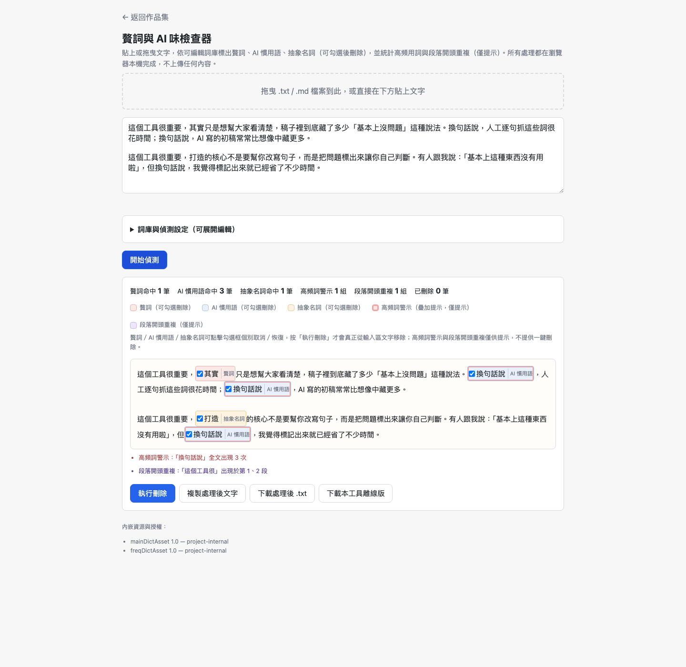
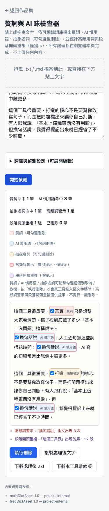

# Day03｜公文裡的 AI 罐頭空話：贅詞與 AI 味雷達

   

👉 [Demo 連結](https://lushinshang.github.io/2026ironman/VibeCoding/Day03_filler-word-checker/index.html)（GitHub Pages 待設定上線，本機直接用瀏覽器開 `index.html` 就能用，不用裝任何東西）


---

## 🏢 一、情境：Markdown 符號脫水乾淨了，長官卻摔公文「這寫的是人話嗎？」

Day02 的文字脫水機交給隔壁同仁後，他開心得不得了。原本卡在 Word 裡的 `##`、`**`、`-` 終於被拔得一乾二淨，公文格式看起來整整齊齊。他滿懷信心地把內網 AI 摘要的會議紀錄呈送上去。

結果不到半小時，同仁又低著頭溜回座位，滿臉苦笑。

長官雖然沒再質疑暗號罵人，但直接把簽呈退了回來，上面用紅筆圈了好幾處，評語更毒辣：「通篇都是『基本上』、『其實』，後面還來一句『全方位賦能團隊、深化跨部門治理、構建永續生態系』……這寫的是人話嗎？公文要是再拿這種 AI 罐頭空話敷衍，就退件重寫！」

同仁抓著頭看著我：「阿星，符號我是清掉了，可是 AI 吐出來的文字就是很愛塞這種空洞的高空詞彙，還有動不動每段開頭都寫『首先、其次、再者』。我自己看久了都麻痺，到底有沒有辦法用工具把這些抓出來？」

這確實戳中了當前辦公室的共同痛點：**格式脫水只是外皮，語言脫水才是肉**。

## 💡 二、想法：從客觀統計走向主觀語意，邊界要先畫乾淨

架構決策依然延續前兩天定調的老規矩：**堅持單一 HTML、共用模組地基、不架伺服器也不裝環境**。丟一個檔案過去雙擊就能開，零維護也最方便同事帶著走。

但動工前，我必須先幫這題劃清邊界。這題跟 Day01 的「文字健檢」乍看很像，都是吃純文字、挑毛病、列出警告。如果沒想清楚，很容易寫成同一支大雜燴。

兩者的本質差異在判斷依據：
- **Day01 是純客觀計算**：字數、連續空白、重複標點，全部可以用數學和正則算出來，不需要任何詞庫。
- **Day03 是主觀語意與風格判斷**：贅詞、AI 慣用語、抽象名詞、高頻詞重複、段落開頭同構，全部必須依賴可自訂的詞庫與門檻。

認知鎖定後，第一道指令先跟 AI 對齊判定規則與假設條件：

> 「規劃贅詞與 AI 味檢查器，針對贅詞、AI 慣用語、抽象名詞進行標註，並支援高頻詞警示與段落開頭同構偵測。注意事項：先提供判定規則，讓我審查假設條件，認知對齊後再開發。」

AI 回傳的假設清單把邏輯拆成三類詞庫與兩組統計，我審查後下了第二道指令，把邊界與防呆釘死：

> 「比對邏輯參數化。引號內引文強制跳過不標記；自訂詞庫匯入須具備結構驗證，防呆避免空欄位污染。」

整個文字檢查的處理流程如下：

```text
  輸入待檢文字
       ↓
  挖空引號區間
(「」『』""與彎引號)
       ↓
 ┌─────┼─────┐
 詞庫  高頻  段落
 比對  統計  開頭
 └─────┼─────┘
       ↓
  合併標記(依起點)
       ↓
  三色標註+高頻紅框
       ↓
  勾選並執行刪除
```

## ⚔️ 三、過程：引號先挖空，才不會把長官講的話當贅詞抓

程式碼寫完，同樣交由獨立 subagent 進行功能與邊界測試。在實作與驗收過程中，踩出了三個非常寶貴的落差：

### 1. 引號內的文字是免死金牌：先挖空再偵測
在公文與簽呈中，常常會引用法規條文或長官的發言：「長官裁示：『基本上朝原定方向推進』」。這句「基本上」是引文，絕對不能被紅筆圈起來當贅詞殺掉。

原本直覺的做法，是在詞庫比對、高頻統計、段落開頭三個函式裡，各自寫一段判斷「當前字元是否在引號內」。但這樣寫三次不僅重複，而且只要遇到「整段文字剛好全包在引號裡」的邊界，邏輯很容易破功。

最後的優雅解法是**預處理先挖空（stripQuotes）**：用正則先抓出所有合法成對的引號範圍（涵蓋中文「」『』、英文半形 `""` 與全形彎引號 `“”`），把引號裡的字元暫時挖成等長的空白佔位符，再把挖空後的文字餵給三個偵測函式。如此一來，引號內的贅詞天然不 match，三個函式一行排除邏輯都不用寫；而未閉合的殘缺引號（只有開頭沒有結尾）因為成對配對失敗，後方文字照常偵測，完全不需額外分支。

### 2. 舊版 JSON 詞庫匯入的「無聲污染」
工具支援使用者自行匯出／匯入 JSON 詞庫。在檢查舊版邏輯時，赫然發現一個隱藏陷阱：舊版只包了 `try/catch` 檢查 `JSON.parse` 是否成功。如果使用者匯入的是合法 JSON，但內容物件缺少 `word` 欄位（例如丟了一份通訊錄 JSON 進去），舊版會把那些缺漏欄位當成空字串安靜地塞進詞庫陣列！比對邏輯一旦吃到空字串，整個標註頁面會瞬間崩潰。

新版在匯入時強制加入逐筆結構驗證：必須具備有效文字、分類必須符合預設類別，不合規的項目直接略過並提示「已略過 N 筆異常項目」，把詞庫的純淨度守住。

### 3. 共用模組簽名演進的摩擦
舊版拖曳上傳函式是傳 DOM id（`setupDropZone(colId, textareaId, fileNameId)`），由內部自己 `getElementById`；但在 Day01 定調的共用模組契約（`shared/CONTRACT.md`）裡，規範統一改成直接傳 DOM 元素（`setupDropZone(dropEl, onText, opts)`），由回呼函式處理內容。實作時沒有盲目複製舊 code，而是老老實實對齊共用模組的契約介面，避免打破共用層的相容性承諾。

## 📦 四、結果：三色標註、高頻詞疊加紅框、手機直屏不破版

驗收時用同一份混雜公文測試：內文包含贅詞（其實）、抽象名詞（打造）、重複出現三次的 AI 慣用語（換句話說）、引號內的「基本上」，以及兩段前五字完全同構的開頭。

桌面版測試結果（1440×900）：



從桌面版截圖可以看到精準的呈現效果：
- **三色分類標註**：贅詞（黃）、AI 慣用語（藍）、抽象名詞（紫）色彩分明，且每筆標記旁都有核取方塊，可單獨勾選要刪除的項目。
- **高頻詞疊加紅框**：「換句話說」出現達 3 次門檻，外圍疊加高頻警示紅框，一眼抓出誰在灌水。
- **引號免死金牌**：引號內的「基本上」完全維持原樣，未被誤圈。
- **段落開頭提示**：「這個工具很」重複出現在連續段落開頭，頂部跳出同構警示。

手機版直屏測試（375×812）：



手機直屏下操作列自動整齊折疊，標色清單在單手滾動時依然一目瞭然，雙擊即可複製清理後的文字。

## ☕ 五、感想與明日伏筆：公文像人話了，外包廠商卻送來「高清、內存、默認」

經過這題的打磨，同仁把那份被長官打槍的會議摘要丟進去，勾選刪除了 6 個「基本上」、抓出 2 處「深化賦能」並替換成具體工作目標，再呈送上去。

長官這回戴起眼鏡細看，滿意地點頭批示：「這次寫得精準、不講空話，核可。」同仁走出主管辦公室時，走路都有風，轉頭跟我比了個大拇指。

我正打算收拾東西準時下班，總務組突然抱著一疊外包廠商剛交驗的資安管理系統操作手冊衝進來，欲哭無淚：「阿星，廠商交來的規格書跟手冊，打開全是簡體字轉過來的『內存溢出』、『默認配置』、『高清截圖』、『登錄項目』……長官發飆說下班前要是沒換成台灣標準資訊用語，驗收款就不簽核了！」

我看著那幾百頁滿滿對岸用語的 PDF，嘆了口氣，默默放下了背包：「好，這幾百頁我得想辦法生出一套解法（XD）。」
