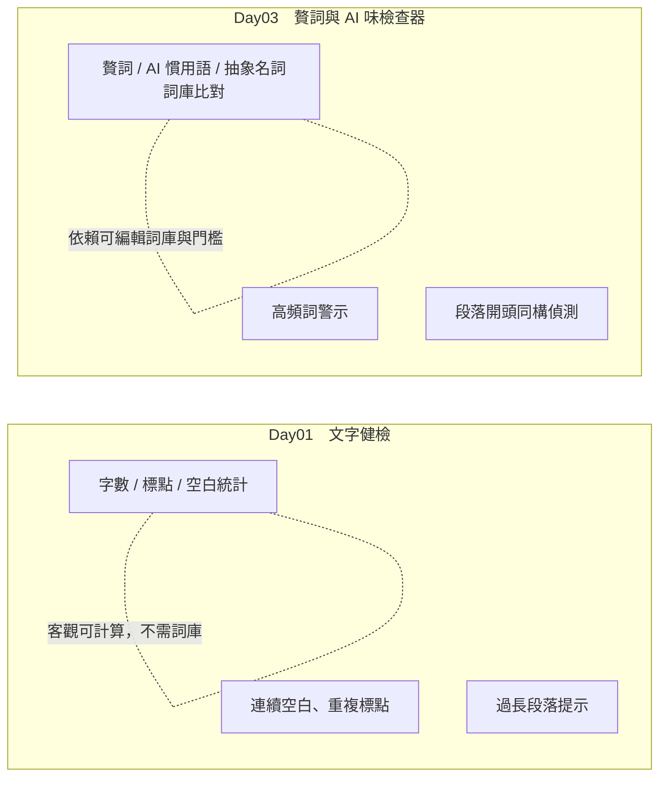
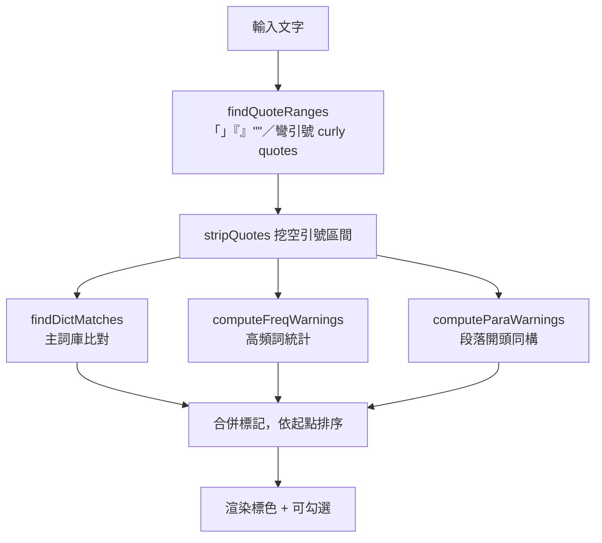
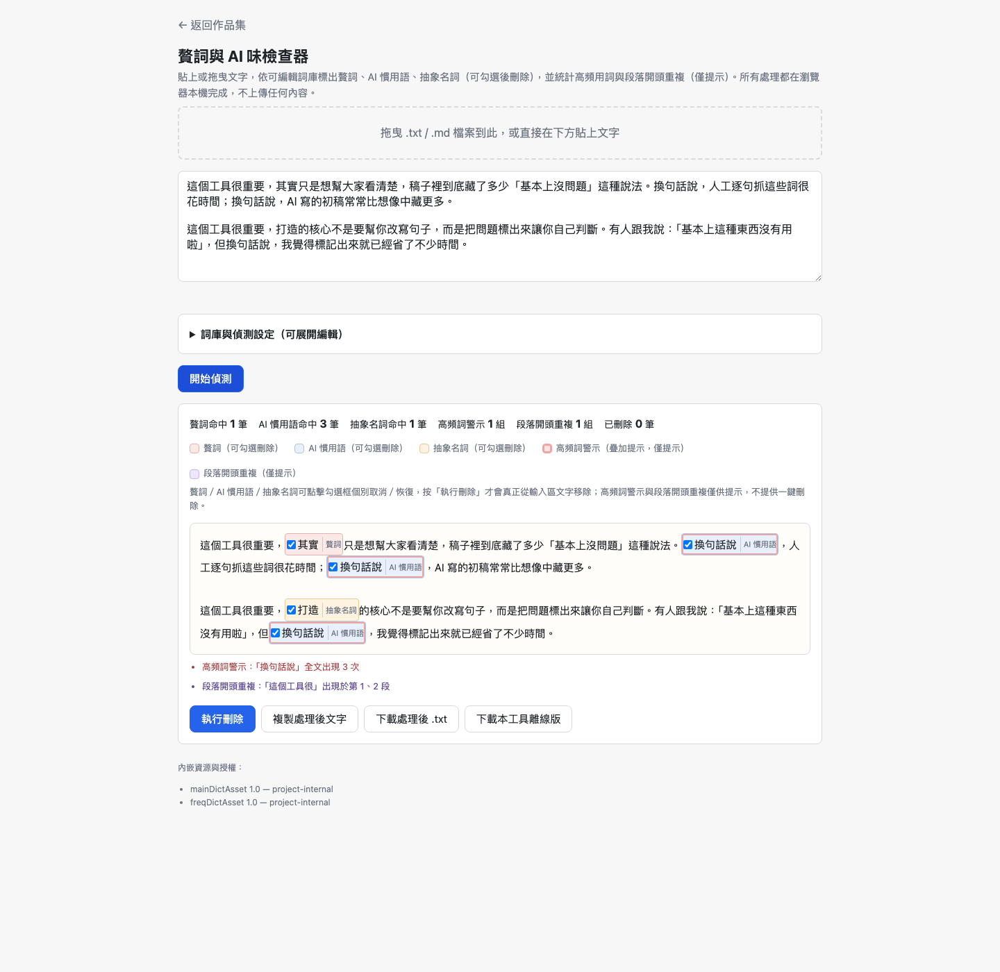
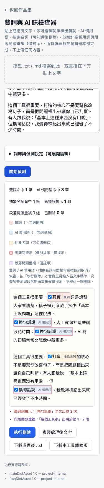

# Day03：贅詞與 AI 味檢查器——一份「補寫的規格」怎麼補出邊界感

`功能` `#純前端` `#規則式偵測` `#SDD` `#補題`

👉 [情境](#情境) · [解題思路](#解題思路) · [資源](#資源) · [Vibe-過程](#vibe-過程) · [產品](#產品) · [心得與反思](#心得與反思)

---

## 情境

30 題的 v2 需求基線裡，Day03 這格原本是空的。

不是漏排，是漏收——基線的 PRD 03 只做字數與格式統計，沒有贅詞偵測這件事。但 v1（去年那一版鐵人賽）Day2 確實做過一個「贅詞與 AI 味檢查器」，功能齊全、邏輯也堪用。於是這一題變成「補題」：另外寫一份 `PRD A1`（A 代表 Additional，不佔基線 01-30 的序號），把 v1 的九項功能升級進 v2 的共用模組架構。

聽起來像是撿現成的省事工作。實際動手才發現，「有舊版可以參考」跟「規格已經清楚」是兩件事——尤其是這題緊貼著 Day01（也做文字檢查、也輸出標記清單）擺在一起，邊界不先劃清楚，兩題做完很容易長成同一個東西。

---

## 解題思路

### 先劃邊界，再動工

Day01 和 Day03 表面上很像：都吃純文字、都輸出「問題清單」、都在段落層級找毛病。真正的差異在判斷依據：

| 檢查維度 | Day01 | Day03 |
|---|---|---|
| 字數／標點／空白統計 | 客觀可計算，無需詞庫 | — |
| 連續空白、重複標點 | 規則固定，不涉語意 | — |
| 贅詞／AI 慣用語／抽象名詞 | — | 需要使用者可編輯的分類詞庫 |
| 高頻詞警示 | — | 門檻可調，屬風格判斷 |
| 段落開頭同構 | — | 判斷句式是否模板化 |

一句話講完：**Day01 的判斷邏輯不依賴詞庫，全部是可計算指標；Day03 的判斷邏輯全部依賴使用者的詞庫與門檻**。連兩題都會碰的「段落」層級也刻意分開——Day01 看長度，Day03 看句首用字，判斷維度不同，不合併。

### 引號要先挖空，再做三件事

主詞庫比對、高頻詞統計、段落開頭偵測這三個功能都要「跳過引號內的文字」——使用者引用別人的話時，裡面的贅詞不該被抓。做法不是在三處各寫一次排除判斷，而是先用正則找出所有引號範圍（涵蓋「」『』""與彎引號 " "），從文字裡把這些範圍挖空，再讓三個偵測函式吃挖空後的文字。這樣「整段都包在引號裡」的邊界情況也不用特別處理——挖空後那一段自然是空的，三個偵測都不會誤判。

未閉合的引號（只有開頭符號，掃到文字結尾都沒對應結尾）在正則層面天然不成 match，所以不會被挖空，後面文字照常參與偵測——不用另外寫分支處理這個邊界情況。

---

## 資源

- 規格：`sdd/filler-word-checker/PRD.md`（`PRD A1`）、`proposal.md`、`tasks.md`
- 共用契約：`VibeCoding/shared/CONTRACT.md`（`escape_mode`、`setupDropZone` 簽名、Level 1 共通 UI 基線）
- v1 原始碼：`VibeCoding/old/Day2/index.html`（只讀參考，不覆寫）
- 建置腳本：`scripts/bundle.py`

---

## Vibe 過程

這題最值得記的不是「功能做完了」，而是三個真實對齊落差，都是規格階段沒完全想清楚、動手才浮出來的。

### 落差一：規格要求 vs 工具鏈能力

proposal 裡寫「內建詞庫用 `json_string` 模式內嵌，不用反引號 template literal」——理由很直接，主詞庫詞彙不含特殊字元，但使用者自訂詞庫沒有這個保證，反引號或 `${` 混進去會直接炸模板語法。

問題是 `scripts/bundle.py` 的 `json_string` 模式**只能透過 ASSET 機制觸發**，不能直接寫在 `src/index.html` 裡當普通字面值。規格說要用 `json_string`，工具鏈的實作方式卻要求先包成 ASSET 才能用。最後的處理是把內建的主詞庫、高頻監測詞庫各自做成一個 `project-internal` 的 ASSET（`main-dict.json`、`freq-dict.json`，見 `src/bundle.json`），而不是寫成裸露的 JS 陣列字面值。這是「規格寫的是意圖（不要反引號），工具鏈要求的是路徑（要走 ASSET）」——兩邊都沒錯，但規格文字本身沒交代清楚要怎麼落地，是實作時才對齊上的。

### 落差二：「有現成的可以複用」≠「可以直接貼上」

v1 的拖曳讀檔函式簽名是 `setupDropZone(colId, textareaId, fileNameId)`——傳三個 DOM id，函式內部自己查找元素。v2 的共用模組 `shared/io-dropzone.js` 簽名是 `setupDropZone(dropEl, onText, opts)`——傳元素本身，讀檔成功時回呼 `onText(textContent, fileName)`，`opts.accept` 限制副檔名。

兩邊做的事一樣（拖曳讀檔、限制副檔名、失敗給提示），呼叫慣例完全不同。proposal 裡老實承認這點：「v1 是傳三個 DOM id、內部自己查找元素」vs「`CONTRACT.md` 的簽名是傳元素本身」，呼叫端要跟著改寫，只有「拖曳僅接受 .txt/.md、非法副檔名時提示」這個行為原樣保留。這是這系列第二次踩到「舊資產能不能複用」的問題（Day02 也踩過一次），這次因為先讀過 `CONTRACT.md` 才知道要改簽名，而不是直接複製貼上撞牆。

### 落差三：v1 一個沒發現的真實缺陷

v1 匯入 JSON 詞庫時只做 `JSON.parse` 失敗檢查——`try/catch` 抓到不合法 JSON 就提示「匯入失敗：檔案格式錯誤」。但如果匯入的是**合法 JSON、內容結構卻不對**（陣列裡的物件缺 `word` 或 `type` 欄位，或匯入了完全不相關的 JSON），v1 沒有攔——這些殘缺項目會被當空字串吃進比對邏輯，安靜地污染詞庫。

這不是這次新踩的坑，是重讀 v1 程式碼時發現的既有缺陷（`proposal.md` 裡逐行核對 v1 行號時記錄下來的）。v2 補上逐筆結構驗證：每筆需有詞彙欄位、分類需屬三選一，不符合的項目略過並提示略過筆數，而不是整包失敗或整包吃進去。

---

## 產品

實際跑一段示範文字：兩段各含一個贅詞（其實）、一個抽象名詞（打造）、一個 AI 慣用語重複三次（換句話說，同時觸發高頻詞警示疊加標紅）、引號內的「基本上」不被標記、兩段開頭前五字相同觸發段落開頭重複提示。

上圖可以同時看到四件事：分類標色（贅詞／AI 慣用語／抽象名詞三色不同）、高頻詞疊加標紅（「換句話說」命中 3 次的紅框疊在 AI 慣用語色塊上，不覆蓋原本分類色）、引號內的「基本上」維持原樣未被標記、段落開頭重複提示（「這個工具很」出現於第 1、2 段）。

手機版（375×812）版面正常收合：

功能清單：

- 主詞庫比對（贅詞／AI 慣用語／抽象名詞三分類），命中處標色且可逐項勾選
- 標記可勾選／取消，按「執行刪除」才真正改寫輸入區文字，未勾選項目維持原樣
- 高頻監測詞庫＋可調門檻，達門檻標紅（僅提示，不可勾選刪除）
- 段落開頭同構偵測（依空行切段，取開頭前 N 字比對，重複 ≥2 段才標記）
- 引號範圍排除（「」『』""＋彎引號 " "，未閉合引號不排除其後文字）
- 詞庫可編輯，支援匯出／匯入 JSON（含結構驗證）
- 複製處理後文字、下載處理後 .txt、下載本工具離線版

線上版：`https://<GITHUB_USER>.github.io/2026ironman/VibeCoding/Day03_filler-word-checker/index.html`（`curl -sI` 已實測回 `HTTP/2 200`）

---

## 心得與反思

回扣系列方法論的四層對齊：

**想 ↔ 表達**：這題的「想法」其實不是原創的——是 v1 已經做過的東西。看起來應該最不容易在這層出問題，但補寫 `PRD A1` 的過程反而逼我把 v1 沒寫清楚的邊界（詞庫格式、引號排除範圍、跟 Day01 的分工）用文字重新講一次。舊產品不會自動帶著清楚的規格，這層對齊還是得補。

**表達 ↔ AI 理解**：`proposal.md` 對 `json_string` 的要求寫得很明確，但沒交代「怎麼在 `bundle.py` 裡落地」。這不是 AI 沒聽懂需求，是規格停在「意圖」層級，沒往下對到工具鏈的實際限制——這一層的落差要靠實作時回頭補，補法是把內建詞庫包成 ASSET。

**AI 規劃 ↔ 腦中藍圖**：`setupDropZone` 簽名不一致這件事，proposal 裡是規劃階段就先發現、先寫清楚要怎麼改，不是實作完才撞到。這算是這次對齊做得比較扎實的地方——先把「複用 v1」這件事拆成「邏輯複用」和「介面複用」分開判斷，介面不相容就老實改寫呼叫端，不硬套。

**規格 ↔ 實際產品**：v1 的 JSON 匯入缺陷（沒驗證資料結構）在補寫規格時被抓出來，是因為要求逐行核對 v1 程式碼行號，而不是憑印象複用。這也是這系列「補題」的意義所在——不是把舊功能原樣搬過來，而是趁重寫的機會，把舊版沒發現的落差一併補上。

**誠實補記一句**：這次沒有踩到 v1 當年踩過的「引號排除要同時套用到三個功能、容易漏掉整段都在引號裡的邊界情況」這個坑——因為「先挖空、再偵測」的做法從一開始就避開了它，不是重新繞了一次彎才發現。
