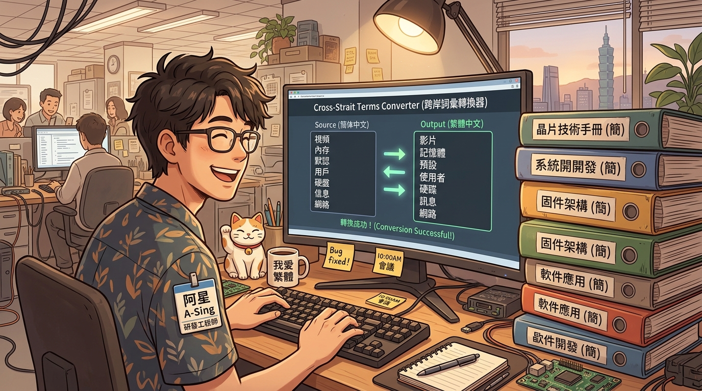
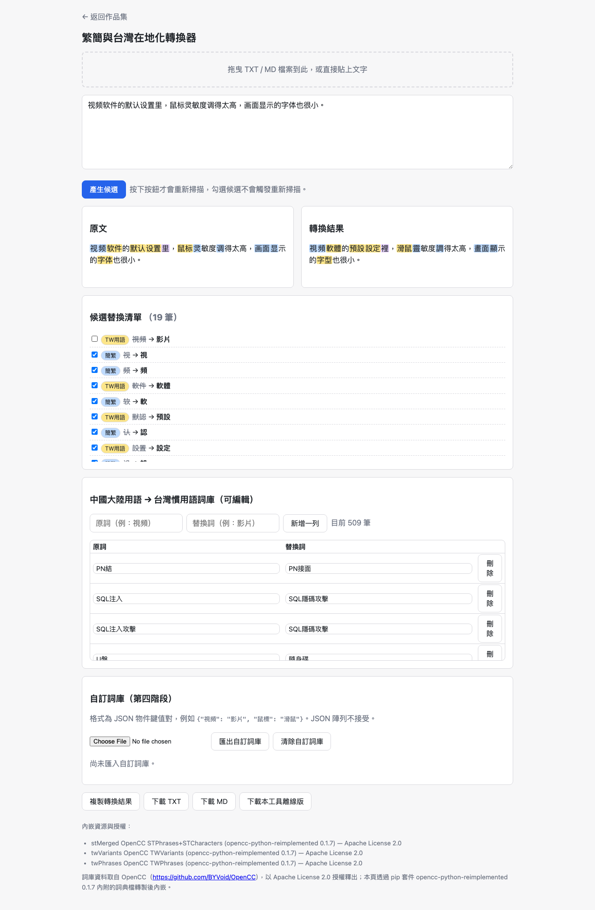
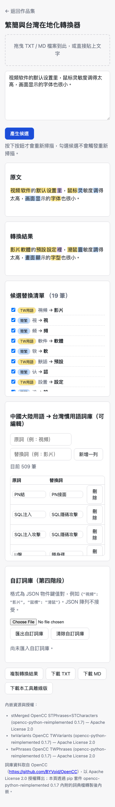

# Day04｜外包手冊裡的對岸用語：繁簡與在地化轉換器

   

👉 [Demo 連結](https://lushinshang.github.io/2026ironman/VibeCoding/Day04_zh-tw-localizer/index.html)（GitHub Pages 待設定上線，本機直接用瀏覽器開 `index.html` 就能用，不用裝任何東西）



---

## 🏢 一、情境：廠商交驗手冊滿滿「內存、默認、高清」，長官放話不改就扣款

Day03 贅詞雷達剛把公文裡的 AI 罐頭空話掃除乾淨，下午我正準備準時下班，總務組同仁突然抱著一大疊厚重的驗收資料衝進來，差點沒當場哭出來。

「阿星，救急啊！外包廠商剛剛送來資安系統的操作手冊跟規格書，整整三百多頁。長官翻了兩頁直接發飆拍桌子，說裡面全是直接簡轉繁的用語——『內存溢出』、『默認網關』、『高清截圖』、『登錄項目』、『視頻軟件』……長官下令下班前沒把這些全部換成台灣標準資訊用語，驗收款就不簽核了！」

同仁抹了把臉：「手動用 Word 搜尋取代根本來不及，而且『項目』有時候是專案、有時候是條目，全部自動取代一定會大翻車。阿星，這個有辦法用工具批次處理、又讓我逐項確認嗎？」

我看著那疊厚厚的手冊，默默把背包放回椅子上。這確實不是單純的簡轉繁，而是嚴肅的在地化語意轉換。

## 💡 二、想法：不是單純的取代，上一關切碎的文字下一關會看不見

架構依然延續老規矩：**單一 HTML 檔案、共用模組地基、不架伺服器、零環境依賴**。三百頁手冊很多是機密系統架構，同仁不可能把文字貼到未知的外部雲端轉換網站，瀏覽器本機離線處理是唯一能通過資安審查的底線。

但這題在演算法上有一個極其陰險的陷阱：**多階段轉換的切詞衝突**。

想像輸入一句「视频软件的默认设置」：
1. 第一階段做「簡轉繁」，把簡體字翻成繁體。
2. 第二階段做「台灣用語在地化」，把大陸術語換成台灣習慣詞。

如果實作時直接把文字切成片段處理，簡繁階段把「软件」逐字轉繁切成兩個獨立片段 `[軟]` 與 `[件]`，下一階段在地化比對時，如果只在單一片段內部找詞，就永遠拼不出完整的「軟件」兩個字，導致「軟件 ➔ 軟體」這條規則直接蒸發！最後轉換出來會變成哭笑不得的「影片軟件」，只轉了一半。

在動手寫程式之前，我先下第一道指令把轉換流程與邊界鎖定：

> 「規劃繁簡與台灣在地化轉換器，拆分為簡繁轉換、異體字修正、台灣用語三階段。注意事項：先提供判定規則，說明如何避免多階段切詞互相干擾，認知對齊後再開發。」

AI 回傳了分階段的比對策略，但我發現它原本只規劃了全自動整篇取代，沒有給使用者後悔的空間。我又追加了第二道指令，要求做出讓人可以反悔的介面：

> 「比對邏輯參數化。轉換前後採雙欄並排對照，所有替換候選必須支援逐項核取與取消；取消內層簡繁轉換時，外層用語替換要能自動連鎖退回。」

整個轉換的核心處理流程如下：

```text
  輸入簡體/用語文字
        ↓
    掃描階段
 ┌──────┴──────┐
 簡繁  異體  台語
 轉換  修正  在地
 └──────┬──────┘
        ↓
  建立巢狀候選樹
(外層用語包內層簡繁)
        ↓
    套用階段
  (逐項勾選/取消)
        ↓
  重組完整在地文字
```

## ⚔️ 三、過程：掃描與套用拆兩階段，巢狀候選樹解開連鎖反應

程式碼定稿後，交由獨立 subagent 跑 5.3 萬筆詞庫的交叉驗證。這次開發踩到三個滿深的雷：

### 1. 巢狀候選樹：解決取消替換時的「幽靈狀態」
驗收時最棘手的問題，是使用者「取消勾選」時的狀態一致性。

舉例來說：`软件` 經過簡轉繁變成 `軟件`，再經台灣用語變成 `軟體`。在資料結構上，這是一個兩層的巢狀節點——外層的「軟體」（期待輸入是「軟件」），包裹著內層的「軟件」（原始文字是「软件」）。

如果使用者取消了內層的簡轉繁勾選，文字退回原始的簡體「软件」，這時外層的台灣用語「軟體」還能不能生效？絕對不行！因為原始文字已經不是「軟件」了。

為了解決這個問題，轉換邏輯被拆成**「掃描」與「套用」兩階段**：
- **掃描階段**：四個 stage（簡繁 ➔ 異體字 ➔ 台灣用語 ➔ 自訂詞庫）依序執行，每個 stage 都在組回的完整文字上找最長比對，並把後續的替換包成巢狀 op node（外層節點把前一 stage 的節點收在 `children` 裡）。
- **套用階段**：使用者在介面上勾選或取消時，不重新掃描文字，只切換節點的 `accepted` 狀態。重組文字時只要一行判斷：`accepted && composeUnits(children) === before` 才算真正套用，否則自動連鎖退回子節點文字。這樣一來，不管使用者怎麼隨意勾選或取消，永遠不會出現狀態矛盾。

### 2. TWPhrases 詞典的 27 筆一對多衝突
詞典來源採用開源的 OpenCC（Apache License 2.0），包含簡繁合併詞庫 53,031 筆、異體字表 39 筆、台灣用語表 509 筆。

在比對簡繁詞典時，原本以為只有簡繁轉換有一對多問題，實測檢查才發現台灣用語表（`TWPhrases`）本身也存在 27 筆一對多：
- `視頻` ➔ `['影片', '視訊']`
- `代碼` ➔ `['程式碼', '代碼']`
- `便攜式` ➔ `['行動式', '攜帶型']`

如果詞庫轉換腳本沒寫好，直接轉成字串，會產出像 `影片 視訊` 這種帶空格的壞值。後來在 `build_dicts.py` 裡定了一條規則：三份詞典只要遇到一對多，一律自動收斂取第一候選，但保留頁面上讓使用者自訂詞庫隨時覆寫的彈性。

### 3. `ensure_ascii` 開關讓 HTML 現省將近 1MB
這題要將 5.3 萬筆詞庫直接內嵌進單一 HTML 檔案，體積控制至關重要。

在建置詞庫 JSON 時，Python 的 `json.dump` 預設是 `ensure_ascii=True`。這個預設值會把每個中文字都轉成 `\uXXXX` 的 Unicode escape 字元（例如一個「繁」字就佔了 6 個位元組）。實測對照：
- `ensure_ascii=True`：簡繁詞庫膨脹到 2,292,048 bytes（約 2.3MB），打包後的 HTML 高達 2.4MB。
- `ensure_ascii=False`：直接輸出 UTF-8 中文字元，簡繁詞庫驟降至 1,355,144 bytes（約 1.3MB），最終單一 HTML 僅 1.5MB！

改一個參數，就幫離線檔案省下快 1MB，瀏覽器解析也快了將近一倍。

## 📦 四、結果：並排對照與候選核取，逐項取消也不破版

驗收時拿廠商手冊的經典混合字串測試：「视频软件的默认设置里，鼠标灵敏度调得太高，画面显示的字体也很小。」

桌面版測試結果（1440×900）：



從截圖中可以看到左欄為輸入原文，右欄為即時轉換結果：
- **完整用語在地化**：「視頻 ➔ 影片」、「軟件 ➔ 軟體」、「默認 ➔ 預設」、「鼠標 ➔ 滑鼠」、「字體 ➔ 字型」，多詞連續替換全部精準命中。
- **逐項取消驗證**：手動取消第一筆「視頻 ➔ 影片」的勾選，右欄立即精準退回「視頻軟體」，其餘 18 筆候選完全不受干擾，位置絲毫不差。

手機版直屏測試（375×812）：



手機直屏下採用垂直自適應排列，候選項目清晰易點，完全無需左右拖曳螢幕。

## ☕ 五、感想與明日伏筆：手冊過關了，同仁卻偷偷開啟手機熱點……

同仁拿著轉譯工具，把三百多頁的手冊章節依序貼進去，花不到半小時快速掃描審核，把所有大陸用語全數轉為標準台灣資安術語，重新匯出列印送審。

長官翻了十幾頁，原本緊繃的眉頭終於鬆開，拿起印章俐落地在驗收單上蓋了章：「這次廠商配合度不錯，術語修得很到位，準時結案！」

同仁歡天喜地把驗收單送回總務組，我也總算能鬆開領帶喝口茶。

就在這時，隔壁座位的同仁突然鬼鬼祟祟地四處張望，接著從口袋掏出手機插上筆電，悄悄打開了個人熱點。我探頭看了一眼他的螢幕，差點把嘴裡的茶噴出來——他居然正把一份滿是客戶身分證號、手機、家用地址與銀行帳戶的機密 Excel 清冊，準備全選複製貼進外部的雲端 AI 網站幫忙做分類分析！

我整個人從椅子上彈了起來，一手按住他的手腕：「等一下！這貼出去我們明天全體都要去法務組喝茶做筆錄了！」

我看著他那份幾萬筆的個資清冊，冷汗直流：「先把網路拔掉再說，這事沒那麼簡單就能過關（XD）。」
