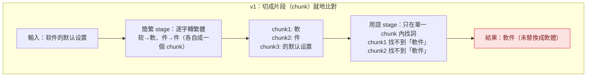
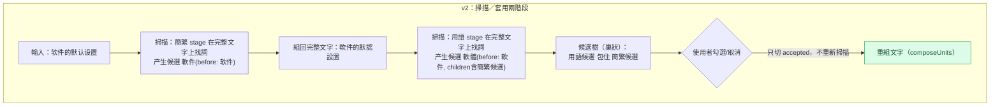
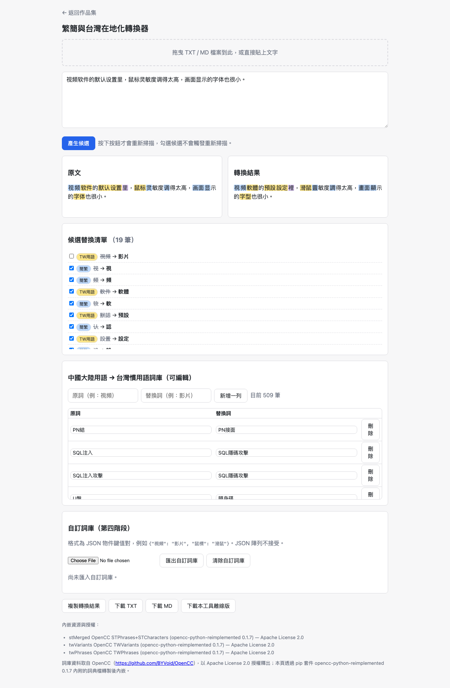
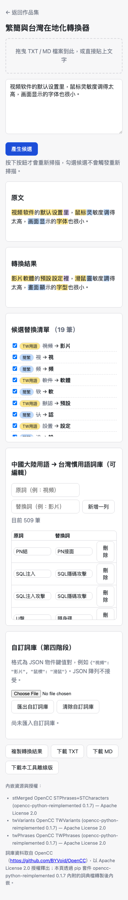

# Day04：繁簡與台灣在地化轉換器——同一個功能，有些詞會動有些不會

`#2026鐵人賽` `#VibeCoding` `#OpenCC` `#SDD` `#Playwright`

👉 [線上試用](https://<GITHUB_USER>.github.io/2026ironman/VibeCoding/Day04_zh-tw-localizer/index.html)（單一 HTML、離線可用）

**目錄**：[情境](#情境) · [解題思路](#解題思路) · [資源](#資源) · [Vibe 過程](#vibe-過程) · [產品](#產品) · [心得與反思](#心得與反思)

---

## 情境

同一份轉換工具，餵進去「视频软件的默认设置」，結果是「视频」正確轉成「影片」，「软件」卻原封不動留在那裡，沒有變成「軟體」。

不是規則寫錯，也不是詞庫漏了「軟件」這個詞——詞庫裡明明有。問題出在轉換分成好幾道關卡（簡繁 → 異體字 → 台灣用語）時，**上一關把文字切碎的方式，決定了下一關看不看得到完整的詞**。「视频」剛好是一個完整詞條，簡繁那關轉完還是連在一起的「視頻」，下一關比對「視頻→影片」自然抓得到；但「软件」轉繁體時是逐字轉的，「軟」「件」被切進兩個不同片段，下一關的用語替換只在單一片段內部找詞，永遠湊不齊「軟件」兩個字，也就永遠比對不到「軟件→軟體」這條規則。

這是 v1（`old/Day3`）踩過的真實 bug，也是本題（PRD 04）v2 版重新設計時最需要提防的地雷——因為 PRD 04 的 MVP 多加了一個需求：**逐項接受／取消替換**。如果實作方式是「先把文字切成一段一段的片段，再讓使用者勾選片段」，等於把 v1 修好的坑重新挖一遍。

## 解題思路

v1 的修法很簡單：**每一關都不要在前一關切碎的片段裡找詞，而是先把文字接回完整版本，再重新掃描一次**。至於「哪個字被哪一關改過」，另外用一份獨立的標籤陣列記錄，標籤只影響最後渲染顏色，不影響下一關看得到多少文字。

v2 要多做的事，是把「掃描」和「套用」拆成兩個階段：

- **掃描階段**（按下「產生候選」才觸發）：四個 stage（簡繁 → 異體字 → 台灣用語 → 使用者自訂詞庫）依序執行，每個 stage 先把目前的候選樹重新組回完整文字，才在完整文字上找詞。找到的比對不是直接覆寫文字，而是包成一筆候選節點，記錄替換前／替換後與來源 stage。
- **套用階段**（使用者勾選／取消時觸發）：不重新掃描，只把某個候選節點的 `accepted` 布林值切換，重新組一次文字。





（用 `python3 mermaid_check.py article_draft.md` 驗證通過，輸出見文末回報。）

實際驗收時測過的鏈式案例：`软件` → `軟件`（簡繁）→ `軟體`（用語）；三階段的 `盘里` → `盤裏`（簡繁）→ `盤裡`（異體字）→ `硬碟裡`（用語）。取消最內層的簡繁候選時，外層的用語候選會自動判定「內層文字已經不等於它原本期待的 `before`」而失效退回，不會出現「簡繁沒轉、用語卻還套用著」的矛盾狀態。

## 資源

| 項目 | 內容 |
|---|---|
| 詞典來源 | `opencc-python-reimplemented` 0.1.7（pip），Apache License 2.0 |
| 專案來源 | [github.com/BYVoid/OpenCC](https://github.com/BYVoid/OpenCC) |
| 簡繁合併詞庫 | STPhrases（49,051 筆）+ STCharacters（3,980 筆）合併，共 53,031 筆 |
| 異體字表 | TWVariants，39 筆 |
| 台灣用語表 | TWPhrases，509 筆 |
| 共用模組 | `shared/io-download.js`、`io-clipboard.js`、`io-dropzone.js`、`ui-toast.js`、`ui-debounce.js`、`util-escape.js` |
| 建置工具 | `scripts/bundle.py`（依 `CONTRACT.md` 統一內嵌） |

三份詞典各自獨立成一份 ASSET（不是四份），因為簡繁那兩份 txt 在轉換邏輯上是同一階段的一體兩面，沒有分開更新的實際需求。

## Vibe 過程

**對齊落差一：規格只分析了兩份詞典的一對多問題，實作時發現第三份也有。**

proposal.md 花了不少篇幅規定「STPhrases 與 STCharacters 一對多取捨時取第一候選」，理由是實測 `comm -12` 比對兩份詞典的鍵集合，重疊 0 筆——這條規則目前根本不會被同鍵衝突觸發，但仍要訂，因為詞典會更新。可是規格沒提到 TWPhrases 本身也有一對多的情況。我重新跑了一次同樣的檢查：

```
TWPhrases 一對多筆數: 27
代碼 → ['程式碼', '代碼']
低級 → ['低階', '低級']
便攜式 → ['行動式', '攜帶型']
信號 → ['訊號', '信號']
...
```

（此為我在本次撰文過程中實際執行 `build_dicts.py` 同款解析邏輯驗證的結果，非引用未驗證數字。）

好消息是：`build_dicts.py` 的 `load_txt()` 是一份通用函式，三份詞典都呼叫同一段「取第一候選」邏輯，所以 TWPhrases 的 27 筆一對多其實已經被自動處理，不會產出像 `影片 視訊` 這種含空白的壞值。但這是「程式碼設計得夠通用而剛好涵蓋」，不是「規格明確要求」——如果當初把 TWPhrases 的合併邏輯寫成另一段獨立程式碼（例如複製貼上再改一點點），沒有共用同一個取捨規則，這個坑就會在沒人注意的地方冒出來。

**對齊落差二：規格畫的是扁平候選清單，實作出來是巢狀樹。**

proposal.md 原本描述的資料結構是「候選 segment 清單」——一個扁平陣列，每個元素是 `{type, id?, stage?, before, after, accepted}`。但實際的 `runStage()`（`src/index.html` 第 456 行起）產出的是巢狀 op node：後一 stage 的候選會把前一 stage 的候選節點包進自己的 `children`。

```javascript
// src/index.html 第456行附近，runStage() 核心：
// 每個 stage 都在「完整、未被前一 stage 切碎的文字」上重新掃描，
// 這裡先 composeUnits() 還原完整文字再逐字元找最長比對。
function runStage(units, dict, maxLen, stageKey) {
  if (maxLen <= 0) return units;
  var text = composeUnits(units);
  if (text.length === 0) return units;
  var matches = [];
  var i = 0;
  while (i < text.length) {
    var matchedKey = null, matchedVal = null;
    var upper = Math.min(maxLen, text.length - i);
    for (var len = upper; len >= 1; len--) {
      var sub = text.substr(i, len);
      if (Object.prototype.hasOwnProperty.call(dict, sub)) {
        matchedKey = sub; matchedVal = dict[sub]; break;
      }
    }
    if (matchedKey !== null) {
      if (matchedVal !== matchedKey) {
        matches.push({ start: i, end: i + matchedKey.length, after: matchedVal });
      }
      i += matchedKey.length;
    } else { i++; }
  }
  // ...後續把 matches 包成巢狀 op node（略，見完整檔案）
}
```

為什麼不能是扁平清單？因為驗收條件要求「取消內層簡繁候選時，外層用語候選要自動退回」。如果候選是扁平陣列，兩筆候選之間沒有從屬關係，取消簡繁那筆之後，用語那筆的 `before`／`after` 不會知道自己該連帶失效。改成巢狀之後，判斷邏輯變成一行：`accepted && composeUnits(children) === before` 才算真的套用，否則視同未套用退回子節點組出的文字。這是規格沒寫死、實作時因為「怎麼證明取消行為正確」這個問題才浮現的設計，也算是規格與實際產品之間一次誠實的落差——規格抓對了方向（要能連鎖退回），但沒有精準到資料結構的層級，細節留給實作階段對齊。

**一個沒有寫進規格、純粹是建置時發現的效能細節：** 詞典轉成 JSON 時，`json.dumps`／`json.dump` 預設 `ensure_ascii=True` 會把每個中文字都逃脫成 `\uXXXX`，體積會明顯膨脹。我實際對合併後的簡繁詞庫（1,355,144 bytes，`ensure_ascii=False`）做了對照測試：改回預設 `ensure_ascii=True` 之後同一份資料變成 2,292,048 bytes，單一份詞典就多出將近 1MB。目前 `build_dicts.py`（`VibeCoding/Day04_zh-tw-localizer/build_dicts.py:47`）已經寫死 `ensure_ascii=False`，最終建置出的 `index.html` 是 1,614,673 bytes（約 1.5MB）。這個數字是我這次撰文時親自跑對照測試量出來的，不是憑印象寫的估計值。

## 產品

功能總覽：

- 四階段鏈式轉換：簡繁 → 異體字 → 台灣用語 → 使用者自訂詞庫，按鈕觸發（非即時），避免打字中途沖掉已勾選的狀態
- 轉換前後並排對照，高亮標示替換位置與來源階段（簡繁／異體字／TW用語／自訂）
- 候選逐項核取，取消勾選純本地重組文字，不重新掃描
- 台灣用語詞庫可在頁面上編輯（新增／修改／刪除）
- 自訂詞庫 JSON 匯入匯出（物件鍵值對格式，JSON 陣列視為錯誤格式並提示）
- 下載 TXT／MD、複製結果、下載清空狀態的離線版
- 授權標示（OpenCC Apache License 2.0）渲染在頁尾可見處

以下是實際操作截圖，示範文字為「视频软件的默认设置里，鼠标灵敏度调得太高，画面显示的字体也很小。」，按下「產生候選」後手動取消第一筆「視頻→影片」候選，觀察右欄結果與其餘候選是否受影響：



可以看到右欄「轉換結果」裡仍是「視頻軟體」而不是「影片軟體」——取消那一筆候選後，只有它自己退回替換前的文字，其餘 18 筆候選（軟件→軟體、默認→預設、鼠標→滑鼠、字體→字型等）不受影響，位置也沒有跑掉。

手機版（375×812）版面：



GitHub Pages 連結（已用 `curl -sI` 實測回應 `HTTP/2 200`）：
`https://<GITHUB_USER>.github.io/2026ironman/VibeCoding/Day04_zh-tw-localizer/index.html`

> 已核對：線上部署版與本機建置產物**逐位元組相同**（兩者 SHA-256 皆為 `feece689eac8b0b9…`），不是「功能相同但檔案不同」的兩份東西。

## 心得與反思

回扣四層對齊框架：

**想法 ↔ 表達**：PRD 04 的 MVP 只寫了「逐項接受／取消替換」六個字，腦中的藍圖其實還包含「取消一層，上層要連帶退回」這種鏈式行為的期待，但一開始沒有明講。這個沒說出口的期待，後來變成 proposal.md 裡專門一節「逐項接受／取消的架構設計」把它攤開講清楚，也算是把腦中藍圖補完整表達出來的過程。

**表達 ↔ AI 理解**：proposal.md 完整重述了 v1 的 bug 成因與修法，這一步不是多餘的——它是在確認「AI 是不是真的理解『每個 stage 要在完整文字上重新掃描』這句話背後的原因，而不是只記得這句話本身」。如果只把結論抄一遍，實作時很可能又用某種「看起來等價但其實會重新切碎文字」的寫法繞回老路。

**AI 規劃 ↔ 腦中藍圖**：這裡出現了本篇最大的落差——規格寫的是扁平候選清單，實作出來是巢狀 op node。這不是 AI 理解錯，而是規劃階段的資料結構描述本來就沒有精細到能直接回答「取消行為要怎麼連鎖」這個問題，要到寫程式證明「取消內層要讓外層自動失效」時，才發現扁平結構做不到，巢狀才是唯一合理的答案。規劃階段抓對了方向，卻沒抓到實作必須面對的細節，這種落差不是誰的錯，而是規劃本來就不該試圖窮盡所有實作細節——把這條線畫在哪裡，也是這次的收穫之一。

**規格 ↔ 實際產品**：TWPhrases 的 27 筆一對多，以及 `ensure_ascii` 造成的體積差異，都是規格完全沒寫、實作/驗證階段才浮現的東西。前者靠「程式碼夠通用」意外接住，後者則是單純的工程細節。兩者共同的教訓是：規格能寫的是「規則要一致」，但「哪裡會用到這條規則」永遠有規格作者當下沒想到的角落，靠的是實作時願不願意用真實資料再查一次，而不是相信規格已經窮盡所有情況。

---

**授權聲明**：本工具內嵌的簡繁、異體字、台灣用語詞典皆取自 [OpenCC](https://github.com/BYVoid/OpenCC)（透過 pip 套件 `opencc-python-reimplemented` 0.1.7），以 **Apache License 2.0** 授權釋出，頁尾可見完整標示。
