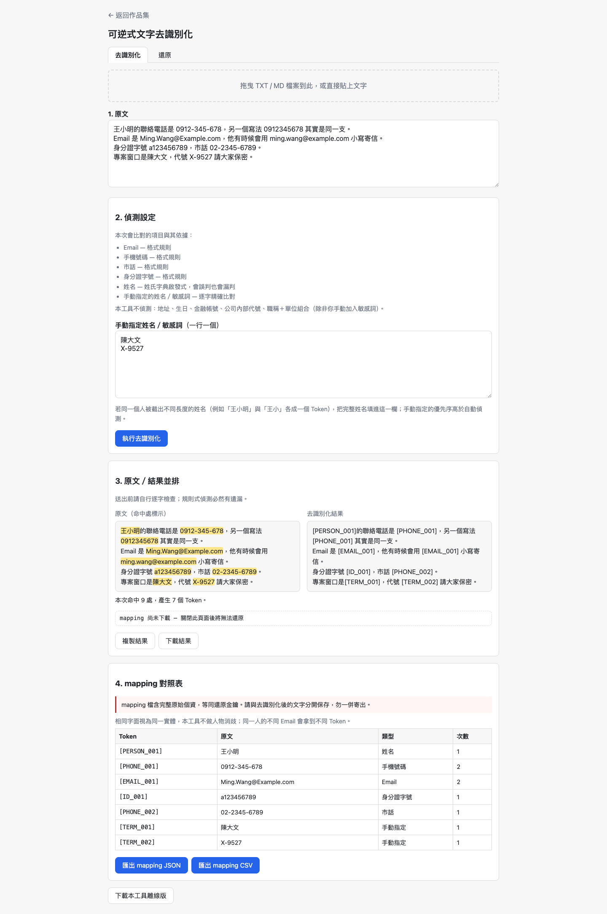
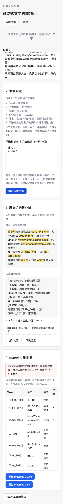

# Day05｜可逆式去識別化工具：阻斷外部 AI 洩密，支援本機雙向還原

   

👉 [Demo 連結](https://lushinshang.github.io/2026ironman/VibeCoding/Day05_reversible-deidentifier/index.html)（GitHub Pages 待設定上線，本機直接用瀏覽器開 `index.html` 就能用，不用裝任何東西）


---

## 🏢 一、情境：同仁偷偷開手機熱點想貼個資給外部 AI，被我一手按住

Day04 的手冊在地化轉換器剛讓總務組順利驗收結案，隔壁座位的同仁轉眼又遇到新的難題。

主管交辦了一份幾萬筆的客戶服務紀錄清冊，限他今天下班前整理出客訴分類與趨勢摘要。內網的 AI 模型運算資源有限，處理大文本速度慢，同仁情急之下，悄悄插上手機打開了個人熱點，打算把整份包含客戶身分證號、手機、家用地址與銀行帳號的 Excel 文字，全選貼進外部的雲端 AI 網站。

我轉頭剛好看見他游標正停在「發送」按鈕上，連忙伸手一把按住他的手腕：「等一下！這份資料一旦送出去，客戶個資就直接留在別人的雲端伺服器上了。資安稽核抓到，我們明天全體都要去法務組做筆錄。」

同仁抹了把冷汗，聲音有點發虛：「阿星，我知道有風險，可是主管只要分析結構跟結論，又不需要真的看客戶是誰。如果我手動一筆筆把名字電話塗掉，根本做不完……到底有沒有辦法把個資藏起來丟給 AI，拿到分析結果後，再把資料換回來？」

這句話問到重點了：單向塗黑誰都會，難的是怎麼安全地換回來。

## 💡 二、想法：可逆性不是加功能，是換了一整套數學前提

架構原則依然延續老規矩：**單一 HTML 檔案、共用模組地基、不架伺服器、100% 本機瀏覽器離線運算**。個資處理工具絕不能連網，這是最基本的資安底線。

過去常見的去識別化，做法通常是破壞性的——把身分證換成 `A●●●●●●789`、電話換成 `0912-***-***`。這種做法塗完原文就丟了，根本無法還原。

而「可逆」兩個字，直接把整個設計的數學前提翻掉了：**Token 與原始字串之間必須建立嚴格的雙射（Bijection）關係**。一個 Token 只能還原成一個字串，一個字串只能對應一個 Token。

為了守住這條雙射底線，動手前我先下第一道指令把判定規則與邊界鎖死：

> 「規劃可逆式去識別化工具，支援姓名、身分證、電話、Email 與自訂詞遮蔽，並生成本地 mapping 表以供雙向還原。注意事項：先提供判定規則，說明如何確保 Token 與原始字串的雙射一致性，認知對齊後再開發。」

AI 回傳的方案把規則拆成自動偵測與手動敏感詞，但我發現若有重疊字詞，先後的裁切很容易出現漏洞。於是我追加了第二道指令，把防呆與邊界收斂明確：

> 「比對邏輯參數化。偵測重疊時一律取聯集並依型態優先序指派 Token；還原引擎採單一 pass 掃描，避免產物二次替換。」

整個流程畫出來大概是這樣：

```text
  原始含個資文本
        ↓
   【去識別化】
  正則偵測+重疊聯集
 ┌──────┴──────┐
 脫敏文本   Mapping表
 [ID_001]   (留存本地)
 └──────┬──────┘
        ↓
  送外部 AI 分析
        ↓
   取得分析結論
  (仍帶有 Token)
        ↓
    【本地還原】
  單一 pass 查表替換
        ↓
  完整原始還原報告
```

## ⚔️ 三、過程：重疊取聯集防漏字，單一 pass 掃描終結二次替換

程式碼定稿後，交由獨立 subagent 進行邊界情境測試，踩出了三個一沒處理好就會直接外洩個資的工程細節：

### 1. 重疊區間取聯集：寧可多蓋，絕不能少蓋
最經典的邊界是手動詞與自動偵測重疊。例如使用者手動指定敏感詞「小明」，而自動姓名正則抓到了「王小明」。

如果依照一般的排序規則，抓到誰在前就留誰、丟棄後面出現的，當「王小明」起始位置較早時，「小明」會被丟棄；但如果使用者填的是前綴或後綴，很容易導致「王」或「明」單獨裸露在外面。

說白了，個資這種東西寧可抓過頭也不能漏抓——**少蓋一個字是重大外洩事故，多蓋一個字頂多是可讀性差一點**。因此規則定為：只要兩個區間有任何重疊，一律合併取聯集（「王小明」），並依型態優先序（`TERM > ID > PHONE > EMAIL > PERSON`）指派單一 Token（`[TERM_001]`），徹底杜絕漏字風險。

### 2. 還原引擎的「二次替換」陷阱
還原階段如果貪圖方便，直接用字串的 `replaceAll` 反覆取代，會引爆極其嚴重的連鎖反應。

假設 mapping 表裡有一筆：`[EMAIL_001] ➔ "請洽 [EMAIL_002]"`。如果引擎對整篇文字反覆跑取代，第一輪剛換出來的字串裡帶有 `[EMAIL_002]`，下一輪掃描時就會把它誤當成合法的 Token 又換了一次！原文明明只有一個人的 Email，還原後卻莫名其妙被塞進另一個人的個資。

解法是**單一 pass（single-pass）正則掃描查表**：一條正則從頭到尾掃描輸入文字，一旦命中 Token，查表把原始值寫入獨立的輸出緩衝區，游標繼續往前推進。**輸出緩衝區的內容絕不參與後續比對**，從演算法結構上直接消滅二次替換的可能。

### 3. 外部 mapping 檔的原型污染防禦
使用者可能隔了幾天要還原資料，需要從檔案載入當初匯出的 JSON 或 CSV mapping 表。

這份檔案屬於不可信任的外部輸入。在解析 JSON 物件時，惡意構造的檔案可能會注入 `__proto__`、`constructor` 或 `prototype` 屬性。程式在載入解析時加入遞歸防護檢驗，一旦發現危險鍵名整份拒收，保護執行環境不被污染。

## 📦 四、結果：遮蔽送審與 mapping 載入還原，手機直屏不破版

驗收時拿一份包含多組身分證、電話、Email 與中文姓名的測試清冊實測。

桌面版測試結果（1440×900）：



從截圖可以清楚看見操作成效：
- **精準標註替換**：正文中的身分證、電話、姓名全部轉換為標準 Token，右側同步生成結構化的對照清單，顯示出現次數與類型。
- **一鍵匯出還原金鑰**：支援將 mapping 表單獨下載為本機 JSON 或 CSV，方便同仁自行留存、視需要再加密保管。
- **還原驗證**：切換至還原分頁，將帶有 Token 的文本與 mapping 載入，一秒內完美還原成原始字串，字元零誤差。

手機版直屏測試（375×812）：



手機直屏下輸入區與對照表格自動調整為垂直堆疊，單手滑動即可快速檢視遮蔽狀態。

## ☕ 五、感想與明日伏筆：個資守住了，長官卻搬來一箱無環境的 Python 腳本……

同仁拿著去識別化工具，把清冊裡的幾萬筆個資全數換成抽象 Token，安心貼上外部 AI。不到十分鐘，AI 便產出漂亮的客訴分類統計圖表與趨勢摘要。

同仁把 AI 產出的文字貼回本機工具，載入留存在本機的 mapping 表，按下還原，一秒鐘就把 Token 換回真實客戶資料，整份報告乾淨俐落又兼顧隱私。主管看過之後讚不絕口，當場核准通過。

同仁長舒一口氣，把手機熱點關掉，心有餘悸地跟我說：「阿星，還好剛才有你拉我一把，不然現在我可能真的在法務組寫檢討報告了。」

我拍拍他的肩膀，正想關機下班，長官突然抱著一台老舊的公務筆電快步走進辦公室，臉色凝重：「阿星，外包廠商撤場時留下了一百多支 Python 資料處理腳本，說是這幾年寫的，但每支縮排都不一樣、有些空格有些 Tab，長官明天一早要抽查原始碼。重點是這台公務機根本沒裝 Python 環境，網路也限制安裝 pip，今晚有辦法把這些腳本全部排版整齊嗎？」

我看著那台跑著古老系統、完全沒有 Python 的電腦，嘆了一口氣：「好，看來今晚要想辦法在瀏覽器裡跑排版引擎了（XD）。」
