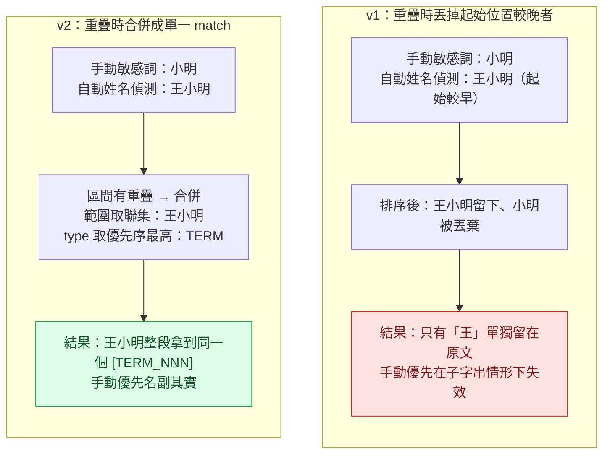
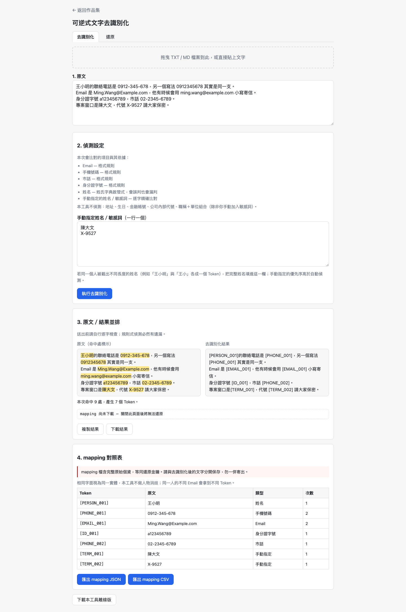
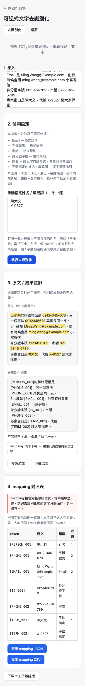

# Day05：可逆式文字去識別化（上）——「可逆」兩個字，把整個設計翻掉了

`#2026鐵人賽` `#VibeCoding` `#SDD` `#資安` `#Playwright`

👉 [線上試用](https://<GITHUB_USER>.github.io/2026ironman/VibeCoding/Day05_reversible-deidentifier/index.html)（單一 HTML、離線可用；本篇涵蓋去識別化功能，還原功能見明天下篇）

**目錄**：[情境](#情境) · [解題思路](#解題思路) · [資源](#資源) · [Vibe 過程](#vibe-過程) · [產品](#產品) · [心得與反思](#心得與反思)

---

## 情境

`grep -n "mapping\|token\|restore" old/Day9/index.html` 沒有任何一筆命中。

這是 v1（`VibeCoding/old/Day9/`）的去識別化工具——它確實能把姓名、電話、Email 塗掉，但塗掉之後就沒有下一步了。`A123456789` 變成 `A●●●●●●789`，機敏詞命中換成 `[已遮蔽]`，原文資訊當場丟棄。這是一次性的、破壞性的操作，做完就是做完，沒有「還原」這回事，程式碼裡自然也就找不到任何跟「還原」有關的字。

這次（PRD 05）的需求多了兩個字：**可逆**。使用者去識別化之後，要能在拿到一份 mapping 對照表的前提下，把 Token 換回原文。

一開始以為這只是「在 v1 上面加一個還原按鈕」的量級。實際寫 proposal 才發現不是——「可逆」不是加功能，是換了一條數學前提，v1 的每一個「差不多就好」的設計決定，到了 v2 都要重新審一次：同名的人怎麼處理？姓名截斷怎麼辦？兩個偵測結果重疊了誰贏？這些問題在單向遮蔽的世界裡答案都無關緊要——反正塗掉就沒了，怎麼塗都是對的。但只要要求「塗掉的東西必須能一字不差地換回來」，每一個答案都變成了會不會讓還原壞掉的問題。

這一篇先講**去識別化**這一半：偵測、合併、Token 分配，是怎麼在「可逆」這個新前提下重新設計的。載入 mapping、還原、以及離線版差點外洩個資的資安事故，留給明天下篇。

## 解題思路

可逆性的數學前提是 **Token 與原始字串之間的雙射（bijection）**：一個 Token 只能還原成一個字串，一個字串只能對應一個 Token。這句話聽起來像廢話，但它直接否決了三個「看起來比較聰明」的做法：

1. **不能按「實體」分配 Token，只能按「字面」分配。** 如果把「同一個人」當成一個 Token 的分配單位，就得先解決「這兩個王小明是不是同一個人」的實體消歧問題——工具沒有能力做這件事，勉強做了，判斷錯了，還原就跟著錯。所以 Token 分配的鍵改成 `(類型, 正規化字串)`：同一鍵給同一個 Token，不同鍵各給各的。代價很直接：兩個不相干的「王小明」會被塗成同一個 Token（工具讀者會誤以為是同一個人），而同一個人的兩個 Email 會拿到兩個不同 Token（工具不做合併）。這兩個代價都得在畫面上講清楚，不能假裝解決了。

2. **姓名不能做前綴合併。** v1 的姓名正則是貪婪匹配，「王小明」會整段吃下來。如果 A 處出現「王小明」、B 處只出現「王小」，兩者是不同的字面，只能拿到兩個不同 Token（`[PERSON_001]`、`[PERSON_002]`）。合併看起來比較貼心，但合併之後 `[PERSON_001]` 要還原成「王小」還是「王小明」就沒有答案了——這是正確性的崩壞，不是強度的損失，兩害相權必須選前者。

3. **重疊區間不能用「丟掉其中一個」處理，要合併聯集。** 這是本題唯一一處真的踩到 v1 遺留 bug 的地方，值得展開講。

### 重疊合併：v1 的「手動優先」在子字串情形下其實是假的

v1 的邏輯是：手動指定的敏感詞（`sensitiveMatches`）排在自動偵測的個資（`piiMatches`）前面，去重時遇到重疊，**用起始位置排序、丟掉後面出現的那個**。乍看是「手動優先」，但當手動詞是自動偵測結果的**子字串**時，這條規則會反過來：

- 使用者手動填了「小明」
- 自動姓名偵測抓到「王小明」（起始位置比「小明」早一個字）
- 排序時「王小明」的起始位置在前，「小明」被丟掉
- 結果：全文只有「王」被漏掉沒塗到，「手動優先」名存實亡

v2 把規則改成：**兩個 match 只要有任何重疊（含部分重疊與完全包含），就合併成一個 match，範圍取聯集、type 取優先序最高者**（`TERM > ID > PHONE > EMAIL > PERSON`）。「小明」與「王小明」重疊，合併後字面是聯集「王小明」，type 是較高優先序的 `TERM`，整段拿到同一個 Token。取聯集而不是取較短者，是因為去識別化的失敗方向不對稱：多蓋一個字只是可讀性差一點，少蓋一個字是個資外洩。

合併之後還有一步 v1 沒有的**字串層歸併**：去重完成後掃描所有 match，如果同一個正規化字串在不同位置被判成不同 type（例如同一個名字，A 處被手動指定成 `TERM`，B 處只被自動偵測成 `PERSON`，兩處位置沒有重疊，因此上面的區間合併規則不會處理到），一律歸併到優先序最高的那個 type，再進入 Token 分配。少了這一步，同一個字串會在 mapping 裡出現兩列、拿兩個不同 Token——還原結果依然正確（兩個 Token 都指回同一個字串），但看起來像 bug，也讓去識別化強度打折扣（讀者能從 Token 不一致反推出這是同一個詞）。

### Token 分配鍵：正規化只做「格式層」的事

Email 全轉小寫、手機與市話去除分隔符號後共用同一組正規化規則（兩者也共用同一個 `PHONE` Token 類型，儘管偵測時仍是兩條不同的 regex）、身分證首字母轉大寫；姓名與手動敏感詞則完全不做正規化。這條界線畫在「格式層 vs. 語意層」：大小寫、分隔符號是同一個東西的不同寫法，機械可逆；但中文姓名的任何正規化（全半形、繁簡轉換）都可能引入誤合併，一旦合併就回到雙射被破壞的老問題。

## 資源

| 項目 | 內容 |
|---|---|
| 偵測層來源 | 移植自 v1 `old/Day9/index.html:222-331`（`PII_PATTERNS` 四條 regex、`SURNAMES` 姓氏字典、`mergeAndDedupe`、`detectAll` 優先序），本題僅重寫「重疊時的動作」與新增歸併／Token 分配 |
| 新增設計 | Token 分配器、`(type, normalized)` 鍵、重疊聯集合併、字串層歸併——v1 完全沒有的部分 |
| 共用模組 | `shared/io-download.js`、`io-clipboard.js`、`io-dropzone.js`、`ui-toast.js`、`util-escape.js` |
| 建置工具 | `scripts/bundle.py`（依 `CONTRACT.md` 統一內嵌單檔） |
| 規格文件 | `sdd/reversible-deidentifier/proposal.md`（六個關鍵設計判斷，逐條含決定與理由） |
| Library / API | 無。全程 browser-side 原生 JS，無外部 library、無 AI、無網路請求 |

## Vibe 過程

**對齊落差：一開始以為六個設計判斷是「寫給文件看的」，實際上每一條都在攔一個真的會讓還原壞掉的 bug。**

proposal.md 定案時，六個判斷讀起來像是把一些邊界情況攤開來講清楚——「同名不合併」「姓名不做前綴合併」「重疊要合併不要丟棄」。當時心裡的優先序是先把偵測與 Token 化跑起來，這些判斷之後照著補就好。實際照 tasks.md 第 3 條的驗收條件重新跑一次，才發現「手動敏感詞是自動偵測結果的子字串」這個案例，不是我隨手想出來湊數的邊界情況——它是 v1 `mergeAndDedupe()` 真實存在、但因為 v1 沒有可逆需求所以從沒被當成 bug 的一個邏輯漏洞。v1 的 `SECURITY_REVIEW.md` 甚至記錄過一個真實案例（用「李永昌」這個例子講手動優先的意圖），但那份文件討論的是「要不要蓋住」，沒有討論到「子字串重疊時到底蓋住了幾個字」。同一段程式碼、同一個真實案例，在 v1 的脈絡下是「已經解決」，在 v2 的可逆脈絡下重新一驗，發現「解決」只解決了一半。

這是規格 ↔ 實際產品這一層的落差：proposal 判斷 6 寫的是「決定改成合併」，但驗收條件逼著我用具體案例去驗證「合併」在程式碼層面到底要動到 `mergeAndDedupe()` 的哪一段游標邏輯，才發現 v1 原本的 `lastEnd` 游標寫法必須整段換掉，不是加一個 if 分支就能接上。

**另一個對齊落差：Token 前綴數（6 種）跟偵測 regex 數（4 條）對不上，一開始差點統一錯方向。**

proposal 判斷 1 講得很明白：手機與市話是兩條不同格式的 regex，都要留著、都要比對，只是命中後統一標成同一個 `PHONE` Token 類型。實作時第一直覺是「既然 Token 類型統一了，regex 是不是也該合併成一條」——這是個看起來合理但方向錯誤的簡化：市話帶區碼（`02-2345-6789`）跟手機（`0912-345-678`）的合法格式差異夠大，硬併成一條 regex 只會讓誤判率上升。停下來重讀 proposal 那句「不得刪掉其中任何一條 regex，統一的只有 Token 前綴，不是比對規則」，才確認這不是隨口一句話，是刻意寫給實作階段的自己看的提醒。

## 產品

Phase A（本篇對應範圍）完成的功能：

- 規則偵測 Email、手機、市話、身分證字號（四條獨立 regex），姓名採姓氏字典啟發式
- 使用者可手動指定姓名／敏感詞，優先序高於自動偵測
- 重疊區間合併聯集 + 字串層 type 歸併，同一字面全域拿同一個 Token
- Token 分配鍵為 `(類型, 正規化字串)`，6 種前綴（`ID`／`PHONE`／`EMAIL`／`PERSON`／`TERM`／`LITERAL`）各自獨立編號
- 原文若本身含 Token 樣式字串（例如原文就寫著 `[PERSON_001]`），收編成 `[LITERAL_NNN]`，新編號會跳過原文已佔用的字面
- 結果區固定顯示「送出前請自行逐字檢查；規則式偵測必然有遺漏」，偵測設定區列出「本工具不偵測：地址、生日、金融帳號…」

以下示範資料全為虛構：「王小明」「陳大文」為捏造姓名，`0912-345-678` / `0912345678`、`Ming.Wang@Example.com` / `ming.wang@example.com`、`a123456789`、`02-2345-6789`、代號 `X-9527` 皆為手動編造的假資料，非真實個資。

重點看 mapping 表格：`0912-345-678` 與 `0912345678` 這兩種寫法的手機號碼，合併成同一個 `[PHONE_001]`，次數欄顯示 2；`Ming.Wang@Example.com` 與 `ming.wang@example.com` 這兩種大小寫寫法的 Email，也合併成同一個 `[EMAIL_001]`，次數欄同樣是 2。手動指定的「陳大文」與「X-9527」各自拿到 `TERM` 類型的 Token，因為兩者在原文中沒有跟自動偵測結果重疊，走的是判斷 6 的字串層歸併路徑而非區間合併路徑。

手機版（375×812）版面：

GitHub Pages 連結（已用 `curl -sI` 實測回應 `200`）：
`https://<GITHUB_USER>.github.io/2026ironman/VibeCoding/Day05_reversible-deidentifier/index.html`

> 目前線上這一版是 Phase A + Phase B 都完成後的完整產品（含還原分頁），因為產品只有一份、不拆成兩個部署。畫面上「還原」分頁的功能屬於明天下篇的範圍，本篇的示範只操作「去識別化」分頁。

## 心得與反思

回扣四層對齊框架：

**想法 ↔ 表達**：一開始腦中對「可逆」的想像很單薄——「多做一個還原按鈕」。真正把這句話寫進 proposal 逐條展開成六個判斷之後，才發現「可逆」牽動的是整個偵測與合併邏輯的設計前提，不是加一個功能而已。這是把腦中模糊的一句話，逼著自己用文字攤開之後，才發現原本想得不夠深的地方。

**表達 ↔ AI 理解**：proposal 裡刻意把「v1 的 grep 結果」（找不到 mapping／token／restore）寫進「為什麼做」那一段，不是為了交代開發史，而是要確認接下來的規劃真的是從「這是全新設計」出發，而不是誤把 v1 當成可以小改的基礎。事後看，這一步確實攔住了「Token 前綴跟著 regex 數量走」這種看起來合理、實則違反 proposal 判斷 1 的簡化衝動。

**AI 規劃 ↔ 腦中藍圖**：六個設計判斷寫的時候感覺是「先把話講清楚」，真正對齊的落差要到照 tasks.md 驗收條件重新跑過一次才浮現——「手動敏感詞是自動偵測的子字串」這個案例，證明了規劃階段文字上「決定改成合併」跟「合併要怎麼在游標邏輯層面實作」之間，還有一段沒有寫進規格、只能靠實作時對照真實案例才會補上的距離。

**規格 ↔實際產品**：目前 Phase A 這一半的產品，行為與 proposal 判斷 1、2（部分）、4、6 的文字描述逐條可以對得上——這是本篇撰文時實際重新跑過一次 Playwright 操作驗證的結果，不是憑記憶寫的。判斷 3（mapping 遺失時的介面表達）與判斷 5（mapping 加密決策）涉及還原分頁與 mapping 檔案本身，留到明天下篇對齊。

---

**下篇預告**：去識別化只是故事的一半。明天要講的是**還原比遮蔽難**——為什麼還原引擎必須是 single-pass 掃描（否則 mapping 值本身含 Token 字面時會被二次替換）、mapping 檔案為什麼是一個全新的攻擊面（不可信輸入，要防原型污染）、以及一個獨立驗收時才抓到的真實資安事故：「下載本工具離線版」這個功能，一度會把共用模組動態插入的 DOM 元素也序列化進那份設計來分享出去的檔案裡。
