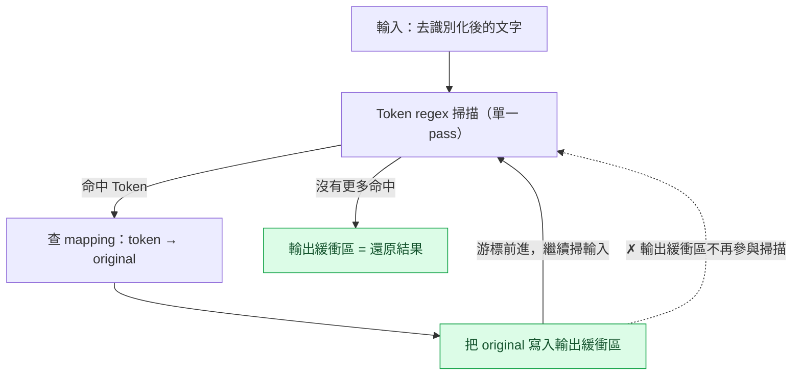
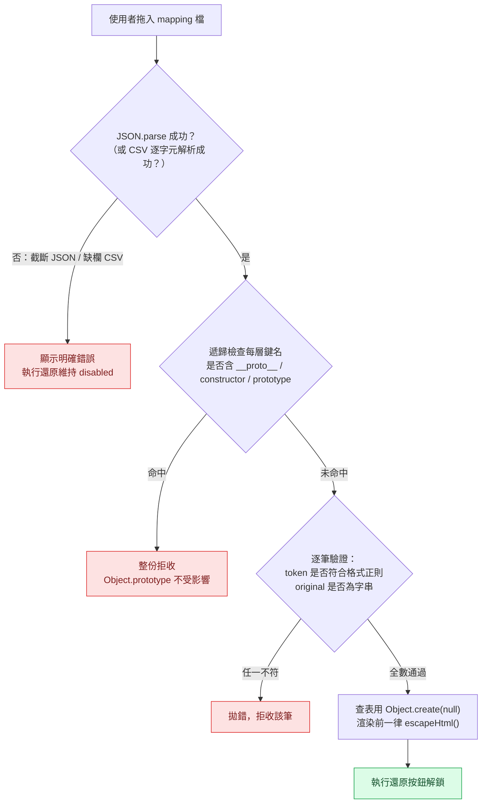
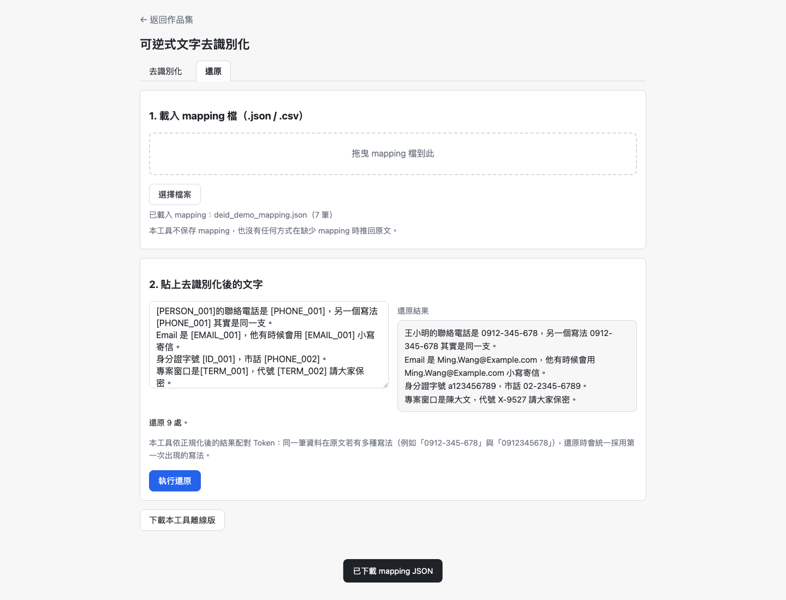
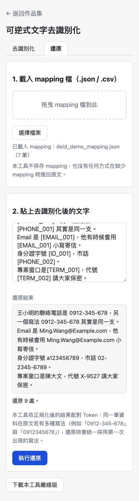

# Day06：可逆式文字去識別化（下）——還原比遮蔽難，而且產物本身就是機密

`#2026鐵人賽` `#VibeCoding` `#SDD` `#資安` `#Playwright`

👉 [線上試用](https://<GITHUB_USER>.github.io/2026ironman/VibeCoding/Day05_reversible-deidentifier/index.html)（單一 HTML、離線可用；本篇涵蓋還原功能）

**目錄**：[情境](#情境) · [解題思路](#解題思路) · [資源](#資源) · [Vibe 過程](#vibe-過程) · [產品](#產品) · [心得與反思](#心得與反思)

---

## 情境

上篇（Day05）把去識別化那一半講完了：偵測、重疊合併、Token 分配，重新設計成滿足「Token 與原始字串之間必須是雙射」這個前提。那一篇的結論是 Phase A——原文能穩定變成 Token，mapping 表格看得到 Token、原文、類型、次數。

但去識別化只是把資訊「藏起來」，藏起來的東西還得拿得回來，這才是 PRD 05 真正要的「可逆」。Phase B 要做的三件事，難度都不在「多寫一個還原函式」：

1. 還原引擎本身要正確——mapping 的原文值如果剛好含有另一個 Token 的字面，會不會被二次替換？
2. mapping 檔案要能被載入——但這個檔案可能是別人給的，格式、內容都不可信。
3. 還原做出來之後，mapping 本身變成一份**完整原始個資的結構化集合**，等同一把還原金鑰。v1 從來沒有過這種東西——v1 的遮蔽是破壞性的，原文丟了就丟了。

這篇就是這三件事,再加上一個獨立驗收才抓到、藏得很深的資安 bug。

## 解題思路

### 還原的正確性：一律 single-pass，輸出不再參與掃描

proposal 判斷 2 點出三個具體風險：(A) 原文本身就含 `[PERSON_001]` 這種 Token 樣式字串；(B) mapping 的原文值本身含 Token 字面；(C) 反覆全域取代時，前一輪剛還原出的內容被後一輪再次取代。

(B) 和 (C) 的根源是同一件事：如果還原做成「對整份文字反覆 `String.replace`」，那麼上一輪替換寫進去的內容，下一輪掃描時會被當成新的比對目標。比方 mapping 裡 `[EMAIL_001] → "聯絡 [EMAIL_002]"`，如果用全域反覆取代，`[EMAIL_002]` 這串字面被寫進輸出後,如果引擎再掃一次,就會被當成合法 Token 又換一次——原文明明只有一個 Token，卻被换成別人的個資。

v2 的解法是**一條 Token regex 對輸入掃一次**，命中就查表把結果寫進輸出緩衝區，輸出緩衝區的內容不再參與後續掃描：



驗收時把插入順序反過來又測了一次——先測 `[PERSON_001] → "[PERSON_002]"`，再測 `[PERSON_002] → "[PERSON_001]"`，兩種寫入順序輸出都正確，因為輸出從不參與掃描，順序根本無關緊要。這比「加逃逸字元」「用不可見字元包住 Token」這類土法可靠：single-pass 是從演算法層直接消滅這個問題，不是靠格式技巧繞開。

### mapping 檔是一個全新的攻擊面

v1 完全沒有「載入外部檔案」這件事。v2 的還原分頁需要使用者拖進一份 mapping（`.json` / `.csv`），這份檔案**可能是別人給的**——不可信輸入的定義就長這樣：內容會被渲染成表格，也會被寫進還原輸出。

檢查分三層：



`SECURITY_REVIEW.md` 記錄的驗收實測涵蓋六種惡意 mapping：含 `__proto__` 鍵、含 `constructor` 鍵、截斷的 JSON、`token` 格式不符、`original` 非字串、CSV 缺欄——全部被拒收，且 `({}).polluted === undefined` 確認 `Object.prototype` 沒被污染。查表結構特意用 `Object.create(null)` 而不是普通物件字面量，這樣即使有漏網的鍵名也不會撞到原型鏈上既有的屬性。

### mapping 不加密：警告跟著檔案走

mapping 檔含完整原始個資，理論上應該加密。proposal 判斷 5 明確決定**不做**，理由有三層：PRD 05 的 MVP 只列「產生 mapping」「匯出 JSON/CSV」，加密是規格外的新功能；半調子加密（Base64、固定金鑰、XOR）比不加密更危險——會製造「看起來加密了」的安全錯覺，而要做對得上 WebCrypto + 金鑰派生 + 密碼強度提示,那是一整條獨立需求;真要做的成本不是零。

改用零成本的做法：警告跟著檔案走，而不是只留在頁面上。

- JSON 匯出：頂層第一個鍵是 `_warning`，開檔即見
- CSV 匯出：第一行是註解列 `# 本檔含完整原始個資，等同還原金鑰，請勿外傳`，第二行才是欄位標題
- 檔名固定樣板 `deid-mapping-DO-NOT-SHARE-YYYYMMDD-HHMM.{json,csv}`

理由是檔案會離開頁面脈絡——被拖進 email 附件、丟進 Slack——那時候 UI 上的警語已經看不到了，只有跟著檔案走的文字還在。

### 一個規格內的必然代價：正規化 vs. 逐字還原

判斷 1 的正規化規則（Email 全轉小寫、手機與市話去除分隔符號後共用同一組規則）是為了讓「同一筆資料的不同寫法」拿到同一個 Token——這是 Day05 上篇的重點。但這條規則有一個代價，只有到還原這一步才會顯現出來：

```
原文  : 手機 0912-345-678 與 0912345678 是同一支
還原  : 手機 0912-345-678 與 0912-345-678 是同一支
```

mapping 保存的是「第一次出現的原始寫法」，所以還原之後，同一個 Token 對應的所有出現位置，全部變成同一種寫法。這不是 bug，是同一個規格內兩個目標互相衝突之後必然要選一邊的結果：要嘛讓 AI／讀者認得出「這兩處是同一支電話」（Token 統一），要嘛讓還原逐字重現原文的每一種寫法（不做正規化，但代價是同一支電話在 mapping 裡拆成兩筆、Token 不統一，去識別化強度變差）。

v2 選擇維持 Token 統一，但要求把這個代價寫在使用者看得見的地方，不能只藏在 `SECURITY_REVIEW.md` 裡當作一則附註。現在 `#restore-normalize-note` 常駐在還原分頁第 2 步下方：「本工具依正規化後的結果配對 Token：同一筆資料在原文若有多種寫法……還原時會統一採用第一次出現的寫法。」——下方的截圖可以直接看到這行字，也可以看到它描述的行為真的發生了。

## 資源

| 項目 | 內容 |
|---|---|
| 延續 Phase A | 偵測、合併歸併、Token 分配（見 Day05 上篇），Phase B 只新增載入與還原這一側 |
| 新增設計 | single-pass 還原引擎、mapping 檔案驗證（`assertNoForbiddenKeys`）、mapping 未下載狀態列、`buildCleanHtmlCopy()` 清空範圍擴充 |
| 共用模組 | `shared/io-download.js`、`io-clipboard.js`、`io-dropzone.js`、`ui-toast.js`、`util-escape.js` |
| 規格文件 | `sdd/reversible-deidentifier/proposal.md`（判斷 2／3／5 對應本篇）、`tasks.md`（任務 6–10） |
| 資安檢視 | `VibeCoding/Day05_reversible-deidentifier/SECURITY_REVIEW.md`（Node.js 純邏輯層 37 項、獨立 Playwright 84 項） |
| Library / API | 無。全程 browser-side 原生 JS |

## Vibe 過程

**對齊落差：獨立驗收抓到一個「功能全部正常但 console 在噴錯」的 bug，寫的人自己完全不會發現。**

任務 9 是擴充 `buildCleanHtmlCopy()` 的清空範圍——這件事本身照著 proposal 的 delta 2 清單做完了：mapping 表格 DOM、已載入檔名、還原分頁的兩個 textarea 全部清空，逐字串 grep 離線 HTML 對照未跑過資料的基準線，零新增命中。這部分我自己驗收時全綠。

真正的落差出現在獨立驗收那一輪。`buildCleanHtmlCopy()` 會把「下載本工具離線版」這顆按鈕從複本 DOM 裡移除——這是刻意的，複本不該包含它自己。但註冊這顆按鈕 click handler 的那一行程式碼寫在 app IIFE 的**最後一句**，前面所有其他按鈕的 handler 都已經註冊完畢，而這一行**沒有做 null 檢查**就直接 `document.getElementById("btn-download-offline").addEventListener(...)`。離線複本載入時,這顆按鈕已經不存在,`getElementById` 回傳 `null`，對 `null` 呼叫 `.addEventListener` 直接拋 uncaught `TypeError`。

這個 bug 藏得深的原因剛好是它「不影響功能」：離線版點去識別化、點還原、點下載，全部正常，因為出錯的那一行是整段程式的最後一步，錯誤發生時前面所有功能該掛的 handler 早就掛好了。跑一輪功能測試（`tasks.md` 任務 9 原本寫的驗收條件也確實只列了功能與 DOM 狀態）會全綠，只有另外去看 console 的人才會發現多了一個 uncaught error。這正是「驗證不自驗」要解決的問題——寫的人測完自己那條路徑會覺得沒事，因為他測的正好是不會觸發這個路徑的操作序列。修法是在那一行前面補上 `if (btnDownloadOffline)` 判斷（`src/index.html:1243-1244`）。

**兩份文件也被驗收打回，不是只有程式碼有問題。**

`tasks.md` 任務 9 原本寫的驗收條件之一是「`grep -n 'nav-back' 離線檔` 為 0 筆」。這條字面上不可能通過——內嵌進單檔的 `base.css` 本身就含 `.nav-back` 這條樣式規則，`buildCleanHtmlCopy()` 函式自己的原始碼裡也含這個字串（畢竟它要在程式碼裡引用這個 class 名稱去移除節點）。驗收條件寫得比實際可驗證的範圍還寬，改成用 DOM 層判定：`document.querySelectorAll('.nav-back').length === 0`。

`SECURITY_REVIEW.md` 原本的邊界情況複驗表格也寫了「無 uncaught page error」，但那一行在發現上面那個 bug之前就已經寫進文件了——換句話說，資安檢視文件自己也宣稱了一件不實的事。這不是特別意外，但值得誠實記下來：寫檢視文件的人跟寫程式的人是同一雙眼睛，同樣會漏看同一個盲點。現在這一列改成先寫「一度不成立」，附上發現與修正的完整過程，而不是悄悄改成通過就當沒發生過。

## 產品

Phase B（本篇對應範圍）完成的功能：

- single-pass 還原引擎：一條 Token regex 掃描輸入一次，輸出緩衝區不再參與掃描；mapping 內找不到的 Token 原樣保留並列出清單
- mapping 檔案載入（`.json` / `.csv`）：型別驗證、拒收 `__proto__` / `constructor` / `prototype` 鍵、CSV 手寫解析不用 `eval`
- mapping 匯出：JSON 頂層 `_warning` 欄位、CSV 首行警告註解、檔名固定樣板含 `DO-NOT-SHARE`
- mapping 未下載狀態列常駐在結果區，下載後切換為「已下載（檔名）」
- 正規化造成的還原代價（統一為第一次出現的寫法）明列在還原分頁的 `#restore-normalize-note`
- `buildCleanHtmlCopy()` 擴充清空範圍：mapping 表格、還原分頁輸入、已載入檔名、狀態列，全部回到初始狀態；離線複本相對於未使用過的 build 產物零新增字串

以下示範資料全為虛構：「王小明」「陳大文」為捏造姓名，`0912-345-678` / `0912345678`、`Ming.Wang@Example.com`、`a123456789`、`02-2345-6789`、代號 `X-9527` 皆為手動編造的假資料，非真實個資。



這張截圖直接展示了本篇兩個重點：一是還原確實把 Token 換回原文（`[PERSON_001]` → 王小明、`[ID_001]` → a123456789）；二是正規化的代價在畫面上看得到——原文裡 `0912-345-678` 與 `0912345678` 兩種寫法，還原後統一變成 `0912-345-678`，下方「本工具依正規化後的結果配對 Token……還原時會統一採用第一次出現的寫法」這行字緊跟著結果，不是藏在文件裡才看得到。

手機版（375×812）版面：



GitHub Pages 連結（已用 `curl -sI` 實測回應 `200`）：
`https://<GITHUB_USER>.github.io/2026ironman/VibeCoding/Day05_reversible-deidentifier/index.html`

> 這兩張截圖是先前工作階段已經產出的既有素材（本篇撰文時開圖確認過內容，未重拍）：畫面內容正好對應本篇要講的兩個重點（mapping 載入還原、正規化代價常駐顯示），因此直接沿用，未使用 Playwright 重新拍攝。

## 心得與反思

回扣四層對齊框架：

**想法 ↔ 表達**：一開始把「還原」想成「去識別化的反向操作」——有 mapping、查表、換回去，邏輯上是對稱的。實際寫 proposal 判斷 2 才發現這個對稱是假的：去識別化只需要處理一次性的正向替換，還原卻要面對「輸出可能又變成新的比對目標」這種去識別化階段完全不存在的遞迴風險。把「還原」這個詞攤開成 single-pass 的具體演算法之後，才發現原本以為對稱的兩個操作，其實一個比另一個難得多。

**表達 ↔ AI 理解**：proposal 判斷 5 刻意把「半調子加密比不加密更危險」這句話寫進理由，而不是只寫「不加密」三個字。事後看，這句話確實攔住了實作時可能出現的「加個 Base64 意思一下」這種折衷衝動——理由寫清楚了，AI 才不會把「不加密」誤解成「這件事不重要，隨便處理也行」。

**AI 規劃 ↔ 腦中藍圖**：任務 9 的驗收條件寫「`grep -n 'nav-back'` 為 0 筆」時，規劃階段沒有意識到 base.css 內嵌之後這條規則本身就會讓字面 grep 不可能歸零。這是規劃時腦中的驗收標準跟實際產物的物理結構脫節的例子——寫驗收條件的時候想的是「離線版不該有導覽連結」，但落成 grep 指令時沒有考慮到「離線版含 CSS 原始碼」這個既有事實會讓字面比對失真。改成 DOM 層判定之後，驗收條件才真正對應到想要驗證的行為。

**規格 ↔ 實際產品**：這篇最值得記的落差，是獨立驗收抓到的那個 uncaught TypeError。proposal 與 tasks.md 都寫了「必須擴充清空範圍」，程式碼也確實做到了——但「清空範圍夠不夠」跟「清空之後程式邏輯還完不完整」是兩件事，前者我自己驗收時全部通過，後者只有另一雙沒讀過實作過程的眼睛去翻 console 才會看到。這也是 `SECURITY_REVIEW.md` 那行「無 uncaught page error」一度寫錯的原因——資安檢視文件同樣是我自己寫的，同樣的盲點會在不同文件裡重複出現。獨立驗收的價值不是抓出「沒做的事」，是抓出「做完了但自己驗證不出來的事」。

---

至此 Day05／Day06 兩篇涵蓋了 PRD 05 的完整範圍：去識別化的偵測與 Token 化（上篇）、mapping 的載入與還原（本篇）、以及 mapping 檔案本身作為新攻擊面的資安處理。`text-diff` 順延至 Day07。
