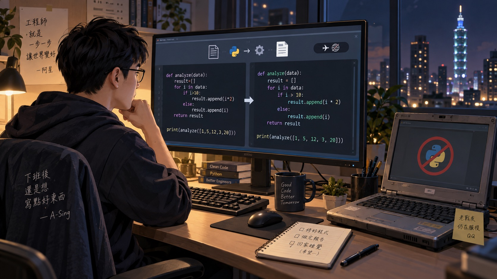
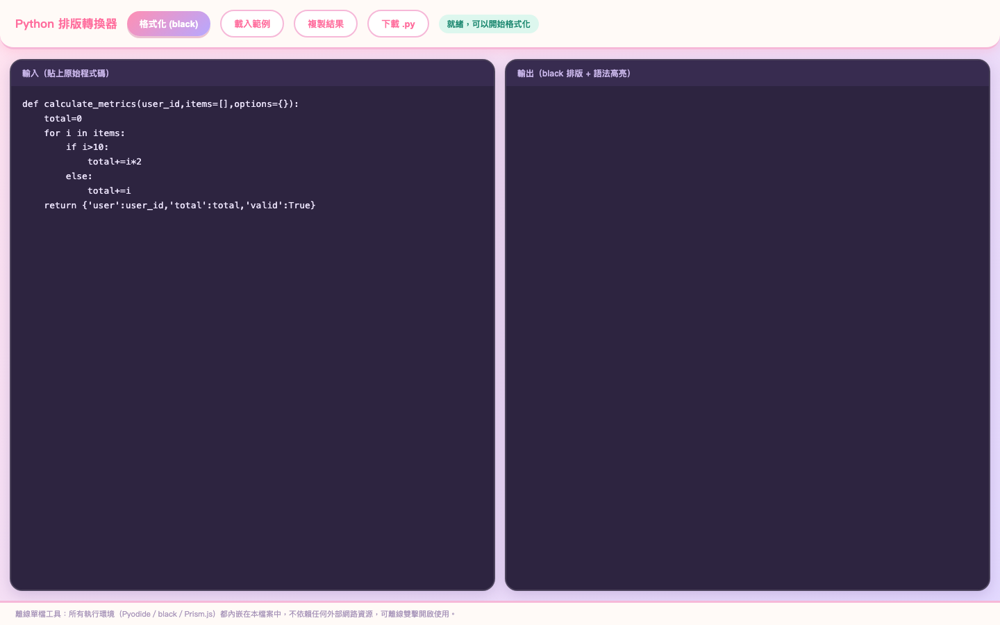
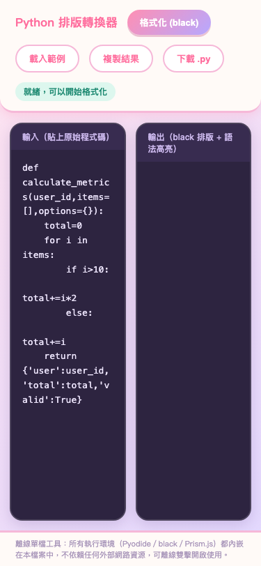

# Day06｜沒有 Python 環境怎麼排版？在瀏覽器塞入 WebAssembly Black

   

👉 [Demo 連結](https://lushinshang.github.io/2026ironman/VibeCoding/Day06_python-code-formatter/index.html)（GitHub Pages 待設定上線，本機直接用瀏覽器開 `index.html` 就能用，不用裝任何東西）



---

## 🏢 一、情境：外包撤場留下一百多支縮排混亂的腳本，公務機卻沒裝 Python

Day05 的可逆去識別化工具剛幫同仁擋下一場個資外洩危機，晚上正準備收拾書包回家，長官突然抱著一台貼滿資產標籤的老舊公務筆電走進辦公室。

「阿星，先別走。外包維護廠商今天正式撤場，交接磁碟裡留了一百多支這幾年寫的 Python 資料處理腳本。但廠商不同工程師寫的風格完全不同，有的用四格空白、有的用 Tab、有些一行寫了兩百個字。長官明天一早要抽查這批腳本的原始碼品質，要求全部符合標準 PEP 8 縮排。」

長官嘆了一口氣，補了一句最要命的限制：「這台公務機跑的是受限環境，既沒有安裝 Python，內網防火牆也禁止連外網打 `pip install`。今晚有辦法在不破壞程式語意的前提下，把這批腳本全部排版整齊嗎？」

我看著那台沒有編譯器、沒有直譯器、也沒有網路權限的老電腦，揉了揉眼睛。如果手動一支支調縮排，今晚肯定不用睡了。

## 💡 二、想法：別逼公務機裝環境，直接把 CPython + Black 打包進 WebAssembly

架構原則依然不變：**單一 HTML 檔案、零伺服器依賴、本機離線雙擊即跑**。既然公務機裝不了 Python，我們就把 Python 搬進瀏覽器。

排版 Python 最權威、最不講人情的工具就是 [Black](https://github.com/psf/black)。它不是用正則表達式猜縮排，而是把程式碼解析成完整的抽象語法樹（AST），再依嚴格規則（88 字元限制、雙引號優先）重新生成程式碼。這樣能 100% 保證程式的邏輯語意分毫不差。

但 Black 是純 Python 套件，要在沒有 Python 的瀏覽器裡跑它，唯一的路徑就是 **WebAssembly（WASM）**。

透過 [Pyodide](https://pyodide.org/)，我們可以把編譯成 WebAssembly 的 CPython 直譯器直接載入瀏覽器記憶體中，再於記憶體內動態載入 Black 的 wheel 套件，直接呼叫 `black.format_str()` 進行運算！

第一道指令先跟 AI 對齊離線架構與依賴封裝：

> 「規劃純前端 Python 離線排版工具，採用 Pyodide (WASM) 於瀏覽器內執行 Black 排版與 Prism.js 語法高亮。注意事項：目標為單一 HTML 檔案，所有 WASM 與 Python 套件必須能離線載入，提供架構假設讓我審查。」

AI 最初提的方案依然是從 CDN 即時拉取 Pyodide，這在斷網公務機上會瞬間癱瘓。於是我追加了第二道指令，把本機離線打包方案釘死：

> 「覆寫 window.fetch 攔截內部請求。將 Pyodide 核心與 Black 套件全部轉為 base64 內嵌進單一 HTML，提供本機 sha256 雜湊核對，確保斷網環境完全獨立可用。」

整個離線 WebAssembly 執行流程如下：

```text
  輸入混亂 Python 程式
        ↓
    瀏覽器記憶體
 ┌──────┴──────┐
 Pyodide      Black
 (跑 WASM)    (排版)
 └──────┬──────┘
        ↓
  AST 語法樹比對重建
   (確保語意不變)
        ↓
   PEP 8 標準程式碼
        ↓
   Prism.js 高亮渲染
```

## ⚔️ 三、過程：19MB 的極限封裝，覆寫 fetch 劫持離線資源

這題是整個系列裡單一檔案體積最大的一支（約 19MB），在封裝與執行時踩過了三個非常硬核的技術坑：

### 1. 覆寫 `window.fetch`：把網路請求無縫導流至 base64 記憶體
Pyodide 在標準設計下，執行 `loadPackage("black")` 時會主動發出 HTTP GET 請求去下載相應的 wheel 檔。但公務機斷網，任何外部請求都會直接噴錯卡死。

解法是在頁面初始化最前端，直接攔截並覆寫原生 `window.fetch`：
- 建置腳本（`build.py`）把 Pyodide 的 `.wasm`、`.asm.js` 以及 Black 依賴的 18 個 wheel 套件全數轉成 base64 字串內嵌在 HTML 內。
- 自訂的 `fetch` 函式收到請求路徑時，直接比對檔名，從 base64 字典裡解碼成 ArrayBuffer 回傳假的 `Response` 物件。
- 這樣一來，底層 Pyodide 完全不知道自己身處斷網環境，如常完成開機與套件安裝。

### 2. AST 語意不變性：杜絕正則排版的致命斷行
為什麼不寫幾十行正則表達式來做字串取代排版就好？

因為 Python 的縮排是語法本體（Indentation is syntax）。如果只是單純 regex 取代，只要遇到括號內多行換行、裝飾器、或是多行字串（docstring），正則極容易改錯縮排導致程式邏輯崩潰。Black 核心透過完整 AST 比對，若格式化後的 AST 與原始 AST 不等價，它會直接拒絕輸出並報錯，這才是公務機自動化批次處理最需要的安全性。

### 3. 本機 SHA-256 完整性防線
單一檔案達 19MB，隨身碟複製或內網傳輸時，使用者往往擔心檔案是否損壞或被動手腳。

我們在建置時同步產出 `python_format.html.sha256` 雜湊檔，並提供了一個極簡的本機驗證工具 `verify.html`。利用瀏覽器原生的 Web Crypto API（`crypto.subtle.digest`）在前端直接計算檔案雜湊，一秒比對是否與官方雜湊吻合，不用在終端機敲指令也能完成完整性校驗。

## 📦 四、結果：桌面雙欄即時排版與 Prism.js 語法高亮，手機直屏也能看

驗收時拿混雜了緊湊運算子、缺空格、長行與亂縮排的 Python 函式進行實測。

桌面版測試結果（1440×900）：



從截圖中可以清楚看見操作成效：
- **標準 PEP 8 轉換**：`calculate_metrics` 函式內的所有等號空格、運算子間距、巢狀 `if/else` 縮排全數精準校正。
- **Prism.js 彩色語法高亮**：排版後的程式碼關鍵字、函式名稱與字串色彩分明，可讀性極高。
- **一鍵複製與下載**：右上方提供一鍵複製與直接下載 `.py` 檔案按鈕，兩秒內就能處理完一支腳本。

手機版直屏測試（375×812）：



手機直屏下編輯區與預覽區垂直堆疊，支援直接在行動裝置上閱讀排版後的程式碼。

## ☕ 五、感想與明日伏筆：腳本排版好了，法務卻拿著兩份修改前後的採購合約走進來……

靠著這支打包了完整 Pyodide + Black 的單一 HTML 檔案，長官在完全沒裝 Python 的老舊公務機上，直接用 Chrome 雙擊打開。

把一百多支混亂腳本依序貼入、一鍵排版、存檔覆蓋，不到四十分鐘，原本被嫌棄像外包學徒練習作的程式碼，全部變成了教科書等級工整的 PEP 8 原始碼。隔天一早長官抽查，滿意地拍了拍同仁的肩膀。

危機解除，我剛泡好一杯咖啡準備回到座位，法務組的同仁突然夾著兩本厚厚的系統採購合約急匆匆跑過來，滿頭大汗：「阿星，要出大事了！廠商剛剛送來合約最終簽署版，宣稱只是微調錯字，但我總覺得條款字數怪怪的。合約有幾十萬字，印出來一頁頁對根本看不出差在哪，萬一廠商暗中改了罰則條款，簽下去公司就要賠幾千萬了！你有辦法用工具幫我抓鬼嗎？」

我看著那兩份密密麻麻、肉眼完全看不出差異的法律合約，放下了咖啡杯：「先別慌，把兩份文字給我，這事我們得精確到字元級別來抓鬼（XD）。」
