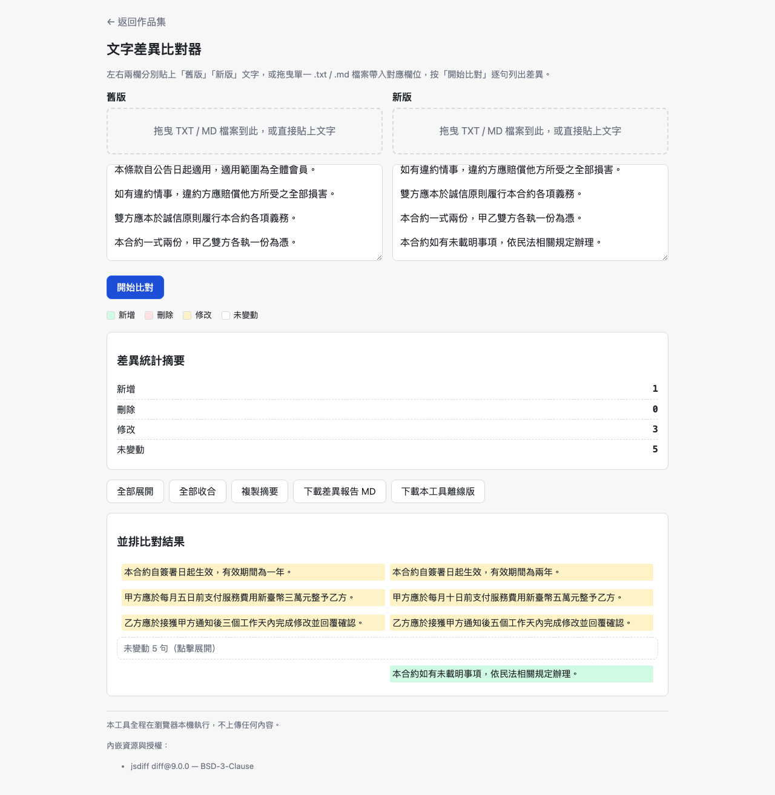
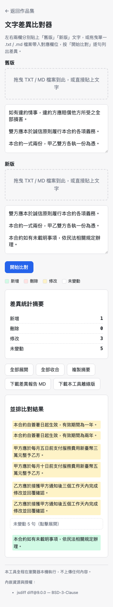

# Day07｜合約簽署前夕廠商暗改條款？雙欄文字差異比對器

   

👉 [Demo 連結](https://lushinshang.github.io/2026ironman/VibeCoding/Day07_text-diff/index.html)（GitHub Pages 待設定上線，本機直接用瀏覽器開 `index.html` 就能用，不用裝任何東西）


---

## 🏢 一、情境：廠商宣稱「只改錯字」，法務卻覺得合約厚度不太對勁

昨晚剛靠著 WebAssembly Black 把一百多支 Python 腳本格式化搞定，今天下午剛泡好咖啡，法務組的同仁就夾著兩大本厚厚的採購合約急匆匆跑過來，滿頭大汗。

「阿星，要出大事了！外包廠商剛剛送來這期千萬級系統採購合約的『最終簽署版』，電話裡口口聲聲說只是順過標點符號跟錯字，叫我們直接蓋章回傳。但我翻閱時總覺得行距跟頁數有些微妙的偏差。這份合約有三十幾萬字，如果印出來拿螢光筆逐行對，對到明天早上也對不完。萬一廠商暗中改了罰則上限或是驗收付款條件，簽下去公司就要承擔幾千萬的風險了！你有辦法用工具幫我抓鬼嗎？」

商業談判上的「微調錯字」，往往是合約暗渡陳倉最常見的手法。機密合約不可能丟到外部的比對網站，唯一的解法是本機離線、雙欄逐句對照。

## 💡 二、想法：純手刻演算法穩死，但這顆依賴我敢不敢升級？

架構原則依然不變：**單一 HTML 檔案、共用模組地基、不架伺服器、100% 本機瀏覽器離線比對**。商業合約屬於一級機密，不能發出任何一包外部請求。

但這題在工程決策上有一個最關鍵的轉折：**文字比對演算法絕不能純手刻**。

如果手刻經典的 Myers Diff 或是 LCS 演算法，光是處理空行、全刪、全增、段落長度不對稱等邊界情況，很容易因為幾處不對齊引發整篇比對的「骨牌式大雪崩」。成熟可靠的做法是內嵌經過全球驗證的開源庫 [jsdiff](https://github.com/kpdecker/jsdiff)。

但內嵌第三方套件，問題就來了：舊版本用的是 `diff@5.2.2`，而官方已經更新到 `diff@9.0.0`，中間歷經兩次重大架構改版。這顆依賴敢不敢升級？

動手前我先下第一道指令，釐清比對粒度與依賴整合邊界：

> 「規劃純前端雙欄文字比對工具，評估內嵌 jsdiff 9.0.0。比對必須以『句子』為最小單位而非字元或行，支援連續未變動摺疊與差異統計。注意事項：先提供架構假設與相依性評估讓我審查。」

我實際用 `npm pack diff@9.0.0` 拆開它的 `dist/` 目錄，確認 9.x 依然保留完整的 UMD bundle，且 `diffArrays` 的比較語意對稱相等，升級後檔案從 53KB 微增至 111KB，但吃到了關鍵的安全性修正。

確認安全後，我追加了第二道指令，把中文合約的分句與配對邏輯釘死：

> 「比對邏輯參數化。僅在空行處切段，段落內以中文標點分句；連續 N 句刪除接 M 句新增時，前 min(N, M) 句視為『修改』並排對齊，連續未變動 ≥3 句自動摺疊。」

整個文字比對處理流程如下：

```text
  輸入舊版與新版合約
        ↓
    段落空行切分
        ↓
  中文句尾標點分句
(。！？；以及段尾)
        ↓
   Diff.diffArrays
  (以句子陣列為單位)
        ↓
  局部配對與變更分級
(新增/刪除/修改/未變動)
        ↓
  雙欄渲染+未變動摺疊
```

## ⚔️ 三、過程：句子級切分防雪崩，不對稱增刪的局部配對法

實作過程中，踩出三個文字比對的實戰坑：

### 1. 句子級切分：防範單一空白引發的全篇雪崩
如果用傳統的「逐行比對」（Line-by-line），中文法律合約經常是一大段長篇大論才一個換行，一旦某一處改了一個字，整整三百字的段落會被全部標成「整段刪除、整段新增」，根本看不出核心差異在哪裡。

反過來，如果用「逐字元比對」（Char-by-char），畫面又會碎成一片片紅紅綠綠的字元雜訊。

最優解是**以「句子」為比對單元**：先以連續換行（`\n\s*\n`）切出段落，段落內部的單一換行正規化為空白，再用正則以中文句尾標點（`[。！？；]`）切分成句子陣列餵給 `Diff.diffArrays`。這樣既能保證比對穩定，又能清楚鎖定改動的條款句子。

### 2. N≠M 的不對稱增刪：局部配對對齊法
在標準 diff 輸出中，只有「新增（added）」與「刪除（removed）」，根本沒有所謂的「修改（modified）」。

當廠商把一段文字改寫時，diff 會吐出一段連續刪除接一段連續新增。如果舊版刪了 3 句，新版新增了 5 句（N=3, M=5），畫面要怎麼排？
- 舊版的粗暴做法是直接分開印，左右欄會完全錯位。
- 新版引入**局部配對演算法**：取 `K = min(N, M)`。前 K 句配對成 K 個「修改」行，左右並排高亮（黃色）；多出來的 `M - K` 句（此例為 2 句）則單獨作為「新增」行（綠色）排在下方。左右兩欄的語意焦點總算對上了。

### 3. 未變動區塊折疊的邊界值陷阱
三十萬字的合約，真正被改動的通常只有幾處，如果全文展開，法務要滾動數十頁才能找到差異點。

工具設計了「連續未變動自動摺疊」。但在規格邊界上，「3 句以上」到底含不含 3 句？三份既有筆記分別寫了「連續 3 句以上」與「≥3 句」。我們在實作中把門檻明確鎖定為**大於等於 3 句（`unchanged.length >= 3`）**即摺疊成一條簡潔的「未變動 N 句（點擊展開）」按鈕，讓法務一打開就能直奔紅黃標記的戰場。

## 📦 四、結果：三萬變五萬一眼抓包，連續未變動自動折疊

驗收時以法務真實遇到的合約修改案例進行實測對照。

桌面版測試結果（1440×900）：



從截圖中可以清楚看見抓鬼成果：
- **微調條款無所遁形**：
  - 「有效期間為一年」➔ 精確高亮被改成「兩年」。
  - 「每月五日前支付新臺幣三萬元整」➔ 被改成「十日前支付五萬元整」！
  - 「接獲通知後三個工作天完成」➔ 被放寬成「五個工作天」。
- **新增條款獨立標綠**：「本合約如有未載明事項，依民法相關規定辦理」被精準列為新增項目。
- **未變動 5 句自動摺疊**：中間未修改的制式法規條款整齊收合為單行按鈕，視覺焦點極其乾淨。

手機版直屏測試（375×812）：



手機直屏下雙欄自動調適為上下對照卡片，隨時隨地都能快速核對差異。

## ☕ 五、感想與明日伏筆：合約抓完鬼，財務部卻端來一箱 Big5 亂碼的 CSV……

看著螢幕上那幾條被黃底標註得無所遁形的條款，法務同仁倒抽了一口涼氣：「金額從三萬偷改成五萬、合約期延長一年、連履約工作天都放寬了……廠商還真的以為我們看不出來！」

法務立刻拿起電話，冷靜地向廠商主管要求針對這三處「非錯字修改」出具正式說明。半小時後，廠商業務主管親自打電話道歉，承諾立刻換回合約標準版——一場差點讓公司賠上幾千萬的合約糾紛，就這麼解決了。

法務同仁鬆了一口氣，拍拍我的肩：「阿星，這次真的多虧你了。」

我正笑著說不客氣，財務部主管突然神色慌張地敲門進來，身後跟著兩個提著硬碟的助理：「阿星，稽核今天突然進駐查帳，要求我們立刻匯出這五年全部的歷史交易報表。但我們的舊系統匯出來的 CSV 全是 Big5 編碼，在 Excel 打開全部是問號亂碼；有些欄位引號沒閉合，欄位直接噴飛幾十格；甚至有些摘要欄位開頭寫著 `=cmd|`，一打開防毒軟體就狂叫報毒！下班前要是生不出一份乾淨正常的 CSV，整個部門都要被記重大稽核缺失了！」

我看著那幾十萬行混雜著亂碼、破損引號與惡意公式的災難 CSV，深吸了一口氣：「好，看來明天我們要來開一間『CSV 急診室』了（XD）。」
