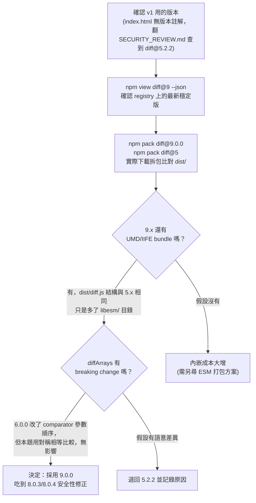
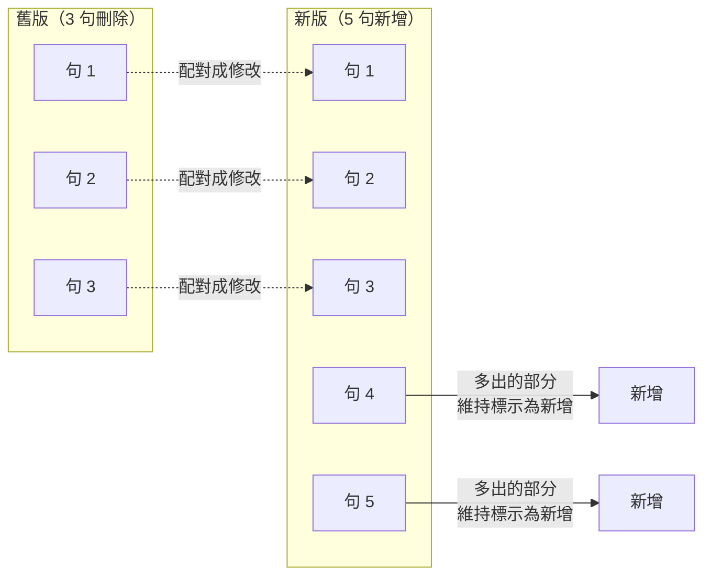
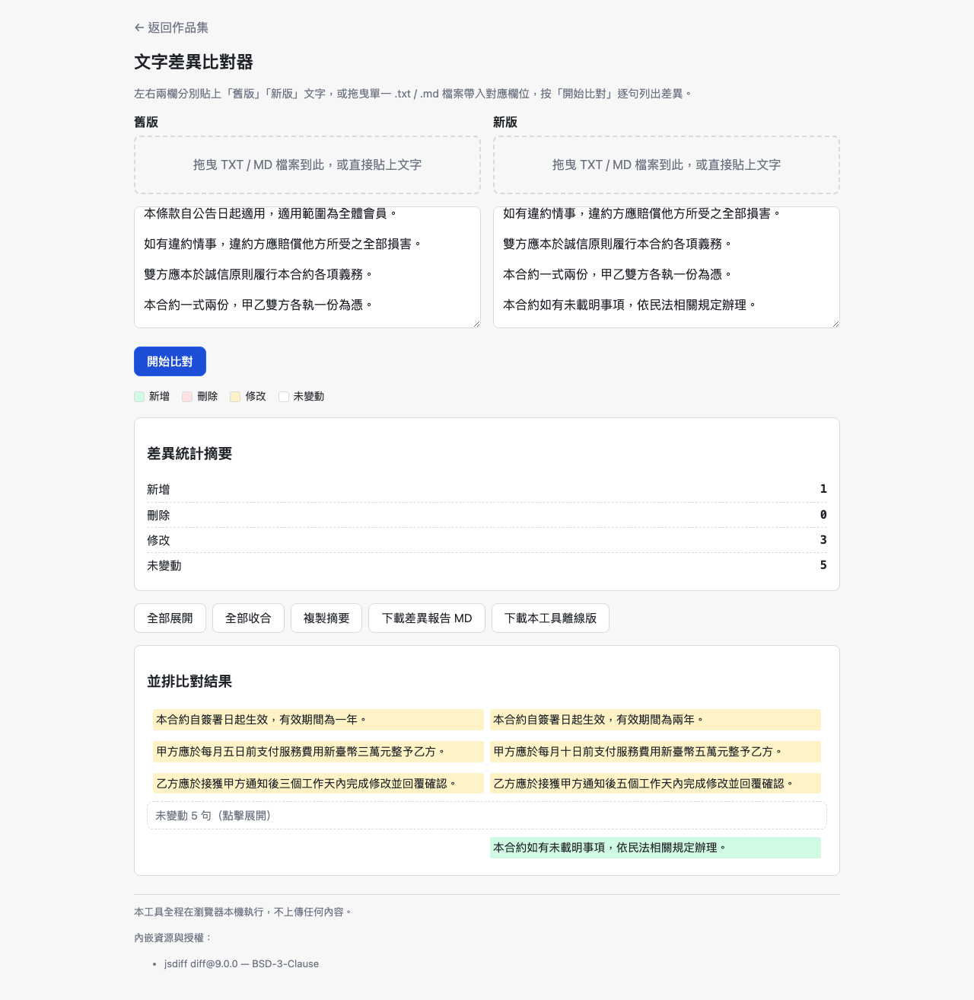
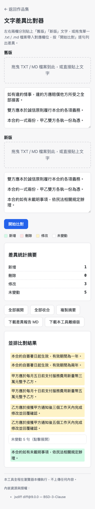

# Day07：文字差異比對器——這題不談規格怎麼寫清楚，談要不要升級一個依賴

`Level 1a` `text-diff` `jsdiff BSD-3-Clause` `按鈕觸發`

👉 [線上試用](https://<GITHUB_USER>.github.io/2026ironman/VibeCoding/Day07_text-diff/index.html)（已用 `curl -sI` 實測回 `HTTP/2 200`）

---

## 目錄

- [情境](#情境)
- [解題思路](#解題思路)
- [資源](#資源)
- [Vibe 過程](#vibe-過程)
- [產品](#產品)
- [心得與反思](#心得與反思)

---

## 情境

Day01 到 Day06 的六篇文章，主軸都在「怎麼把一句模糊的需求，寫成 AI 跟人都不會誤解的規格」。Day07 不一樣。

這題是目前 Level 1a 唯一需要**內嵌第三方 JS library** 才能穩定運作的題目。純手刻 LCS / Myers diff 演算法，要處理空輸入、全刪、全增、句數不等長這些邊界情況，穩定度打不過成熟函式庫；但一旦決定要內嵌，問題就從「規格寫不寫得清楚」變成「這顆依賴，我敢不敢升級」。

v1（原 Day3，因系列重新分類移到 `old/Day7`）用的是 `diff@5.2.2`，而且這個版本號**沒有寫在程式碼裡**——內嵌進 `index.html` 的 UMD bundle 連版本註解都沒留，要回頭翻 `SECURITY_REVIEW.md` 才查得到。npm 上現在最新是 `9.0.0`，中間隔了 `6.0.0` 與 `8.0.0` 兩次 breaking change。這篇文章想記的，就是「版本要不要升」這個決定是怎麼做出來的——不是查文件猜，是真的把兩個版本的套件下載下來拆開比對。

## 解題思路

MVP 沿用 v1 的核心邏輯（詳見 `sdd/text-diff/PRD.md`，編號 PRD A2）：

1. 雙欄輸入 + 拖曳讀檔（左「舊版」右「新版」）
2. 逐句斷句：先依空行切段落，段落內單一換行正規化為半形空白後再依中文句尾標點分句
3. 用 `Diff.diffArrays` 對兩份句子陣列比對，把連續刪除接連續新增的區段配對成「修改」
4. 並排顯示，連續未變動 ≥3 句摺疊
5. 差異統計摘要、複製、下載 MD

比較特別的是升級 jsdiff 的判斷流程：



決定升級後，代價很清楚：未壓縮 bundle 從 53.7KB 增為 111.3KB，換到的是安全性修正而非新功能。

第二個要定案的是規格裡三處含糊的地方，`tasks.md` 原本三份文件（PRD、proposal、tasks）用詞不完全一致，開發前先統一：

- **分段規則**：原文寫「段落切分（`\n\s*\n` 或單一 `\n`）」——「或」到底是兩者都算段界，還是二選一？定案：只有空行才切段，段落內部的單一換行正規化為半形空白，不當段界。
- **摺疊門檻邊界值**：三份文件分別寫「連續 3 句以上」「連續 ≥3 句」「3 句以上」，「以上」含不含 3 剛好落在邊界上。定案統一寫成「≥3 句（達到 3 句本身就觸發）」。
- **N≠M 的配對規則**：連續 N 句刪除接 M 句新增，且 N≠M 時怎麼配？

第三點最容易講不清楚，畫成圖：



規則：依出現順序第 i 句配第 i 句，配到 `min(N, M)` 對算「修改」，多出的部分排在配對區段之後，仍標原本的刪除或新增。

## 資源

- 演算法：內嵌 [jsdiff](https://github.com/kpdecker/jsdiff)（`diff@9.0.0`，**BSD-3-Clause** 授權），只用 `diffArrays` 與 `diffChars` 兩個匯出函式
- 共用模組：`shared/io-dropzone.js`（拖曳讀檔）、`shared/io-download.js`（下載）、`shared/io-clipboard.js`（複製）、`shared/util-escape.js`（HTML escape）、`shared/ui-toast.js`（提示）
- 版本查證方法：`npm view diff@9 --json`、`npm pack diff@9.0.0` / `npm pack diff@5` 實際下載拆包、`diff` 指令逐行比對 `lib/diff/array.js` 與 `libcjs/diff/array.js`
- v1 參考：`VibeCoding/old/Day7/README.md`、`VibeCoding/old/Day7/SECURITY_REVIEW.md`（v1 版本佐證出處，`index.html` 本身沒留版本字串）

## Vibe 過程

這題的對齊落差，主要不在「AI 有沒有聽懂我的話」，而在**規格文件之間互相不對齊**——三份文件（PRD、proposal、tasks）對同一件事寫了三種措辭，是典型的「表達 ↔ 表達」層級的落差，得靠逐條核對才抓得出來。

第一個落差：斷句規則的「或」字。`tasks.md` 早期版本寫「段落切分（`\n\s*\n` 或單一 `\n`）」，字面上讀起來像是「這兩種都算段界」，但如果真的照字面實作，一份正常散文只要出現手動折行就會被切成一大堆假段落，摺疊功能形同虛設。回頭核對 PRD 的完整敘述才確認：真正的意思是「先用空行切段，段落內部的單一換行不算段界，只是正規化掉」。這是先寫清楚再動手才抓到的落差，不是實作完才發現。

第二個落差，也是最大的一個：**規格在開發途中被改了**。實作到一半，共用層契約（`CONTRACT.md`）追加了幾條新規定——`LICENSES` placeholder 從建議變成有外部資源時的**強制項**（缺就中止建置）、`escape_mode` 從有預設值變成必填、資源名限制要符合合法 JS 變數名規則、`buildCleanHtmlCopy()` 要多清空一個元素。這不是我自己改的，是共用層在多題並行開發時同步演進。這件事誠實記錄下來：**規格不是寫完就凍結的**，尤其是多人／多 agent 協作，共用契約隨時可能因為別的題目踩到坑而補規則，這一題剛好接在後面收下這些新規定。

第三個落差，是 v1 留下的一個缺口，這次用工具鏈結構性補掉：v1 完全沒有把 jsdiff 的授權標示在 PRD、README 或頁面任何地方（同系列 v1 的繁簡轉換那題有標 OpenCC 授權，Day3/Day7 這題偏偏漏了）。這不是「這次比較細心記得補」，而是 v2 的 `bundle.py` 建置腳本直接把這條規則寫死：模板缺 `<!--{{LICENSES}}-->` placeholder、或資源缺 `license` 字串，建置直接中止，不是 lint 警告，是 exit non-zero。把「記得標授權」從人的自律，變成建置流程擋不過去的門檻——這是第三、四層對齊（AI 規劃 ↔ 藍圖、規格 ↔ 實際產品）能穩定達成的原因：靠制度而非記性。

版本升級決策本身，反而是這次對齊最順的一段——因為方法從一開始就定調成「不查文件猜、直接下載拆包看」，`npm pack` 兩個版本、`diff` 逐行比對原始碼、讀套件內附的 `release-notes.md`，每一步都有留下具體證據（見 `sdd/text-diff/proposal.md` 的查證表格），沒有靠印象或訓練資料裡的舊知識做判斷。

## 產品

實際操作畫面（本機 Playwright 開獨立瀏覽器實例拍攝，非共用 MCP 連線）：



示範資料是一段模擬合約條文，舊版 8 句、新版 9 句：前 3 句內容相近但數字被改了（一年→兩年、三萬→五萬、三個工作天→五個工作天），畫面正確標成 3 處「修改」（黃底）；中間 5 句完全沒改，摺疊成一行「未變動 5 句（點擊展開）」；新版結尾多加一句，標成「新增」（綠底）。統計摘要同步顯示新增 1／刪除 0／修改 3／未變動 5，與畫面內容一致。

手機版（375×812）驗證同一組資料在窄螢幕下的並排比對可讀性：



頁尾可見處渲染授權標示：

```
內嵌資源與授權：
jsdiff diff@9.0.0 — BSD-3-Clause
```

輸出 HTML 頂端也有機器可讀的建置註解：

```
<!-- BUNDLED: jsdiff@diff@9.0.0 (BSD-3-Clause) sha256:5773c7efb34715bb built 2026-08-23 -->
```

線上版本：👉 [https://<GITHUB_USER>.github.io/2026ironman/VibeCoding/Day07_text-diff/index.html](https://<GITHUB_USER>.github.io/2026ironman/VibeCoding/Day07_text-diff/index.html)

## 心得與反思

回扣四層對齊框架：

- **想法 ↔ 表達**：這題的表達層落差不是我自己口述需求時漏講，而是三份既有規格文件（PRD／proposal／tasks）彼此用詞不一致，逐條核對後才統一。啟示是：規格文件之間的一致性，本身就需要被檢查，不能假設「都寫過了」等於「都寫得一樣」。
- **表達 ↔ AI 理解**：版本升級的查證過程，刻意不讓 AI 憑訓練資料裡的舊印象回答「jsdiff 9.x 大概還能用」，而是要求它實際 `npm pack` 下載、拆包、逐行比對。這一層對齊靠的不是講清楚，是要求可驗證的證據。
- **AI 規劃 ↔ 腦中藍圖**：授權標示是最能體現這層的例子。v1 的藍圖裡本來就該有「使用第三方函式庫要標授權」這件事，但 v1 沒做到，是規劃時的疏漏。v2 沒有靠「這次記得提醒」解決，而是把它變成建置腳本的強制檢查，讓藍圖與規劃之間的落差，從「靠自律對齊」變成「靠工具擋不過去」。
- **規格 ↔ 實際產品**：開發途中共用契約被改了三、四條，這是規格本身在過程中位移，不是產品偏離規格。誠實記錄下這個事實，而不是假裝規格從頭到尾都沒變過，是這一節最想強調的——多 agent／多人協作下，「規格先行」不代表「規格永遠不動」，重要的是每次變動都留下痕跡可追溯。

這題另外印證一件事：不是每一次踩坑都值得重新踩一遍。v1 花了好幾輪（Round 1 到 Round 4）處理真實 280 頁 PDF 文件才發現的斷句顆粒度、配對錯位等問題，這次 MVP 階段直接不碰——那些是「驗收通過後拿真實文件實測才發現要修」的精修，不是這一輪 SDD 流程的範圍。已經知道解法的坑，不需要為了寫文章而假裝重新發現一次。

---

**未驗證項目誠實揭露**：jsdiff 9.0.0 在瀏覽器（非 Node）環境下 `diffArrays`／`diffChars` 的執行結果，查證階段僅靠原始碼比對與 UMD wrapper 結構核對，並非瀏覽器實測；瀏覽器實測是在後續 `bundle.py` 建置產物驗收階段（也就是本文附的截圖）才做的，兩者屬於查證流程的不同階段，如實分開記錄。
