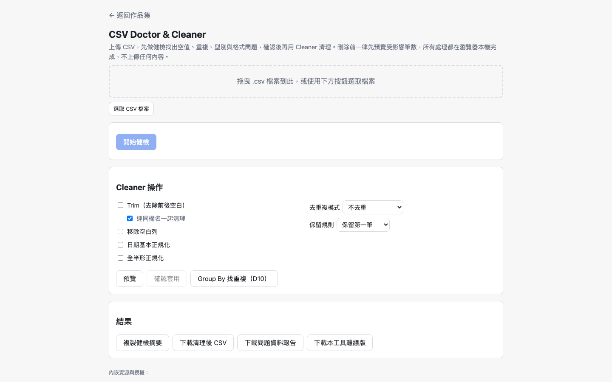
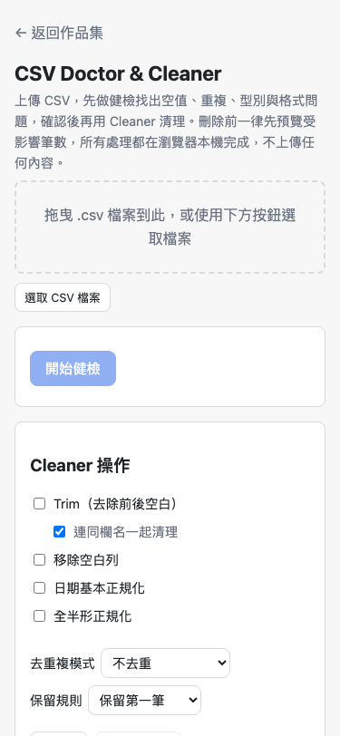

# Day 08：CSV 急診室——當 Parser 的「貼心修正」成了健檢的隱形殺手


## 1. 情境：辦公室的 CSV 災難日常

「阿星，業務部傳來的業績清冊，我用 Excel 打開全部變亂碼，而且第 450 列之後整個欄位都大挪移了……下班前要交報告，救命啊！」

週五下午四點，這類呼救聲在辦公室裡早已見怪不怪。在企業日常裡，CSV 檔就像是資料傳遞的通用貨幣，卻也是最脆弱的易碎品：

- 從舊系統匯出的檔案帶著 Big5 編碼，直接點開就是滿螢幕問號與黑框。
- 某個業務在備註欄填了換行，結果引號沒閉合，一整列硬生生被腰斬成兩半。
- 人工貼上的資料夾帶了肉眼難辨的全形空白、民國年與西元年混雜，甚至有人把文字硬塞進金額欄。

每個人遇到這類爛資料，第一反應往往是「丟給線上工具修一下」。但我一看同仁正準備把整份客戶名單貼進某個不知名的免洗工具網站，冷汗立刻冒了出來。資料上雲意味著資安外洩，但要在每台電腦裝一套 Python 或複雜環境又極不現實。

我們需要一個**零伺服器、純離線、單一 HTML 檔案就能在瀏覽器運作的「CSV 急診室」**。只要把檔案拖進去，不用一秒就能照出所有隱藏病灶，還能一鍵安全清洗。

---

## 2. 想法：反其道而行的 Parser 哲學

做這個工具的第一直覺，是找一個成熟強大的 CSV 解析套件。但當我和 AI 坐下來梳理架構時，卻撞上了一個反直覺的死角：**一般 Parser 引以為傲的「貼心修正」，在急診室裡全都是謀殺病徵的毒藥**。

一般的 CSV 套件在解析資料時，通常會做這些貼心舉動：
- 發現欄名重複？自動幫你改名成 `name_1`、`name_2`。
- 發現某一列缺了兩格？自動在尾端補齊空字串。
- 發現格子前後有空白？自動幫你 `trim()` 乾淨。
- 發現看起來像數字？自動把 `"123"` 轉型成純數字 `123`。

在一般資料管線裡，這些自動修復省時又省心。但 Day 08 的核心價值是「健康檢查」，我們要抓的病症偏偏就是：欄名重複、欄數不一致、前後帶空白、數值欄混入文字。

如果 Parser 在底層先把資料擦乾淨了，後端的診斷器看到的只是一張完美無瑕的表，等同於病灶在上游被默默抹平。

```text
常見 Parser 貼心修復
--------------------
1. 重複欄名自動改名
2. 欄位短缺自動補齊
3. 前後空白自動移除
4. 數值字串自動轉型
        |
        v 上游默默抹平
--------------------
急診室健檢全數失效
--------------------
欄名重複(D4) -> 消失
欄數不齊(D3) -> 消失
偷藏空白(D6) -> 消失
文字混入(D5) -> 消失
```

因此，我們為底層制定了一份嚴格的資料契約：**「忠實還原，不修正、不猜測、不轉型」**。
每一格讀出來都是原始字串；短列絕對不自動補齊；`line` 紀錄的是檔案實體行號而非邏輯列序（因為引號內的換行會跨行）。

我們定義了十項健檢指標（D1 至 D10）：從最基本的空值、空白列、欄名衝突，到全半形混用、日期格式不一致、整列重複等。而在 Cleaner 清理端，我們同樣克制：只提供沒有歧義的客觀清理（去前後空白、刪除整列全空行、日期統整、移除完全重複列），絕不自作聰明替使用者「自動填補空值」或「猜測欄位定義」。

---

## 3. 過程：各自合理的規則，交界處迎面對撞

架構定案後，我們立刻進入規格實作。原以為只是一組規則比對，沒想到底層契約在真實邊界上狠狠摔了兩次跤。

### 痛點一：短列缺的那一格，在記憶體裡到底是什麼？

資料契約裡寫明了兩條看似天經地義的守則：
1. **短列不自動補齊**：如果標頭有三欄，資料列只有兩格，陣列長度就只能是 2。
2. **空值只有空字串**：系統內一律以 `""` 代表空值，避免 `null` 與 `undefined` 造成歧義。

這兩條規則各自獨立存在時都無比正確，直到它們在實務代碼中相遇：

```javascript
// 檔案標頭：a,b,c
// 資料列：1,2 （短列）
const cells = parseCsv('a,b,c\n1,2\n').rows[0].cells; // ["1", "2"]
console.log(cells[2]);         // undefined！
console.log(cells[2] === '');  // false！空值檢查整批漏抓
console.log(cells[2].trim());  // Uncaught TypeError: Cannot read property of undefined！
```

因為短列沒有被補齊，讀取 `cells[2]` 時 JavaScript 給了我們最原始的 `undefined`。結果診斷器拿它跟 `""` 比對，判定這格「不是空值」；緊接著下一步清理邏輯呼叫 `.trim()`，整頁直接拋出 `TypeError` 白畫面崩潰！

這就是典型的「個別邏輯皆合理，邊界交會出漏洞」。我們不能退回自動補齊的老路（否則就違背了誠實反映檔案結構的初衷），最終解法是封裝一個安全的讀取閘門：

```text
parseCsv 讀到短列
表頭 a,b,c 資料 1,2
        |
        v
 cells = ["1","2"]
        |
   +----+----+
   |         |
直接讀取    改用
cells[2]    cellAt()
   |         |
   v         v
undefined   安全回傳 ""
   |         |
漏抓空值    正確命中
.trim()崩潰 運算穩定
```

所有工具嚴禁直接讀取 `row.cells[i]`，一律透過 `cellAt(row, i)` 取值。底層陣列保持短列原貌，讓長度比對維持真實，讀取時則確保永遠拿到空字串。

### 痛點二：空白列到底算不算欄數不一致？

另一個在驗證時浮現的摩擦是空白列。一個完全空白的行，Parser 切割出的 `cells` 長度通常是 1（包含一個空字串 `[""]`）。如果按照邏輯比對「標頭有 5 欄，這一行只有 1 欄」，系統就會將它判定為「D3 欄數不一致」。

但對於使用者來說，「整行全空」和「資料填一半漏填兩欄」是截然不同的問題。把空白列跟短列混在一起，只會讓真正的欄位偏移病灶被大量空白雜訊淹沒。

我們因此在契約中追加防線：**全空白列直接由 D2（空白列指標）專門接手，D3（欄數不一致）強制排除全空白列**。兩項指標各司其職，互不干擾。

### 痛點三：日期異常與非日期值的概念界定

在實作 D8 日期檢查時，AI 一開始將其簡化為「只要不是合法日期就報錯」。但在深入探討後，我們發現使用者在面對日期欄時，痛苦來自兩個完全不同的層次：

1. **非日期值（資料損壞）**：日期欄裡居然夾雜著 `"暫無"`、`"待補"` 甚至是金額數字，這是根本上的資料污染。
2. **格式不一致（風格混亂）**：整欄都是合法日期，但有人寫 `2026/01/05`、有人寫 `2026-1-5`、還有人寫 `20260105`。

我們最終將 D8 拆成兩個獨立子項：第一子項清點「完全不符合標準白名單」的壞資料；第二子項則採「多數決統計」，自動找出該欄最普遍的日期格式，將少數不同風格的資料列為格式異常。這讓使用者在清洗資料時，能一鍵將全欄格式整齊劃一，而不會粗暴地誤殺有效日期。

---

## 4. 結果：桌機與手機雙端操作成果

經過多輪驗收與調校，這個單一 HTML 檔案的 CSV 急診室完全落地。不管丟入幾萬列的雜亂檔案，瀏覽器本機端都能在數百毫秒內解析完畢並產出完整健康報告。

### 桌面端展示

在寬螢幕上，上方以儀表板清爽列出十項指標的健康燈號，下方直接支援視覺化資料修復與匯出：



### 行動端展示

在窄螢幕環境下，介面自適應折疊為垂直卡片流，即使在手機或平板上也能順暢檢視檔案病灶：



---

## 5. 感想與明日伏筆

完成 CSV 急診室後，我把這個單檔丟給了經常在各系統間搬運資料的幾位同事，辦公室裡那種抓狂的求救聲瞬間少了許多。

這次開發最有感的一課是：程式碼的「貼心」有時候反而是診斷的絆腳石。平常寫系統我們習慣自動防呆、自動補值，替使用者把坑都填平；但這次的任務剛好相反——要的就是那些坑，填平了就等於白做工。不猜測、不越權，資料長什麼樣就照實秀出來，這才是「健檢」該有的態度。

看著大家把一份份格式混亂的 CSV 修理得整整齊齊，我正準備端起咖啡享受片刻寧靜。

這時，人資主管神色凝重地快步走進辦公室，把門悄悄關上：

「阿星，剛才系統好像出了點意外……我們發現上個月跟這個月兩份各有五萬列的員工薪資清冊裡，有人疑似偷改了某些同仁的職等與加給。Excel 兩份表打開眼睛都要花了，而且有些列順序根本跳掉了，根本沒辦法用肉眼抓鬼。有沒有辦法在不把薪資上傳到外部伺服器的情況下，精準抓出所有被改動的格子？」

辦公室裡的資安守門員任務，看來才剛進入深水區。
