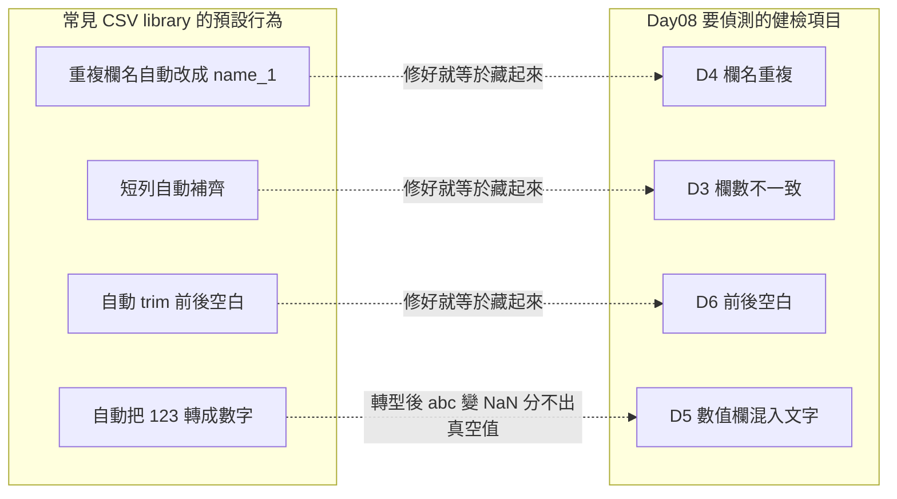
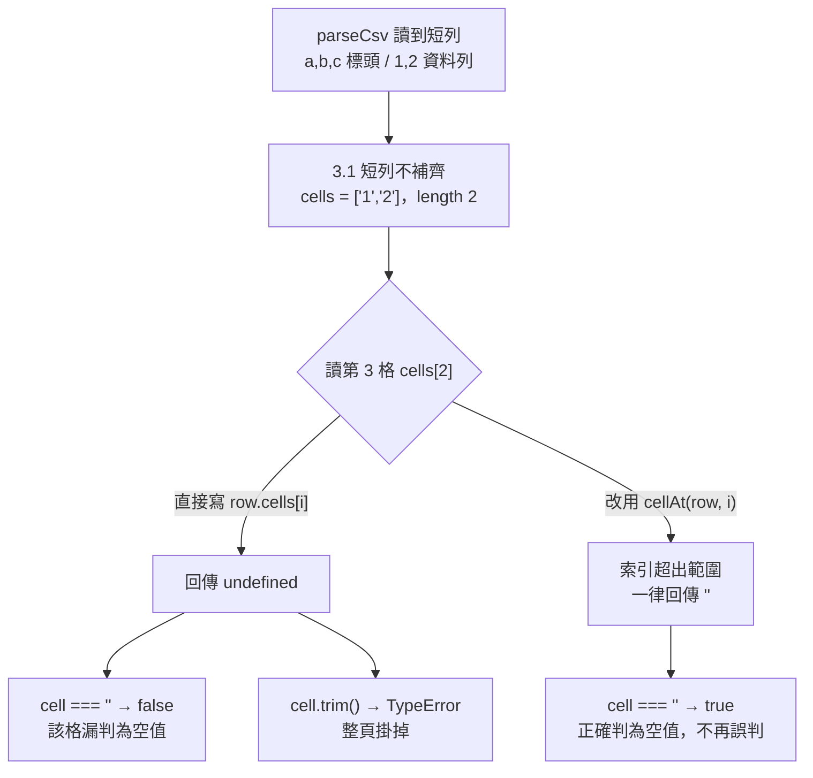
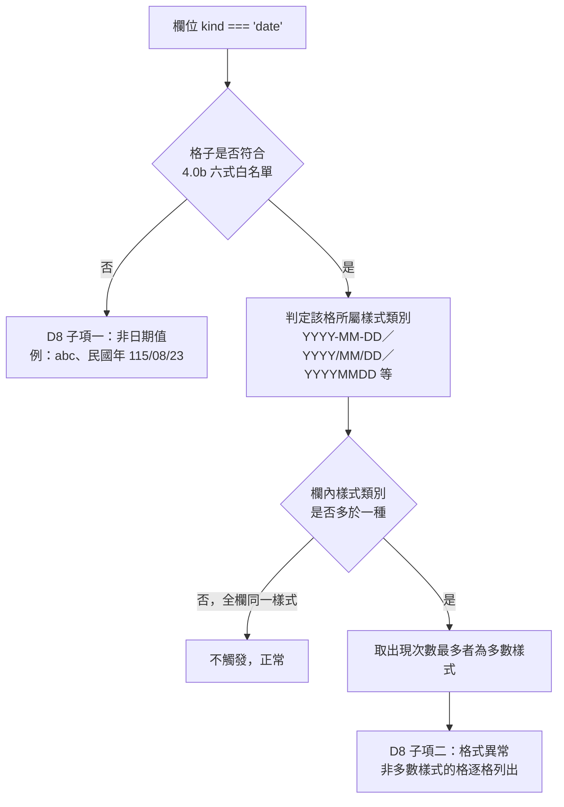

# Day08：CSV Doctor & Cleaner——一份「不做貼心修正」的 parser，把好意見誤判成缺陷

`功能` `#Level1b` `#CSV` `#資料層契約` `#SDD`

👉 [情境](#情境) · [解題思路](#解題思路) · [資源](#資源) · [Vibe-過程](#vibe-過程) · [產品](#產品) · [心得與反思](#心得與反思)

---

## 情境

Level 1a 七題全是純字串處理，沒有外部 library、沒有共用資料層。Day08 開始的 Level 1b 五題全部繞著 CSV 打轉，第一次需要五題共用同一套 parser——這代表 parser 的行為只要有一絲模糊，五題會各自長出五種解讀，後面四題（`csv-period-diff`、`csv-batch-splitter`、`csv-pivot-dashboard`、`csv-one-page-report`）全部得跟著歪。

於是這一批不是先寫某一題，是先花一整輪把 `shared/CSV_CONTRACT.md` 定案，再讓 Day08 當第一個吃這份契約的題目。而 Day08 本身又是這五題裡最特殊的一個：它的產品價值不是「處理 CSV」，是「找出 CSV 裡的髒東西給人看」——空值、重複列、欄名衝突、日期格式亂七八糟。這個定位聽起來單純,但它逼出一個反直覺的結論：市面上大多數 CSV library 引以為傲的「貼心行為」，在這題全部變成必須關掉的功能。

---

## 解題思路

### parser 的「優點」為什麼在這題是缺陷

常見 CSV library 的預設行為是：自動把重複欄名改成 `name_1`、自動把短列補齊、自動 trim 前後空白、自動把 `"123"` 轉成數字。這些行為在一般的資料處理情境下省事又貼心。

但 Day08 的健檢項目正好就是：欄名重複（D4）、欄數不一致（D3）、前後空白（D6）、數值欄混入文字（D5）。如果 parser 自己先把這些修好了，Doctor 打開資料時看到的已經是一份乾淨表格，等於偵測目標被上游默默清空。`CSV_CONTRACT.md` 第 2 節把這句話寫得很直白：「如果 parser 自作主張把這些修好了，Day08 就沒有東西可以偵測。」

所以契約定的規則是「忠實還原，不修正，不猜測，不轉型」——每一格都是字串、短列不補齊不丟棄、重複欄名不改名、`line` 記的是原始檔案行號而非列序（因為引號內換行會讓一列跨多行）。這條原則不是 Day08 自己加的規矩，是整份契約的核心，Day08 只是第一個把它用到極致的題目。



### 十個健檢項目，判定規則寫死不留模糊

Doctor 一次跑十項：空值（D1）、空白列（D2）、空白欄（D2b）、欄數不一致（D3）、欄名重複（D4）、數值欄混文字（D5）、前後空白（D6）、全半形混用（D7）、日期格式異常（D8）、整列重複（D9）、Group By 找重複（D10）。`proposal.md` 把每一項的判定式寫到可以直接照抄實作的程度，例如 D9 整列重複不是「內容看起來一樣」，是 `cells.join('\0')` 組 key 逐格 `===` 比對，理由是 `\0` 不會出現在 CSV 文字內容裡，能避免 `["a,b"]` 與 `["a","b"]` 這種邊界誤判。

Cleaner 這邊刻意收斂：只提供有明確對應動作的修正（Trim、移除空白列、日期正規化、全半形正規化、去重複），故意不提供「自動填空值」「自動改重複欄名」「自動轉型」——因為這些動作沒有唯一正確答案，做了就是系統代替使用者猜。這條界線跟 parser 那條「不做貼心修正」的原則是同一種立場，只是換了一層。

---

## 資源

- 規格：`sdd/csv-doctor/proposal.md`、`tasks.md`（10 條任務）
- 共用契約：`VibeCoding/shared/CSV_CONTRACT.md`（第 2、3、4、5 節）、`VibeCoding/shared/CONTRACT.md` 第 6 節（Level 1 共通 UI 基線）
- 前置工程：`sdd/csv-infra/`（`csv-decode.js`／`csv-parse.js`／`csv-write.js`／`csv-types.js`，Papa Parse 5.6.0、fflate 0.8.3）
- 建置腳本：`scripts/bundle.py`

---

## Vibe 過程

這一批（Day08 與 Day09）由 sonnet subagent 併行實作，指揮官獨立複驗。這題最值得記的不是實作過程本身——commit message 裡沒有留下逐行的心路歷程——而是**契約在被寫出來之後，被兩輪獨立驗收接連挑出內部矛盾**，這些矛盾直接決定了 Day08 能不能正確運作。

### 契約自己撞出來的矛盾：短列缺的格到底是什麼

`CSV_CONTRACT.md` 第 3.1 節規定「短列不補齊」，第 3.2 節規定「空值只有空字串，沒有 `null`、沒有 `undefined`」。這兩條規則各自看都合理，但沒人一開始想過它們會在同一個地方打架：一列如果比表頭少一格，那一格讀出來到底是什麼？

2026-08-23 的獨立驗收實測給出答案：`undefined`。後果是連鎖的——`cell === ''` 判斷會把 ragged 列的空缺格整批漏判為「不是空值」，而 `cell.trim()` 直接 `TypeError`，整頁掛掉。這不是理論推演，是契約 commit（`8da81e7`）裡寫明的實測結果：

```js
parseCsv('a,b,c\n1,2\n').rows[0].cells      // ["1","2"]，length 2
  .cells[2]            // undefined
  .cells[2] === ''     // false  ← Day08 的空值判定會整批漏掉 ragged 列
  .cells[2].trim()     // TypeError，整頁掛掉
```

裁示是加一個 `cellAt(row, i)`——索引超出範圍一律回傳 `''`，五題不得直接寫 `row.cells[i]`。`cells` 本身維持不補齊（這樣 `length` 跟 `raggedRows` 才誠實），但讀取一律經過 `cellAt()`。這是「兩條各自正確的規則交界處對撞」的典型案例，不是誰寫錯了，是規則之間的邊界一開始沒人算到。



同一輪驗收還抓到另一個容易漏的細節：檔案中間的空白列，`cells` 是 `['']`、長度 1——如果不特別排除，會被誤判成「欄數不一致」（D3），把 D3 這個訊號跟空行噪音混在一起。契約補上「空白列不算 ragged」，D2（空白列）與 D3（欄數不一致）各自獨立判定、互不覆蓋。

### 這系列第六次「字面上不可能通過」的驗收條件

Level 1b 提案階段的獨立驗收（`codex exec -s read-only`）跑了十一輪才收斂，其中一類缺陷專門打在驗收條件本身：條件寫得看起來合理，但字面上根本不可能通過。`CONTRACT.md` 第 6 節後來記了六個這樣的實例，其中一個直接命中 Day08 的離線版測試：驗收條件原本要求「離線版原始碼 grep `.nav-back` 為 0 筆」，但 `base.css` 本身就含 `.nav-back` 的樣式規則，這條 CSS 規則會被 `bundle.py` 內嵌進產物，grep 永遠會命中，這條驗收條件字面上不可能通過。

`shared/ui-toast.js` 也有同樣的問題——`__shared_toast` 這個字串本來就寫在程式碼裡（`ui-toast.js:4,7`），單純 grep 原始碼永遠會命中。裁示改成「原始碼 grep 判定」跟「DOM 層判定」分開、不可混用：`ZZDOCVAL`／`ZZDOCCOL` 這種哨兵值可以用原始碼 grep（正常情況下不可能出現在程式碼裡），但 `#__shared_toast` 元素是否存在、`.nav-back` 元素是否還在畫面上，得用 Playwright 載入實際 DOM 斷言，不能用 grep。這一條後來也真的用在 Day08 的離線版測試上——`f7b72ff` 的複驗記錄顯示上傳含哨兵 CSV、健檢、下載離線版之後，`ZZDOCVAL`／`ZZDOCCOL`／檔名全 0 筆、`toast===null`、`nav-back=0`，是照這條修正後的驗收方式測出來的。

### 「日期格式異常」不等於「不在白名單」

D8 這一項在 `proposal.md` 裡特別花篇幅重新定義，因為第一直覺很容易把它跟「D5 數值欄混文字」的邏輯套進去——欄位是日期欄、格子不符合日期格式就算異常。但契約規定「不在白名單」跟「格式異常」是兩個不同性質的問題：前者是資料錯誤（例如日期欄裡混了一格 `"abc"` 或民國年 `115/08/23`，這種完全不符合六式白名單的值），後者是格式一致性問題（欄內每一格都合法，只是樣式不統一，例如同一欄同時有 `2026/01/05` 跟 `2026-1-5`）。

`proposal.md` 把這兩者拆成獨立子項：子項一（非日期值）直接用 `inferColumnTypes()` 回傳的 `mismatchLines`；子項二（格式異常）要先對欄內符合白名單的格逐一分類樣式（`YYYY-MM-DD`、`YYYY/MM/DD`、`YYYYMMDD` 等六式，`-` 與 `/` 視為同一大類），取出現次數最多的樣式當作該欄多數樣式，其餘樣式的格才列為格式異常。兩個清單分開呈現，不合併成一份。



### 素材不足的部分，誠實標記

這一輪 commit（`f7b72ff`）是 Day08 與 Day09 併行完成後的單一大 commit，訊息集中記錄兩題共通的複驗結果與踩坑，沒有逐題拆開寫 Day08 專屬的開發歷程細節（例如哪一條 task 卡了多久、哪個判定式改過幾次）。commit 裡有記錄「實作者自己抓到的兩件事」，其中一件跟 Day08 直接相關：「Day08 修掉 `onData()` 會清掉 `onGate()` 剛設好的 warn 訊息」——但這件事在契約或 commit 裡沒有更多前後脈絡（例如具體是哪個大檔案警示情境），所以本文只點出這個事實存在，不編造細節。

---

## 產品

Day08 的畫面分四塊：上傳區（拖放或選取檔案，接大檔案門檻）、Doctor 健檢結果區（十項分開列出，逐行標示原始行號）、Cleaner 操作區（動作勾選＋去重複模式選擇＋「預覽 → 確認套用」兩段式流程）、複製／下載三個共通按鈕。

Doctor 的十個判定式在 `src/index.html` 裡逐一對應：`type: 'D1'` 到 `'D9'`，加上獨立觸發的 `D10`（Group By 找重複，因為需要使用者指定欄位才能跑，不算在「開始健檢」一次全跑的範圍內）。每筆異常紀錄統一結構：問題類型、原始行號、欄位名稱、原始值、備註，這份結構同時餵給畫面顯示跟「問題資料報告」CSV 匯出。

Cleaner 最重要的安全設計是「預覽」跟「確認套用」拆成兩個獨立按鈕：點「預覽」只計算受影響筆數與行號清單、不動 working table；「確認套用」在還沒點過一次「預覽」之前維持 disabled，且只要使用者在預覽後又調整任何選項，「確認套用」會重新回到 disabled，逼使用者重新預覽一次——避免看到的預覽跟實際套用的設定兜不起來。這條規則對應 PRD 的硬性驗收條件：真正刪除前一律先預覽。

匯出固定兩份檔案：`{原檔名}_cleaned.csv`（清理後資料）與 `{原檔名}_issues.csv`（問題清單），檔名都跟原始上傳檔不同，不會覆寫使用者的原始檔案。離線版下載會清空已上傳的 CSV 內容、working table、Doctor 結果、Cleaner 預覽狀態，並移除站內導覽連結——這條在 `f7b72ff` 的複驗記錄裡有實測：哨兵值上傳、健檢、下載離線版之後，哨兵字串與 toast 元素在離線版裡確認歸零。

線上版：`https://<GITHUB_USER>.github.io/2026ironman/VibeCoding/Day08_csv-doctor/index.html`（尚未實測 `curl -sI`，收尾階段補測後才會確認可用）

---

## 心得與反思

回扣系列方法論的四層對齊：

**想 ↔ 表達**：「Doctor 只偵測、不動資料；Cleaner 每個動作對應明確 Doctor 項目」這個分工在 PRD 階段就講得很清楚，`proposal.md` 沿用得很扎實。真正花力氣的不是想法本身，是把「不做貼心修正」這個原則從一句口號變成十條可以直接照抄實作的判定式——D8 的「日期格式異常不等於不在白名單」就是把一個看似單一的健檢項目拆成兩個不同性質的問題，這一層拆解就是把「想法」精確表達出來的過程。

**表達 ↔ AI 理解**：契約寫「短列不補齊」跟「空值只有空字串」時，兩條規則各自表達得很清楚，但沒人算到它們的交界處會產生 `undefined` 這個第三種狀態。這不是 AI 沒理解規格，是規格本身在覆蓋範圍的邊界留了空隙——`cellAt()` 是補上這個空隙的產物，靠的是實測（`parseCsv('a,b,c\n1,2\n')` 這行程式碼真的跑過），不是憑空推論。

**AI 規劃 ↔ 腦中藍圖**：Level 1b 提案階段十一輪獨立驗收裡有「六次字面上不可能通過的驗收條件」，這代表規劃階段寫出來的驗收指令，跟指揮官腦中設想的「這條件應該測得出東西」有落差——`grep .nav-back` 為 0 這種條件，寫的時候以為在測「離線版有沒有殘留內容」，實際上測的是「CSS 檔名剛好含這個字串」，兩者不是同一件事。這一層的落差最終靠「原始碼 grep」跟「DOM 層判定」分開處理解掉，不是靠更仔細地寫 prompt。

**規格 ↔ 實際產品**：`f7b72ff` 複驗記錄裡有句話值得記下來：「資料沒進去就測清空，會得到假通過」——測試設計本身修了三次才有效，第一次用乾淨值當哨兵，結果 Doctor 只列出「有問題的格」，哨兵值不會被渲染，等於沒帶資料就測空狀態。這跟規格與產品之間的落差是同一種問題：驗收條件看起來合理，但沒有真的驗證到規格要求的那件事，得靠實際跑一次、看真實輸出才抓得出來。

**誠實補記一句**：Day08 這次沒有留下逐題拆分的開發歷程 commit，本文能寫的都是兩題併行 commit 裡共通記錄的部分（`cellAt()`、驗收條件矛盾、D8 定義）。「Day08 修掉 `onData()` 會清掉 `onGate()` 警示」這件事雖然 commit 有記，但沒有更多脈絡可以還原成一段完整的踩坑故事，本文只如實提及這個事實存在，不補寫沒有證據支撐的細節。
