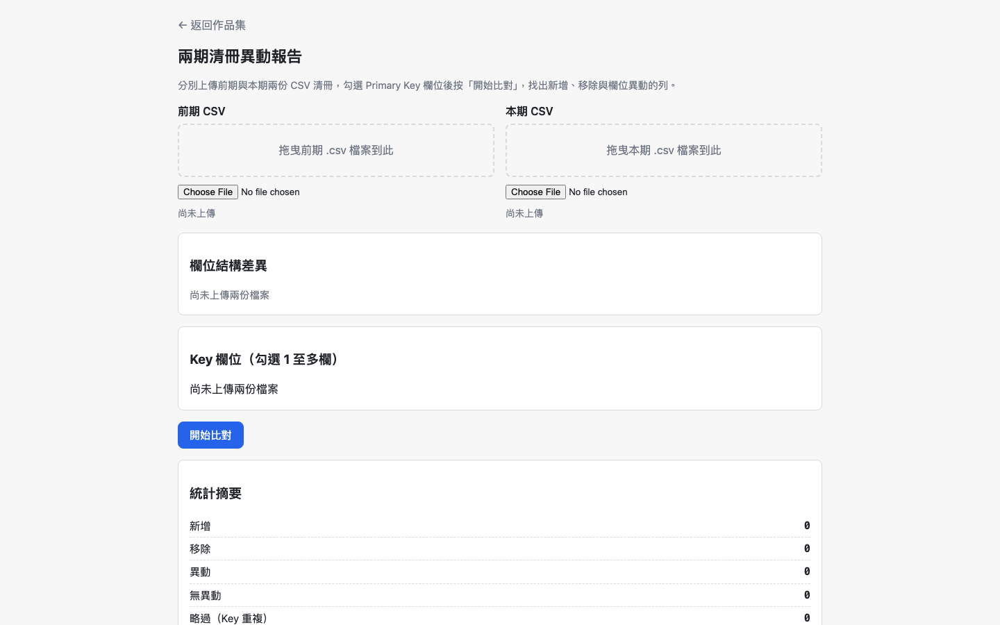
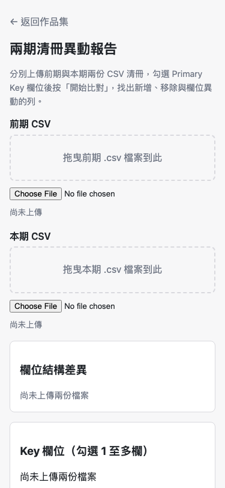

# Day 09：兩期清冊異動報告——當 LCS 遇上清冊，為什麼比對方向完全搞錯了？


## 1. 情境：兩份五萬列的薪資清冊

剛搞定 CSV 急診室，咖啡還沒喝完，人資主管就神色凝重地走進辦公室，把門掩上。

「阿星，我們懷疑上個月跟這個月兩份各五萬列的員工薪資清冊裡，有人動了手腳。某些同仁的職級加給好像被改了，但兩份 Excel 打開，中間有新進員工、也有離職員工，列的順序整個跳掉。我們用 VLOOKUP 對了快兩小時，眼睛都快花了，還是一團亂。」

「不能丟線上工具比對嗎？」我隨口一問。

「那是全公司同仁的薪資底冊啊！傳上雲端，資安部立刻找我喝咖啡，直接記大過！」主管急忙擺手。

這是辦公室最真實的惡夢：機敏資料不能離境，人工在 Excel 裡對齊多張工作表又容易眼花看錯。而且只要有一筆資料的員編重複，VLOOKUP 還會默默抓第一筆，直接給出假象。

我們需要一個**在瀏覽器本機端執行、絕對不聯網、能以「主鍵」為核心瞬間抓出兩期清冊異動的單檔工具**。

---

## 2. 想法：為什麼 Day 07 的 diff 演算法在這題完全行不通？

既然要比對兩份資料，第一直覺自然是沿用 Day 07 文字差異比對器用到的演算法（如 jsdiff 的最長共同子序列 LCS）。但坐下來一分析，我們立刻發現：**如果把文字 diff 搬來比對清冊，這不是效能變差，而是方向徹底搞錯**。

在文字比對中，「順序」帶有強烈語意：把一句話從第一段搬到第三段，代表文章架構真的變了。

但清冊完全是另一回事：
- 同一名員工在前期是第 3 列，這期因為前面加了新人，被推移到第 87 列。
- 這種列序的位移**沒有任何資料意義**，員工本人還是那個員工。

如果硬用文字比對的 LCS 去跑，中間只要插入一筆新資料，演算法就會判定後面幾萬列全部都是「刪除舊列＋新增新列」。畫面上只會看到滿江紅的虛假異動，真正的欄位改動反而被海量噪音淹沒。

```text
清冊比對的本質差異
--------------------
文字比對 (LCS 序列)
順序有語意
位移視為整行異動
雜訊直接爆量
        |
        v 改用
--------------------
清冊比對 (集合比對)
順序無語意
以 Primary Key 為準
時間複雜度 O(n)
新增/刪除/異動分明
```

正確的解法是**以 Primary Key 為準的集合比對（Set-based Reconciliation）**：
1. 讓使用者指定主鍵（例如「員工編號」，或勾選多欄作為複合鍵）。
2. 將兩期資料分別建立雜湊表（`Map<Key, Row>`）。
3. 比對兩個集合的鍵值：本期有前期無為「新增」；前期有本期無為「移除」；兩期皆有才逐欄比對內容為「異動」。

全程只需 O(n) 的雜湊查找，即使幾萬列順序完全大亂，也能在零點幾秒內精準定位。

對於「主鍵重複」或「主鍵缺值」的髒資料，我們堅持**「絕不幫使用者瞎猜誰配誰」**。這類資料直接抽離，獨立列在「略過比對」警示清單中，交由人工確認，絕不冒著配對錯誤的風險給出誤導結論。

---

## 3. 過程：時序上的漏洞與假通過的測試

演算法方向確認後，底層實作與安全邊界卻接連給了我們深刻的教訓。

### 痛點一：記憶體閘門的「時序漏洞」

在先前制定的資料契約中，我們嚴格規定：**「單檔 ≤20MB 且兩檔合計 ≤20MB，大小閘門必須在讀檔之前執行」**。

字面上寫得很漂亮，但當模組被串接起來時，我們抓出了一個致命漏洞：工程實作把「檢查檔案大小」與「讀取檔案」寫成了各自獨立的步驟，呼叫端直覺寫成了「先把兩個檔案讀成 `ArrayBuffer`，再加總計算大小」！

```text
原本的錯誤時序
--------------------
拖放選取兩份檔案
        |
        v
先讀成 ArrayBuffer
(記憶體直接吃滿)
        |
        v
檢查是否超過 20MB
(超過才報錯，為時已晚)

修訂後的安全時序
--------------------
拖放選取兩份檔案
        |
        v
gate(file) 立即攔截
(只讀 File.size)
        |
        v 通過才建立
FileReader 串流解析
```

如果有人誤拖入兩個 500MB 的大檔案，在閘門發揮作用前，瀏覽器記憶體就已經被撐爆無聲當掉了。

我們果斷重構了上傳介面，將順序寫死在介面核心：在 `setupDropZone` 內嵌 `gate(file)` 回呼。這個閘門在建立任何 `FileReader` 之前就被觸發，全程只讀取輕量的 `file.size`。只要單檔或累計大小超標，直接中斷拒絕，根本不給它碰觸記憶體的機會。

### 痛點二：測試的假通過——「沒把資料帶進去，就宣稱清空了」

在複驗離線版功能時，我們最重要的資安驗收指標是：**下載後的離線版 HTML，絕對不能殘留使用者剛才上傳過的比對資料**。

第一輪測試很順利，哨兵值比對全數為 0，測試全部打勾通過。

但仔細檢查測試腳本才發現那是「假通過」：我們丟進去的測試資料是完全無異動的乾淨清冊，而介面預設只會渲染「有異動的欄位」。換句話說，那份測試資料從頭到尾根本沒有被印在 DOM 畫面上，測試當然測不到殘留！

發現盲點後，我們重新設計了測試：注入包含特定特異字串（如 `ZZTOASTLEAK`、`ZZDIFFKEY`）的變更資料，並觸發複製通知與畫面渲染，再執行清空並檢視離線版原始碼。這才抓出快顯通知（Toast）與暫存元素中曾經留下的微小字串，徹底完成修補。

---

## 4. 結果：桌機與手機雙端操作成果

完成後的兩期清冊異動報告，支援雙 CSV 檔案拖曳載入，使用者能自由勾選一個或多個欄位作為比對主鍵。

### 桌面端展示

在大螢幕上，上方清楚列出新增、移除、欄位變更與略過比對的統計總覽；下方以高對比色票清楚標記哪位員工的哪一欄被改動，原值與新值一目了然：



### 行動端展示

在行動裝置上，兩期對照自適應轉為單欄垂直比對卡片，主管就算在會議室用手機或平板，也能快速核對異動重點：



---

## 5. 感想與明日伏筆

把工具交付給人資主管後，不到五分鐘，他就在兩份五萬列的薪資表中抓出了那三筆被悄悄調高職級加給的異常資料。

這次開發讓我體會到：面對結構化資料，不能被「比對」兩個字牽著鼻子走。文字與表格看似都在找差異，底層的資料特性與數學本質卻不一樣。選對模型（集合比對取代序列比對），幾萬筆的運算瞬間就能跑完，而且不會有假異動的雜訊來亂。

正當人資主管鬆了一口氣準備回報稽核部門時，行政總監又抱著筆電敲開了門：

「阿星，剛才看到你們能處理這麼大的 CSV……下週是全台分店盤點，總部系統匯出了一張全台灣 50 間門市、整整幾十萬筆庫存的超級大總表。以前總務都要花一整天手動套篩選、把每一間店複製出來另存成一個 CSV 寄給各店長。有沒有辦法丟一張大總表進去，瀏覽器自動依門市欄位拆成 50 個乾淨檔案，還順便幫我打包成 ZIP 檔下載？」

十萬筆資料的跨分店拆檔挑戰，看來明天得在前端瀏覽器裡上演一場記憶體極限挑戰了。
