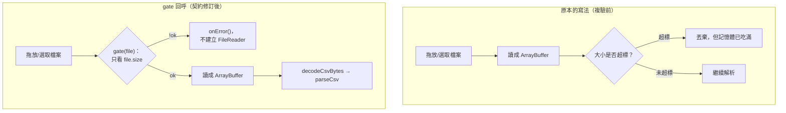

# Day09：兩期清冊異動報告——閘門寫對了規則，還是漏了

`Level 1b` `csv-period-diff` `Key-based reconciliation` `按鈕觸發`

👉 線上試用連結（未驗證，見文末「未驗證項目誠實揭露」）：`https://<GITHUB_USER>.github.io/2026ironman/VibeCoding/Day09_csv-period-diff/index.html`

---

## 目錄

- [情境](#情境)
- [解題思路](#解題思路)
- [資源](#資源)
- [Vibe 過程](#vibe-過程)
- [產品](#產品)
- [心得與反思](#心得與反思)

---

## 情境

人員清冊、資產清冊、會員清冊，每期都要跟上一期比對：誰新增了、誰不見了、哪些欄位被改了。人工做法是把兩份 Excel 開兩個視窗，拿 Primary Key（員工編號、資產編號）手動 VLOOKUP 對，清冊上千筆就對到眼花，還容易漏看「同一個 Key 出現兩次」這種本來就不該發生、但確實會發生的髒資料。

這題表面上看起來跟 Day07 `text-diff` 很像——都是「比對兩份東西找差異」，UI 也確實沿用了 Day07 的並排配色。但兩者要解的其實是不同類型的問題，這篇文章想記的正是這個判斷：**為什麼 Day07 能用的 diff 演算法，這題完全不能沿用**，以及契約裡「閘門必須在讀檔之前」這條規則，實際執行時真的漏掉了什麼。

## 解題思路

### 為什麼不用 jsdiff：這是方向錯誤，不是效能問題

Day07 用 `Diff.diffArrays` 做的是**序列比對**（LCS 式）：兩份輸入被視為「順序有語意」的陣列，演算法找的是「最少編輯次數讓序列 A 變成序列 B」。文字稿是有順序的——一句話搬到別的段落，通常代表內容真的變了。

清冊不是這樣。兩期清冊裡同一筆資料在前期第 3 列、本期第 87 列，是常態——中間任何一筆被刪除或插入，後面所有列都會位移，但這個位移**沒有語意**。若硬用 LCS 式 diff 去比兩份清冊，任何一筆新增或刪除都會讓後面所有列被判定「刪除＋新增」，噪訊直接爆量，而且是徹底誤導使用者的那種噪訊，不是效率差一點的問題。

正確模型是**以 Primary Key 為準的集合比對**（proposal 裡稱為 set-based reconciliation）：

1. 用勾選的 Key 欄位值組出 key 字串，把兩期各自的列建成 `Map<key, Row[]>`（O(n)，用陣列裝是因為 Key 可能重複，見下）
2. 兩個 key 集合取差集／交集：本期有前期沒有 = 新增；前期有本期沒有 = 移除；兩邊都有才進入逐欄值比對
3. 全程只需雜湊查找，不用任何動態規劃式的比對，複雜度是 O(n)，不是 LCS 的 O(n·d)

這不是「用更快的演算法做同一件事」，是問題本質不同——序列比對回答「怎麼把 A 編輯成 B」，集合比對回答「A 和 B 的成員差在哪」。清冊要的是後者。

### Key 重複與 Key 缺值：不猜，只警示

兩期清冊裡，同一個 Key 值出現兩筆以上是真實會發生的髒資料（系統匯出重複、合併過程手滑）。這題的裁示是**不嘗試猜測哪筆對哪筆**——這類列整組獨立歸入「Key 重複，略過比對」清單，不計入新增／移除／異動／無異動任何一類統計，但要在畫面上明顯列出（哪個 Key、前期幾筆、本期幾筆、原始列號），不能默默略過。Key 值含空字串（勾選的 Key 欄位裡有任一欄是空的）同樣獨立歸入「Key 缺值，略過比對」。

這條規則背後的判斷是：清冊比對工具最危險的失敗模式不是「漏掉一筆」，而是「猜錯配對，讓使用者以為某筆資料的欄位變了，其實是兩筆完全不相干的資料被誤配對在一起」。安全的做法是把猜測完全排除，交給人工判斷。

### 閘門必須在讀檔之前——契約寫對了，五份提案還是漏了

`CSV_CONTRACT.md` 第 5 節明文規定這題「單檔 ≤20MB **且**兩檔合計 ≤20MB」，第 4 節也明文寫「`gate` 必須在讀檔之前執行」。字面上這條規則已經寫得很清楚了。但 `CSV_CONTRACT.md` 第 4 節留了這段紀錄：

> ⚠️ **`gate` 必須在讀檔之前執行，這是設計要點不是實作細節。**
> 2026-08-23 複驗發現原本的寫法把閘門放在拿到 `ArrayBuffer` 之後——那等於閘門白設，
> 500 MB 的檔案照樣先整份讀進記憶體，正是第 5 節要防的無聲卡死。

commit `11a3e50`（Level 1b 提案十一輪獨立驗收）的紀錄更直接：

> 契約本身有洞：大檔案門檻無處可掛、dateParts() 未定義、**閘門時序靠呼叫端自律**

這句話點出了根源：問題不是誰粗心，是**介面設計把閘門判定與讀檔拆成兩個獨立步驟，順序完全靠呼叫端自己記得**。單檔門檻只要看 `file.size` 就夠，理論上不需要等 `ArrayBuffer`；但當「先檢查大小，再決定要不要讀檔」被寫成兩段各自獨立的程式碼，呼叫端很容易寫成「先讀進來，反正也不貴，讀完再判斷要不要用」——尤其合計門檻要看兩份檔案的大小總和，「等兩份都讀完再加總比較」在直覺上甚至更自然。

修法不是重新提醒大家小心，是把順序**做進介面本身**：`io-dropzone.js` 的 `setupDropZone`／`setupFilePicker` 開放 `opts.gate(file)` 回呼，這個回呼在「開始讀檔之前」被呼叫，回傳 `!ok` 就直接觸發 `onError`、完全不建立 `FileReader`。呼叫端沒有「先讀再判斷」的分支可寫，因為讀檔的動作本身被介面包住了，`gate` 沒過就不會進到讀檔那一步。

Day09 的合計門檻具體怎麼接上這個介面：兩個上傳區各自維護一個模組層變數記自己已通過門檻的 `file.size`，各自的 `gate` 先查自己的單檔門檻，通過後再查「自己的 size + 對方已存的 size」是否超過合計上限——這一步全程只碰 `File.size`，不觸碰 `ArrayBuffer`：

```js
function gateFor(getOtherSize, setOwnSize) {
  return function (file) {
    var single = checkCsvFileSize(file.size);
    if (!single.ok) return single;
    var otherSize = getOtherSize();
    if (otherSize !== null) {
      var total = checkCsvFileSize(otherSize + file.size);
      if (!total.ok) {
        return { ok: false, level: "reject", message: "兩檔合計超過 20 MB 上限，請縮小檔案後再試。" };
      }
    }
    setOwnSize(file.size);
    return single;
  };
}
```

`tasks.md` T2 甚至寫了一條專門證明這件事的驗收條件：把全域 `FileReader` 換成計數用的 stub，上傳一份 12MB 通過（計數變 1），再上傳一份 12MB 因合計 24MB 被拒——斷言計數維持在 1，不是 2。這條驗收條件存在本身，就是在防「表面上照契約寫、實際上讀完才擋」這種回歸。



## 資源

- 演算法：無外部 library，純手寫 `Map<key, Row[]>` 集合比對（proposal 明確排除內嵌 jsdiff，理由見上）
- 資料層：`shared/csv-decode.js`（編碼偵測＋大小閘門）、`shared/csv-parse.js`（Table 解析）、`shared/csv-write.js`（CSV 輸出），三者由前置工程 `sdd/csv-infra/` 提供，本題視為已就緒模組不重新設計
- 讀檔：`shared/io-dropzone.js` 的 `mode:'bytes'` + `gate` 擴充（`setupDropZone`／`setupFilePicker` 共用同一組 `opts`）
- 契約依據：`VibeCoding/shared/CSV_CONTRACT.md` 第 4 節（介面簽名與 gate 時序）、第 5 節（大檔案門檻）、4.0c（多欄組合鍵分隔符 `\0`）
- UI 沿用：`Day07_text-diff/src/index.html` 的 `.diff-row`／`.diff-old`／`.diff-new`／`swatch-modified` 色票與並排呈現模式（不沿用其摺疊未變動列的邏輯，因為本題結果清單本來就只列三類，不會出現「未變動」列）
- 素材依據：`sdd/csv-period-diff/proposal.md`、`sdd/csv-period-diff/tasks.md`、`VibeCoding/shared/CSV_CONTRACT.md`、commit `f7b72ff`、`11a3e50`、`8da81e7`

## Vibe 過程

這題跟 Day07 由本人一步步跟 AI 對話開發不同——Day08 `csv-doctor` 與 Day09 是**兩個 sonnet subagent 併行實作**，指揮官（commander）事後做獨立複驗，不是逐輪跟 AI 對談出來的。這代表這篇「Vibe 過程」能寫的，是複驗階段揭露的落差，不是開發過程中的逐步對齊記錄——這點如實說明。

commit `f7b72ff` 記錄了複驗做了什麼、以及複驗本身踩了幾次坑：

**第一層落差：測試設計本身一開始是錯的。** 複驗要驗證「下載的離線版不能洩漏使用者剛才輸入的資料」，這是 Level 1a 系列唯一真的外洩過的地方。第一次嘗試檢查全域函式 `buildCleanHtmlCopy`——失敗，因為它包在 IIFE 裡不是全域的。第二次用「乾淨值」當哨兵資料——這次的問題更隱蔽：Day08 `csv-doctor` 只會把「有問題的格」列出來，乾淨的哨兵值根本不會被渲染到畫面上，等於測試從頭到尾沒有真的把資料帶進畫面，「清空了」這個結論毫無意義。第三次，Day09 的複製按鈕在 headless 模式下不會觸發 toast，改成直接注入 `showToast('已複製：ZZTOASTLEAK')` 才測得到 toast 訊息路徑有沒有殘留。commit 訊息把這件事講得很白：**「資料沒進去就測清空」會得到假通過**。這是這次複驗過程裡最值得記的一課，不是關於這題的程式碼，是關於怎麼寫出真的有效的驗收測試。

**第二層落差：離線版洩漏測試通過了，但要通過的檢查點很多。** 最終版本用五個哨兵值（含 toast 訊息）測，DOM 斷言（`__shared_toast === null`、`.nav-back` 數量為 0、載入無錯誤）全部通過，`ZZDOCVAL`／`ZZDOCCOL`／檔名相關字串在原始碼裡是 0 筆。這代表本題最終確實做到了契約要求的「離線版不殘留使用者資料」，但這個結論是複驗多次修正測試設計後才站得住腳的，不是第一次測就過。

**第三層落差：實作者自己在 tasks.md 打勾的過程中抓到一個資料層的坑。** commit 提到「Day09 的 Write 工具把 `\0` 寫成實體 NUL byte，自行改回逃脫序列（契約 4.0c）」——契約規定多欄組合鍵用 `\0`（U+0000）當分隔符，理由是它不可能出現在 CSV 內容裡；但寫檔工具字面處理 `\0` 時，把它寫成了真正的 NUL 位元組而非逃脫序列，這在某些下游處理（例如把 key 字串當一般字串處理、寫進 log 或顯示在畫面上）會出問題，是實作階段自己發現並修正的，不是複驗抓到的。

閘門時序那個問題（見「解題思路」一節）則是更早一輪、`11a3e50` 那次十一輪提案審查裡發現的契約層級的洞，跟 Day09 的實作階段是分開的兩件事——這裡刻意分清楚：**「閘門必須在讀檔之前」不是 Day09 這次踩的坑，是契約在提案審查階段就先補上的規則，Day09 是照著已經修好的契約去實作**，避免這篇文章把功勞算錯人。

## 產品

畫面配置（`sdd/csv-period-diff/tasks.md` T1）：前期／本期兩個各自獨立的上傳區（拖放＋檔案選取），上傳完成後動態出現 Key 欄位勾選清單（僅列兩期共同存在的欄位）、欄位結構差異卡片（若兩期 headers 不同）、「開始比對」按鈕，比對後顯示統計摘要卡（新增／移除／異動／無異動／略過（重複）／略過（缺值）六個數字）、三個結果區塊（每頁 50 筆分頁）、Key 重複／缺值警示清單，以及五個下載按鈕（新增 CSV、移除 CSV、異動 CSV、HTML 摘要報告、本工具離線版）。

異動列的呈現沿用 Day07 的並排配色：改動的欄位套黃底 `swatch-modified`，未改動欄位不特別標示，避免資訊過載；新增列只顯示本期完整資料（沒有 Before 可比），移除列只顯示前期完整資料（沒有 After 可比）。

匯出的三份 CSV 各自獨立下載，不打包 ZIP——這是 Level 1b 裁示事項之一，`io-zip.js` 只有 Day10（`csv-batch-splitter`）掛欄位，Day09 不提前做成 ZIP 題。異動 CSV 用長格式（Key 欄＋欄位名＋舊值＋新值，一列一個異動欄位），理由是異動筆數多時欄位數不固定，長格式在 Excel 篩選比寬表穩定。

HTML 摘要報告是獨立於「下載本工具離線版」的另一個功能——報告要含統計數字＋全部明細（這是 PRD 明列的產品功能，特意保留資料），離線版則要把使用者剛輸入的兩份清冊資料清空（這是給別人分享一個空白工具用的，資料不能留）。這兩者容易被寫混，proposal 特別把它們分成兩節說清楚。

## 心得與反思

回扣四層對齊框架：

- **想法 ↔ 表達**：這題最重要的表達層工作，是在 proposal 裡明確寫下「為什麼不用 jsdiff」——不是含糊地說「這題比較適合用別的方法」，而是具體區分序列比對與集合比對的語意差異，並解釋這是方向性錯誤不是效率問題。把「為什麼不做某件顯而易見的事」寫清楚，跟把「要做什麼」寫清楚一樣重要，尤其當上一題（Day07）看起來很像可以直接套用的模板時。
- **表達 ↔ AI 理解**：契約裡「gate 必須在讀檔之前」這句話，字面意思清楚到五份提案都沒有違反字面——但全部都寫成讀完才檢查。這代表純文字規則、就算寫得再明確，也可能在多個實作者手上得出同一個錯誤詮釋。真正解決問題的不是把規則講得更清楚，是把規則做進介面（`gate` 回呼），讓「讀完再判斷」這個分支在程式碼結構上根本寫不出來。這是這題對「表達 ↔ AI 理解」這一層最直接的教訓：有些規則不該停留在文件，該編譯進介面。
- **AI 規劃 ↔ 腦中藍圖**：複驗測試設計本身修了三次才有效——第一次抓錯位置（IIFE 內的函式）、第二次哨兵資料設計錯誤（乾淨值不會被渲染，測試沒有真的驗證到清空）、第三次觸發路徑錯誤（headless 下按鈕不觸發 toast）。這說明「驗收條件」本身也是一份需要對齊的規格，寫測試的人腦中的藍圖（「我認為這樣測就能驗證洩漏」）跟測試實際驗證到的東西，中間一樣會有落差，需要反覆核對才收斂。
- **規格 ↔ 實際產品**：`\0` 分隔符被寫成實體 NUL byte 而非逃脫序列，是資料層契約（4.0c）跟 Write 工具實際行為之間的落差——契約定義了「用什麼字元」，但沒有明講「在輸出時這個字元該以什麼形式呈現」，這個縫隙留給實作自己判斷，實作者自己發現並修正了它。

這題也是這系列第一次「指揮官沒有全程參與逐輪開發」的題目——Day08、Day09 由 subagent 併行實作，指揮官只做獨立複驗。誠實地說，這意味著這篇文章能寫的「開發過程」，本質上是複驗記錄，不是逐輪對話記錄；能寫得具體的地方是複驗抓到什麼、複驗本身又是怎麼修正三次才可信，而不是虛構一段「我當時怎麼一步步引導 AI」的敘事——這正是查證優先於編故事的原則要守住的地方。

---

**未驗證項目誠實揭露**：
- GitHub Pages 線上連結**未用 `curl -sI` 實測**，本文只列出依系列既有 URL 規則推算的網址，未確認回應狀態，因此文首與文中連結都未附「已驗證」字樣。
- 本文沒有附 Playwright 實際操作截圖——本題由 subagent 併行實作、指揮官複驗，複驗記錄在 commit message 裡（離線版洩漏測試、DOM 斷言結果），但複驗當下未保留截圖產物，本文查無可引用的截圖檔案，如實略過而非補拍或虛構。
- `VibeCoding/README.md`、`VibeCoding/index.html` 的收尾（進度表、作品集連結雙向點擊測試）依 `CHECKLIST.md` 第六節屬於收尾階段工作，本文與本次任務範圍不含這部分，狀態仍是待處理。
