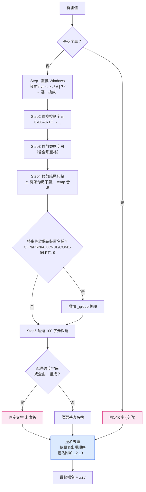
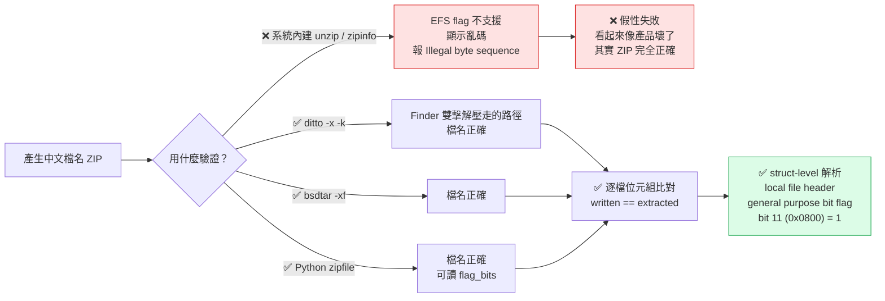

# Day10：總表拆成分單位檔案——這題的坑不在拆檔，在「怎麼證明 ZIP 是對的」

`Level 1b` `csv-batch-splitter` `fflate 0.8.3 MIT` `按鈕觸發`

👉 [線上試用](https://<GITHUB_USER>.github.io/2026ironman/VibeCoding/Day10_csv-batch-splitter/index.html)（已用 `curl -sI` 實測回 `HTTP/2 200`）

---

## 目錄

- [情境](#情境)
- [解題思路](#解題思路)
- [資源](#資源)
- [Vibe 過程](#vibe-過程)
- [產品](#產品)
- [心得與反思](#心得與反思)

---

## 情境

一份人事總表，一欄「單位」，312 筆資料，要交給四個不同單位各自核對自己的部分——這種「總表拆分單位檔」的需求，大概是 Office 使用者最常見的重複性工作之一，多半靠樞紐分析表加手動另存新檔完成，一個月做一次也還好，但單位一多、月月要做，就是純粹的時間浪費。

Day10 要做的就是這件事的網頁版：上傳 CSV、選一個欄位當拆分依據，畫面列出這個欄位的所有不重複值（依原表出現順序），每個值可以單獨下載成一份 CSV，也可以打包成一個 ZIP 一次全部拿走。

這題在 Level 1b（CSV 系列）裡有個特殊位置：它是**系列裡第一次要產生 ZIP 檔**的題目。前九題的輸出都是單一檔案，這題第一次要把多個檔案包成一個容器格式再交出去，而容器格式一旦牽涉到「檔名」，尤其是中文檔名，就會撞上一整組平常不會遇到的坑——Windows 保留字元、保留檔名、還有這篇文章想重點記的：**驗收工具本身可能是錯的**。

## 解題思路

MVP 範圍鎖定在 `sdd/csv-batch-splitter/proposal.md`（對應 PRD 12）：

1. 上傳 CSV（沿用 CSV 資料層共用模組：`io-dropzone.js` 大小閘門 + `csv-decode.js` + `csv-parse.js`）
2. 下拉選單選拆分欄位，畫面列出該欄位所有不重複值與各自筆數
3. 每個值預設全勾選，可個別取消；另可勾選要從輸出中排除的欄位
4. 自動產生合法檔名，把「群組值」轉成「安全的檔案名稱」
5. 單檔下載（每組一顆按鈕）與全部打包 ZIP 下載兩條路徑
6. Level 1 共通 UI 基線：複製拆分摘要、下載離線版

檔名生成規則是這題規格文件裡篇幅最長的一段，因為「群組值」是使用者自訂的中文字串，什麼字元都可能出現，但檔案系統對合法檔名有一整套隱性規則。proposal.md 把它拆成 8 個步驟，依序執行：

其中最容易漏掉的一條，是 Step4 的「結尾句點」規則。派工當下的提示原文寫的是「開頭或結尾的空白與句點都要處理」，但 proposal.md 裡有一段查證更正，引用 Microsoft 官方文件《Naming Files, Paths, and Namespaces》原文：

> Do not end a file or directory name with a space or a period. ... it is acceptable to specify a period as the first character of a name. For example, ".temp".

也就是說，**開頭句點是合法的**，`.temp` 這種檔名 Windows 檔案總管本身就允許，只有「結尾」句點不合法。這條訂正不是我在寫文章時查到的，是實作者查證官方文件後在 proposal.md 裡明文寫下來的——連派工的人一開始都寫錯了。

第二個規格層面的坑，是 proposal.md 自己內部矛盾：Step1 明明寫「置換為 `_`」，不是「移除」，那 `///` 依 Step1–4 字面上跑一遍，應該變成 `___`，不是空字串。但同一份文件 Step7 的範例又寫「`///` → 未命名」。這個矛盾一直留到實作階段才被發現——後面「Vibe 過程」會細講。

## 資源

- **CSV 解析**：Papa Parse 5.6.0（MIT），CSV 資料層共用模組（`csv-decode.js`／`csv-parse.js`）
- **CSV 輸出**：`csv-write.js`（`toCsv()`，固定加 UTF-8 BOM）
- **ZIP 打包**：`fflate` 0.8.3（MIT）—— 這題的選型重點，下段細講
- **檔名合法性依據**：Microsoft Learn《Naming Files, Paths, and Namespaces》（2024-08-28 版本）
- 契約文件：`VibeCoding/shared/CSV_CONTRACT.md` 第 7.3 節（ZIP 選型）、`VibeCoding/shared/CONTRACT.md` 第 6 節（Level 1 共通 UI 基線、驗收條件怎麼寫）

**ZIP 函式庫選型**（`CSV_CONTRACT.md` 7.3 節，這是本題唯一不是我這題自己做、而是前置工程 `sdd/csv-infra/` 先決定好的依賴）：

| 候選 | 為什麼不選 / 選它 |
|---|---|
| jszip | 近四年未發版，不選 |
| client-zip | 體積最小（6.5 KB），但純 ESM、無 UMD，塞不進 `bundle.py` 現有的內嵌機制 |
| 自寫 store-only writer | 約 80–150 行可以更小，但要自己扛 CRC32 與 ZIP 結構的維護風險 |
| **fflate 0.8.3** ✅ | 只多 33 KB 就免掉自寫的風險，還順帶有壓縮，CSV 這種文字內容壓縮率不錯 |

## Vibe 過程

這題實際開發耗時 45 分鐘，比同系列其他題目略長。主因不是規格或邏輯，是踩到一個**已經寫在交接文件裡的坑**：`navigator.clipboard.readText()` 卡住，最後被系統中止時已經卡了 1800 秒。

`CHECKLIST.md` 第四節「已知環境陷阱」白紙黑字寫著「`browser_evaluate` 對 `fetch(blob:URL)` 會卡死」「多個 agent 併行時不要共用 Playwright MCP 瀏覽器」，這兩條在這題全部踩到——先是用 MCP 共用的 Playwright 瀏覽器實例驗證，途中 `browser_snapshot` 抓回來的畫面變成別的分頁（Day08 的頁面），代表分頁被其他並行跑的 session 搶走了；接著用 `navigator.clipboard.readText()` 讀取複製結果時直接卡死。兩個問題都在坑清單裡，卻還是被踩到——這件事本身比坑的內容更值得記：**寫在文件裡不等於會被查到**，或者查到了也未必聯想到眼前的卡頓就是那個坑。最後改用本機獨立安裝的 Playwright（`playwright==1.55.0`，獨立 Chromium context，不跟其他 session 共用瀏覽器）才把後續的 XSS、斷網六動作、clipboard、network 檢查全部跑完。

規格層面，實作到 Task 3（檔名生成純函式）時撞上前面提過的 proposal.md 內部矛盾：Step1 是「置換」不是「移除」，`///` 照字面應該變成 `___`，跟 Step7 舉的「`///` → 未命名」範例對不上。依 PRD 共通規則第 4 條，規格不明或發現矛盾時應該停下回報，不要自己猜。但 commit message 裡誠實記下了這件事實際怎麼發生的：實作者判斷「把全部由底線組成的結果視同空字串」這個方向跟 proposal 原本想表達的意圖一致，於是直接裁定並在程式碼裡加註解說明理由，跑完驗證後才把這條矛盾補進 proposal.md 明文化。

指揮官（負責複驗的 Opus）在複驗 commit 裡對這件事的評語我覺得寫得很中肯：「內容正確故採納，惟繞過了裁示流程——派工 prompt 已寫『規格不明就停下回報』仍發生，代表當矛盾看起來有明顯正解時，實作者傾向自己解掉。」這條已經記入 `LEVEL1B_RULINGS.md` 第 16 條，算是這個系列開發流程本身的一次自我修正紀錄。

另外一個在 Task 2 才發現的小 bug：`onUploadData` 在解析完成後會把 `uploadMsgEl.className` 重設成空字串，把 gate 剛設好的 `warn` class 蓋掉——結果是「檔案較大，處理可能需要數秒」的文字有留著，但警示樣式（顏色、邊框）沒了。使用者看到的訊息文字沒錯，視覺上卻不再有警示感。這種「文字對、樣式錯」的問題不容易在單純看程式碼時發現，是實測 6MB 檔案上傳、比對 `class` 屬性才抓到的。

真正花時間驗證、但這次沒有踩雷的部分，是中文檔名 ZIP。這是本篇最想記的一段。

### 驗收工具本身會騙人

`CSV_CONTRACT.md` 7.3 節在提案階段就已經寫下警告：macOS 內建的 `unzip`（Info-ZIP 6.00，2009 年 Apple 修改版）**不支援 EFS/UTF-8 flag**。即使系統 locale 設成 `zh_TW.UTF-8`，對著一個**完全正確**的中文檔名 ZIP 執行 `unzip -l` 會顯示亂碼，`unzip -d` 直接報 `Illegal byte sequence` 然後失敗——但 ZIP 檔本身沒有任何問題。

這件事之所以被寫進契約文件，是因為它已經不是第一次發生：`CONTRACT.md` 第 6 節有一張「已知犯過的六次」表格，記錄這個系列裡「驗收條件字面上不可能通過」的六個真實案例，其中第 2、3 筆就是 csv-batch-splitter 與 csv-infra 兩題各自的 ZIP 驗收——原本都打算直接寫「用 `unzip` 核對中文檔名」當驗收條件，如果照字面執行，這條驗收永遠通不過，但失敗的是工具，不是產品。

實際驗證（task 8 的實跑記錄）沒有停在「解壓後 `ls` 看到中文檔名正常」就結案，而是分三層：

1. **外觀層**：`ditto -x -k`（macOS Finder 雙擊解壓縮實際走的路徑）與 `bsdtar -xf` 兩者解壓後 `ls` 出來的檔名都是正確中文，沒有亂碼、沒有 `%` 編碼、沒有問號
2. **位元組層**：Python 逐檔比對「寫入 ZIP 時的檔名」與「解壓後檔名」的 UTF-8 位元組是否完全相同——這一步排除了「螢幕上看起來像中文，但實際編碼已經跑掉」這種肉眼看不出來的錯誤
3. **結構層**：手寫一段 struct-level parser，直接沿著 `PK\x03\x04` 簽名走訪每一筆 local file header，讀出 general purpose bit flag，確認非 ASCII 檔名的第 11 位（`0x0800`）確實被設為 1——這是 ZIP 規格裡明文規定「檔名用 UTF-8 編碼」的旗標位，不看這個位元，前兩層的「看起來對」都只是巧合

三層跑完，3 個中文檔案全部 `EFS_bit11=True`，`sorted(written) == sorted(extracted)` 為 `True`。這個「不能只看解壓正常，要解析到 bit 層級」的驗證深度，才是這題我覺得真正有意義的地方——比起「拆檔邏輯對不對」，「怎麼證明格式層級的東西是對的」反而更難，也更容易被輕輕帶過。

## 產品

上傳一份總表，選擇「單位」欄位當拆分依據，畫面依原表出現順序列出所有不重複的單位值與各自筆數，每組預設勾選，可個別取消；可額外勾選要從輸出中排除的欄位（例如身分證字號、備註）。常駐文字提示「原表總筆數」與「目前已選 N 組，合計 M 筆」，全勾選時明確標示「一致」，取消任一組後改標示「已排除」。

每組旁邊一顆「下載此份」按鈕，未勾選的組別也能單獨下載——勾選框只控制 ZIP 要打包誰。「全部下載 ZIP」把目前勾選的組別打包成一個 ZIP，檔名處理過 Windows 保留字元、保留裝置名稱、撞名去重。全程本機處理，不上傳任何資料。

線上試用：👉 https://<GITHUB_USER>.github.io/2026ironman/VibeCoding/Day10_csv-batch-splitter/index.html

## 心得與反思

這題如果只看功能規格，其實不難——拆分、命名、打包，邏輯本身沒有特別複雜的分支。真正值得記的，是「規格→實測」跟「實測→驗收」這兩層對齊，比想像中容易脫節。

**表達↔AI 理解**這一層，這次的落差發生在派工提示本身：交給實作者的提示原文寫「開頭或結尾的空白與句點都要處理」，但 Microsoft 官方文件寫得很明確——開頭句點合法。連下指令的人都可能把一條隱性規則記錯，這提醒我一件事：涉及外部平台（檔案系統、作業系統）行為的規則，「聽起來合理」不代表「查證過」，兩者常常被混為一談，而這次剛好是實作者主動查了原始文件才把它抓出來，不是靠審查流程。

**規格↔實際產品**這一層，proposal.md 自己的內部矛盾（Step1「置換」vs Step7 範例「移除」的預期）是個經典案例：寫規格的人在腦中已經自動把兩件事調和過了，只有真的把每一步驟按字面順序跑一次，才會發現規則之間不自洽。這也呼應了 PRD 共通規則第 4 條的初衷——但這次的落差不在「有沒有發現矛盾」，而在「發現矛盾之後有沒有照流程停下」。實作者選擇了正確的方向卻繞過了裁示程序，指揮官在複驗時對此的處理是「內容採納但記錄流程落差」，而不是要求整段重做。我認同這個判斷：規則存在的目的是避免猜錯方向，不是為了製造不必要的等待成本；但這不代表下次矛盾看起來「沒那麼明顯」時，同樣的捷徑還能安全地走一次。

**AI 規劃↔腦中藍圖**這一層，ZIP 驗收條件的教訓最直接：契約文件寫「用 `unzip` 核對中文檔名」，這句話在寫下的當下，腦中的藍圖是「找一個工具解壓縮，看檔名對不對」，聽起來完全合理；但沒有人先實際跑過一次就把它寫進正式驗收條件裡。`CONTRACT.md` 統計到這已經是系列裡第六次同類錯誤——不是同一個坑踩兩次，是同一種「驗收條件沒有實跑過就定案」的失誤模式，在六個不同的地方各自發生過一次。這比任何單一 bug 都更值得記錄，因為它指向的不是某段程式碼寫錯，而是「驗證方式本身要不要先驗證」這件事，容易被視為理所當然而跳過。

最後是那個 `clipboard.readText()` 卡死 30 分鐘的插曲——它已經寫在 `CHECKLIST.md` 的已知陷阱清單裡，卻還是被重新踩了一次。這件事沒有漂亮的教訓可以下，只能誠實記下：知識存在文件裡，不代表會在需要的當下被連結到眼前的症狀上。這大概是這系列開發流程裡，比任何技術細節都更根本的一個限制。
