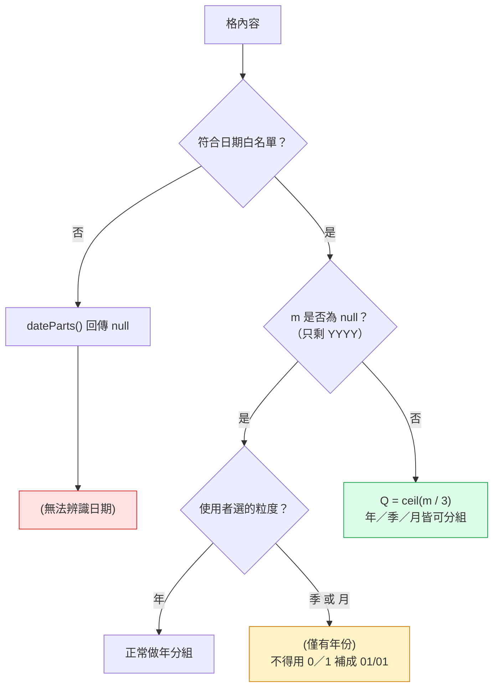
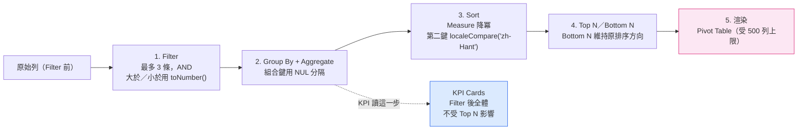

# Day11：CSV Pivot Dashboard（上篇）——樞紐引擎，還沒畫半根長條圖

`Level 1b` `csv-pivot-dashboard` `即時（debounce 150ms）` `零 SVG`

👉 線上試用連結（未驗證，見文末「未驗證項目誠實揭露」）：`https://<GITHUB_USER>.github.io/2026ironman/VibeCoding/Day11_csv-pivot-dashboard/index.html`（本篇只涵蓋樞紐引擎；圖表模組、匯出 Dashboard、離線版清空、列印驗收留給明天下篇，連結指向的是同一個產品資料夾，畫面上會看到還沒接線的圖表分頁）

---

## 目錄

- [情境](#情境)
- [解題思路](#解題思路)
- [資源](#資源)
- [Vibe 過程](#vibe-過程)
- [產品](#產品)
- [心得與反思](#心得與反思)

---

## 情境

PRD 10 的需求很直白：使用者想快速回答「每單位幾件、多少錢、趨勢如何」，但未必會 Excel 樞紐分析表。做法也直觀——上傳 CSV，選欄位當 Group By，選另一欄當 Measure，選個 Aggregate，畫面自動給表格、KPI、圖表。

但把這題的實際工作量攤開來看，樞紐引擎本身（型別推薦、數值解析、雙欄分組、日期分組、Filter/Sort/TopN 四段管線、KPI 口徑）就已經是 5 條 task 的量，`shared/ui-chart-svg.js`（契約 7.4 節明文規定座標映射、軸刻度取整、標籤重疊、色盤、四種退化情形都要各自獨立成 task）又是至少 4 條，加上匯出 Dashboard HTML 與 `buildCleanHtmlCopy()` 兩個相反方向的產物各自的資安驗收——整份 `tasks.md` 會膨脹到 11 條，超過共通開發規則「單份不超過 10 條」的字面上限。硬塞進一天，會讓每一條都趕，違反規則的精神；偷偷放寬單日上限，則是違反規則的字面。兩條路都不對，所以使用者裁示拆成 Day11（上篇）／Day12（下篇）兩個發文日，產品仍是同一個，資料夾只有一個 `Day11_csv-pivot-dashboard/`，這個先例 Day05／Day06 的可逆式去識別化已經走過一次。

拆點選在「算對」跟「畫對」之間：Phase A（本篇，任務 1–5）完全不碰 SVG，交付一個「Excel 樞紐分析替代品」——有表格、有 KPI、能匯出彙總 CSV，本身就是可用的東西，不是半成品；Phase B（明天，任務 6–11）才動手寫 `ui-chart-svg.js`、匯出靜態快照 Dashboard、清空離線版、驗證列印不坍縮。這篇文章只講前者：型別推薦為什麼是「建議」而不是「決定」、`toNumber()` 為什麼對長得很像數字的字串一律說不、日期分組為什麼不能用 `new Date()`，以及固定死的管線順序背後的理由。

## 解題思路

### 型別推薦：回報而不改寫

`inferColumnTypes()` 是 `csv-infra` 前置工程建立的共用函式（`CSV_CONTRACT.md` 第 4.0b 節），本題不自己判、也不自加二次門檻。它對每一欄的非空樣本做比例判定：可解析為數字的比例 ≥ 0.9 判為 `number`，否則符合日期白名單的比例 ≥ 0.9 判為 `date`，否則 `text`；樣本數 < 3 一律 `text`（樣本太少不猜）。

這條規則在跨題審查時抓到一個真實的分裂：Day08 原本自己加了「非空樣本 ≥3」的門檻、Day11 原本自己訂了「比例 ≥0.9」、Day12 原提案只看 `kind` 完全沒提門檻，三題各寫各的，結果會是**同一份 CSV 在三個工具裡被判成三種欄位型態**。這種分裂比任何單一 bug 都難察覺，因為每一題單獨測試都會通過，只有把同一份檔案跨題比對才會發現。契約收斂為只在 4.0b 定義一次，五題一律直接用回傳的 `kind`，不得再自行判斷。

`number` 判為 Measure 候選並標「建議」，`date` 判為 Dimension 候選並啟用日期粒度下拉，`text` 也是 Dimension 候選，但 distinct 值數超過 `min(100, 列數 * 0.5)` 時不標建議——這類欄位通常是身分證字號、流水號，分組後每組剛好 1 列，統計上沒有意義，但**不阻擋使用者選它**。這是本題型別處理最重要的一條原則：兩個下拉都列出**全部欄位**，建議項排最前面加標記，其餘依原始欄序排在後面，使用者永遠可以覆寫。這不是偷懶，是延續 Day08 那條「parser 不做貼心修正」的家族原則往下走：型別推論的職責是**回報**，不是替使用者做決定，把 `text` 欄選成 Measure 這種明顯沒意義的操作也是被允許的，結果會是全部「無法計算」，由後面的計數如實呈現，不跳警告框攔人。

### `toNumber()` 為什麼對 `1,234`、`$100`、`50%` 一律回 `NaN`

契約 4.0b 定義的共用 `toNumber()`：先 trim，接受選用正負號、十進位小數、科學記號；**不接受**千分位逗號、貨幣符號、百分比、會計式括號負數 `(1,200)`、全形數字。不符合的一律回傳 `NaN`（2026-08-23 裁示，不是 `undefined`、不是 `null`），檢查一律用 `Number.isNaN()`，不用全域 `isNaN()`——原因是 `isNaN('')` 會先做隱性型別轉換回傳 `false`，會把空字串誤判成數字。

這條「不接受」看起來像少做了一步，但少做的那一步正是坑所在。`(1,200)` 是負 1200 還是財務報表裡的備註格式？`1,234` 的逗號是千分位分隔，還是本題不支援的另一種分隔慣例？程式猜對了使用者不會發現，猜錯了會得到一個看起來正常、實際上錯誤的加總數字，而且完全沒有任何錯誤訊號——這正是契約第 2 節反覆強調的「猜測會製造沉默錯誤」。修這種髒資料是 Day08 `csv-doctor` 的職責，不是這裡；`csv-pivot-dashboard` 拿到一格解析不了的值，唯一誠實的回應是說「這格我不算」，而不是自作聰明剝掉符號硬轉成數字。

這條規則在 Aggregate 語意上落地成一張表：`COUNT` 是該組列數，跟 Measure 欄無關，永遠可算；`SUM` 只加總可解析的格，全組不可解析時顯示 `—`，**不顯示 `0`**（`0` 是有意義的數值，不能拿來代表「沒得算」）；`AVG` 的分母是**可解析格數**，不是總列數；`MIN`／`MAX` 同樣只在可解析格中取。「有 N 筆無法計算」這件事在畫面上要出現三個層級都不能少：每一組的 Pivot Table 多一欄「無法計算」、全體的 KPI Card 一張「無法計算 63 筆（已排除）」、匯出的彙總 CSV 也保留這一欄——缺一個層級，使用者就會發現總計對不上卻找不到原因。

### 日期分組：只有一條擷取路徑，`null` 不能用 0 或 1 補

日期分組不用 `new Date(字串)` 解析——`new Date('2026/1/2')` 的行為隨瀏覽器地區與時區設定而變，同一份檔案在不同機器可能分到不同月份，是最難察覺的一類錯誤。契約 4.0b 定義了唯一的擷取函式 `dateParts(s)`，回傳 `{ y, m, d }`，`m`／`d` 缺項為 `null`，不符白名單則整體回傳 `null`。這個函式的存在本身就是一次跨題審查的產物：一開始契約只定義了「這格是不是日期」的 `isDateLike()`，但 Day11 要做年／季／月分組、Day13 要做趨勢，都需要把年月日拆出來，若各題自己寫一套 regex capture，會重演三題三套規則的老問題，只是這次藏在擷取層而不是判定層。

`dateParts()` 刻意**不做任何範圍驗證**——不檢查月份是不是 1 到 12、不檢查每月實際天數，2 月 30 日這種不存在的日期照樣歸進「2 月」。理由寫在裁示裡：合法性的判準只有白名單一份，白名單過了就是日期，白名單過不了 `dateParts()` 直接回 `null`；在擷取層再加一道驗證，等於偷偷定義了第二套「什麼算日期」，跟原本要避免的分裂是同一種錯。日期資料本身是否合理，是 Day08 的健檢職責，不是這裡。

真正容易被忽略的一條是「缺項不能補」：`YYYY` 沒有月日，`m` 和 `d` 皆為 `null`；如果選了季或月粒度，這一格不能被硬塞成 1 月或第 1 季，只能歸入獨立的 `(僅有年份)` 群組，跟真正解析失敗的 `(無法辨識日期)` 分開——兩者原因不同，混在一起使用者無從判斷該修哪一邊。用 0 或 1 補的誘惑在於「反正只差一點點」，但那一點點會讓「2026 年」在趨勢圖上憑空長出一個從未存在過的 `2026-01-01`，這比「缺資料」更糟，因為它看起來像一筆真實觀測值。

### 管線順序：寫死，不可調整

Filter → Group By + Aggregate → Sort → Top N／Bottom N → 渲染，這五步的順序不是隨意排的，換個順序結果就不同：Filter 一定在最前面，先篩再算才符合「這份資料裡我只看某某」的直覺，先算再篩的話，被篩掉的列已經混進 SUM 裡，數字是錯的；Sort 一定在 Top N 之前，Top N 的定義就是「排序後取前 N」，順序反過來沒有意義；Bottom N 等於取排序後的最後 N 筆，並**維持當前排序方向顯示**——降冪排序取 Bottom 5，畫面上仍是由大到小的那 5 個最小值，不做二次反轉，反轉會讓使用者以為排序方向被偷改了。

最容易被做錯的一條，是 KPI 該用哪一步的結果。KPI Cards 用的是**第 2 步**（Filter 後、Top N 前）的完整結果，卡片標題固定加註「Filter 後全體，不受 Top N 影響」。理由很直接：如果 KPI 跟著 Top N 走，使用者選 Top 5 就會看到「總計」暴跌成只剩前 5 名的和，那不是總計，是誤導——使用者選 Top N 是為了「看重點」，不是為了「改變分母」。

Sort 的預設是 Measure 值降冪，第二排序鍵固定為 Dimension 組合鍵的字典序（`localeCompare('zh-Hant')`）——這條是為了確保值相同時每次重算順序一致，不依賴 JS 引擎 sort 是不是穩定排序。值為 `—`（全組不可計算）的組別不參與大小比較，升冪降冪一律沉底，不會出現「無法計算的組排在中間」這種說不清的位置。

### 五道效能防線

契約第 5 節的大小閘門管住了輸入端——5 MB 以下直接處理、5–20 MB 先提示、20 MB 以上拒絕——但這題選了「即時」互動模式（PRD 10 驗收條件字面要求「Group By 或 Aggregate 改變時圖表同步更新」），代表 20 MB 上限下約 15 萬列乘十餘欄的資料，每動一次下拉就要重跑一次整條管線。D2 定的五道防線，處理的正是「門檻內、但重算很頻繁」這個場景：

| 手段 | 做法 | 消滅的成本 |
|---|---|---|
| 數值欄快取 | Measure 欄第一次數值化後存成 `Float64Array` 加 `Uint8Array` 的 `isValid` 旗標，切 Group By／Aggregate／Sort／Top N 都不重新解析，只有換 Measure 欄才重建 | `toNumber()` 的 regex 測試從「每次重算 15 萬次」降為「換欄才 15 萬次」 |
| Filter 結果快取 | 條件未變時重用上一輪算出的 `passIndex`（`Int32Array` 列索引清單） | 一趟全表掃描 |
| 單趟分組 | 一個 `Map<string, Acc>` 一次掃過 `passIndex`，同一趟內把 sum／count／min／max／nonNumeric 全部累加完 | 不為每種 aggregate 各掃一次 |
| 一次性 DOM 寫入 | Pivot Table 先在記憶體拼成字串陣列 `push` 加 `join('')`，最後一次 `innerHTML` | 數百到數千次 reflow |
| 渲染上限 | Pivot Table 最多渲染 500 列，超過顯示提示；匯出不受此限 | DOM 節點數量從無上限降為常數級 |

## 資源

- **CSV 解析與資料層**：全部沿用前置工程 `sdd/csv-infra/` 建立的 `shared/csv-decode.js`／`csv-parse.js`／`csv-write.js`／`csv-types.js`，本題不建立、不重新定義 parser
- **型別推論**：`inferColumnTypes()`（`csv-types.js`），依契約 4.0b 統一判準
- **數值解析**：`toNumber()`（`csv-types.js`）
- **日期擷取**：`dateParts()`（`csv-types.js`）
- 契約文件：`VibeCoding/shared/CSV_CONTRACT.md` 第 4.0b 節（型別判準、`toNumber()`、`dateParts()` 唯一定義）、第 4.0c 節（多欄組合鍵一律用 `\0` 分隔）
- 本題不需要 ZIP，`shared/io-zip.js` 未被引用
- 圖表函式庫：本篇尚未動用，`shared/ui-chart-svg.js` 是明天下篇才建立的模組

## Vibe 過程

Phase A（任務 1–5）由 sonnet subagent 實作，任務 6–11（下篇的圖表與匯出）本篇未動。指揮官複驗打勾 5 勾／6 未勾，範圍正確；`shared/` 未被動到，manifest 11 個資源全部與現行 `shared/` 相符；`perl` 掃描實體控制字元 0 筆。

複驗特別檢查了禁用項目：全檔搜尋 `new Date(` 用於分組的呼叫得 0 命中，`.cells[` 直接存取（應改走 `cellAt()`）得 0 命中，`dateParts(` 得 3 命中，證明日期分組確實只走共用擷取這一條路徑，沒有另外自寫 regex。這種「用 grep 驗證某個字面**不存在**」的驗收方式，在這系列已經反覆出現，是把「禁止自寫」這種規範轉成可執行檢查的具體做法。

實測值得記的幾項：

- 21 MB 檔案經拖放與檔案選取兩條路徑皆被拒絕，且用 monkey-patch `window.parseCsv` 證明呼叫次數為 0——閘門確實在讀檔之前擋下，不是先整份讀進記憶體才判斷
- `AVG` 分母只算可解析的格：測資 `[100, 200, 'abc']` 得 `150 = (100+200)/2`，不是除以 3；全組不可解析時顯示 `—`，不是 `0`
- 空字串、`'  '`（兩個空白）、字面上真的叫 `(空值)` 的字串，分成三個不同群組，只有真空值那組帶 `.is-empty-key` 樣式
- 雙欄 Group By 測資 `A|B` + `C` 與 `A` + `B|C` 正確分成 2 組——NUL 分隔鍵生效，沒有被可見字元分隔符的組合鍵撞在一起
- 日期 7 列測資（`2026-08-23`／`2026/8/3`／`20260823`／`2026-08`／`2026`／`115/08/23`／`abc`）分組結果完全符合 `tasks.md` 預先手算的期望值：月粒度下 `2026-08` 4 筆、`(僅有年份)` 1 筆、`(無法辨識日期)` 2 筆（民國年不支援、以及本來就不是日期的字串）
- 50,000 列 × 6 欄實測 4 次獨立執行分別為 7.30ms／13.10ms／17.70ms／18.40ms，遠低於 500ms 的目標門檻，數字記在 `logs/perf.md`；`perf.md` 也如實標註了量測方式的取捨——沒有手動操作 DevTools Performance 面板錄影，改用等效但可重跑驗證的 `performance.now()` 埋點，在觸發 `change` 事件的同一個巨集任務前後量測，並在兩個 `requestAnimationFrame` 之後才停表，語意等同 DevTools「change 到最後一次 paint」
- 群組數 600 的測資下，表格只渲染前 500 列並顯示提示，下載的彙總 CSV 有 601 行（600 組 + header）且開頭為 BOM，證明渲染上限不影響匯出

### 第三次踩到同一個工具行為

commit 記錄裡有一句話值得單獨拉出來講：「第三次踩到同一個工具行為：Write 把 `\0` 落成實體 NUL byte（Day09、Day11 都中）」。契約 4.0c 明文規定多欄組合鍵一律用 `\0`（U+0000）當分隔符，理由是它不可能出現在合法 CSV 的儲存格內容裡，用可見字元（`-`、`|`）反而會讓「`A|B` + `C`」與「`A` + `B|C`」撞成同一個鍵。但這條規則落到程式碼時，`Write` 工具會把逃脫序列 `\0` 直接寫成實體控制字元，而不是保留成程式碼裡的逃脫序列字面——這件事 Day09 就踩過一次，這次是第三次，兩次都是實作者自己發現、用位元組層級的方式改回逃脫序列才修掉。這已經不是個案，是這個工具對逃脫序列的固定處理方式，值得寫進交接文件讓下一個實作者提早知道，而不是每次都靠實作者自己重新發現。

### 開工前的一輪跨題矛盾清理

本題能在這一天順利做完 5 條 task，前提是契約 4.0b 那幾條裁示已經先在 `csv-infra` 那一輪就位。其中一條矛盾直接卡住了下游：`csv-infra` 任務 7 的測資 `['1','2','abc','4']` 原本預期判成 `number`，但 3/4 = 0.75，低於後來新增的 `≥0.9` 門檻，測資本身跟門檻對不上。裁示結果是**保留門檻、改測資**——25% 是雜訊的欄位本來就不該被判成數值欄，測資改成 10 筆中 9 筆可解析（剛好 `0.9`）應為 `number`、8 筆可解析（`0.8`）應為 `text`，兩個邊界都測，只測「通過」那一條的話，比較運算子寫成 `>` 還是 `>=` 都會過，驗不出差別。這條矛盾的成因也被誠實記在裁示文件裡：測資是第一輪提案時寫的，`≥0.9` 門檻是後來補進契約時才要求逐字抄回任務文字，插入新規則時沒有回頭驗證既有測資還成不成立——這正是 `ops/TEMPLATES.md` 早就寫著的「每加一條特例處理規則，要回頭驗它有沒有破壞既有案例」，這次沒有先做到。

另一條同一批清理的裁示，是 `toNumber()` 非數字統一回傳 `NaN` 而不是 `undefined`：`csv-infra` 任務 7 的文字原本寫「`NaN` 或 `undefined`，依實作擇一」，實作者依規則「規格不明就停下回報」卡住等裁示——這個「卡住」本身是對的行為，但也留下一條教訓：`tasks.md` 裡不該留「依實作擇一」這種措辭，那等於把裁示往後拖到最不方便的時刻才處理，Day11 的樞紐引擎要等到這條裁示定案才能真正動工。

## 產品

上傳一份 CSV，畫面依契約規則顯示檔名、編碼、`confidence`、分隔符、列數、欄數。Dimension 與 Measure 兩個下拉都列出全部欄位，`inferColumnTypes()` 判出的建議項排最前面並標「建議」，使用者可以完全覆寫成任何欄位，包括把明顯不適合的欄位硬選進去——工具不攔，只如實顯示結果。

Group By 支援 1 到 2 欄，日期欄可選年／季／月粒度分組，Filter 最多 3 條（AND）、Sort、Top N／Bottom N 一應俱全。KPI 區固定顯示總計、群組數、資料列數、無法計算筆數，並標註「Filter 後全體，不受 Top N 影響」。Pivot Table 每個 Dimension 各佔一欄，「無法計算」獨立成欄，空值群組顯示為 `(空值)` 並與真的長成這四個字的資料視覺區分。全部下拉與輸入框改動即時重算（下拉直接 `change`、文字與數字輸入 debounce 150ms），不需要按「套用」。

彙總結果可複製、可下載成帶 BOM 的 CSV，且下載內容不受表格 500 列渲染上限影響。全程本機處理，不上傳任何資料。圖表分頁與匯出 Dashboard HTML 的按鈕在畫面上已經出現（骨架階段就先鋪好版面），但點下去還沒有實際輸出——那是明天下篇要接的線。

## 心得與反思

**表達↔AI 理解**這一層，這次比較特別：落差不是發生在派工提示的字面本身，而是發生在「規則之間互不知道彼此存在」——Day08、Day11、Day12 三題各自對同一件事（型別判準）補上了自己覺得合理的門檻，每一題單獨看都通得過驗收，只有把三題擺在一起才看得出同一份 CSV 會被判成三種型態。這提醒我一件事：跨題共用的判準，光靠「每題各自寫清楚」是不夠的，因為每個實作者只看得到自己那一題的規格，看不到隔壁那題悄悄加了什麼。這種分裂只能靠明確指定「唯一定義處」加上跨題審查才抓得出來，不能指望單題驗收流程覆蓋到。

**規格↔實際產品**這一層，`csv-infra` 任務 7 的測資矛盾是個具體案例：契約門檻是分批補訂的，`toNumber()` 的 `NaN` 裁示、`≥0.9` 比例門檻，都是在第一輪測資寫完之後才追加進契約，而追加規則的當下沒有回頭驗證舊測資是否還站得住。這件事本身沒有把整個開發流程拖垮——因為契約矛盾在 Day11 真正開工前就被清乾淨了——但代價是前置工程要多繞一輪，而這種繞路是可以避免的：每加一條規則就順手跑一次既有測資，成本遠低於事後發現矛盾再回頭補。

**AI 規劃↔腦中藍圖**這一層，效能實測是這篇最值得複製的一個習慣：proposal.md 裡白紙黑字寫著「通過門檻：小於 500ms（未實測的目標值，非已知事實）」，先承認這是目標而非事實，再用實測數字去驗證，而不是反過來先寫「效能沒問題」再回頭找數字佐證。實測結果 7.30ms 到 18.40ms，遠低於門檻，這個「遠低於」本身也值得記——它代表五道防線裡最貴的那一項（數值欄快取消除重複的 `toNumber()` regex 測試）確實有效，不是門檻剛好卡在及格邊緣的僥倖通過。

最後是 `\0` 被 Write 工具落成實體 NUL byte 這件事，第三次發生。前兩次都是實作者自己發現、自己修掉，沒有一次是靠交接文件事先提醒。這跟 Day10 那個 `clipboard.readText()` 卡死是同一種模式：知識存在，但沒有被連結到當下的症狀上。差別是這次的解法比較確定——它不是環境設定的偶發問題，是工具對逃脫序列的固定行為，下一次遇到含 `\0`、`\t` 這類逃脫序列的檔案寫入，應該一開始就避開用 `Write` 直接塞逃脫序列字面，而不是等實作者自己再踩一次才發現。

---

### 未驗證項目誠實揭露

本篇撰寫時，`VibeCoding/Day11_csv-pivot-dashboard/` 資料夾內的 `index.html`、`bundle_manifest.json`、`src/` 正由另一項作業同步進行下篇（Day12：圖表模組、匯出、離線版、列印）的開發，本文作者未對這些檔案做任何修改，也未對線上連結執行 `curl` 或瀏覽器實測——連結是否可正常開啟、頁面當下呈現的內容是否已包含尚未定案的下篇變更，請以發文當下實際重新測試為準。文中「Vibe 過程」段落引用的實測數字（效能、grep 命中數、複驗結果）全部取自 `logs/perf.md` 與 git commit `7f6eb05` 的複驗記錄，未另外重跑驗證。
