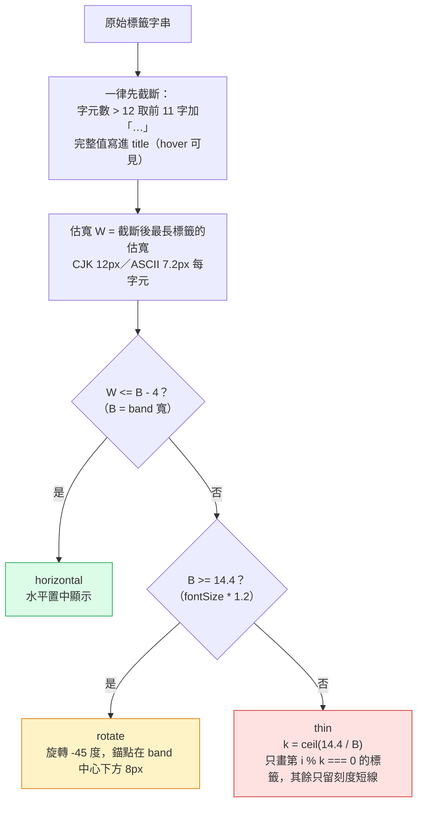
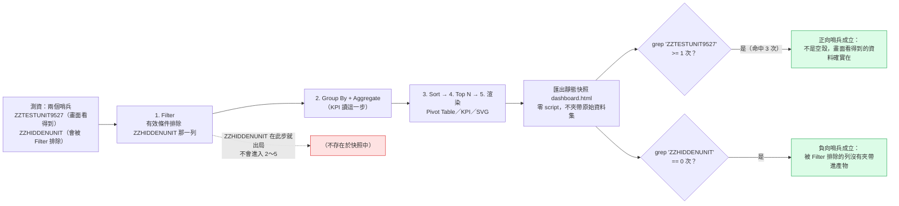

# Day12：CSV Pivot Dashboard（下篇）——手寫 SVG，以及「產物裡沒有夾帶原始資料集」怎麼證明

`Level 1b` `csv-pivot-dashboard` `零 SVG library` `靜態快照匯出`

👉 線上試用連結（未驗證，見文末「未驗證項目誠實揭露」）：`https://<GITHUB_USER>.github.io/2026ironman/VibeCoding/Day11_csv-pivot-dashboard/index.html`（本篇涵蓋圖表模組、匯出 Dashboard、離線版清空、列印驗收；上篇的樞紐引擎、Group By、彙總管線、KPI 見昨天的 Day11）

---

## 目錄

- [情境](#情境)
- [解題思路](#解題思路)
- [資源](#資源)
- [Vibe 過程](#vibe-過程)
- [產品](#產品)
- [心得與反思](#心得與反思)

---

## 情境

昨天 Day11 交出的是一個完全不含 SVG、可用的「Excel 樞紐分析替代品」——上傳 CSV、選 Dimension／Measure、看表格與 KPI。今天要補的三件事，才是 PRD 10 標題裡「Dashboard」這個字真正的份量：把彙總結果畫成圖、把畫好的東西匯出成一份能單獨拿去分享的靜態頁面、以及確保這份產品自己的離線版清空乾淨。

`tasks.md` 把這三件事拆成 6 條 task（6–11），加上昨天的 5 條，整份任務書共 11 條，超過共通規則「單份不超過 10 條」的字面上限。裁示（`sdd/LEVEL1B_RULINGS.md` 第 4 節第 13 條）是保留 11 條：契約第 7.4 節明文規定手寫 SVG 的座標映射、軸刻度取整、標籤重疊、色盤、以及**四種退化情形**都必須各自獨立成 task，不能塞進「畫圖表」一條裡；上一輪修正曾為了湊到 10 條把退化情形併回渲染任務，那正是 7.4 節寫來防的事——為了數量規則去犧牲品質規則，方向反了。裁示的計算基準改成「以發文日計算」：Phase A（Day11）5 條、Phase B（Day12）6 條，兩天皆未超過各自的 10 條上限，這是本題專屬的例外，其餘五題不得援引。

今天建立的 `VibeCoding/shared/ui-chart-svg.js` 是 Level 1b 系列裡唯一一支進 `shared/` 的產出——`csv-decode.js`／`csv-parse.js`／`csv-write.js`／`csv-types.js` 都是開工前的前置工程一次做完，圖表模組卻特意排在下篇才建，理由記在契約第 6.2 節：手寫 SVG 的邊界處理要邊做邊看實際資料才收斂得掉，關在前置工程裡等於閉門造車。但它一開始就寫成共用模組，不是先幫這題寫一份、明天 Day13 再複製——因為 Day13（`csv-one-page-report`）確定會用到同一支模組，這不是「猜測未來會共用」，是已知的排程。

## 解題思路

### (a) 為什麼不引 Chart.js：決定性理由是「內嵌兩次」

這系列從 Day01 開始就在講「零依賴」，但今天是這條原則第一次被真正的數字壓著測：需求只有 Bar／Line／Pie 三種圖、資料點數十到數百、不需要動畫與互動 tooltip，看起來 Chart.js 這種成熟函式庫是合理選擇。但這題有一個其他題都沒有的結構——匯出的靜態快照 dashboard 要能離線觀看，等於畫圖能力必須跟著產物走一份。`bundle.py` 不做 minify，所以圖表函式庫要背兩次：一次在工具本體（`index.html`），一次在每一份匯出的 dashboard 裡。

| 方案 | 工具本體 | 匯出產物 | 合計 |
|---|---|---|---|
| Chart.js 4.5.1 | 208 KB | 208 KB | **417 KB** |
| uPlot | 51 KB | 51 KB | 102 KB（Pie 支援弱） |
| 手寫 SVG | ~0 | ~0 | **0** |

417 KB 換三種基本圖表，不成比例。這個決定寫在契約第 7.4 節，也附了一句誠實的但書：手寫 SVG 的體積是推測值（決定當下沒有實際寫程式），如果做完發現遠超預期，允許改用 uPlot——但不能中途換方案。今天做完之後，這個「如果」沒有發生。

### (b) 軸刻度取整：為什麼要 `niceNum()`／`niceScale()`

如果 Y 軸刻度直接把 `[dataMin, dataMax]` 五等分，資料範圍是 `[3, 17]` 時會得到 `3, 5.8, 8.6, 11.4, 14.2, 17` 這種刻度——沒有人類會這樣讀圖表。`ui-chart-svg.js` 用的是 Heckbert《Graphics Gems》的 nice numbers 演算法：

```
niceNum(x, round):
    exp = floor(log10(x))
    f   = x / 10^exp
    nf  = round ? (f<1.5?1:f<3?2:f<7?5:10) : (f<=1?1:f<=2?2:f<=5?5:10)
    return nf * 10^exp
```

`niceScale(3, 17)` 依此算出 `[0, 5, 10, 15, 20]`，`niceScale(0, 100)` 得 `[0, 20, 40, 60, 80, 100]`——刻度永遠落在 1／2／5 的整數倍上，不會出現 `0, 3.33, 6.67` 這種除不乾淨的值。task 6 的驗收條件逐一手算了四組期望值並跟實測輸出比對，全部相符。

但這個演算法本身有一個副作用：`niceScale(0, 0.3)` 用浮點數累加 `niceMin + i * step` 產生刻度，末項算出來是 `0.30000000000000004`，不是 `0.3`——這是 IEEE 754 浮點數的老問題，不是邏輯錯誤。`ui-chart-svg.js` 的處理是在每個刻度算完後 `Number(v.toFixed(10))` 去尾：

```js
ticks.push(Number((niceMin + i * step).toFixed(10)));
```

task 6 驗收條件要求把去尾前後兩個值都印出來比對，不是只驗結果「看起來對」——`0.30000000000000004` 若直接丟給 `Intl.NumberFormat` 格式化，多數情況下顯示層會四捨五入掩蓋掉，但如果拿這個值去做後續比較（例如判斷某個刻度是否等於某個資料值），浮點誤差就會在看不到的地方咬人。

同一批邊界處理裡，標籤重疊的決策鏈也是寫死順序、由上而下第一個成立者生效，不是「先旋轉再看要不要截斷」這種可以互換順序的規則：



task 6 驗收條件用固定標籤「教育處」（3 個 CJK 字元）搭配三種 band 寬各跑一次：`B=60` 得 `horizontal`、`B=20` 得 `rotate`、`B=6` 得 `thin` 且 `k=3`，跟上圖三條路徑一一對應。

### (c) 四種退化情形為什麼要獨立成 task

Bar／Line／Pie 三種圖各自要處理無資料、單一資料點、全部為零、含負值四種退化情形——這件事契約第 7.4 節寫得很直接：「必須各自獨立成 task，不能塞在『畫圖表』一條裡」。這條規則背後的教訓，本題自己踩過一次：上一輪修正過程中，為了把 `tasks.md` 壓到 10 條的字面上限，曾經把這四種退化情形併回 task 7（Bar/Line/Pie 基本繪製）那一條，理由是「反正驗收條件都寫在同一份文件裡」。但退化情形跟正常繪製是完全不同的兩件事——正常繪製要驗證的是「圖畫對了沒」，退化情形要驗證的是「不該畫圖的時候有沒有畫錯圖」。空群組時如果照常呼叫 `niceScale()`，`dataMax - dataMin === 0` 會讓 `log10(0)` 算出 `-Infinity`，這種錯誤只有在把退化情形當成獨立驗收項目、逐一列出「0 組」「1 組」「全 0」「含負值」四種輸入分別跑一次，才會被系統性地攔下來，混在「畫圖表」一條裡驗收，很容易只驗了正常路徑就打勾。

四種情形在三種圖上各自的行為並不對稱，這也是必須逐一列出而不能一句「妥善處理」帶過的原因：

- **無資料**：三種圖一律不輸出 `<svg>`，改輸出 `.chart-empty` 文字提示。這條規則本身也有一個容易忽略的陷阱——空的座標軸看起來會像「所有數值都是 0」，是一種會誤導使用者的錯誤訊息，所以不能連座標軸都畫。
- **單一資料點**：Bar 正常畫 1 根；Line 沒有第二個點連不成線，改畫一個實心圓點加一條水平虛線並註記「僅 1 個資料點，趨勢線無意義」；Pie 畫整圓標「100%」。
- **全部為零**：Bar／Line 的 Y 軸固定 `[0, 1]`、step `0.2`，在基線畫一個 2px 標記讓使用者知道類別存在而不是資料消失了；Pie 因為占比算不出來，直接回 `.chart-empty`。
- **含負值**：Bar／Line 畫一條零線，負值長條往下延伸；Pie 完全拒繪——負值在圓餅圖上沒有合法的幾何表示，取絕對值或截為 0 都是造假。

### (d) 匯出靜態快照：只驗「哨兵在」不夠，必須同時驗「哨兵不在」

task 9 的匯出格式在裁示階段就定案為 **A1 靜態快照**：零 `<script>`、不夾帶原始資料集。「不夾帶原始資料集」聽起來像一句原則性的話，但要把它變成可執行的驗收條件，本題遇到一個方法論上的坑：只驗「敏感字串不在產物裡」，一個空檔案也會通過。如果驗收條件寫成「`grep 'ZZTESTUNIT9527' dashboard.html` 等於 0」，那麼渲染邏輯整段沒接上、匯出出來的是一張白紙，這條驗收一樣會打勾。

task 9 的做法是準備兩個哨兵，測資裡各放一列：

- `ZZTESTUNIT9527`——一個會被 Group By 選中、會出現在 Pivot Table／KPI／圖表上的正常值
- `ZZHIDDENUNIT`——它的 Group By 維度值會被一條有效的 Filter 條件在管線第 1 步就排除掉，因此永遠不會進入 KPI 讀取的第 2 步結果、不會進 Pivot Table、也不會進圖表

匯出後跑兩條方向相反的 grep：`ZZTESTUNIT9527` 必須 **大於等於 1**（畫面上看得到的東西真的在，證明不是空殼），`ZZHIDDENUNIT` 必須 **等於 0**（被排除的東西真的沒被夾帶進去）。單獨驗第一條只能證明「有內容」，單獨驗第二條只能證明「沒有某個字串」，兩條合起來才真正逼近「產物內容等於畫面上看得到的東西，不多也不少」這個目標。



實測結果：`ZZTESTUNIT9527` 在 dashboard 產物裡命中 3 次（分別出現在 Pivot Table、KPI 摘要與圖表 tooltip 三處），`ZZHIDDENUNIT` 命中 0 次。

### (e) 列印驗收為什麼要在 Day12 做，不能留給 Day13

契約第 7.4b 節（2026-08-23 補訂）記錄了一次差點造成返工的衝突：跨題審查發現 Day11 原本打算用 CSS 百分比控制 SVG 尺寸，Day13 卻要求明確的 `width`／`height` 屬性，兩者正面衝突。如果這個衝突不在 Day12 建立模組的當下解決，等 Day13 真正做 A4 列印時，圖表在 Chrome 會坍縮成 0×0——屆時只能 fork 一份模組出來單獨改，那就等於白做了共用的意義。

所以契約明訂了硬性要求：每個 `<svg>` 必須同時帶明確的 `width`／`height` 屬性與 `viewBox`，不得只靠 CSS 百分比；`opts` 要支援指定固定像素尺寸，供列印時使用。task 11 的驗收就是直接把這條要求兌現：用 Playwright 對含圖表的頁面呼叫 `page.emulateMedia({ media: 'print' })` 後量測 `document.querySelector('svg').getBoundingClientRect()`，實測結果寬高為 `800×400`，不是 `0×0`；再轉成點陣圖用 `pdftoppm` 量測非白像素邊界，得 `2027×912`；用固定像素尺寸呼叫（`opts.width`／`opts.height`）跟 `getBoundingClientRect()` 讀回來的值比對，誤差為 0px。模組是 Day12 建的，列印壞掉就是 Day12 的缺陷，這個驗收不留到明天才補。

## 資源

- **圖表模組**：`shared/ui-chart-svg.js`（本題建立，`CSV_CONTRACT.md` 第 6.2 節），對外三個函式 `renderBarChart(series, opts)`／`renderLineChart(series, opts)`／`renderPieChart(series, opts)`，一律回傳字串，不碰 DOM
- **色盤**：Okabe–Ito 色盲友善色盤 7 色加 1 補色共 8 色，灰色 `#999999` 不進循環，專用於 Pie「其他」與退化狀態佔位
- **軸刻度演算法**：`niceNum()`／`niceScale()`，Heckbert《Graphics Gems》nice numbers
- **標籤截斷**：`escapeHtml()`（`shared/util-escape.js`）處理過的文字才進 `<text>`／`<title>`
- 契約文件：`VibeCoding/shared/CSV_CONTRACT.md` 第 6.2 節（模組歸屬）、第 7.4／7.4b 節（選型理由與五項硬性要求）
- 承接昨天：Group By、彙總引擎、Pivot Table、KPI 皆沿用 Day11 的資料層，本篇不重複實作

## Vibe 過程

Phase B（任務 6–11）由 sonnet subagent 實作，指揮官複驗。任務 6 只做基座，三個 render 函式先回傳空骨架，`niceScale()` 四組期望值與浮點去尾都在這一步驗完，之後才在任務 7 接上實際繪製邏輯，任務 8 再補四種退化情形——這個順序本身就是在落實「不要把退化情形塞進畫圖表那條」的分工。

### 驗收條件字面上不可能成立：負值 bar 的 `y` 座標

task 8 的驗收條件原文寫著「含負值時 Bar 的零線 `<line>` 存在且負值 bar 的 `y` 大於零線 `y`」。這句話在寫下來的當下聽起來合理——負值往下延伸，「下面」在螢幕座標系裡數值更大——但實作時發現它字面上不可能成立。SVG 的 `<rect>` 元素，`y` 屬性指的是矩形**左上角**的座標，不是矩形的位置泛稱。負值 bar 是從零線往下畫的，矩形的左上角剛好就落在零線上，`y` 屬性的值等於零線的 `y`，不會大於它。真正代表「這根 bar 延伸到零線以下」的座標關係是 `y + height` 大於零線的 `y`——這才是矩形的下緣。

```js
var top = v >= 0 ? y(v) : zeroY;
var bottom = v >= 0 ? zeroY : y(v);
var rectY = Math.min(top, bottom);
var rectH = Math.max(0, bottom - top);
// 負值時：rectY === zeroY，rectY + rectH === y(v) 才是真正落在零線下方的那個座標
```

這是本專案第八次抓到「驗收條件字面上寫不通」這類問題（前幾次多半是驗收工具本身有陷阱，例如 Day10 的 macOS `unzip` 不支援 EFS bit、Day05／Day06 的 `.nav-back` grep 不可能歸零），但這次不太一樣——前幾次都是驗收工具的行為跟預期不符，這次是驗收條件本身對 SVG 座標系統的理解有誤，而且是實作者自己在寫程式碼、對照 `y` 屬性的實際語意時發現的，不是靠獨立驗收的另一雙眼睛抓到的。修正後的驗收判準改成量測 `y + height`，實測負值 bar 確實延伸到零線以下，方向正確。

### 離線版驗收時的一次假陽性：註解裡的哨兵字串

task 10 的驗收要求對下載到的離線版跑 `grep -c 'ZZSALARYCOL'`（欄名哨兵）與值哨兵各自等於 0，證明清空徹底。第一次跑這條驗收時 `ZZSALARYCOL` 命中了 1 次——但畫面上手動檢查，下拉選單、Pivot Table 表頭、Filter 欄位選單全部確認過，看不到這個欄名的蹤影。追下去發現命中的位置是程式碼本身的一段註解，寫驗收流程說明時把真實測資用的哨兵字串原樣寫進了程式碼裡當作範例文字，而不是用一個佔位符描述「這裡放測資欄名哨兵」。程式碼裡的字面字串一樣會被 `grep` 命中，跟畫面上實際殘留的資料是兩回事，但驗收指令分辨不出這個差異。

修法是把註解裡的範例改成不會被誤判的敘述性文字，不直接抄測資裡真正會用的哨兵字串。這件事也提醒了一個對稱的教訓：task 9 用哨兵字串驗證「產物裡有沒有夾帶資料」，這個方法本身有效，但前提是哨兵字串只能出現在真正的資料流路徑裡，不能同時出現在程式碼、註解、或任何跟「這次操作載入的實際資料」無關的地方——否則驗收指令量到的就不是它原本想量的東西。

## 產品

上傳一份 CSV、選好 Dimension／Measure／Aggregate 之後，圖表分頁會即時畫出 Bar／Line／Pie 三種圖，切換 Group By 或 Aggregate 時圖表跟著重畫。長條圖與折線圖固定藍色 `#0072B2`（單一 Measure 不用多色，避免暗示不存在的分類語意），圓餅圖依色盤循環上色，類別超過 9 個時第 9 片合併為灰色「其他」。座標軸刻度一律用 nice numbers 取整，不出現除不乾淨的小數；X 軸標籤過長時依序嘗試水平置中、旋轉 -45 度、每隔 k 個抽稀顯示，抽稀時圖下方固定提示「類別過多，每 k 個顯示 1 個標籤」。無資料、單一資料點、全部為零、含負值四種情形，三種圖各自有明確定義的行為，不會畫出誤導性的空座標軸或不存在的比例。

匯出「Dashboard HTML」產出一份零 `<script>`、不含原始資料集的靜態快照，頂端固定提示「本檔含資料快照，分享前請確認可外流」，離線用 `file://` 開啟時 KPI、Pivot Table、圖表與匯出當下的畫面逐項一致，Network 面板顯示 0 筆對外請求。「下載本工具離線版」則走另一個方向：`buildCleanHtmlCopy()` 清空所有使用者資料痕跡，包含 Dimension／Measure／Filter／Sort 四組下拉裡從 CSV 欄名動態產生的 `<option>`——欄名本身就是使用者資料，這是本題比其他 Level 1a 題目多出來的一個清空漏點。列印時圖表維持固定像素尺寸，A4 輸出下 SVG 邊界寬高皆大於 0，不會坍縮。

## 心得與反思

**規格↔實際產品**這一層，這次的落差發生在最不該出錯的地方——驗收條件本身。「負值 bar 的 `y` 大於零線 `y`」這句話寫的時候，腦中想的是「負值往下畫」這個直覺畫面，但沒有回頭核對 SVG `<rect>` 的 `y` 屬性實際代表矩形哪個角。這跟這系列前幾次抓到的「驗收條件寫不通」略有不同：之前幾次多半是對工具行為（`unzip` 不支援 EFS、CSS 內嵌後 grep 不可能歸零）有錯誤假設，這次是對 SVG 座標系統本身的語意有誤解。同一類問題出現在越來越具體的技術細節上，代表寫驗收條件時光靠「聽起來合理」是不夠的，凡是牽涉到座標、屬性語意這種有精確定義的東西，寫下驗收條件之後應該先自己對著規格核一次，而不是等實作者寫程式碼時才發現字面兜不攏——這次算幸運，是實作者自己在動手時發現的，不是留到獨立驗收才被抓到。

**AI 規劃↔腦中藍圖**這一層，離線版驗收的假陽性是個小事故，但值得記：寫驗收流程說明時，把真實的哨兵字串原樣抄進了程式碼註解，變成自己的檢查指令抓到自己寫的範例。这跟本篇一開始特別提醒過的「示範檢查指令要用佔位符，不要把真實要搜尋的字串原樣寫進程式碼」是同一種錯誤模式——差別是這次的當事人是實作過程中的一份程式碼註解，不是最終文件。這提醒一件更根本的事：任何會被拿去做字面比對（grep／字串比對）的驗收，寫測資與寫程式碼的人都要記得，凡是「這個字串應該只出現在真實資料流裡」的哨兵，就不能在任何跟資料流無關的地方（程式碼、註解、文件範例）重複出現同一個字面，否則驗收工具沒有能力分辨這兩種「命中」的差別。

**表達↔AI 理解**這一層，「不引 Chart.js」這個決定第一次被壓上真正的數字。之前幾題講零依賴，大多是在講「這個小需求不值得換一個 library」，這次不一樣——如果只看工具本體，208 KB 換三種圖表未必划不來；讓決定翻盤的是「內嵌兩次」這個本題特有的結構（匯出的離線 dashboard 也要能畫圖），把成本乘以二之後才真正壓過門檻。這提醒一件事：零依賴這條原則不是無條件適用的教條，它的說服力來自每次都把實際成本算出來，而不是預設「手寫永遠比較好」。

---

### 未驗證項目誠實揭露

本篇引用的效能與驗收數字（`niceScale()` 四組期望值、`ZZTESTUNIT9527` 命中 3 次、列印 SVG 邊界 `800×400`、`pdftoppm` 非白像素 `2027×912`）取自 git commit `88ad63f` 的複驗記錄與 `tasks.md` 對應任務的驗收條件描述，本文作者未另外重跑驗證。線上連結（`<GITHUB_USER>.github.io`）未執行 `curl` 或瀏覽器實測，是否可正常開啟、當下呈現內容是否與本文描述一致，請以發文當下實際重新測試為準。
