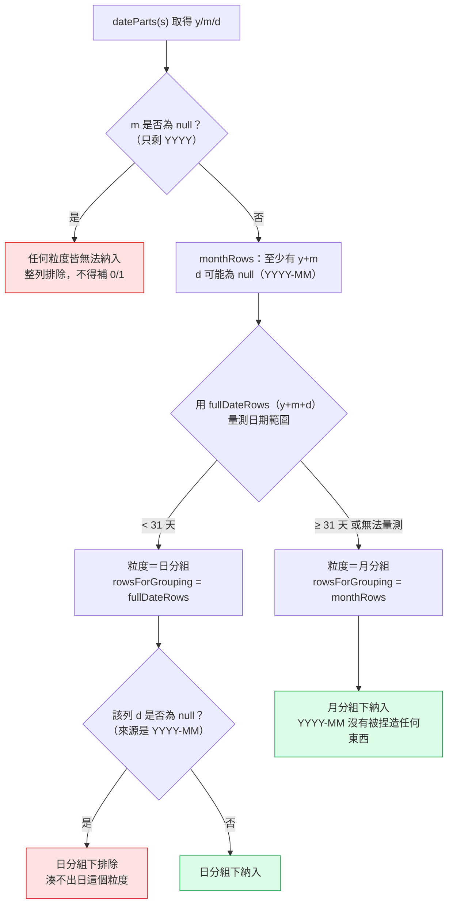

# Day13：CSV 一頁式管理報告——一條「測資剛好無法區分正解與誤解」的驗收陷阱

`Level 1b` `csv-one-page-report` `按鈕觸發` `A4 直式列印`

👉 線上試用連結（未驗證，見文末「未驗證項目誠實揭露」）：`https://<GITHUB_USER>.github.io/2026ironman/VibeCoding/Day13_csv-one-page-report/index.html`

---

## 目錄

- [情境](#情境)
- [解題思路](#解題思路)
- [資源](#資源)
- [Vibe 過程](#vibe-過程)
- [產品](#產品)
- [心得與反思](#心得與反思)

---

## 情境

Level 1b 五題 CSV 工具做到這裡只剩最後一題。PRD 11 的需求很直白：資料分析完成後，主管通常不是要操作樞紐表，而是要一張能列印出來、帶去開會的紙——KPI、排名、趨勢一次看完，不用自己拉欄位。

這題跟兩天前做完的 `csv-pivot-dashboard`（Day11＋12，上下篇）吃同一份 CSV、用同一套資料層，畫面上看起來甚至有點像：都有 KPI 卡、都有分組彙總、都有圖表。但 proposal.md 在動工前就把這件事講清楚：**本題不是 pivot dashboard 的縮小版**。pivot dashboard 是使用者自己一直換欄位、換 Aggregate、加 Filter 的探索工具；這題是使用者已經知道要看什麼，選一個 measure、一個 dimension，按一次「產生報告」就定稿——定稿之後不會再變，適合列印或存成 PDF 交出去。分工不同，兩題該做的事也刻意不同：本題不加圖表類型切換、不加多維度 Group By、不加互動式 Filter，這些是 pivot dashboard 的範圍，重複做只會模糊兩題的定位。

技術上，這題直接沿用 Day12 建立的 `shared/ui-chart-svg.js`——不重寫任何圖表繪製邏輯。這件事本身回頭印證了一個開發順序上的決定：`ui-chart-svg.js` 從一開始規劃時就不是只服務 Day12 一題，`CSV_CONTRACT.md` 第 7.4b 節「硬性要求」那六條（明確 `width`/`height`/`viewBox`、支援固定尺寸呼叫、`fill` 屬性上色、標籤截斷、色盤中性色參數）沒有一條是 Day12 自己會需要卻 Day13 用不到的——全部六條都是因為契約起草時已經知道 Day13 也要用同一個模組，才提前寫死。這篇文章的重點，除了圖表模組的延續之外，是這一天遇到的一個更值得記的方法論案例：**一條驗收條件的測資，剛好無法區分「正解」與「一個看起來合理但過嚴的誤解」，直到裁示補上第二份測資才被抓出來。**

## 解題思路

### 一頁式報告要彙整什麼：KPI、Top5/Bottom5、占比、趨勢

proposal.md 把畫面拆成五個固定區塊，全部由使用者選定的一個 measure（數值欄）與一個 dimension（分類欄）驅動：

- **KPI Cards**：固定 4 張，SUM／AVG／COUNT／MAX，不可自訂（PRD 只寫「KPI Cards」沒給數量，指揮官裁示不開放勾選 UI）
- **Top5／Bottom5**：依 dimension 分組、對 measure 做 SUM 聚合，取排序後前 5／後 5，分組數不足 5 時如實顯示實際筆數，不補空列
- **分類占比**：沿用契約 7.4b 的門檻——類別數 ≤9 全畫，≥10 取前 8 大 + 其餘併為「其他」（固定灰階，不從一般色盤挑色）
- **日期資料趨勢**：固定依月分組，日期範圍不足 31 天時退化為日分組，無日期欄則整段隱藏改顯示提示文字

跟 pivot dashboard 比，這裡的每一項都「少一個維度」：pivot dashboard 的 Group By 可以選到兩欄、Aggregate 可以切換五種、KPI 是「Filter 後全體」的動態統計；這題的 KPI 是四張寫死的卡，Top5/Bottom5 的聚合方式固定是 SUM，分類占比與趨勢的粒度也都不開放使用者調整。這種「刻意做少」不是功能不足，是產品定位決定的——定稿報告的價值在於穩定，不在於可調。

### KPI 計算前先過濾，且要讓使用者看得到排除了多少

計算 SUM/AVG/COUNT/MAX 之前，`inferColumnTypes()` 標記為 `mismatchLines` 的非數值格與空值格（依契約 3.2 節，空值只有空字串 `''`）一律不納入計算，畫面上同時顯示「納入計算筆數 / 總筆數」，例如「128 / 130 筆」。這條規則延續 Day08「parser 不做貼心修正」的家族原則，往下延伸到聚合層：排除規則要讓使用者看得到，不悄悄跳過。

取格一律走 `cellAt(row, i)`，不得直接寫 `row.cells[i]`——短列缺格若直接存取會拿到 `undefined`，`cell === ''` 判斷為 `false`、`cell.trim()` 直接丟 `TypeError`，這是整個 Level 1b 契約第 3.2.1 節的硬性規定，Day13 的驗收條件之一就是全檔案 grep `row.cells[` 必須 0 筆。

### 匯出單一 HTML vs 下載離線版：資料方向完全相反

這題有兩個匯出按鈕，目的和驗收方向剛好相反：

- **匯出單一 HTML**：目的是「把算好的報告帶著走」，PRD 驗收條件明寫「輸出 HTML 不需重新上傳 CSV」，所以要把 KPI／Top5/Bottom5／占比／趨勢的已計算結果連同 SVG 內容直接寫進匯出檔——**不清空任何資料**，清空了就違反這條驗收條件本身
- **下載本工具離線版**：目的是分享「這個空白工具」，必須清空所有使用者資料——上傳過的 CSV、已選欄位、標題／期間／註記輸入、已算出的結果，一律清空，並移除 `#__shared_toast` 動態元素與 `.nav-back` 外連

兩者資料保留的期望完全相反，proposal.md 明確要求兩條路徑各自獨立實作，不共用「複製當下頁面再事後清空」的邏輯——`CONTRACT.md` 第 6 節已經記過這類疏漏（`showToast()` 動態插入的元素不在表單欄位裡，容易被漏清，Level 1a Day05 踩過同一類缺陷）。

驗證「匯出單一 HTML 沒有夾帶原始 CSV 全表」用的是雙哨兵法：測資準備 14 個分類，一個哨兵 `ZZHIDDENCAT` 放在依 measure 排序的第 9 名——刻意選在「占比圖只畫前 8 大」與「Bottom5 蓋住最後 5 名」都躲得掉的位置（14 類時第 9 名是唯一躲得掉兩者的解，11 類時無解，任何名次都會落進某一個輸出區塊，那條驗收會變成必定失敗的假性失敗）；另一個哨兵 `ZZVISIBLECAT` 放在會進 Top5 的名次。匯出後精確搜尋：`ZZHIDDENCAT` 必須 0 筆（證明中段分類沒有被整份夾帶），`ZZVISIBLECAT` 必須 ≥1 筆（證明 Top5 真的有資料，不是空殼）。只驗第一項的話，一個空白檔案也會通過。

離線版清空的驗證則分成兩種判定方式，明確標註不可混用：原始碼精確搜尋哨兵字串（`ZZCATEGORYVAL`、`ZZTITLE`、`ZZPERIOD` 等，這些字串正常情況不可能出現在程式碼裡，應為 0 筆）；`#__shared_toast` 與 `.nav-back` 則必須用 Playwright 載入 DOM 斷言判定——因為 `shared/ui-toast.js` 與 `base.css` 本來就含這兩個字串，會被 `bundle.py` 內嵌進產物，原始碼 grep 永遠會命中，字面上不可能通過。這條區分是這個系列反覆撞出來的教訓，第六次以上出現在契約文件裡，這題只是照著已經寫好的方法再做一次。

### 這一天真正的坑：一律排除 `YYYY-MM`，看起來對，但過嚴

日期趨勢分組要拆年月日，一律經共用的 `dateParts(s)`，回傳 `{y, m, d}`，`m`／`d` 缺項回 `null`，不符白名單整體回 `null`。契約第 4.0b 節裁示 12 早就講清楚：`YYYY` 這種只有年份的資料，`m`／`d` 不能用 0 或 1 補，否則「2026 年」會在趨勢圖上憑空長出一個不存在的 `2026-01-01`。

問題出在 `YYYY-MM`（只有年月、沒有日）這種介於中間的情況。Day13 實作時面對「`m` 有值但 `d` 為 `null`」的列該不該排除，第一直覺很容易套用同一條「缺項不能補」的邏輯，直接寫成「`m` 或 `d` 任一為 `null` 就整列排除」。實作者採了這個字面解讀，但主動在提交裡標註「此子情境未經裁示，僅有間接依據」——這個回報行為本身是對的，不確定就講清楚，而不是自己認定答案明顯就繞過去。

指揮官複驗時給出的裁示（`LEVEL1B_RULINGS.md` 裁示 18）是：**排除規則依「當下粒度」而定，不是一律排除**。

| 當下粒度 | 需要的欄位 | `YYYY-MM`（`d === null`） |
|---|---|---|
| 月分組（`y`／`m`） | `y` + `m` | **納入** |
| 日分組（`y`／`m`／`d`） | `y` + `m` + `d` | 排除 |

理由是裁示 12 要防的是「捏造出不存在的日期點」——把 `2026` 補成 `2026-01-01` 是捏造，但把 `2026-08` 放進「2026-08」這個月桶，沒有捏造任何東西，那就是它本來的粒度。一律排除反而是無故丟掉真實資料：使用者明明給了月份，報告卻說這一列沒有日期。

真正值得記下來的是這條裁示為什麼會被漏掉、又為什麼能被抓到：`tasks.md` 任務 5 原本準備的測資跨度不到 31 天，依規則本來就會退化成日分組——而在日分組底下，`YYYY-MM` 本來就該排除（沒有日，湊不出日分組要的粒度）。也就是說，**「一律排除」跟「依粒度而定」這兩種寫法，在這份測資上會得到一模一樣的結果**，測資本身無法區分哪一種寫法是對的。這跟裁示 15（`csv-infra` 任務 7 的 `0.9` 門檻測資矛盾）是同一類問題：驗收測資必須能區分正解與誤解，否則驗了等於沒驗。修法是另外補一份跨度超過 31 天、含 `YYYY-MM` 列的測資，逼這一列必須出現在月分組結果裡，兩種寫法才會分出高下。

實作採用的修正是把日期列分兩層：`monthRows` 收 `m !== null` 的列（`YYYY-MM` 在這一層納入），`fullDateRows` 再從 `monthRows` 裡篩出 `d !== null` 的列，用來量測日期範圍以決定粒度、也是日分組實際要用的資料。月分組用 `monthRows`，日分組用 `fullDateRows`——`YYYY-MM` 在月分組下自然被涵蓋，在日分組下自然被排除，不需要另外寫一條特例判斷。

### 列印是這題的技術主角，但「一頁式」不是無條件保證

proposal.md 對「一頁式報告到底是不是硬性保證」給了一個誠實的答案：以一頁為設計目標，用兩道有界防線讓正常情境下必為一頁，但不對瀏覽器渲染差異做 100% 數學保證。防線一是內容筆數有界——Top5/Bottom5 固定最多 5 筆、分類占比類別數上限、KPI 卡片固定 4 張，這些區塊的版面高度不會隨資料量無限增長；防線二是自由文字有界——標題／期間／註記三個輸入框設 `maxlength`（60／40／200），從輸入端就阻止文字撐爆版面，而不是排版完再用 `overflow: hidden` 事後補救（`overflow: hidden` 在列印時的實際生效行為不同瀏覽器不一致，不能拿來當防線）。無法保證的部分也寫得很清楚：分類名稱字串本身長度不可控，這是圖表模組自己要處理的標籤截斷問題（契約 7.4b 已列為硬性要求）；不同作業系統與使用者手動調整的預設列印字級差異，理論上仍可能讓內容溢到第二頁，這是瀏覽器渲染環境決定，不是本題程式碼能完全控制的。因此驗收條件不能寫「看起來是一頁」這種主觀敘述，改用 Playwright 產生 PDF 後客觀檢查頁數與各區塊的邊界框。

列印 CSS 有三個容易忽略的技術點，proposal.md 逐條查證過來源：`@page { size: A4; margin: 2cm }` 用實體單位而非 `px`，因為列印目標是實體紙張，`px` 在不同印表機 DPI 下不可靠；報表容器要顯式設定 `print-color-adjust: exact`（並保留 `-webkit-print-color-adjust: exact` 相容舊版），因為瀏覽器預設的 `print-color-adjust: economy` 會為了省墨拿掉背景色與圖表配色，而這份報表的顏色是內容本身（KPI 卡片底色、占比圖色塊、「其他」類的灰階），不是裝飾；四個主要區塊各自套 `break-inside: avoid`，避免表格或圖表被硬切一半。SVG 列印還有一個瀏覽器實測坑：Chrome 列印時不支援 viewport 相對單位（`vw`/`vh`），若 SVG 尺寸依賴這類單位會被壓縮成 0×0——這正是 `ui-chart-svg.js` 一開始就被要求「必須有明確 `width`/`height` + `viewBox`」的原因，圖表模組提早滿足了這條要求，Day13 不用回頭修圖表模組本身，只需要在報表容器層做好列印 CSS。

## 資源

- **CSV 解析與資料層**：全部沿用 `sdd/csv-infra/` 前置工程建立的 `shared/csv-decode.js`／`csv-parse.js`／`csv-write.js`／`csv-types.js`，本題不重做
- **型別推論／數值解析／日期擷取**：`inferColumnTypes()`／`toNumber()`／`dateParts()`（`csv-types.js`），依契約 4.0b 唯一判準
- **圖表模組**：`shared/ui-chart-svg.js`（Day12 建立），本題直接呼叫產生圓餅圖與折線圖，不重寫繪製邏輯
- **XSS 防護**：`shared/util-escape.js` 的 `escapeHtml(s)`，標題／期間／註記三個自由輸入欄位渲染前一律跳脫
- 契約文件：`VibeCoding/shared/CSV_CONTRACT.md` 第 4.0b 節（型別／`toNumber()`／`dateParts()` 唯一定義）、第 7.4b 節（`ui-chart-svg.js` 硬性要求）、`CONTRACT.md` 第 6 節（Level 1 共通 UI 基線、離線版清空硬性要求）
- 裁示依據：`sdd/LEVEL1B_RULINGS.md` 裁示 18（日期趨勢排除規則依粒度而定）

`toCsv()` 匯出走的是同一套契約層（第 4.2a 節），這裡順帶記一句：試算表公式注入防護（裁示 17）在 Day13 開工前已經補進 `shared/csv-write.js`，本題不需要另外處理，是自動繼承到的。

## Vibe 過程

任務 1–10 由 sonnet subagent 實作，指揮官獨立複驗，commit `48dd876`。

裁示 18 落地後，實作者針對修正跑了三項回歸測試：跨度 2026-01～08、含一列 `YYYY-MM` 的新測資，月分組下得到 4 個資料點，`YYYY-MM` 那一列確實被納入；原本跨度不到 31 天的舊測資重跑一次，維持日分組、2 個資料點，`YYYY` 與 `YYYY-MM` 兩類皆排除，確認沒有把舊行為改壞；兩次輸出裡都沒有出現任何非原始輸入的日期字串（沒有虛構的 `2026-01-01` 或 `2026-08-01`），確認裁示 12「不得用 0/1 補」的底線沒有被裁示 18 的放寬動到。

其餘驗收重點皆為 Playwright 實跑，非人工目視判斷：

- **XSS**：標題／期間／註記三個注入點分別打入 `` 與 ``，`page.evaluate()` 讀回 `window.__xss`／`window.__xss2` 皆為 `undefined`，預覽區容器內查無被注入的 `script`／`img` 元素
- **列印**：PDF 頁數收斂為 1 頁（commit 記錄提到最初版本會跑到 3 頁，逐步調整列印版型才收斂下來）
- **匯出單一 HTML**：前述雙哨兵法，`ZZHIDDENCAT`（第 9 名，畫面看不到）0 命中，`ZZVISIBLECAT`（第 1 名，畫面看得到）≥1 命中，並有正向對照證明 grep 指令本身有效（先確認哨兵字串故意存在時抓得到，再驗證正式輸出裡抓不到）
- **離線版**：5 個哨兵字串原始碼精確搜尋 0 命中；DOM 層確認 `document.getElementById('__shared_toast') === null`、`.nav-back` 元素數為 0；且驗證了「前置狀態」——toast 確實在操作過程中真的觸發過、欄名哨兵確實曾出現在 live DOM 的 `<option>` 裡，不是本來就沒資料的假性通過
- **邊界情況**：空 CSV、只有 1 個分類、類別數恰為 9（不合併）、類別數 = 10（前 8 + 其他）、缺日期欄、註記欄位打滿字數上限、5–20MB 大檔案提示、>20MB 大檔案拒絕，且拖放與檔案選取兩條上傳路徑分別測過，皆不崩潰

契約合規快掃（grep 全檔案）：`row.cells[` 0 筆（確認一律走 `cellAt()`）、全域 `isNaN(` 0 筆（確認一律用 `Number.isNaN()`）、實體控制字元 0 筆；唯一一處 `new Date()`（`:1145`）是報表產生時間戳，不是用來解析 CSV 裡的日期欄，不違反契約「禁止用 `new Date(字串)` 判斷日期」的規定。

實作者在 commit message 裡誠實標註了幾項未完全驗證的細節，本篇原樣轉述：PDF 頁數是用 `/Type /Page` 物件數推算，不是完整 PDF 結構解析；版面邊界框（bounding box）是近似量測，不是逐像素比對；未測 Firefox／WebKit 與 Windows 平台，這是契約既有的平台限制（本機為 macOS + Chromium），不是這一題新增的缺口。

## 產品

上傳一份 CSV，畫面依契約規則顯示檔名、編碼、`confidence`、分隔符、列數、欄數；`confidence` 為 `fallback` 時提供手動切換編碼下拉，切換後重新解碼並標記為 `manual`。選定核心 measure 與 dimension（下拉只列出 `inferColumnTypes()` 判為 `number`／`text` 的欄位），若有日期欄可另選粒度來源欄，按下「產生報告」才計算與渲染——按鈕觸發，非即時，因為這是「定稿」情境，不需要邊調欄位邊看報告跳動。

報表本體五塊：KPI 卡片（4 張，固定 SUM／AVG／COUNT／MAX，並標示納入計算筆數／總筆數）、Top5／Bottom5 排名表、分類占比圓餅圖（≥10 類時前 8 大 + 灰階「其他」）、日期資料趨勢折線圖（月分組，退化為日分組時如實反映；無日期欄則整段隱藏改顯示提示文字）。標題／期間／註記三個自訂欄位皆有字數上限，渲染前一律經 `escapeHtml()` 跳脫。

複製報告摘要按鈕會把標題、期間、4 項 KPI 數值、Top5/Bottom5 各筆分類名稱與數值組成純文字寫入剪貼簿，尚未產生報告前點擊會提示先產生報告而非複製空白內容。兩個匯出按鈕方向相反：「匯出單一 HTML」把已計算完成的結果與圖表 SVG 一起凍結進檔案，`file://` 雙擊開啟不需重新上傳 CSV，下載前有一行機敏資料提示（僅提示，不攔截）；「下載本工具離線版」則清空所有使用者資料與已算出的結果，交出去的是一個空白的工具。全程本機處理，不上傳任何資料。

## 心得與反思

**表達↔AI 理解**這一層，裁示 18 是這次最直接的案例：`CSV_CONTRACT.md` 裁示 12 講的是「`YYYY` 缺月日不能用 0/1 補」，這條規則表達得很清楚，但沒有明講「`YYYY-MM` 這種介於中間的情況該怎麼算」。實作者面對這個空隙時，選擇套用看起來最接近的既有規則（「缺項就排除」），這個選擇不是亂猜，是有明確的間接依據——但依據不等於裁示本身，實作者也清楚知道這一點，主動標註「此子情境未經裁示」。這個動作比答案本身更重要：規格覆蓋不到的地方，誠實地說「我不確定」，比自信地選一個看起來合理的方向更安全，即使後來證明選錯了。

**AI 規劃↔腦中藍圖**這一層，是這篇真正想記的教訓。`tasks.md` 任務 5 的驗收測資跨度不到 31 天，依規則退化成日分組——而「一律排除」跟「依粒度而定」這兩種寫法，在日分組底下算出來的結果完全一樣。也就是說，這條驗收條件從一開始就不可能抓出這個分歧，不是實作者沒測，是測資本身沒有能力做出區分。這跟裁示 15（`csv-infra` 任務 7 的 `0.9` 門檻矛盾）是同一種模式：規則之間留了一個測資覆蓋不到的縫隙，兩種互斥的實作都能通過同一組驗收，直到有人真的去想「這條規則的邊界在哪裡」才會發現。教訓已經寫進裁示 18 本身：驗收測資必須能區分正解與誤解，否則驗了等於沒驗——這句話值得往前貼到每一條驗收條件定案的當下去問一次，而不是等出了分歧才回頭補。

**規格↔實際產品**這一層，圖表模組的延續是這系列少見的「提前佈局後來證明正確」的例子。`ui-chart-svg.js` 在 Day12 動工前，契約 7.4b 節就已經把「明確 `width`/`height`/`viewBox`」「支援固定尺寸呼叫」「`fill` 屬性上色」這些要求寫死——這些要求沒有一條是 Day12 自己會需要卻用不到的，全部是因為契約起草時已經算進 Day13 要用同一個模組。Day13 實作時完全沒有回頭修圖表模組本身，只在報表容器層加列印 CSS 就讓圖表在 PDF 輸出裡正確顯示。這跟「先射箭再畫靶」的常見開發問題正好相反：靶是先畫好的，箭最後真的射中了。

**想↔表達**這一層，兩個匯出按鈕的分工是這題把「想法」轉成「可驗證規格」做得比較扎實的地方——「帶著走的報告」跟「分享的空白工具」聽起來像同一個「匯出」動作，但資料保留的期望完全相反，proposal.md 一開始就把這個分歧寫清楚並要求兩條路徑獨立實作，沒有出現「先複製當下頁面再事後清空」這種容易漏東西的捷徑，也沒有再次踩到 `#__shared_toast` 這個 Level 1a 就記過的坑。

---

### 未驗證項目誠實揭露

本篇「Vibe 過程」段落引用的實測結果（XSS、列印、雙哨兵匯出、離線版清空、邊界情況、grep 快掃）全部取自 git commit `48dd876` 的 commit message 與 `sdd/csv-one-page-report/tasks.md`、`sdd/LEVEL1B_RULINGS.md` 裁示 18 原文，撰寫本篇時未另外重跑這些 Playwright 測試。commit message 本身已標註 PDF 頁數為近似推算、bounding box 為近似量測、未測 Firefox／WebKit 與 Windows 平台，本篇原樣轉述這些限制，不做額外聲稱。線上試用連結未經 `curl` 或瀏覽器實測，是否可正常開啟請以發文當下重新測試為準。
