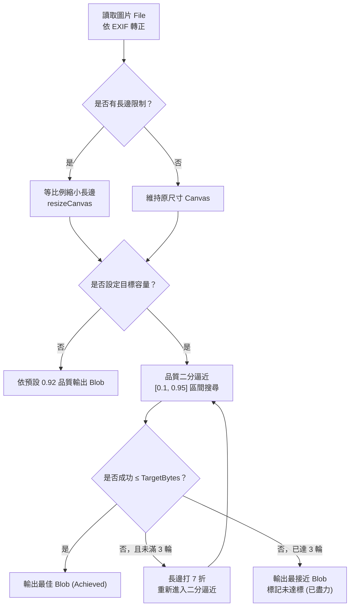
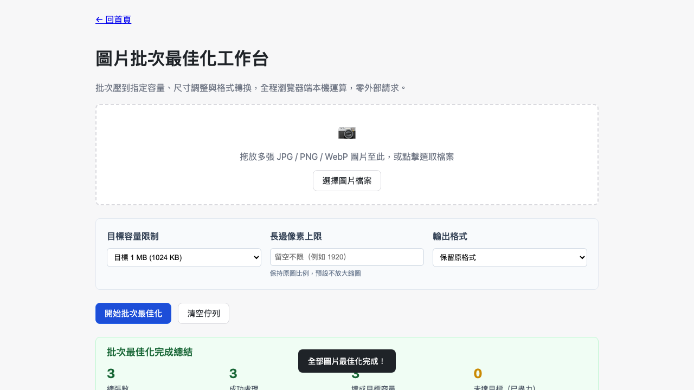

# Day 14 — 圖片批次最佳化工作台：壓到 1MB 以下的二分逼近與批次佇列

> 現代智慧型手機拍攝一張照片動輒 8–15MB，但 Email 附件、政府上傳系統或通訊軟體常限制單檔必須小於 1MB 或 2MB。使用者真正需要的不是手動微調壓縮品質滑桿，而是「幫我把這批照片壓到 1MB 以下」。今天我們進入 Level 1c 圖片處理篇的第一題，打造純瀏覽器端的「圖片批次最佳化工作台」。

---

## 🎯 情境：上傳限制下的批次壓縮痛點

在日常公務或行政流程中，常遇到以下場景：
- 活動或施工現場拍了 20 張高解析度照片，需要上傳到限制單檔 1MB 的報部系統。
- 若用傳統圖片編輯軟體逐張另存新檔、調整品質參數，既費時又難以精確命中「剛好小於 1MB」的最佳平衡點。
- 若丟到線上壓縮網站，敏感業務照片有外洩隱憂，且免費版往往有單日張數限制。

我們需要一個**零伺服器上傳、可離線使用、支援批次佇列、自動二分逼近目標容量**的純前端工具。

---

## 💡 解題思路：二分搜尋品質與多層降階管線

圖片壓縮本質上是「檔案大小（Bytes）」與「視覺品質（Quality）」的非線性關係。我們在 `shared/img-canvas.js` 實作了目標容量二分逼近演算法：

### 關鍵技術點
1. **EXIF Orientation 先行修正**：手機直拍照片在 Canvas 上若未讀取 EXIF 轉正標籤，會變成橫向旋轉。我們透過 `loadImageFile()` 先將畫布座標系校正為正確方向。
2. **二分搜尋目標品質**：在 `[0.1, 0.95]` 品質範圍內二分逼近，每次量測實際產生的 Blob 大小。
3. **尺寸降階 Fallback**：若最低品質 0.1 仍超過目標容量，自動將長邊打七折重試，最多 3 輪，確保盡可能滿足目標限制。
4. **PNG 格式的特殊處理**：`canvas.toBlob()` 對 PNG 格式會忽略 quality 參數，因此系統在偵測到批次含 PNG 且設定目標容量時，主動提示使用者轉檔為 JPEG。

---

## 🛠️ 資源與共用模組

- **fflate 0.8.3**：提供批次多檔案的二進位 ZIP 壓縮打包能力。
- **共用模組**：
  - `shared/img-decode.js`：圖片讀取與 EXIF 轉正。
  - `shared/img-canvas.js`：長邊等比例縮放與目標容量壓縮。
  - `shared/img-file-size.js`：檔案大小與批次總量安全閘門。
  - `shared/io-dropzone.js`：多檔批次拖放與選取。
  - `shared/io-zip.js`：二進位 Uint8Array 檔案 ZIP 打包。

---

## 🔄 Vibe 過程：AI 協作中的對齊與陷阱

在實作批次佇列與建置打包過程中，發生了幾次關鍵對齊：

1. **打包 Placeholder 的容器層級對齊**：
   - *問題*：最初在 `src/index.html` 中將 `<!--{{ASSET:fflate}}-->` 與 `<!--{{SHARED:...}}-->` 包在同一個 `<script>` 標籤中，而 `bundle.py` 替換時會自動為每個資源加上 `<script>` 標籤，導致產生巢狀 `<script>` 語法錯誤（`Unexpected token '<'`）。
   - *修正*：將所有資源 placeholder 獨立放置於外層，依據 `bundle.py` 的標準格式進行打包。
2. **大批次處理的主執行緒讓出**：
   - 若用同步迴圈處理 20 張以上圖片，會造成瀏覽器畫面凍結。我們在 `processQueueItem()` 中使用 `setTimeout(0)` 讓出 Event Loop，使每一張處理完畢後能即時更新 UI 狀態與進度。

---

## 📦 產品展示

- **線上體驗網址**：`https://<GITHUB_USER>.github.io/2026ironman/VibeCoding/Day14_image-batch-optimizer/index.html`
- **離線版功能**：點擊「下載本工具離線版」，即可下載單一乾淨 HTML 檔案，在無網路環境下完全正常運作。

---

## 💭 心得與反思：四層對齊框架

- **想（意圖）**：希望一鍵將多張照片批次縮小到特定大小，省去手動調整的不便。
- **說（表達）**：在 PRD 明確規範「目標容量二分逼近」、「長邊限制預設不放大」、「PNG 轉檔提示」與「原檔對應順序」。
- **對（校準）**：透過 Playwright 模擬真實照片批次上傳、PNG 轉檔切換、二分搜尋與離線版哨兵檢查，確認產物符合全部預期。
- **做（實作）**：手寫 Canvas 二分逼近與批次佇列排程，達成零伺服器上傳的高效圖片最佳化工具。
