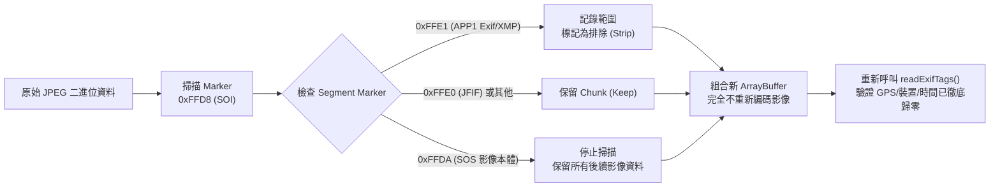
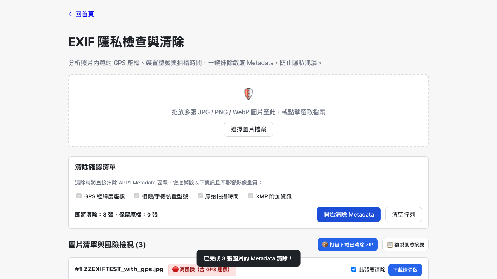

# Day 15 — EXIF 隱私檢查與清除：手寫 JPEG APP1 剖析與零伺服器抹除

> 隨手拍下的照片在發布到社群、提供給客戶或公開送審前，往往暗藏拍攝地點精確經緯度（GPS）、相機型號與精確拍攝時間。這些 Metadata 常在無意間洩漏家庭住址或行動軌跡。今天我們打造「EXIF 隱私檢查與清除工作台」，直接在瀏覽器端手寫剖析二進位 JPEG Segment，一鍵銷毀隱私風險。

---

## 🎯 情境：照片分享背後的隱私暗礁

在日常數位辦公與社群交流中：
- 房地產、開箱、二手買賣或活動照片，常帶有手機拍照時自動記錄的 GPS 經緯度，能被任何人反查到精確住址。
- 內部送審或新聞發布照片，可能包含特定相機序號、作者標籤或修圖軟體產生的 XMP 資訊。
- 線上隱私清除工具需要將整張照片上傳到未知伺服器，反而造成更大的資料外洩風險。

我們需要一個**百分之百在瀏覽器本機端執行、可離線運作、視覺化呈現前後差異**的 EXIF 隱私清理工具。

---

## 💡 解題思路：二進位 Segment 掃描與無損切除

不透過 Canvas 重新轉檔（重繪會改變畫質與壓縮係數），我們採用最純粹的高效作法——**二進位 JPEG Segment 手寫過濾**：

### 關鍵核心設計
1. **TIFF IFD0 與 GPS IFD 剖析**：
   - 支援 Little-Endian (`II`) 與 Big-Endian (`MM`) 字節序。
   - 解析 IFD0 中的 `0x010F` (Make)、`0x0110` (Model)、`0x8825` (GPSInfoIFD)。
   - GPS 經緯度三組 Rational（度/分/秒）轉換為帶正負號之十進位度數。
2. **三級風險分級評估**：
   - 🔴 **高風險**：含 GPS 座標。
   - 🟡 **中風險**：無 GPS 但含相機裝置型號或拍攝日期。
   - 🔵 **低風險**：僅含 XMP 資訊。
   - ⚪ **無風險**：未偵測到任何 Metadata（如普通截圖或 PNG）。
3. **清除前後真實驗證**：
   - 清除完成後立即重新呼叫 `readExifTags()` 對產出的二進位 bytes 進行第二輪檢驗，以對照表呈現「清除前 vs 清除後」的真實抹除狀態。

---

## 🛠️ 資源與共用模組

- **fflate 0.8.3**：提供批次清理後的多檔案 ZIP 下載功能。
- **共用模組**：
  - `shared/img-exif.js`：手寫 JPEG Marker 掃描、EXIF 標籤讀取與 APP1 Segment 移除。
  - `shared/img-file-size.js`：批次總量與單檔大小限制閘門。
  - `shared/io-zip.js`：二進位打包。
  - `shared/io-clipboard.js`：複製隱私分析摘要。

---

## 🔄 Vibe 過程：AI 協作中的二進位字節序校準

在打造二進位解析器時，我們特別留意了以下細節：
1. **Rational 數值的邊界保護**：
   - EXIF 中的 GPS 經緯度是由 3 個 64-bit Unsigned Rational 組成。若分母為 0 必須回傳 0 避免除以零產生 `NaN` 或 `Infinity`。
2. **無 EXIF 圖片的相容性**：
   - 對於截圖或 PNG 格式圖片，`stripMetadataSegments()` 必須安全保持原始 ArrayBuffer 不變，不損壞原本檔案。

---

## 📦 產品展示

- **線上體驗網址**：`https://<GITHUB_USER>.github.io/2026ironman/VibeCoding/Day15_exif-privacy-cleaner/index.html`
- **離線可用性**：支援一鍵下載離線版，在飛航模式或無網路環境下依然能安全清除照片隱私。

---

## 💭 心得與反思：四層對齊框架

- **想（意圖）**：提供直覺、安全的相片隱私清洗工具，不讓敏感個資意外流出。
- **說（表達）**：在 PRD 中規範「敏感 Metadata 風險提示」、「逐張開關」、「清除前後對照」與「無 EXIF 不報錯」。
- **對（校準）**：透過 Playwright 注入合成的 GPS EXIF、純相機資訊 EXIF 及無 EXIF 檔案，比對各項徽章與對照表。
- **做（實作）**：純原生 JavaScript 手寫剖析與 ArrayBuffer 組合，達到毫秒級極速清除。
