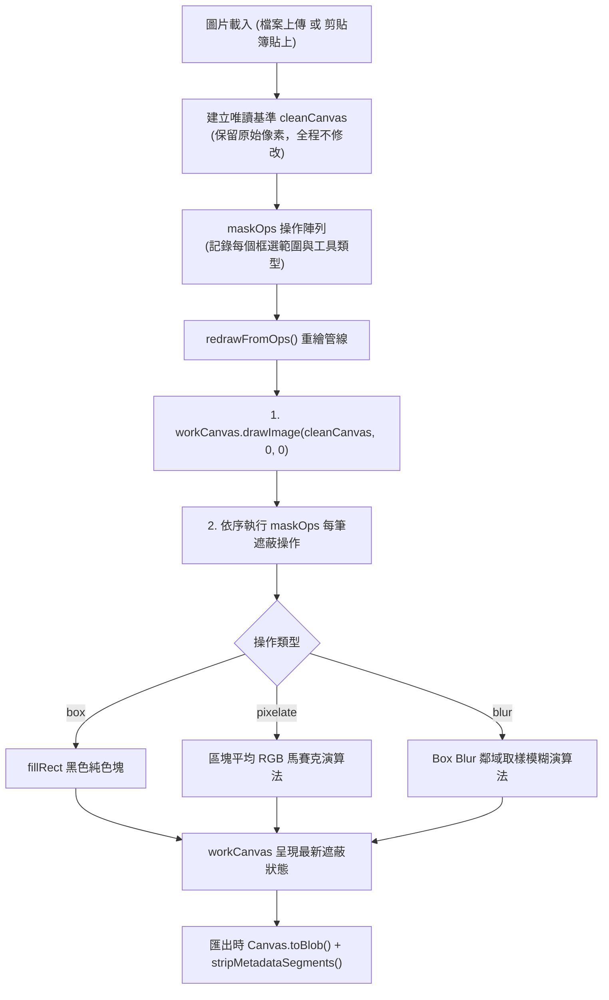
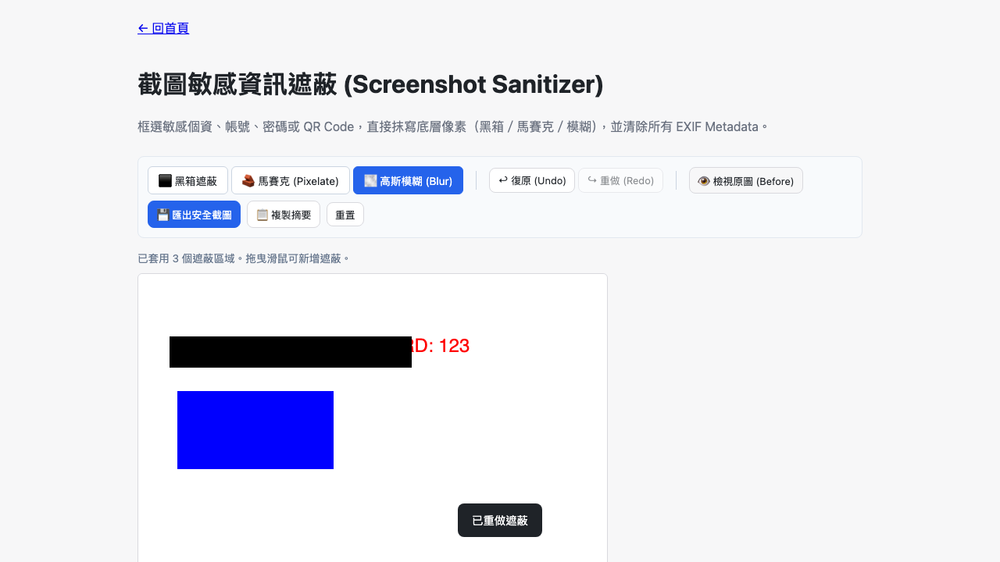

# Day 16 — 截圖敏感資訊遮蔽：真・像素抹除與可撤銷操作管線

> 很多時候我們在發送截圖前，只是用標記工具畫了個半透明黑框，或者在 CSS 上加了 `filter: blur()`，殊不知底層像素依然完整留存，只要被稍微調亮對比度或移除 DOM Overlay，機密資料就一覽無遺。今天我們打造「Screenshot Privacy Sanitizer」，確保每一次遮蔽都是真正的底層像素覆寫，並兼具流暢的 Undo/Redo 操作體驗。

---

## 🎯 情境：截圖外傳前的隱私漏洞

在工程除錯、客服對話與公文報表中，截圖是最高頻的溝通媒介：
- 截圖中常包含姓名、手機號碼、API Key、Token、私有 IP 或伺服器內部網址。
- 使用者常仰賴通訊軟體內建塗鴉，但許多塗鴉筆刷帶有邊緣羽化或半透明度，無法徹底遮蔽文字。
- 部分網頁截圖工具只在前端放上 HTML 遮罩，匯出時若未真正 Rasterize，底層資料仍有被還原風險。

我們需要一個**直接抹寫 Canvas 像素（黑箱／馬賽克／模糊）、支援無上限 Undo/Redo、並自動剔除 EXIF** 的離線截圖安全工具。

---

## 💡 解題思路：唯讀 Baseline 與操作重繪管線

為了讓每一次遮蔽都能隨時復原（Undo）與重做（Redo），且不造成畫質逐次劣化，我們設計了「操作紀錄 + 重繪（Command-based Redraw）」架構：

### 核心演算法亮點
1. **馬賽克（Pixelate）**：
   - 將指定區域切割為 $10 \times 10$ 網格，計算每格內部所有像素的平均 RGB 值，再將整格填滿為該平均色。處理邊界不滿 10 像素的殘餘區塊，保證覆寫不留縫隙。
2. **純 JS 模糊（Box Blur）**：
   - 不依賴 CSS 濾鏡，直接在 `ImageData` 上執行 $k \times k$（$k=8$）鄰域取樣平均。邊界處採用座標夾取（Clamping），杜絕超出陣列索引的記憶體錯誤。
3. **螢幕座標至畫布像素座標精確換算**：
   - 在高解析度螢幕或被 CSS 縮放的 Canvas 上，透過 `scaleX = canvas.width / rect.width` 精確換算實際繪圖座標，確保使用者框選的位置與最終產出的像素完全吻合。

---

## 🛠️ 資源與共用模組

- **共用模組**：
  - `shared/img-decode.js`：圖片讀取與直拍方向轉正。
  - `shared/img-exif.js`：匯出時徹底切除 APP1 Metadata。
  - `shared/img-file-size.js`：輸入容量防禦性檢驗。
  - `shared/io-clipboard.js`：支援 `pasteImageFromClipboard()` 直接從剪貼簿讀取圖片。
  - `shared/io-download.js`：觸發安全檔案下載。

---

## 🔄 Vibe 過程：Before/After 安全機制的設計考量

在實作 Before/After 對照檢視功能時，我們遇到了一個重要的安全抉擇：
- *問題*：當使用者切換到「Before（檢視原圖）」模式時，如果使用者誤按「匯出安全截圖」，會不會意外把未遮蔽的機密原圖下載傳送出去？
- *處置*：我們在 Before 檢視模式下將「匯出安全截圖」按鈕強制 `disabled`，並在狀態列提示使用者必須切回 After 模式才能匯出。這貫徹了「安全優先、防呆設計」的產品準則。

---

## 📦 產品展示

- **線上體驗網址**：`https://<GITHUB_USER>.github.io/2026ironman/VibeCoding/Day16_screenshot-sanitizer/index.html`
- **剪貼簿直接支援**：按下 `Ctrl+V` 或點擊「從剪貼簿貼上」，即可瞬間載入剛截好的圖片。

---

## 💭 心得與反思：四層對齊框架

- **想（意圖）**：提供簡單直覺、保證安全且能隨時撤銷的截圖打碼工具。
- **說（表達）**：在 PRD 規範「黑箱/馬賽克/模糊三模式」、「Undo/Redo」、「Before/After」與「寫入底層像素」。
- **對（校準）**：透過 Playwright 進行拖曳框選、多重遮蔽套用、Undo 復原、Redo 重做與離線版無殘留驗證。
- **做（實作）**：手寫 Canvas 雙緩衝操作管線與 ImageData 影像處理演算法，打造純本機端截圖隱私衛士。
