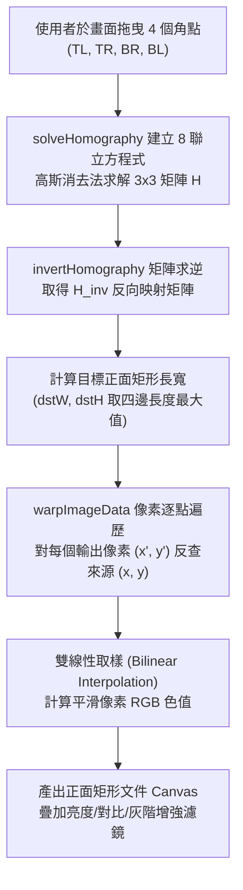
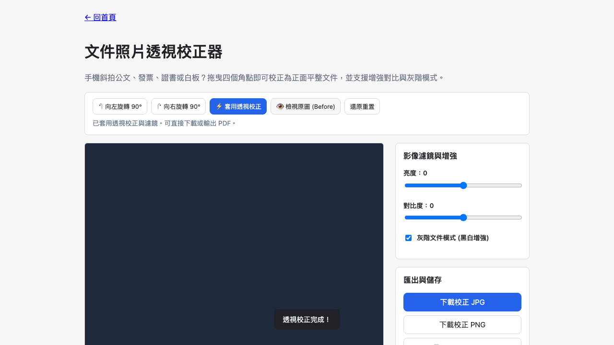

# Day 17 — 文件照片透視校正器：高斯消去法透視投影與三階預覽管線

> 手機斜拍公文、合約、發票、證書或會議白板時，嚴重的梯形透視變形常使得文件難以閱讀，後續 OCR 辨識率也大幅下降。今天我們在純瀏覽器環境下，以數學原理手寫透視變換（Perspective Transform），實現專業級的「文件照片透視校正器」。

---

## 🎯 情境：斜拍文件的視角扭曲與辨識障礙

在行動辦公時代，隨手拍公文或白板是常態：
- 手機鏡頭角度傾斜導致矩形文件變成任意四邊形（梯形或斜角菱形），頂端文字擠壓變小、底部文字拉長。
- 多數相機掃描 App 包含繁重廣告或需付費雲端同步，內部公文直接上傳有洩密風險。
- 傳統修圖軟體的四角變形工具需要手動調整複雜節點，操作門檻極高。

我們需要一個**四點直覺拖曳對齊、三階漸進運算、純本機毫秒級校正**的純前端工具。

---

## 💡 解題思路：單應性矩陣（Homography）與反向映射

透視校正的數學核心是求解平面到平面的單應性矩陣 $H$（3x3 矩陣，8 個自由度）：

$$\begin{bmatrix} x' \\ y' \\ 1 \end{bmatrix} \sim H \begin{bmatrix} x \\ y \\ 1 \end{bmatrix}$$

### 關鍵技術亮點
1. **8 聯立方程式高斯消去法**：
   - 4 組對應點可列出 8 條線性方程式 $Ah = b$。我們在 `shared/img-perspective.js` 實作了帶主元挑選（Pivoting）的高斯消去法，能在角點退化或三點共線時安全拋出錯誤並防護。
2. **反向映射與雙線性插值（Bilinear Interpolation）**：
   - 若使用正向映射（從來源點算目標點），會在輸出畫布上產生大量空洞破洞（Holes）。
   - 我們採用反向映射（從目標點算來源點），對來源浮點數座標 $(u, v)$ 取周圍 4 個像素進行雙線性權重插值，產出平滑銳利的正面文件。
3. **濾鏡與透視運算解耦**：
   - 調整亮度、對比度或開啟黑白灰階增強時，僅在已校正的矩陣像素上執行色彩映射，**不重複執行耗時的單應性矩陣插值運算**，達成 60fps 的滑桿即時預覽。

---

## 🛠️ 資源與共用模組

- **共用模組**：
  - `shared/img-perspective.js`：求解單應性矩陣、逆矩陣與雙線性取樣影像變形。
  - `shared/img-decode.js`：圖片載入與 EXIF 方向校正。
  - `shared/img-canvas.js`：Canvas 格式轉換。
  - `shared/img-file-size.js`：容量防禦閘門。
  - `shared/io-download.js`：下載校正後圖片。

---

## 🔄 Vibe 過程：拖曳互動與座標正規化架構

在實作前端互動層時，我們採用了「正規化座標（Normalized Coordinates）」架構：
- *問題*：當使用者在手機或窄螢幕操作時，Canvas 會被 CSS 縮小適應容器。若角點儲存為 CSS 像素或實體像素，在視窗縮放或旋轉時位置會跑掉。
- *解法*：角點一律以 $[0, 1]$ 的相對比例儲存為唯一的「單一真相（Single Source of Truth）」。繪製控制點時才動態換算為 DOM 像素，執行 Tier 3 運算時換算為原始解析度像素，徹底解決跨螢幕解析度對齊問題。

---

## 📦 產品展示

- **線上體驗網址**：`https://<GITHUB_USER>.github.io/2026ironman/VibeCoding/Day17_document-perspective-corrector/index.html`
- **列印支援**：支援「🖨️ 輸出 / 列印 PDF」，透過 `@media print` 實現單頁專用列印版面。

---

## 💭 心得與反思：四層對齊框架

- **想（意圖）**：斜拍文件能一鍵拉平成正面掃描件，省去掃描機硬體。
- **說（表達）**：在 PRD 規範「四個可拖曳角點」、「透視投影」、「旋轉裁切」、「灰階增強」與「單頁 PDF 輸出」。
- **對（校準）**：透過 Playwright 注入合成的梯形傾斜公文，驗證旋轉、透視插值演算法、灰階濾鏡與離線版無殘留。
- **做（實作）**：手寫線性代數高斯消去法與雙線性影像插值，打造極速純前端透視校正工具。
