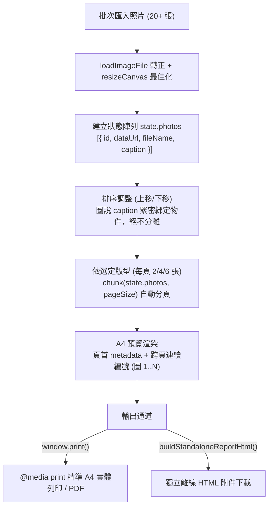
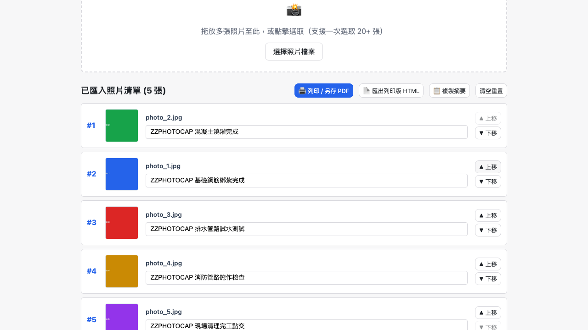

# Day 18 — 照片成果附件產生器：A4 自動分頁與非破壞性排版

> 舉辦活動、工程施工、教育訓練或設備檢修後，整理數十張施工或成果照片並排版成符合公文規範的 A4 成果照片冊，往往要在 Word 或 PPT 中一張張拉框、縮圖、調對齊，耗費數小時。今天我們在純瀏覽器端打造「照片成果附件產生器」，支援 20+ 張大批次匯入、自由排序、圖說綁定與精準 A4 分頁輸出。

---

## 🎯 情境：重複繁瑣的照片排版地獄

在行政、總務、工程與專案管理中：
- 驗收報告或工作日誌要求固定版型（每頁 2 張大圖、4 張標準或 6 張縮圖），並附帶照片編號與圖說說明。
- 在 Word 裡只要新增或刪除一張照片，後續幾十張照片與圖說排版就瞬間跑位、換頁崩潰。
- 上傳到一般線上排版網站，高畫質工程照片有資安洩密疑慮，且輸出版面往往無法精準吻合 A4 列印標準。

我們需要一個**支援大批次直拍橫拍自適應、上移／下移即時重排、連續自動編號、100% 離線列印**的純前端工作台。

---

## 💡 解題思路：資料物件與 A4 CSS Grid 響應式切版

為了徹底避免「刪一張、整份崩潰」的傳統排版痛點，我們採用「資料陣列驅動分頁」的架構：

### 關鍵設計亮點
1. **照片與圖說的原子綁定**：
   - 每個照片項目為單一 JavaScript 物件 `{ id, dataUrl, fileName, caption }`。使用者在調整照片順序時，透過 `splice` 進行原子操作，圖說與編號永遠跟著照片走，徹底告別傳統文書軟體圖文脫鉤的噩夢。
2. **三種標準 A4 格網切版**：
   - **每頁 2 張**（1 欄 × 2 列）：適用於大尺寸特寫或精細施工細節。
   - **每頁 4 張**（2 欄 × 2 列）：標準公文與驗收照片冊通用版型。
   - **每頁 6 張**（2 欄 × 3 列）：高密度紀錄、活動花絮或設備巡檢報告。
3. **無損容器自適應與防破版**：
   - 格網內照片容器套用 `object-fit: contain; max-width: 100%; max-height: 100%`，無論手機直拍或相機橫拍，皆能以原始長寬比完整呈現，絕不裁切或拉伸變形。
   - 頁面容器標註 `break-inside: avoid; page-break-after: always;`，列印時絕不會發生單張照片被硬生生切成兩半跨頁的窘境。

---

## 🛠️ 資源與共用模組

- **共用模組**：
  - `shared/img-decode.js`：批次圖片讀取與直拍 EXIF 轉正。
  - `shared/img-canvas.js`：縮圖尺寸調整（加速預覽渲染）。
  - `shared/img-file-size.js`：大批次上傳容量安全閘門。
  - `shared/io-dropzone.js`：支援多檔案拖放與選取。
  - `shared/io-download.js`：下載獨立列印版 HTML。

---

## 🔄 Vibe 過程：分頁切版最後一頁的留白處理

在設計分頁演算法時，我們特別處理了邊界情況：
- *問題*：當匯入 5 張照片、選擇「每頁 4 張」時，第 2 頁只有 1 張照片。若 CSS Grid 設死固定高度分配，第 2 頁的單張照片可能會被強制放大填滿整頁。
- *處置*：透過設定標準 `grid-template-rows` 與固定單元格高度，讓最後一頁維持與前幾頁相同的格線尺寸，保持整體報告風格嚴謹一致。

---

## 📦 產品展示

- **線上體驗網址**：`https://<GITHUB_USER>.github.io/2026ironman/VibeCoding/Day18_photo-evidence-sheet/index.html`
- **匯出雙通道**：支援瀏覽器直接「列印 / 另存 PDF」，或「匯出列印版 HTML」打包成單一完整可離線交付的成果附件。

---

## 💭 心得與反思：四層對齊框架

- **想（意圖）**：解決現場施工與活動照片排版耗時、容易跑版的痛點。
- **說（表達）**：在 PRD 規範「20+ 照片批次匯入」、「2/4/6 切版」、「圖說與照片綁定」、「A4 列印不超出版面」。
- **對（校準）**：透過 Playwright 模擬 5 張照片注入、圖說填寫、即時上移下移重排、切換 4/6 張版型與離線版完全清理檢驗。
- **做（實作）**：手寫資料驅動的 A4 分頁排版引擎與獨立 HTML 匯出功能，打造零伺服器依賴的報告神器。
