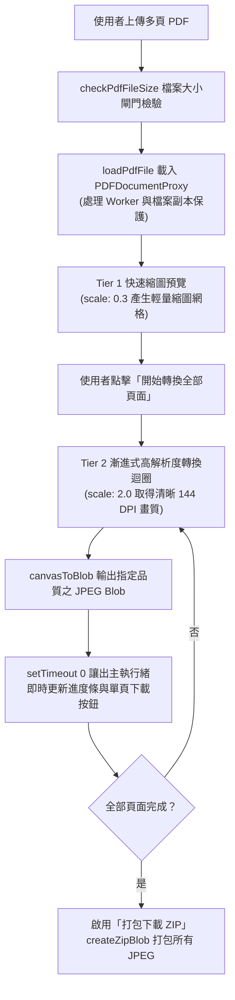
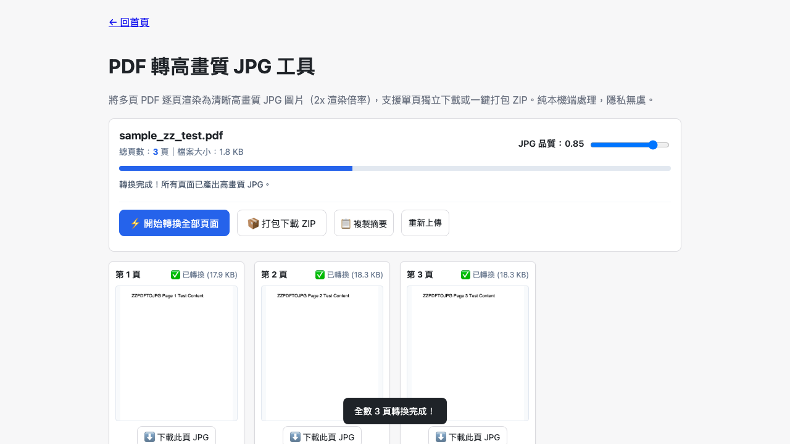

# Day 19 — PDF 轉高畫質 JPG 工具：非同步渲染排程與二倍取樣輸出

> 許多公文、電子書、簡報或掃描文件都是 PDF 格式。當我們需要將特定頁面插入簡報、貼上社群或轉成圖檔存證時，往往得手動截圖或冒著洩密風險將整份合約上傳至第三方轉檔網站。今天我們在純瀏覽器端打造「PDF 轉高畫質 JPG 工具」，支援大檔案逐頁流暢渲染與批次打包下載。

---

## 🎯 情境：多頁 PDF 轉圖片的畫質與隱私困境

在行政辦公與教學報告中：
- 手動逐頁螢幕截圖不僅費時，且解析度受限於螢幕視窗大小，放大後文字邊緣模糊失真。
- 線上免費轉檔工具常有單日張數限制、廣告干擾，且敏感公文與合約上傳至雲端伺服器有資安風險。
- 傳統前端轉檔若在單一同步迴圈內硬跑 20 頁高解析度 Canvas 渲染，會造成瀏覽器主執行緒凍結、畫面卡死甚至當機。

我們需要一個**本地執行、2x 高畫質取樣（約 144 DPI）、非同步排程不卡頓、支援單頁與 ZIP 打包**的極速轉檔工具。

---

## 💡 解題思路：二階縮放與微任務非同步排程

為了在保證高解析度的同時避免瀏覽器畫面凍結，我們設計了「二階渲染 + 逐頁事件迴圈讓出」的管線架構：

### 關鍵技術亮點
1. **二階縮放策略（Dual-scale Strategy）**：
   - 上傳當下以 `scale: 0.3` 快速產生頁面縮圖，讓使用者立即掌握整份 PDF 頁面結構。
   - 點擊轉換後以 `scale: 2.0` 進行二倍取樣渲染，產出足以用於印刷與簡報的高清晰度 JPG 圖片。
2. **非同步協程排程（Async Yielding）**：
   - 透過 `setTimeout(convertNextPage, 10)` 在每頁完成後主動讓出主執行緒，確保瀏覽器進度條動畫、頁面捲動與 UI 互動全程維持 60fps 流暢度。
3. **記憶體防護與無損打包**：
   - 轉換後的圖片暫存為 Blob 與 Object URL，下載 ZIP 時直接將二進位 Uint8Array 傳給 `fflate` 壓縮，不依賴龐大的 Base64 字串，有效防止行動裝置記憶體溢位。

---

## 🛠️ 資源與共用模組

- **共用模組**：
  - `shared/pdf-decode.js`：封裝 Mozilla pdf.js，提供 `loadPdfFile`、`getPageCount` 與 `renderPageToCanvas`。
  - `shared/pdf-file-size.js`：單檔 30MB/100MB 安全檢查閘門。
  - `shared/img-canvas.js`：Promise 封裝之 `canvasToBlob`。
  - `shared/io-zip.js`：二進位 ZIP 壓縮打包。
  - `shared/io-download.js`：觸發安全檔案下載。

---

## 🔄 Vibe 過程：命名規格與補零對齊的細節

在處理下載檔名時，我們落實了規格中的命名規則：
- *檔名規範*：採用 `{原檔名}_p{補零頁碼}.jpg`（例如 `report_p01.jpg`、`report_p02.jpg` ... `report_p10.jpg`）。
- *優勢*：在檔案總管或資料夾依檔名排序時，不會出現 `p1` 接 `p10` 再接 `p2` 的字典序錯位問題，保持使用者檔案清單的井然有序。

---

## 📦 產品展示

- **線上體驗網址**：`https://<GITHUB_USER>.github.io/2026ironman/VibeCoding/Day19_pdf-to-jpg/index.html`
- **靈活匯出**：可依需求只下載特定頁面，亦可一鍵打包全部頁面為 ZIP 壓縮檔。

---

## 💭 心得與反思：四層對齊框架

- **想（意圖）**：解決 PDF 單頁萃取困難與線上轉檔洩密的痛點。
- **說（表達）**：在 PRD 規範「2x 渲染倍率」、「單頁/ZIP 雙下載通道」、「非同步進度條」與「純前端離線轉換」。
- **對（校準）**：透過 Playwright 注入多頁測試 PDF，驗證縮圖生成、非同步轉換佇列、ZIP 打包與離線複本安全。
- **做（實作）**：整合 `pdf.js` 與 `fflate`，打造極速、安全且高品質的 PDF 轉圖工具。
