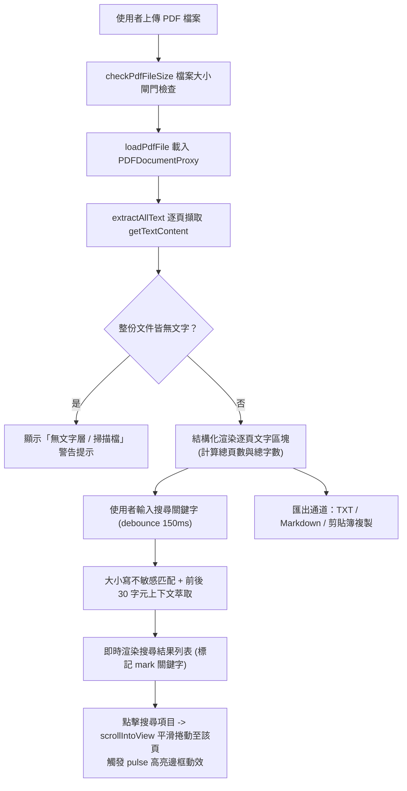
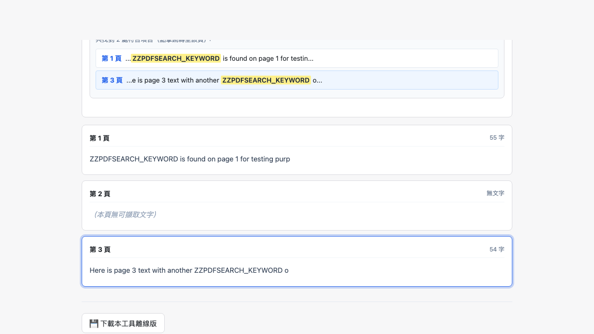

# Day 20 — PDF 文字擷取與全文搜尋：文字層萃取、防抖搜尋與頁面定位

> 面對數十頁的規範手冊、政府招標書或財務報告，如果只想快速找到某個條款並複製純文字，開啟厚重的桌面閱讀器往往非常繁瑣。今天我們在瀏覽器端打造「PDF 文字擷取與全文搜尋」，實現零伺服器依賴、即時全文搜尋高亮、頁面自動定位與 TXT/Markdown 匯出。

---

## 🎯 情境：PDF 閱讀與文字擷取的搜尋痛點

在日常處理 PDF 文件時：
- **尋找困難**：長篇 PDF 的內建搜尋常因介面笨重或無法一次看清所有命中上下文（前後語境），使用者得反覆點擊「下一筆」翻頁。
- **複製格式混亂**：直接從 PDF 複製貼上常遺失頁碼分段，或者把跨欄、跨頁的零碎字串混在一起。
- **無文字層誤判**：純掃描圖片 PDF 沒有嵌入文字層，傳統工具往往顯示空白或靜默失敗，使用者無法得知是軟體故障還是檔案本身需要 OCR。

我們需要一個**能解析多頁文字層、防抖全文搜尋、顯示前後上下文片段、點擊直接跳轉高亮，並能匯出結構化文字**的輕量檢索工具。

---

## 💡 解題思路：文字層解析與上下文片段索引

我們透過 `pdf.js` 的 `getTextContent()` 抽取純文字，並建立純前端全文檢索與跳轉管線：

### 關鍵技術亮點
1. **精準的文字層與空頁判定**：
   - 區分「整份無文字（掃描檔）」與「單頁空白（如隔頁、插圖頁）」：只有全書文字皆為空時才觸發掃描檔提示；單頁空白則在該頁標註「本頁無可擷取文字」，不中斷整份檢閱。
2. **高效搜尋與前後上下文摘要**：
   - 輸入框具備 150ms 防抖（`debounce`），避免每鍵觸發大文字掃描。
   - 搜尋依據裁示 4–6 規則：英文大小寫不敏感、提取關鍵字前後各 30 字元，命中處以 `<mark>` 標註，幫助使用者一眼看清語境。
3. **無縫視覺跳轉（Scroll & Pulse Highlight）**：
   - 點擊搜尋結果立即透過 `scrollIntoView({ behavior: 'smooth', block: 'center' })` 定位，並利用 DOM 重繪技巧觸發 CSS 邊框發光脈衝動畫，提供清晰的視覺導引。

---

## 🛠️ 資源與共用模組

- **共用模組**：
  - `shared/pdf-decode.js`：`extractAllText` 循序擷取每頁 `textContent` 並保留合理換行。
  - `shared/pdf-file-size.js`：檔案大小安全防禦。
  - `shared/ui-debounce.js`：搜尋輸入防抖。
  - `shared/util-escape.js`：防止 XSS 攻擊。
  - `shared/io-clipboard.js` & `shared/io-download.js`：匯出與複製。

---

## 🔄 Vibe 過程：Markdown 結構化分節的貼心設計

在實作匯出功能時，我們特別優化了 Markdown 的產出結構：
- 為每頁加上 `## 第 N 頁` 的標準標題，若該頁為空白則標示 `*（本頁無文字）*`。
- 產出的 `.md` 檔案能直接被 Obsidian、Notion 或 VS Code 預覽，方便知識庫整理與筆記歸檔。

---

## 📦 產品展示

- **線上體驗網址**：`https://<GITHUB_USER>.github.io/2026ironman/VibeCoding/Day20_pdf-text-search/index.html`
- **操作亮點**：無論是數百頁規章還是合約，都能在零秒內搜尋並跳轉到目標章節。

---

## 💭 心得與反思：四層對齊框架

- **想（意圖）**：解決 PDF 難以搜尋片段語境與難以結構化抽取文字的痛點。
- **說（表達）**：在 PRD 規範「全文搜尋前後 30 字元摘要」、「平滑捲動高亮」、「掃描檔限制提示」與「TXT/MD 匯出」。
- **對（校準）**：透過 Playwright 注入多頁測試文件（含文字頁、空白頁與純掃描檔），驗證搜尋命中、跳轉動效與離線複本安全。
- **做（實作）**：運用 `pdf.js` 文字串流解析與 CSS 平滑捲動，打造極致流暢的純前端 PDF 檢索器。
