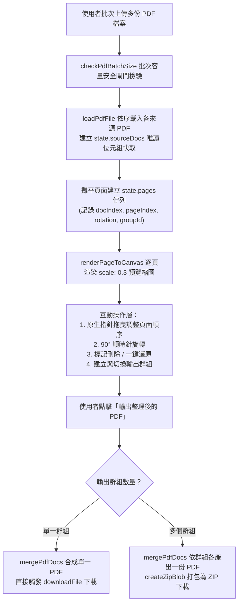
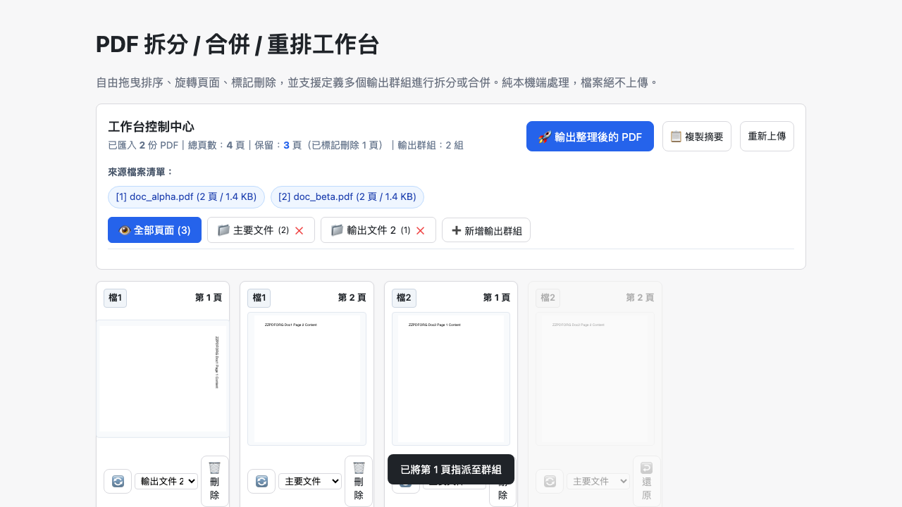

# Day 21 — PDF 拆分 / 合併 / 重排工作台：原生拖曳排序、多群組拆分與頁面合成

> 整理跨部門報告、標案招標書或合約附件時，我們常需要把多份 PDF 中的特定頁次挑選出來重新排序、刪除多餘的空白頁，或是把一份長篇檔案依章節拆解成數份獨立文件。今天我們在純瀏覽器端打造「PDF 拆分 / 合併 / 重排工作台」，支援原生拖曳互動、自訂輸出群組與批次 ZIP 打包。

---

## 🎯 情境：PDF 結構編輯與整理的繁瑣流程

在行政辦公與技術文檔彙整時：
- **跨檔案合併繁瑣**：過去若要合併「A 檔案前 3 頁」與「B 檔案第 5 頁」，往往得先使用工具分別拆解成零碎檔案，再重新組裝，操作極為繁瑣。
- **缺乏視覺化排版**：純文字型或表單式的頁碼輸入工具容易填錯頁碼，無法直觀預覽旋轉角度與排版順序。
- **拆分與合併二選一**：市面工具多半將「合併」與「拆分」切為獨立功能；若使用者想在同一介面完成「先調整順序再分別匯出成兩份文件」，就必須切換多次工具。

我們需要一個**支援多檔批次拖入、原生可拖曳重排、旋轉與標記刪除，並能定義多個輸出群組**的現代化 PDF 工作台。

---

## 💡 解題思路：頁面物件單一真相與多群組輸出管線

我們建立了以 `state.pages` 為核心的單一真相（Single Source of Truth）資料模型，將跨檔案的頁面攤平成獨立可調度單元：

### 關鍵技術亮點
1. **跨來源虛擬頁面索引（Virtual Page Mapping）**：
   - 每個頁面卡片記錄 `{ docIndex, pageIndex, rotation, groupId, deleted }`。拖曳排序時僅調整陣列位置，不觸動底層巨大的二進位 ArrayBuffer，操作瞬間完成零延遲。
2. **真拖曳互動（Pointer-based Drag & Drop）**：
   - 依裁示 2 要求，實作完整拖曳狀態與視覺回饋（拖曳半透明 Ghost 卡片與 `drag-over` 插入提示外框），提供順暢的直覺排列體驗。
3. **靈活多群組拆分與打包（Group Dispatcher）**：
   - 依裁示 3 定案，使用者可隨意新增「輸出群組」並將不同頁面指派至不同群組。若只有 1 組則直接下載單一 PDF；若定義了 2 組以上，工具會依序合成各組 PDF 並以 `fflate` 壓縮打包為 ZIP 下載。
4. **來源檔案絕對不可變（Immutability Guarantee）**：
   - 透過 `@cantoo/pdf-lib` 的 `copyPages` 機制，所有新頁面皆為深層複製，原始匯入的 PDF 位元組資料全程保持唯讀，絕不覆寫。

---

## 🛠️ 資源與共用模組

- **共用模組**：
  - `shared/pdf-decode.js`：解析 PDF 與產生 0.3x 輕量預覽縮圖。
  - `shared/pdf-build.js`：封裝 `@cantoo/pdf-lib` 之 `mergePdfDocs` 跨文件頁面複製與旋轉。
  - `shared/io-zip.js`：多群組輸出時打包 ZIP。
  - `shared/pdf-file-size.js`：單檔 100MB / 批次 400MB 安全閘門。
  - `shared/io-dropzone.js` & `shared/io-download.js`：多檔拖放匯入與安全下載。

---

## 🔄 Vibe 過程：群組歸屬與刪除防孤兒機制

在實作多群組管理時，我們加入了健全的防禦設計：
- 當使用者刪除某個輸出群組時，工具會自動將該群組內未刪除的頁面重新歸派至預設群組，防止任何頁面因群組被刪而變成「孤兒頁面」或遺失。

---

## 📦 產品展示

- **線上體驗網址**：`https://<GITHUB_USER>.github.io/2026ironman/VibeCoding/Day21_pdf-organizer/index.html`
- **操作亮點**：多檔案混編、直覺拖曳重排、單頁旋轉刪除，合併與拆分一次搞定。

---

## 💭 心得與反思：四層對齊框架

- **想（意圖）**：提供直覺且全功能的 PDF 頁面重組、拆分與合併工作台。
- **說（表達）**：在 PRD 規範「原生拖曳排序」、「多群組拆分」、「單頁旋轉與刪除還原」與「純本機合成」。
- **對（校準）**：透過 Playwright 注入多份測試 PDF，驗證跨檔案拖曳順序、旋轉、刪除標記、群組新增與 ZIP 封裝。
- **做（實作）**：整合 `pdf.js`、`@cantoo/pdf-lib` 與 `fflate`，打造流暢穩定的純前端 PDF 頁面編輯器。
