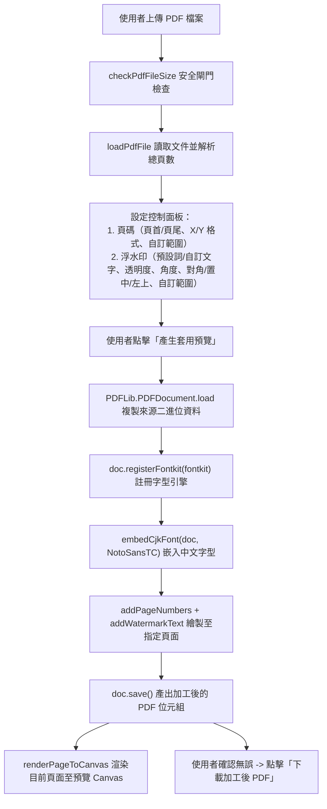
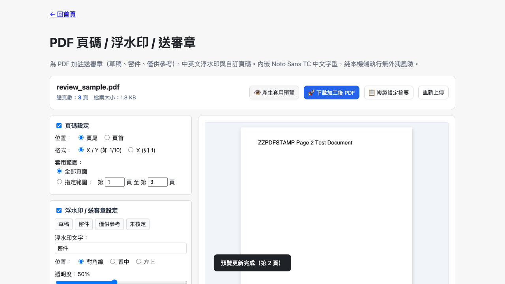

# Day 22 — PDF 頁碼 / 浮水印 / 送審章：CJK 中文字型嵌入與視覺加註管線

> 呈報公文、合約審查或分發內部參考文件時，我們經常需要在 PDF 每頁加註「草稿」、「密件」、「僅供參考」等送審章，並標上「1/10」格式的頁碼。然而 PDF 格式底層並未內建中文字體，若要在瀏覽器中產出真正可攜且字型不缺字的中文浮水印，就必須克服字型嵌入（Font Embedding）的技術挑戰。

---

## 🎯 情境：PDF 送審加工的缺字與字型嵌入困境

在行政送審與法務核定流程中：
- **中文字型缺失**：標準 PDF 規範僅內建 14 種英文字體（如 Helvetica、Times）。若要在 PDF 頁面繪製中文字串，必須將 TrueType / OpenType 字型嵌入文件，否則會發生缺字方框（Tofu）或拋出例外。
- **即時預覽需求**：使用者需要先檢視浮水印的透明度、旋轉角度與排版位置是否會遮擋正文關鍵內容，確認無誤後再下載輸出。
- **頁碼與審查章混編**：頁碼通常需要套用整份文件，但送審章有時只需加註於封面或特定章節頁面，兩者的頁碼範圍必須獨立可調。

我們需要一個**內嵌 Noto Sans TC 思源黑體、支援預設/自訂中文詞彙、頁碼格式自訂、獨立頁碼範圍設定與即時渲染預覽**的專業加註工具。

---

## 💡 解題思路：字型註冊快取與雙通道加註架構

我們整合 `@cantoo/pdf-lib`、`fontkit` 與 `pdf.js`，建構了「字型快取嵌入 + 預覽/匯出共用管線」：

### 關鍵技術亮點
1. **完整的 CJK 字型嵌入支援**：
   - 依裁示 1 定案，內嵌完整 Noto Sans TC（思源黑體）。搭配 `fontkit` 引擎進行字型子集化與字符映射，保證自訂任意繁體中文字串皆能完美呈現，杜絕缺字問題。
2. **獨立的頁碼與浮水印範圍引擎**：
   - 頁碼（`StandardFonts.Helvetica`）與浮水印（`Noto Sans TC`）具備各自獨立的 `pageRange` 參數。使用者可輕易達成「頁碼套用全書 1–20 頁，密件章僅加註於第 1–3 頁」等精細組合。
3. **按鈕觸發式渲染管線（On-demand Preview Pipeline）**：
   - 依裁示 9 採按鈕觸發模式，避免滑桿拖曳時反覆編譯龐大 PDF 與字型，有效節省 CPU 資源，並提供最真實的高解析度渲染預覽。

---

## 🛠️ 資源與共用模組

- **共用模組**：
  - `shared/pdf-decode.js`：`renderPageToCanvas` 渲染高解析預覽畫面。
  - `shared/pdf-build.js`：封裝 `addPageNumbers`、`addWatermarkText` 與 `embedCjkFont`。
  - `shared/pdf-file-size.js`：檔案大小防護。
  - `shared/io-download.js`：觸發安全檔案下載。

---

## 🔄 Vibe 過程：字型體積與離線可用性的工程取捨

在設計單檔離線版時，我們面臨了 5.6MB Noto Sans TC 字型帶來的體積代價：
- *實測體積*：包含 pdf.js、@cantoo/pdf-lib、fontkit 與完整 Noto Sans TC Base64 後，單檔 HTML 最終大小為 **10 MB**。
- *使用者價值*：雖然體積略增，但換來的是 **100% 離線可用、完全不依賴 Google Fonts CDN、支援任意生僻繁體中文** 的極致隱私保障。

---

## 📦 產品展示

- **線上體驗網址**：`https://<GITHUB_USER>.github.io/2026ironman/VibeCoding/Day22_pdf-review-stamper/index.html`
- **操作亮點**：預設四大切身審查詞（草稿、密件、僅供參考、未核定），一鍵套用，即時翻頁預覽。

---

## 💭 心得與反思：四層對齊框架

- **想（意圖）**：為 PDF 文件提供專業、無缺字且隱私安全的頁碼與送審浮水印標註。
- **說（表達）**：在 PRD 規範「Noto Sans TC 中文字型嵌入」、「頁碼 X/Y 格式」、「獨立範圍設定」與「按鈕觸發預覽」。
- **對（校準）**：透過 Playwright 驗證多頁 PDF 的字型嵌入、翻頁預覽、預設詞切換與離線複本安全。
- **做（實作）**：整合 `@cantoo/pdf-lib`、`fontkit` 與 `pdf.js`，打造純前端公文加註利器。
