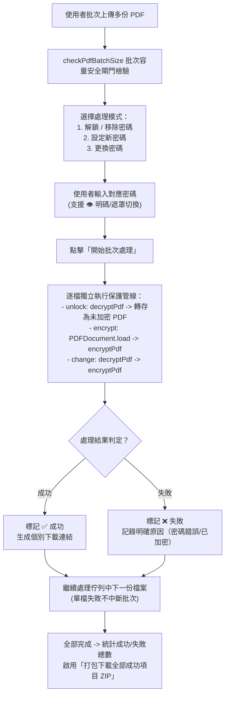
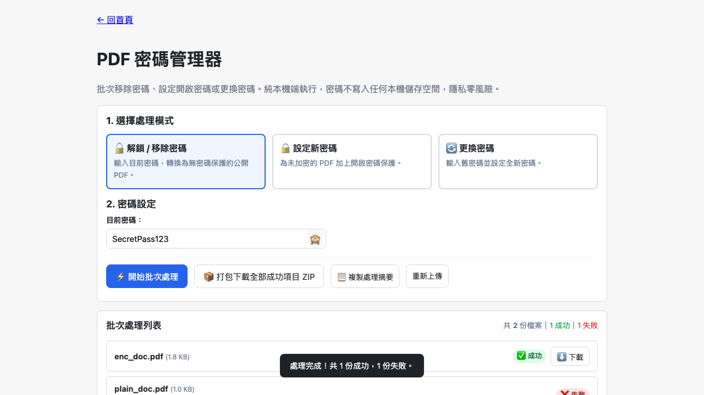

# Day 23 — PDF 密碼管理器：批次解鎖、設定新密碼與更換金鑰安全管線

> 電子薪資條、扣繳憑單、銀行對帳單等重要文件通常預設以身分證字號或生日設有開啟密碼；在轉發、歸檔或列印時，手動逐份輸入密碼再另存非常耗時。今天我們在純前端打造「PDF 密碼管理器」，支援批次解鎖、設定新密碼與更換密碼，密碼絕不寫入本機儲存空間，確保個人資料零外洩。

---

## 🎯 情境：PDF 密碼管理的繁瑣與資安風險

在企業財務與人資日常作業中：
- **批次解鎖需求**：每月收到多份加密薪資單或對帳單，若要一次歸檔到內部受保護的資料夾，必須反覆開啟每份檔案、手動輸入密碼並重新列印成未加密 PDF。
- **機密外洩隱患**：部分線上轉檔工具宣稱能解除 PDF 密碼，但這需要將含有身分證字號與薪資明細的原始 PDF 以及解密密碼同步上傳至雲端伺服器，資安風險極大。
- **批次容錯性差**：傳統批次腳本若遇到其中一份檔案密碼不同或格式不支援，常會直接拋錯中止，導致其餘正常檔案無法繼續處理。

我們需要一個**支援三種模式（解鎖 / 加密 / 換密碼）、批次容錯不中止、密碼零持久化洩漏、可個別下載或打包 ZIP**的純前端 PDF 安全工具。

---

## 💡 解題思路：狀態機分流與零殘留安全架構

我們整合 `@cantoo/pdf-lib` 的 `encryptPdf` 與 `decryptPdf` 引擎，建立三大模式分流管線：

### 關鍵技術亮點
1. **三大安全模式完整覆蓋**：
   - **解鎖模式**：透過 `decryptPdf(bytes, password)` 驗證並剔除加密字典，直接還原為原生未加密 PDF。
   - **加密模式**：透過 `encryptPdf(doc, { userPassword })` 為標準 PDF 加上高強度開啟密碼。
   - **更換密碼模式**：在記憶體中串接「舊密碼解密」與「新密碼重新加密」，一氣呵成完成金鑰輪替，不產生半加密的中繼檔案。
2. **批次處理韌性（Batch Resilience）**：
   - 依裁示 10 定案，批次迴圈採用獨立 Promise 串接，任一檔案密碼錯誤或格式不符時僅標註失敗原因，其餘正常檔案照常產出，絕不中途崩潰。
3. **密碼零殘留防禦（Zero-leakage Design）**：
   - 密碼僅在記憶體變數中傳遞，絕不寫入 `localStorage`、`sessionStorage` 或 Cookie。
   - 「複製摘要」功能僅輸出成功/失敗總數統計，完全不包含任何密碼明文，防範剪貼簿監聽。

---

## 🛠️ 資源與共用模組

- **共用模組**：
  - `shared/pdf-build.js`：封裝 `@cantoo/pdf-lib` 之 `encryptPdf` 與 `decryptPdf`。
  - `shared/pdf-file-size.js`：批次容量門禁防護。
  - `shared/io-zip.js`：一鍵打包所有成功產出的 PDF 為 ZIP 壓縮檔。
  - `shared/io-download.js` & `shared/io-clipboard.js`：安全下載與摘要複製。

---

## 🔄 Vibe 過程：狀態精準識別與防呆引導

在實作加密與解鎖邏輯時，我們強化了狀態防呆：
- 若使用者在「設定新密碼」模式誤傳了一份原本就已加密的檔案，工具會明確提示「此檔案已加密，請改用解鎖或更換密碼」，引導使用者正確操作。

---

## 📦 產品展示

- **線上體驗網址**：`https://<GITHUB_USER>.github.io/2026ironman/VibeCoding/Day23_pdf-password-manager/index.html`
- **操作亮點**：一鍵批次解鎖多份帳單，或批次替多份考卷/合約加密，快速又安全。

---

## 💭 心得與反思：四層對齊框架

- **想（意圖）**：解決 PDF 密碼批次管理的繁瑣操作與雲端轉檔的資安風險。
- **說（表達）**：在 PRD 規範「三大模式」、「批次失敗不中止」、「密碼零持久化」與「ZIP 批次匯出」。
- **對（校準）**：透過 Playwright 注入多份真實加密與未加密 PDF，驗證解鎖、加密、錯誤密碼隔離與剪貼簿防護。
- **做（實作）**：整合 `@cantoo/pdf-lib` 與 `fflate`，打造高效又兼顧資訊安全的純前端密碼管理神器。
