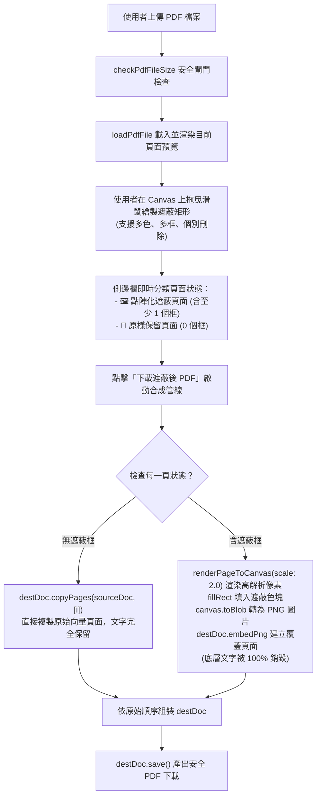
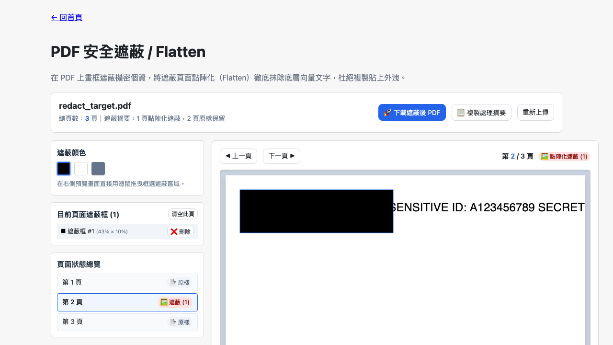

# Day 24 — PDF 安全遮蔽 / Flatten：選擇性點陣化與敏感文字銷毀管線

> 許多人在 PDF 上塗黑個資時，習慣用 PDF 註解工具加一個黑色矩形色塊；然而這種方式僅在視覺上覆蓋，底層的向量文字依然完好無損，只要全選複製貼上，身分證字號或帳號密碼就會全數曝光。今天我們在純前端打造「PDF 安全遮蔽 / Flatten」，採用選擇性點陣化技術徹底銷毀敏感文字層。

---

## 🎯 情境：PDF 偽遮蔽與文字層殘留的資安地雷

在政府公開資訊或企業法務公開檔案時：
- **偽遮蔽漏洞**：在 PDF 頁面加上黑色 Annotation 矩形，實際上只是在向量畫布多蓋了一層透明圖層，底層文字內容未受任何破壞，文字搜尋引擎與剪貼簿依然能輕易抓出敏感資料。
- **全篇點陣化的畫質代價**：若把整份長篇 PDF 的所有頁面全部轉為點陣圖片，會導致檔案暴增數倍，且原本未含敏感資訊的頁面也喪失了文字選取與清晰度。
- **逐頁靈活操作困難**：一般工具缺乏逐頁即時框選、自訂遮蔽顏色與即時狀態總覽的直覺介面。

我們需要一個**支援視覺拖曳框選、多色塊覆蓋、僅針對含遮蔽頁面執行 2.0x 點陣化銷毀（Selective Flattening），其餘頁面 100% 原樣保留**的安全加固工具。

---

## 💡 解題思路：選擇性點陣化（Selective Flattening）管線

我們設計了「純向量無損複製」與「高解析度點陣化銷毀」混合合成架構：

### 關鍵技術亮點
1. **真正的文字銷毀（True Redaction via Rasterization）**：
   - 遮蔽頁面經由 `pdf.js` 以 2.0x（144 DPI）渲染為純 Canvas 像素，再繪製黑色矩形色塊後輸出 PNG 內嵌回 PDF。文字層徹底消失，即使使用專業 PDF 編輯器或 OCR 逆向也無法還原被塗黑的字元。
2. **選擇性頁面處理（Selective Preservation）**：
   - 僅有包含遮蔽框的頁面會被點陣化；其餘無遮蔽的頁面直接透過 `@cantoo/pdf-lib` 的 `copyPages()` 複製。確保整份 PDF 大小適中，且未遮蔽頁面依然具備清晰向量文字與搜尋能力。
3. **直覺的互動式座標系統**：
   - 遮蔽框以 0.0–1.0 正規化座標（Normalized Coordinates）儲存，不受預覽視窗大小縮放影響，並在匯出高解析度畫布時精準對齊像素。

---

## 🛠️ 資源與共用模組

- **共用模組**：
  - `shared/pdf-decode.js`：`renderPageToCanvas` 渲染 1.5x 編輯預覽與 2.0x 高解析度點陣化。
  - `shared/pdf-build.js`：封裝 `@cantoo/pdf-lib` 進行向量頁面複製與 PNG 點陣頁面封裝。
  - `shared/pdf-file-size.js`：檔案大小安全防護。
  - `shared/io-download.js` & `shared/io-clipboard.js`：檔案下載與處理摘要複製。

---

## 🔄 Vibe 過程：正向與負向哨兵測試雙重檢驗

為了確保個資 100% 銷毀，我們在 Playwright 測試中建立了嚴格的哨兵驗證：
- **正向哨兵**：原始 PDF 第 2 頁含有 `SENSITIVE ID: A123456789 SECRET`，遮蔽前透過 `extractPageText()` 可成功讀出。
- **負向哨兵**：遮蔽輸出後，對第 2 頁重新擷取文字，結果為**空字串**，完全檢索不到任何身分證字號與機密字元；同時第 1 頁與第 3 頁的向量文字依然完整保留！

---

## 📦 產品展示

- **線上體驗網址**：`https://<GITHUB_USER>.github.io/2026ironman/VibeCoding/Day24_pdf-secure-redactor/index.html`
- **操作亮點**：像小畫家一樣隨手一框，個資徹底抹除，安全公開無後顧之憂。

---

## 💭 心得與反思：四層對齊框架

- **想（意圖）**：杜絕偽遮蔽漏洞，提供安全、直覺且兼顧檔案品質的 PDF 個資塗黑工具。
- **說（表達）**：在 PRD 規範「視覺框選」、「選擇性點陣化」、「未遮蔽頁原樣保留」與「文字銷毀驗證」。
- **對（校準）**：透過 Playwright 進行文字層抽取檢驗，證實遮蔽頁文字層 100% 銷毀、非遮蔽頁 100% 保留。
- **做（實作）**：整合 `pdf.js` 與 `@cantoo/pdf-lib`，打造純前端高規格 PDF 安全遮蔽利器。
