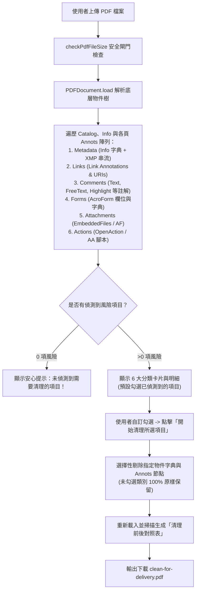
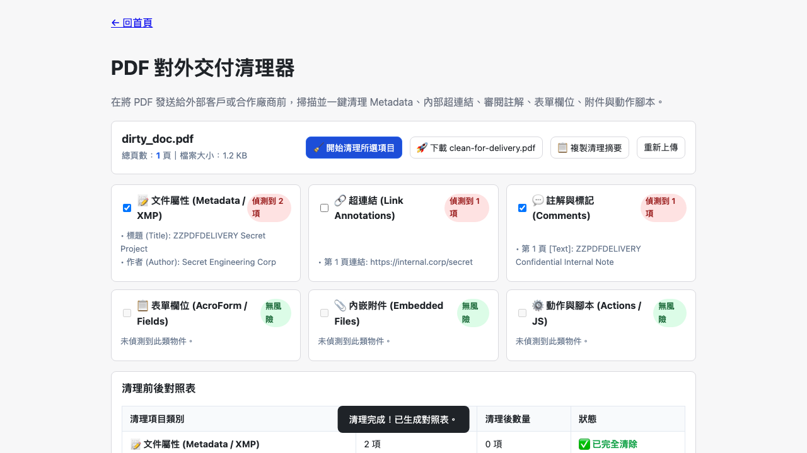

# Day 25 — PDF 對外交付清理器：六大風險物件自動掃描、選擇性清洗與交付加固

> 向投標廠商、外包團隊或客戶發送 PDF 報告前，你是否曾留意過檔案中悄悄內嵌的資訊？作者本名、公司內部伺服器網址、審閱留言、表單資料甚至是草稿附件，都可能在不經意間對外洩密。今天我們在純前端打造「PDF 對外交付清理器」，自動檢測並一鍵清洗 6 大類隱蔽風險物件。

---

## 🎯 情境：PDF 對外交付時的隱形資安漏洞

在企業商務往來與公文對外發布時：
- **隱形 Metadata 洩密**：從 Word 另存的 PDF 往往包含文件作者、公司名稱、內部範本路徑與建立時間等 XMP 中繼資料。
- **內部連結與審查備忘殘留**：文件製作過程中加入的內部 JIRA 連結、公司 Intranet 網址或同事間的審閱便利貼註解（Comment Annotations），若未經清理直接外發，會曝露內部架構與爭議細節。
- **盲目全清破壞文件**：部分清理工具採「一刀切」模式，連表單互動或必要連結也強制拔除；使用者需要精準選擇「只清 Metadata」或「只清註解與內部連結」的細緻控制。

我們需要一個**能全面掃描 6 大類風險物件、支援選擇性勾選清理、生成清理前後對照表、無風險時明確安心提示，且固定輸出 `clean-for-delivery.pdf`** 的專業交付加固工具。

---

## 💡 解題思路：低階 PDF 物件樹掃描與精準過濾管線

我們深入 PDF 規範的低階物件字典與 Catalog 結構，建立 6 大類獨立過濾器：

### 關鍵技術亮點
1. **6 大對外交付風險類別全覆蓋**：
   - **文件屬性（Metadata）**：清空 Title、Author、Subject、Creator、Producer、CreationDate，並自 Catalog 徹底移除 `/Metadata` XMP 串流。
   - **超連結（Links）**：精準遍歷各頁 `/Annots`，僅挑出 `/Subtype === 'Link'` 的節點剔除，不影響其他圖層。
   - **註解與標記（Comments）**：過濾 `/Text`、`/FreeText`、`/Popup`、`/Highlight` 等非 Widget 註解。
   - **表單欄位（Forms）**：自 Catalog 安全移除 `/AcroForm` 互動字典。
   - **內嵌附件（Attachments）**：清除 `/Names/EmbeddedFiles` 與 `/AF` 關聯附件。
   - **動作與腳本（Actions）**：移除 `/OpenAction` 與 `/AA` 附加動作。
2. **選擇性精準清理（Selective Sanitization）**：
   - 嚴格遵守「只清理勾選項，未勾選類別絕不順便移除」原則。例如：只選 Metadata 時，超連結與表單欄位 100% 完整保留。
3. **清晰透明的對照機制**：
   - 清理後立即重新掃描新檔案二進位資料，產出即時對照表，清楚展示各類別從 N 項歸零，確認已完全清除。

---

## 🛠️ 資源與共用模組

- **共用模組**：
  - `shared/pdf-build.js`：底層 PDF 結構編輯。
  - `shared/pdf-file-size.js`：檔案大小安全防護。
  - `shared/io-download.js` & `shared/io-clipboard.js`：安全下載與清理摘要複製。

---

## 🔄 Vibe 過程：零風險檢測與安全感設計

在安全工具的使用體驗中，「沒有問題」也是一種至關重要的回報：
- 當使用者上傳一份原本就無任何 Metadata、連結或註解的純淨 PDF 時，工具會直接呈現清爽的安心橫幅「🎉 掃描完成：未偵測到需要清理的對外風險項目！」，避免呈現滿版空勾選框造成困惑。

---

## 📦 產品展示

- **線上體驗網址**：`https://<GITHUB_USER>.github.io/2026ironman/VibeCoding/Day25_pdf-delivery-cleaner/index.html`
- **操作亮點**：一鍵掃描潛在洩密風險，清理前後清楚對照，交付文件萬無一失。

---

## 💭 心得與反思：四層對齊框架

- **想（意圖）**：為 PDF 對外發布建立一道專業、透明且可自訂的安全檢查哨。
- **說（表達）**：在 PRD 規範「6 大分類掃描」、「選擇性勾選清理」、「清理前後對照表」與「安心零風險提示」。
- **對（校準）**：透過 Playwright 注入含有多重 Annots 與 Metadata 的真實測試 PDF，驗證未選項目原樣保留、已選項精準歸零。
- **做（實作）**：直接操作 `@cantoo/pdf-lib` 低階物件樹與 Catalog 字典，打造可靠的純前端交付清理利器。
