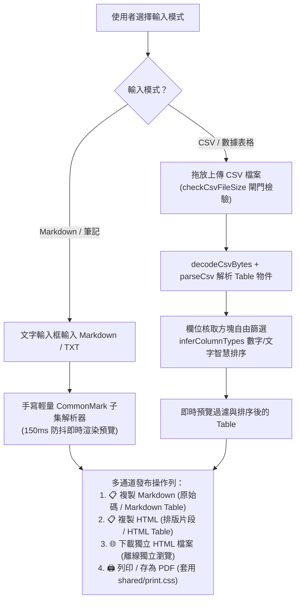
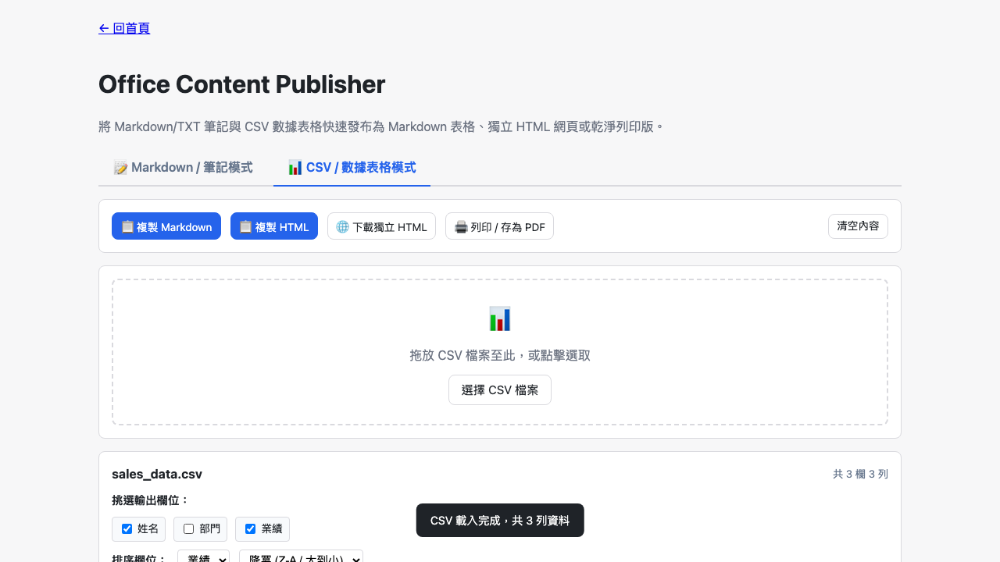

# Day 26 — Office Content Publisher：Markdown 筆記與 CSV 數據多通道發布工作台

> 在日常辦公中，我們經常需要在不同溝通媒介間切換格式：將會議紀錄 Markdown 轉為乾淨的 HTML 網頁寄給主管、把龐大的 CSV 數據篩選特定欄位並轉為 Markdown 表格貼到 GitHub / Notion，或是直接列印成無干擾的紙本報告。今天我們打造「Office Content Publisher」，實現雙模式輸入與多通道一鍵發布。

---

## 🎯 情境：跨平台內容格式轉換的破碎體驗

在專案協作與跨部門發布時：
- **Markdown 轉發障礙**：工程師習慣以 Markdown 撰寫技術規格與筆記，但發送給非技術主管或外部客戶時，需要一份免裝閱讀器、開箱即讀的獨立 HTML 或 PDF 文件。
- **CSV 轉 Markdown 表格痛苦**：若要將試算表中的前 3 欄數據貼到 Issue 或討論區，手動排版 `| --- |` 分隔線極易出錯；現有工具多半不支援「欄位挑選」與「型別感知排序」。
- **列印樣式雜亂**：直接對網頁按列印常會把按鈕、輸入框與導覽列一併印出，破壞正式文件的整潔度。

我們需要一個**支援 Markdown/TXT 與 CSV 雙輸入模式、型別感知排序、自由挑選欄位、一鍵產生 Markdown/HTML Table/獨立網頁，並內建通用乾淨列印樣式**的一體化發布工具。

---

## 💡 解題思路：雙模式輸入與多格式輸出矩陣

我們設計了流暢的雙向轉換矩陣：

### 關鍵技術亮點
1. **極簡零依賴 Markdown 解析引擎**：
   - 依裁示 18 定案，不引入肥大的第三方解析庫，手寫專注於辦公最常用的語法子集（標題、粗體、斜體、清單、連結與代碼區塊），解析迅速且零額外體積。
2. **型別感知 CSV 排序（Type-aware Sort）**：
   - 整合 `shared/csv-types.js` 的 `inferColumnTypes`，自動判斷欄位為數值（Number）或字串（Text）。數值欄位按大小排列（`2` 在 `10` 前面），避免純字串排序造成的誤判。
3. **靈活欄位挑選與逸出防護**：
   - 使用者可任意勾選欲輸出的欄位；輸出 Markdown Table 時自動逸出管道符號 `\|`，輸出 HTML 時自動進行 HTML Entity 逸出，徹底防止 XSS 注入與表格破版。
4. **無縫整合通用列印基線（Print Infrastructure）**：
   - 引用前置工程建立的 `shared/print.css`，列印時自動隱藏操作按鈕列與導覽區（`.no-print`），以標準 A4 邊距與純白背景呈現專業報告。

---

## 🛠️ 資源與共用模組

- **共用模組**：
  - `shared/csv-decode.js` & `shared/csv-parse.js`：BOM 與編碼識別、強固 CSV 解析。
  - `shared/csv-types.js`：型別感知推論。
  - `shared/print.css`：通用列印 CSS 基線。
  - `shared/io-clipboard.js` & `shared/io-download.js`：剪貼簿複製與單檔下載。

---

## 🔄 Vibe 過程：狀態隔離與無縫切換

在介面設計上，我們確保了 Markdown 與 CSV 兩套輸入狀態互不干擾：
- 當使用者在 Markdown 模式輸入草稿，中途切換至 CSV 模式分析數據，再切回 Markdown 時，先前的文字與預覽狀態完整保留，提供極佳的平行作業體驗。

---

## 📦 產品展示

- **線上體驗網址**：`https://<GITHUB_USER>.github.io/2026ironman/VibeCoding/Day26_office-content-publisher/index.html`
- **操作亮點**：輸入文字立即預覽、CSV 智慧挑欄排序、一鍵打包獨立網頁或列印。

---

## 💭 心得與反思：四層對齊框架

- **想（意圖）**：縮短辦公文件在 Markdown、HTML、CSV 與列印格式間的轉換摩擦。
- **說（表達）**：在 PRD 規範「雙模式切換」、「輕量 Markdown 子集」、「CSV 挑欄排序」與「多格式一鍵發布」。
- **對（校準）**：透過 Playwright 驗證 Markdown 即時渲染、CSV 數值排序、欄位過濾與列印無干擾版面。
- **做（實作）**：整合 `csv-parse`、`csv-types` 與 `print.css`，打造優雅且極度實用的多合一辦公發布工具。
