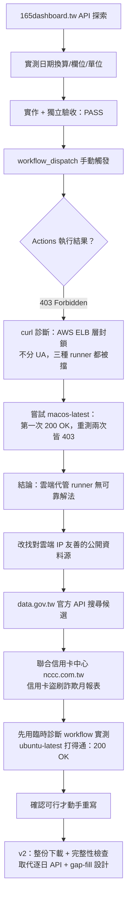
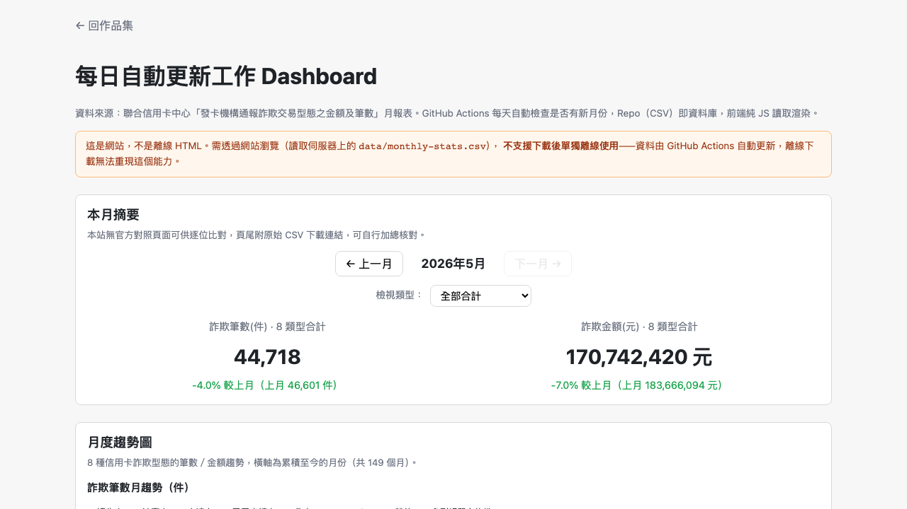

# Day 28 — Scheduled Work Dashboard：GitHub Actions 排程 + Repo 即資料庫，以及一次資料源被雲端封鎖的真實踩坑記

> Level 2 的第一題，正式離開「單一 HTML 就是完整產品」的世界。今天要做一個每天自動抓資料、以月為單位彙總呈現的 Dashboard，資料存在 Repo 裡（CSV 即資料庫），靠 GitHub Actions 排程更新——聽起來是很標準的 CI/CD 練習題，但過程中撞到一件事先完全沒預料到的狀況：**選定的資料源，對 GitHub 雲端代管的 Actions runner 直接做 IP 封鎖**。這篇文章記錄從「資料格式對了」到「真的能自動化跑」中間，還隔著一層容易被忽略的驗證。

---

## 🎯 情境：固定報表的手動更新之痛，以及「格式對不代表存取得到」

PRD 24 的原始需求很直白：固定報表每天／每週由人手動更新，容易耗時、忘記、產生版本不一致。標準解法是把資料放進 Repository（CSV/JSON 當資料庫），用 GitHub Actions 排程執行更新，Pages 顯示 KPI、摘要表、趨勢，並且——這題 PRD 特別強調——**只下載 HTML 不能算完整產品**，因為自動更新能力完全依賴 Actions 這套機制。

這句話在開發過程中，意外地變成了最關鍵的一句。

我最初鎖定的資料源是內政部警政署「165打詐儀錶板」（`165dashboard.tw`），一個公開、免登入、免 API Key 的 JSON 端點，實測過日期換算公式、欄位語意、單位換算，一切都對得上頁面顯示值。腳本寫完、Dashboard 頁面做完、獨立驗收也通過了——直到**第一次真的用 `workflow_dispatch` 手動觸發 Actions**，才等到一個從沒設想過的結果：`403 Forbidden`。

## 💡 解題思路：先自我修復，再發現真正的牆在哪裡

### 關鍵技術亮點

1. **驗證分兩層，缺一層就會白做工**：資料格式對不對、能不能被本機打通，只是第一層；「GitHub Actions 的雲端代管 runner 能不能連到這個資料源」是完全獨立的第二層驗證，而且**只能靠實際跑一次 Actions 才知道**，本機 curl 測不出來。這兩層驗證都要做，缺一不可。我是在整個功能做完、獨立驗收都通過、真的按下 `workflow_dispatch` 那一刻，才撞到這面牆——如果早一步先測第二層，可以省掉整套實作跟一輪獨立驗收的工。

2. **一次僥倖的假訊號，差點變成錯誤結論**：診斷 403 原因時發現封鎖是 AWS ELB 層做的、不分 User-Agent，測了 `ubuntu-latest`、`windows-latest` 都被擋。抱著一絲希望測了 `macos-latest`（GitHub 用的是不同基礎設施，不是 Azure），第一次真的打通了（`200 OK`）。如果就此收工、下結論「改用 macOS runner 就解決了」，回頭一看會很尷尬：重新觸發兩次，`macos-latest` 一樣被擋。GitHub Actions 的 runner IP 是動態池，第一次能打通很可能只是對方封鎖清單還沒同步到那個 IP。**沒有重複驗證就下結論，是這次過程中最接近踩坑的一步**，還好在正式寫進文件前多測了兩次。

3. **換資料源不是找到「格式像」就好，要先測「連得到」**：找候選資料源時，一度以為找到接近的替代品（警政署的逐案明細資料），結果沒有財損金額欄位；換了地方政府的統計表，粒度是年度、範圍侷限在單一縣市。最後選定聯合信用卡中心的信用卡盜刷詐欺月報表（有金額、有筆數、天然月粒度），但**動手重寫程式碼之前，先用一個臨時診斷 workflow 打了一次這個資料源**，確認 GitHub Actions 打得通（`200 OK`）才開始正式改版——這次順序對了，沒有再重演「做完才發現連不上」的劇本。

4. **資料源換了，設計也跟著簡化**：舊版（逐日 API）需要處理「查詢當天資料可能還沒生成」的不確定性，設計了就緒檢查、最近 7 天 gap-fill、月度交叉驗證三層機制。新資料源是「整份月報表直接下載」，這些不確定性直接消失，程式碼複雜度也跟著降下來——資料源的形狀，會直接決定要寫多少防禦性程式碼。

---

## 🛠️ 資源與共用模組

Level 2 開始跳出純前端 HTML 的範疇，沒有沿用 `shared/` 底下 Level 1 系列的模組，改用這一題自己的組合：

- **資料收集**：Python `requests` 下載 CSV（`utf-8-sig` 編碼），整份覆蓋寫入本地 `data/monthly-stats.csv`，並跑完整性檢查（每月應有 8 種信用卡詐欺型態，缺筆寫進 `data/validation-log.csv` 但不中斷）
- **排程機制**：GitHub Actions（`schedule` cron + `workflow_dispatch`），`runs-on: ubuntu-latest`（已實測此資料源對 Azure IP 沒有封鎖）
- **Dashboard 前端**：純 client-side JS 讀 CSV render，無 build step；趨勢圖用手刻 SVG（單一 `<path>` 畫線，149 個月的資料點不逐點畫 `<circle>`，避免效能問題），不引入 Chart.js 之類的外部圖表庫

---

## 🔄 Vibe 過程：一個真實 bug，一個資料源的真實變化

開發資料收集腳本時，完整性檢查邏輯一開始寫錯了——`sorted(extra) | duplicated` 這行想拿 `list` 跟 `set` 做聯集，Python 直接丟型別錯誤。這種錯誤很典型：邏輯上「我想比對兩組資料的差異」是對的，但落到程式碼時混用了不相容的容器型別，只有實際跑一次才會現形，靜態看程式碼容易漏掉。

另一個更有意思的發現，是完整性檢查揪出的一個**真實資料特性**，不是 bug：「多刷帳單之詐欺」這個信用卡詐欺型態，在來源資料裡只出現到 2020 年 12 月，2021 年 1 月之後就完全消失，之後也沒再出現過。完整性檢查一開始把這 65 個月全部標記成「缺筆異常」——第一時間看到一長串 `::warning::` 洗版，直覺是腳本哪裡漏抓了，但回頭去查原始 CSV，確認這個型態真的從 2021 年起就不存在於官方公布的資料裡。這不是本站抓取有誤，是資料源本身的分類方式隨時間改變了。與其讓程式碼「假裝」這件事沒發生（例如悄悄補零、不記錄），我們選擇讓完整性檢查誠實地標記出來，並在頁尾註明這個已知的資料特性——這比讓使用者自己發現數字對不上、再懷疑是不是網站抓錯，要負責任得多。

---

## 📦 產品展示

- **線上體驗網址**：`https://<GITHUB_USER>.github.io/2026ironman/VibeCoding/Day28_scheduled-work-dashboard/index.html`
- **操作亮點**：本月摘要卡片可用下拉選單切換「全部合計」或單一信用卡詐欺型態（8 選 1，切換月份時選取狀態會保留）、月度趨勢折線圖、月度明細表，頁尾清楚標註資料來源、非官方聲明與通報延遲說明。
- **資料範圍**：`201401` ～ `202605`，共 149 個月，由聯合信用卡中心「發卡機構通報詐欺交易型態之金額及筆數」CSV 提供，GitHub Actions 每天自動檢查是否有新月份。

---

## 💭 心得與反思：四層對齊框架

- **想（意圖）**：把「固定報表手動更新」這件事交給排程自動化，同時親身驗證「Repo 即資料庫」這套 Level 2 的核心練習模式到底走不走得通。
- **說（表達）**：PRD 24 要求 Actions 排程執行、Pages 顯示 KPI/摘要表/趨勢、支援手動 `workflow_dispatch`，並且明確排除「只下載 HTML 當完整產品」這種偷懶解法。
- **對（校準）**：這題的校準特別戲劇性——第一版資料源在功能開發完、獨立驗收都通過之後，才在**真正跑一次 Actions** 這一步被推翻，逼著整個資料源重選；重選之後也沒有直接相信「格式對就好」，而是先用臨時診斷 workflow 實測過雲端可存取性，才動手正式改版。
- **做（實作）**：從「逐日 API + gap-fill + 交叉驗證」的複雜設計，簡化成「整份月報表下載 + 完整性檢查」，資料源的形狀決定了程式該有多複雜；本月摘要卡片後續也加上了單一類型檢視的下拉選單，讓「合計」跟「細分」兩種視角都能兼顧。

這題最大的收穫，其實不是任何一行程式碼，而是一個容易被跳過的順序問題：**功能做完、測試通過，不等於「能自動化」這件事被驗證過**。GitHub Actions 的雲端代管 runner 有自己的網路身分，跟本機開發環境是兩個世界，這道牆只有真的觸發過一次排程，才會現形。
