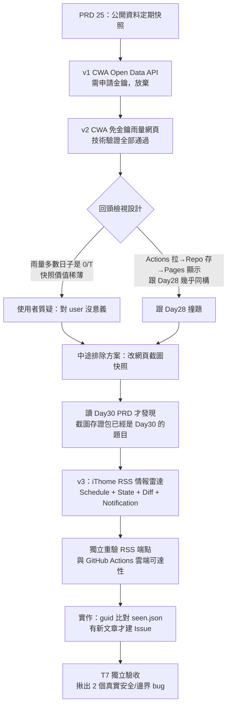
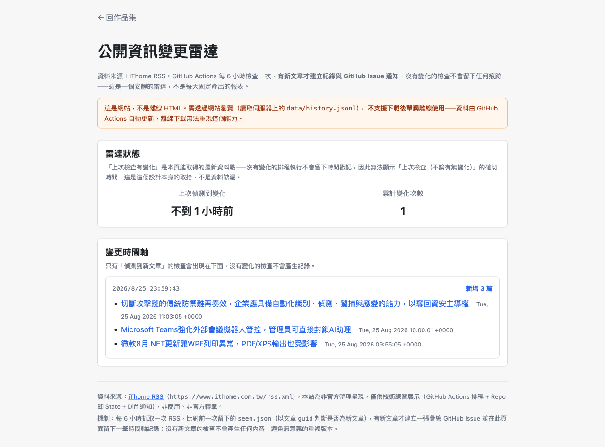

# Day 29 — 公開資訊變更雷達：一個提案被推翻三次，才留下的「有事才響」設計

> Level 2 第二題，PRD 25 的原始要求是「幫公開 CSV/JSON 資料做定期快照」，聽起來跟 Day28 差不多——排程抓資料、存進 Repo、Pages 顯示。但這題最後做出來的東西，跟一開始想的完全不一樣：三次提案，兩次被自己（或使用者）推翻，最後留下的是一個「沒事不出聲、有事才建一張 Issue」的安靜雷達，而不是每天固定產出的報表。

---

## 🎯 情境：從「快照雨量」到「有變化才通知」，中間丟掉了兩個版本

PRD 25 給的 MVP 骨架很直白：設定一個公開資料 URL、Actions 排程下載、依日期保存 Snapshot、跟上一版做差異比較、內容相同時不留無意義的重複版本、Pages 顯示時間軸。

第一版鎖定中央氣象署的六都每日雨量，先撞上「Open Data API 要申請個人金鑰」的門檻，改成直接 curl 官網免金鑰的 HTML 端點，技術上全部驗證過——本機 curl、GitHub Actions 雙重測試都對得上，連「資料到底是每日更新還是月結才回填」這種容易誤判的細節，都在被提醒「你網頁看到的不代表你查得到」之後，重新逐日檢查過一次才敢下結論。

但技術驗證通過，不代表這個設計就該做。回頭看這份提案時，冒出一個更根本的問題：雨量測站多數日子的累積值是 `0` 或 `T`（雨跡），每天存一份幾乎不變的表，「快照」對讀者到底有什麼意義？而且機制拆開看，跟 Day28（Actions 排程拉資料 → Repo 存 → Pages 彙總顯示）幾乎是同一套骨架，兩題放在一起看不出差異化——這不是技術問題，是選錯了要練的東西。

## 💡 解題思路：從「拍照存證」換成「有事才響」

### 關鍵技術亮點

1. **「快照」不等於「每天都留一份」，而是「留下每一次真正的變化」**：雨量快照被推翻的關鍵不在技術，是資料變化太稀薄，撐不住「快照對讀者有意義」這個前提。換成 iThome RSS 之後，資料源天生一小時內就有好幾篇新文章，「有變化才通知」這件事終於有東西可以真的偵測。同一份 PRD，資料源選對了，整個設計的意義才浮現出來，這比把程式碼寫得更漂亮重要得多。

2. **識別身分要用不會變的 key，不能用看起來唯一的欄位**：判斷「這篇文章是不是已經看過」，不是拿標題比對，而是用 RSS 的 `guid`——標題可能事後被編輯改掉，`guid` 不會變。這題選 `guid` 不是憑空決定，是先確認 iThome 的 RSS 真的把 `guid` 當成穩定識別碼在用（`178429 at https://www.ithome.com.tw` 這種格式，跟 `link` 是分開的兩個欄位），才敢把它當成 State 比對的主鍵。

3. **候選資料源要先排除「形狀對但會撞題」的選項**：中途一度考慮「如果要強調快照，乾脆改成網頁截圖」，技術上 GitHub Actions 確實可以跑 Playwright 做截圖。但回頭讀 Day30 的 PRD 才發現，截圖＋PDF/HTML/Markdown 存證包本來就是 Day30 明確要做的東西——如果 Day29 也做截圖快照，兩題會直接撞題。這個排除不是技術上做不到，是先讀清楚「隔壁題在做什麼」才避開的一次重工。

4. **驗證分兩層，這次直接把第二層挪到功能開發之前**：Day28 曾經在功能做完、獨立驗收都過了之後，才在真正觸發 Actions 那一步被資料源封鎖打臉。這次吸取教訓，RSS 端點與 GitHub Actions 雲端可達性的驗證，在提案階段、寫任何正式程式碼之前就先用臨時診斷 workflow 測過一次，確認 `200 OK`、真的抓到最新文章標題，才開始動手寫 `check_feed.sh`。

## 🛠️ 資源與共用模組

跟 Day28 一樣不沿用 Level 1 的 `shared/`，這題另外組合：

- **雷達腳本**：全程 bash + curl + `awk`/`grep`/`sed` 解析 RSS XML，State 比對與 JSON 操作交給 `jq`（GitHub Actions `ubuntu-latest` 內建，不用額外安裝）——刻意不嵌多行 Python，因為在更早的診斷階段真的踩過「YAML block scalar 縮排錯誤，導致整份 workflow 解析失敗」的坑，這次直接把「不嵌多行內嵌 Python」定成規則。
- **排程機制**：GitHub Actions（`schedule` cron 每 30 分鐘 + `workflow_dispatch`），`permissions` 只給 `contents: write` 和 `issues: write`，不用額外 Secret——通知管道是內建 `GITHUB_TOKEN` 建立的 GitHub Issue，不是另外接 Email API。
- **前端頁面**：純 client-side 讀 `data/history.jsonl`（JSON Lines，一行一次「有變化」的紀錄），無 build step，跟 Day28 一樣不引入外部框架。

## 🔄 Vibe 過程：一次真實的 XSS 缺口，和一個潛伏在 `set -e` 裡的邊界 bug

功能做完、六條任務都通過自己的驗證之後，照專案慣例派了一個沒參與實作的 agent 重新驗收——不是走個形式，這次真的抓到兩個東西：

第一個是安全性的。前端渲染文章標題時，一開始就記得「不能把 RSS 來源的文字直接拼進 `innerHTML`」，全部改用 `textContent` 賦值，這層防護做對了。但漏掉了另一條路：文章連結是直接把 `item.link` 賦值給 `<a>.href`，沒有檢查這個字串的 scheme。如果來源被入侵、夾帶一個 `javascript:alert(1)` 當作連結，這條防線完全擋不住——`textContent` 防的是把資料當 HTML 解析，`href` 賦值防的是另一類完全不同的攻擊面，兩個要分開處理。修法是加一層 `safeHttpUrl()`，只放行 `http`/`https`，其餘一律降級成 `#`。

第二個更隱蔽，是一個只在特定時序下才會出現的邊界情況。commit 步驟原本寫 `[ -f "$f" ] && git add "$f"`，平常沒事，因為多數時候 `seen.json` 早就存在。但在 GitHub Actions 的 `set -e` 底下，如果剛好遇到「檔案還不存在（真正第一次執行）＋這次 RSS 抓取又剛好失敗」這兩個條件疊在一起，`[ -f ]` 判斷為假時整條運算式會回傳非 0，直接把整個 step 中止掉。這個 bug 早就在正式驗收前的一次真實 Actions 執行留下了失敗紀錄，只是因為 `seen.json` 後來很快就建立起來，之後再也沒觸發過，不重新去查歷史紀錄根本不會發現它還埋在那裡。改成 `if [ -f "$f" ]; then git add "$f"; fi` 就穩了。

這兩個 bug 有個共同點：都不是「邏輯寫錯了」，是「同一段程式碼在另一個沒被正式驗收項目覆蓋到的情境下，會走上不一樣的路」。這正是「驗證不自驗」這條規矩存在的理由——寫程式的人很容易只驗證自己設計時想到的路徑，沒參與實作的人回頭重新逐項核對，才會去追問「如果這個檔案根本不存在呢」「如果這個字串不是網址呢」。

## 📦 產品展示

- **線上體驗網址**：[lushinshang.github.io/2026ironman/VibeCoding/Day29_public-data-snapshot/index.html](https://lushinshang.github.io/2026ironman/VibeCoding/Day29_public-data-snapshot/index.html)
- **操作亮點**：頁面只有兩塊——「雷達狀態」卡片（上次偵測到變化的相對時間、累計變化次數）跟「變更時間軸」（逐筆列出每一次真的抓到新文章的紀錄，標題／連結／發布時間），沒有變化的排程執行完全不會留下痕跡，時間軸本來就該是稀疏的，不需要用空白格填滿沒事發生的日子。上面這張截圖就是真實排程跑出來的資料，不是灌進去的示範假資料。
- **背後機制**：GitHub Actions 每 30 分鐘比對一次 iThome RSS 的 `guid`，有新文章才建立一張彙總 GitHub Issue（範例：[#1](https://github.com/lushinshang/2026ironman/issues/1)，驗收過程中真實產生的一次通知）並在頁面留下對應的時間軸紀錄；沒有新文章，Actions 執行完就結束，不 commit、不建 Issue。

## 💭 心得與反思：四層對齊框架

- **想（意圖）**：練 PRD 25 要求的「Repo 即歷史版本庫」這個 Level 2 核心模式，但同時想搞清楚「快照」這件事對讀者到底有沒有意義，不想只是把 Day28 的骨架套上另一個資料源。
- **說（表達）**：PRD 25 要求 Actions 定期下載、依日期保存、跟上一版比較差異、內容相同時不留無意義的重複版本、Pages 顯示時間軸——這些字面要求其實沒有規定「快照」一定要是「每天都拍一張照」，只是我一開始下意識照著 Day28 的形狀去理解它。
- **對（校準）**：這題的校準比其他題都戲劇性——技術驗證全部通過的 v2 設計，是在「這東西對讀者有意義嗎」這個問題上被推翻的，不是在「做不做得出來」上被推翻。換資料源之後，又靠讀清楚隔壁題的 PRD，避開了一次會撞題的重工。獨立驗收再抓出兩個只在特定情境才現形的真實 bug，證明「六條任務都自己驗證過一遍」跟「真的沒問題」中間，還是有一段距離。
- **做（實作）**：把「每天固定產出報表」換成「Schedule + State + Diff + Notification」，State 比對用不會變的 `guid` 而不是標題，通知管道用內建 `GITHUB_TOKEN` 建 Issue 而不是另外接金鑰服務，讓整個設計在「免金鑰、Repo 即資料庫」這個 Level 2 的精神底下，同時做出跟 Day28 明確不一樣的東西。

這題最後留下的東西，程式碼量比 Day28 還精簡，但繞的路更長——多花的時間不是花在寫程式，是花在一次又一次回頭問「這個資料源真的值得快照嗎」「這跟隔壁題會不會撞」。有時候把設計做對，比把程式碼寫對更花力氣。
