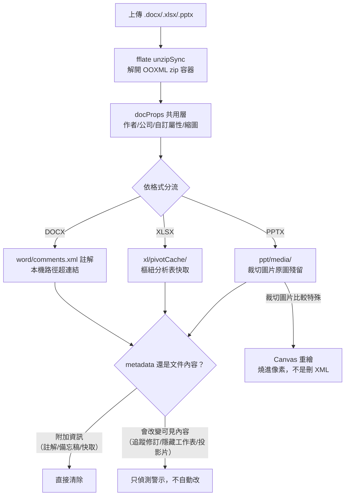
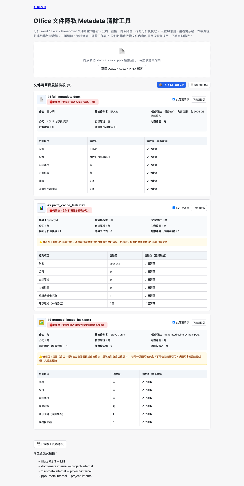

# Day 30 — Office 文件隱私 Metadata 清除工具：一個只刪 XML 節點救不了的裁切圖片

> Day15 做完 EXIF 隱私清除後，回頭問了自己一個問題：PDF 已經在 Day25 處理過送件前的 Metadata 清理，那 DOCX/XLSX/PPTX 呢？查證後發現三種格式各自藏著意想不到的角落——其中最麻煩的一個，連「刪掉裁切標記」都救不回來，非得把圖片重新畫過一次不可。

---

## 🎯 情境：Word/Excel/PowerPoint 檔案裡，比 EXIF 更隱蔽的洩漏

日常公務往來裡，Office 檔案的外流風險常常不是內容本身，而是檔案背後那層看不見的結構：

- 一份對外簡報的作者欄位、最後修改者，可能直接寫著內部窗口的真實姓名。
- Excel 報表刪掉了「來源工作表」自以為資料清乾淨了，實際上樞紐分析表的快取裡還完整留著一份原始資料明文。
- PowerPoint 裡「已經裁掉」的機密畫面（浮水印、旁邊洩漏內容的視窗），在檔案裡其實從頭到尾都沒被真的裁掉。

這些角落用 Word/Excel/PowerPoint 桌面版的一般操作根本看不到，必須把檔案當 zip 容器打開、逐一比對 OOXML 內部結構才找得到。跟 Day15 一樣，這題也要求**百分之百瀏覽器端執行、不上傳任何檔案**。

---

## 💡 解題思路：docProps 共用一層，三格式各自處理自己的坑

DOCX/XLSX/PPTX 全部都是 OOXML（zip + XML）容器，`docProps/` 那層（作者、公司、時間戳、內嵌縮圖）三格式完全共用同一套機制，可以只寫一份。真正的難點在**各格式獨有的隱私角落**——而且三個角落，處理方式三種不同。

### 三個角落，三種答案

1. **XLSX 樞紐分析表快取（pivotCache）——最容易被忽略的資料殘留**：實測建一份含姓名/薪資的工作表，做出樞紐分析表後把來源工作表整個刪掉，`xl/pivotCache/pivotCacheDefinition1.xml` 跟 `pivotCacheRecords1.xml` 裡的姓名、數字**原封不動**還在。使用者以為「刪掉來源分頁」就等於清乾淨，樞紐快取根本沒被連動處理。清除策略是整組移除（part + relationship + `[Content_Types].xml` 的 Override + `workbook.xml` 的 `<pivotCaches>` 節點），但要在 UI 上明講「這會讓對應的樞紐分析表失效」，不能靜默處理。

2. **XLSX/PPTX 隱藏工作表／投影片——hidden 只是一個顯示旗標**：`state="hidden"` 或 `show="0"` 完全不影響資料是否寫進檔案，工作表名稱、投影片標題與內容原封不動存在 XML 裡，任何人解開 zip 用文字編輯器就看得到。這屬於「會改變文件結構」的操作，比照 DOCX 追蹤修訂的判準——只偵測警示、列出名稱，不自動移除。

3. **PPTX 裁切圖片——唯一一個「只刪 XML 節點沒用」的情境**：PowerPoint 的「裁切」（`<a:srcRect>`）只是告訴渲染引擎「畫的時候只取這個矩形範圍」，`ppt/media/` 底下永遠是裁切前的完整原圖。這跟 Day16 screenshot-sanitizer「遮蔽必須燒進像素」是同一類風險，於是清除邏輯也得比照辦理：用 `Image` 解碼原圖、依裁切比例算出可見矩形、`canvas.drawImage()` 只重繪保留範圍、`canvas.toBlob()` 輸出裁切後的位元組去**取代**原始媒體檔案，最後才移除 `<a:srcRect>` 標記（標記留著，等於在已經裁切過的圖上再裁一次）。同一張圖被多處引用但裁切規格不一致時，強行處理會破壞另一處的合法顯示——這種情況直接跳過自動清除，只提示風險。

---

## 🛠️ 資源與共用模組

- **fflate 0.8.3**：`shared/io-zip.js` 補匯出 `unzipSync`/`strFromU8`，解開／重壓 OOXML zip 容器。
- **架構決定：docProps 共用函式留在 `docx-meta.js`，不搬進 `shared/`**——`xlsx-meta.js`／`pptx-meta.js` 直接呼叫，物理上三個檔案在 bundle 時已經內嵌進同一份 `index.html`，是「同一題內部重用」而非「跨題共用」，跟 `shared/` 既定角色（例如 `img-exif.js` 被 Day14/15/16 三題共用）不是同一件事，等真的出現第二個題目要處理 OOXML docProps 再搬。細節記在新建的 `shared/OOXML_CONTRACT.md`。
- **DOMParser／XMLSerializer／Canvas**：全部瀏覽器原生 API，沒有引入任何 XML 或圖片處理 library。

---

## 🔄 Vibe 過程：subagent 撞額度上限，改自己下場做研究

這題原本規劃「DOCX 打完共通機制後，XLSX/PPTX 的結構研究可以平行派 subagent 去做」——不用等 DOCX 驗收完才開始下一階段。派出去之後兩個 subagent 都撞上同一句錯誤：`You've hit your session limit`。

沒有等額度重置，也沒有讓工具停擺，直接把研究方法原封不動搬到自己身上：用 `openpyxl`/`python-pptx` 手動注入 XML、寫測資產生器、每個情境都印出 `[OK]` 的自我驗證斷言。這批研究後來就是 pivot cache 洩漏跟裁切圖片殘留兩個最關鍵發現的來源——**subagent 能不能跑，不該決定研究的深度打幾折**，同一套「真的跑一次、看真實輸出」的紀律換誰執行都一樣。

裁切圖片這個功能實作時也出現一次典型的「腦中藍圖」落差：一開始寫掃描邏輯時，直覺反應是「找到 `<a:srcRect>` 就刪掉」——但這樣做完，圖片顯示範圍會變回「未裁切」，反而洩漏更多。真正要清的是圖片本體，`<a:srcRect>` 只是事後要收尾移除的標記，順序完全相反。這個落差是在對照研究筆記「PowerPoint 的裁切是純顯示層屬性」這句話時才校準回來——沒有先做研究，光憑經驗去寫，很容易把「清除」這件事做反。

---

## 📦 產品展示

同時丟一份帶作者/公司的 DOCX、一份含樞紐分析表快取的 XLSX、一份裁切圖片的 PPTX，風險標籤會依實際偵測到的欄位動態組字（不是固定文案），清除後的「重新驗證」表格全部即時比對真實掃描結果，不是預設寫死「已清除」。

- **線上體驗網址**：[lushinshang.github.io/2026ironman/VibeCoding/Day30_ooxml-privacy-cleaner/index.html](https://lushinshang.github.io/2026ironman/VibeCoding/Day30_ooxml-privacy-cleaner/index.html)
- **離線可用性**：支援一鍵下載離線版，斷網環境下依然能安全清除三種 Office 文件的隱私 metadata。

---

## 💭 心得與反思：四層對齊框架

- **想（意圖）**：把 Day15 圖片隱私清除的思路延伸到 Office 文件，讓使用者送出檔案前能真正看清楚檔案裡藏了什麼。
- **說（表達）**：OpenSpec 提案把「metadata 才清除、會改變內容的只警示」定成貫穿三格式的統一判準，避免三題各自寫出不一致的清除範圍。
- **對（校準）**：subagent 額度中斷後改自己做的實測研究，校準出「裁切圖片必須先重繪像素再拆標記」這個原本直覺會做反的順序；派 fresh agent 用自己重新產生的測資獨立驗收，抓到風險標籤文案固定字串誤導使用者的瑕疵並修正。
- **做（實作）**：三支 `*-meta.js` 模組 + 一份共用 docProps 層，Canvas 像素級裁切清除全程獨立用 Python PIL 交叉驗證，不只信任頁面內建的重新掃描結果。
