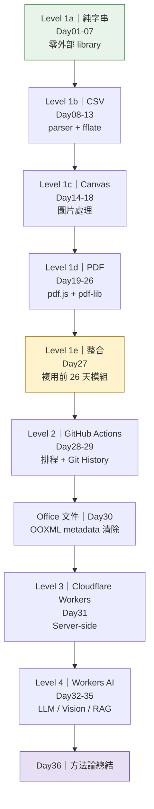
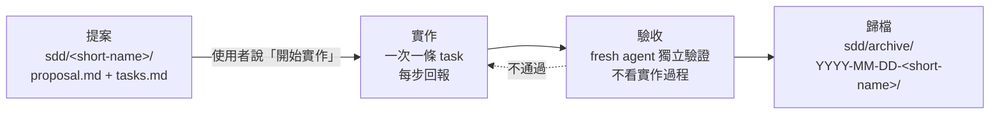

> [!IMPORTANT]
> 🤖 **給協作 AI 的寫作與開發規範：**
> 本檔案及本專案之寫作與 Debug 歷程，皆受根目錄 [readme.md](../readme.md) 之 AI 協作規範與「隱私安全防護（嚴禁留下真實姓名、Email、IP 與真實使用者路徑）」約束。請勿刪除已有的開發日誌。

# 2026 iThome 鐵人賽 — Vibe Coding（v2 重製）


這個系列想回答的不是「AI 寫程式有多快」，而是：

> **我腦中原本有一個藍圖，最後 AI 和我共同做出的東西，到底有沒有和那個藍圖一致？**

方法論主軸是 **想 → 說 → 對 → 做** 的四層對齊，完整論述見 [`vibe-coding-alignment-method.md`](vibe-coding-alignment-method.md)。這篇**刻意排在最後一天**發表——先讓讀者跟著走完 32 個產品的實作歷程，再回頭比對方法論，比一開始就講抽象框架更有說服力。

30 個產品的需求基線在 [`2026-ironman-vibecoding-30-prd.md`](2026-ironman-vibecoding-30-prd.md)（v2.0）。**那份是需求，不是實作授權**；每一題要動工前另外走提案流程。

---

## 📌 目錄

- [這一版跟舊版差在哪](#-這一版跟舊版差在哪)
- [開發順序與進度](#-開發順序與進度)
- [技術棧遞進](#-技術棧遞進)
- [三階段開發流程](#-三階段開發流程)
- [目錄結構](#-目錄結構)
- [舊版作品](#-舊版作品old)

---

## 🔄 這一版跟舊版差在哪

舊版（`old/`）是「100 題清單挑 30 題」，主題按 5 天一循環的**使用情境**分組。做到第 9 題時發現兩個問題：題目之間的技術棧跳來跳去（純字串 → pdf.js → 純字串），每天都在重新暖機；而且清單裡的題目強度不一，有幾題腦力激盪後才發現需求不成立，臨時換題。

v2 改成按**技術棧**分群連續做，一次學會、後面複用；順序由淺入深，整合題壓軸。

### v2 排序時做的三個調整

**1. `document-tools` 從第一題移到 Level 1 壓軸（Day27）**

PRD 01 的 MVP 是「圖片互轉/Resize/壓縮 + PDF 合併/拆分/轉圖 + Markdown 預覽輸出」——這整個是 PRD 02、07、13、18 的聯集。放第一天等於還沒有任何底層能力就先蓋整合殼，到了圖片那週又要重做一次壓縮。移到最後，直接把前 25 天的模組組起來。

**2. 補回舊版兩題**

新 30 題把舊系列的「贅詞與 AI 味檢查器」「文字差異比對器」漏掉了（PRD 03 只做字數與格式，不含贅詞偵測；PRD 09 是 CSV 清冊比對，不是文字 diff）。這兩題在舊版有實測過的演算法，補回來當 Day03、Day07。

> ⚠️ 補回的是**題目與技術資產**，不是文章。`old/` 的文章草稿不重用，一律依當下實作狀況重寫。

**3. 外部 library 的離線打包流程提前立起來**

PRD 共通規則要求「用第三方 library 需固定版本並打包／內嵌，避免依賴 CDN」。第一次真正需要是 Day07 的 jsdiff，接著是 JSZip、pdf.js、pdf-lib。Day07 順手寫 `scripts/bundle.py`（固定版本下載 → 內嵌 → 產出單檔 HTML），之後每題複用。

---

## 📊 開發順序與進度

**總覽**：30 / 36 完成

> 鐵人賽是連續 30 天，本表排到 36。**Day01–Day30 對應賽程**，Day31–Day36 賽程外續寫——工具集不該被 30 這個數字綁住。Day30 起插入了「Office 文件隱私 Metadata 清除工具」（2026-08-27 使用者裁示插隊，原 Level 3/4/收尾各往後推一天），見下方 Level 1f。

### Level 1a：純文字處理，零外部 library

| Day | 產品 | 短名稱 | PRD | 新技術點 | 開發 | 撰文 |
|:---:|---|---|:---:|---|:---:|:---:|
| 01 | 文字健檢工作台 | `text-health-check` | 03 | 純字串統計、CJK 判定、即時更新。**方法論示範題**，四層對齊完整跑一遍 | ✅ | ✅ |
| 02 | AI 回答 → Office 文字清理器 | `ai-text-cleaner` | 06 | regex 清理、三種輸出模式 | ✅ | ✅ |
| 03 | 贅詞與 AI 味檢查器 | `filler-word-checker` | 補回 | 詞庫比對＋詞頻統計＋段落開頭同構偵測 | ✅ | ✅ |
| 04 | 繁簡與台灣在地化轉換器 | `zh-tw-localizer` | 04 | 第一次內嵌大型靜態資料（OpenCC 詞典）、多階段轉換架構 | ✅ | ✅ |
| 05 | 可逆式文字去識別化（上篇） | `reversible-deidentifier` | 05 | Token 化 + 偵測 + 合併歸併 + token 分配，第一次有「可逆」設計起手 | ✅ | ✅ |
| 06 | 可逆式文字去識別化（下篇） | `reversible-deidentifier` | 05 | mapping 匯出／載入、還原引擎、`buildCleanHtmlCopy()` 資安擴充，第一次有「可逆」往返測試 | ✅ | 🔵 |
| 07 | 文字差異比對器 | `text-diff` | 補回 | 第一次內嵌第三方 library（jsdiff 9.0.0，BSD-3-Clause），走 `bundle.py` 的 `raw_js` 模式 | ✅ | ✅ |

> ⚠️ **Day05／Day06 是同一個產品的兩篇文章**（`reversible-deidentifier`，工作量超過單日上限，2026-08-23 使用者裁示拆分），資料夾只有 `Day05_reversible-deidentifier/` 一個，不會另建 `Day06_...` 資料夾。

### Level 1b：表格資料 CSV

| Day | 產品 | 短名稱 | PRD | 新技術點 | 開發 | 撰文 |
|:---:|---|---|:---:|---|:---:|:---:|
| 08 | CSV Doctor & Cleaner | `csv-doctor` | 08 | CSV parser（後面 4 題全靠它）、編碼偵測、BOM | ✅ | ✅ |
| 09 | 兩期清冊異動報告 | `csv-period-diff` | 09 | 兩期比對，複用 Day07 的 diff 思路 | ✅ | ✅ |
| 10 | 總表 → 分單位批次拆檔 | `csv-batch-splitter` | 12 | 第一次需要 ZIP（**fflate 0.8.3**，非 JSZip，見 `shared/CSV_CONTRACT.md` 第 7.3 節），複用 Day07 打包流程 | ✅ | ✅ |
| 11 | CSV Pivot Dashboard（上篇） | `csv-pivot-dashboard` | 10 | 樞紐引擎：型別推薦、多欄 Group By、彙總管線，零 SVG | ✅ | ✅ |
| 12 | CSV Pivot Dashboard（下篇） | `csv-pivot-dashboard` | 10 | 手寫 SVG 圖表模組 `ui-chart-svg.js`、匯出靜態快照 dashboard | ✅ | ✅ |
| 13 | CSV 一頁式管理報告 | `csv-one-page-report` | 11 | 列印版型（為 Day18 鋪路） | ✅ | ✅ |

### Level 1c：圖片 / Canvas

| Day | 產品 | 短名稱 | PRD | 新技術點 | 開發 | 撰文 |
|:---:|---|---|:---:|---|:---:|:---:|
| 14 | 圖片批次最佳化工作台 | `image-batch-optimizer` | 13 | Canvas 基礎、目標容量二分逼近、複用 Day10 ZIP | ✅ | ✅ |
| 15 | EXIF 隱私檢查與清除 | `exif-privacy-cleaner` | 14 | 二進位 EXIF/XMP 解析 | ✅ | ✅ |
| 16 | Screenshot Privacy Sanitizer | `screenshot-sanitizer` | 15 | Canvas 互動、undo/redo、**遮蔽必須燒進像素** | ✅ | ✅ |
| 17 | 文件照片透視校正器 | `document-perspective-corrector` | 17 | 透視變換矩陣（本階段最硬） | ✅ | ✅ |
| 18 | 照片 → 工作成果附件 | `photo-evidence-sheet` | 16 | 版型與列印，複用 Day13 列印模板；硬題後放輕一天 | ✅ | ✅ |

### Level 1d：PDF

| Day | 產品 | 短名稱 | PRD | 新技術點 | 開發 | 撰文 |
|:---:|---|---|:---:|---|:---:|:---:|
| 19 | PDF_TO_JPG 重製版 | `pdf-to-jpg` | 02 | pdf.js 入門（render→canvas），複用 Day14 壓縮 + Day10 ZIP | ✅ | ✅ |
| 20 | PDF 文字擷取與全文搜尋 | `pdf-text-search` | 19 | pdf.js 文字層擷取（`file://` 下 ES Module Worker 的坑） | ✅ | ✅ |
| 21 | PDF 拆分 / 合併 / 重排 | `pdf-organizer` | 18 | pdf-lib 入門，改動 PDF 結構 | ✅ | ✅ |
| 22 | PDF 頁碼 / 浮水印 / 送審章 | `pdf-review-stamper` | 20 | pdf-lib 繪製 + **中文字型嵌入**（已知大坑） | ✅ | ✅ |
| 23 | PDF 密碼管理器 | `pdf-password-manager` | 22 | 加解密 | ✅ | ✅ |
| 24 | PDF 安全遮蔽 / Flatten | `pdf-secure-redactor` | 21 | render + 重建，PDF 群最難 | ✅ | ✅ |
| 25 | PDF 送件清理器 | `pdf-delivery-cleaner` | 23 | Metadata / annotation / form / action 掃描清理，PDF 綜合題 | ✅ | ✅ |
| 26 | Office Content Publisher | `office-content-publisher` | 07 | Markdown→HTML、CSV→Table，複用 Day08 parser | ✅ | ✅ |

### Level 1e：整合壓軸

| Day | 產品 | 短名稱 | PRD | 新技術點 | 開發 | 撰文 |
|:---:|---|---|:---:|---|:---:|:---:|
| 27 | Document Tools 重製版 | `document-tools` | 01 | **集大成**：圖片區接 Day14、PDF 區接 Day19/20、Markdown 區接 Day26 | ✅ | ⬜ |

### Level 2：GitHub Actions（不可只下載 HTML 使用）

| Day | 產品 | 短名稱 | PRD | 新技術點 | 開發 | 撰文 |
|:---:|---|---|:---:|---|:---:|:---:|
| 28 | 每日自動更新工作 Dashboard | `scheduled-work-dashboard` | 24 | Actions 排程、Repo 即資料庫 | ✅ | ✅ |
| 29 | 公開資訊變更雷達 | `public-data-snapshot` | 25 | Schedule + State + Diff + Notification；每小時第 23 分檢查，RSS + 首頁 HTML 雙來源合併去重（避免排程延遲時 RSS 只回 10 筆造成漏抓） | ✅ | ✅ |

### Office 文件（single HTML，2026-08-27 插隊追加）

Day15 EXIF Privacy Cleaner 的 Office 文件版，DOCX/XLSX/PPTX 隱私 metadata 清除。PDF 已在
Day25 完成，不重做。規格見 OpenSpec `integrations/openspec/specs/_archived/20260827_003406_78c4e53c/proposal.md`。

| Day | 產品 | 短名稱 | PRD | 新技術點 | 開發 | 撰文 |
|:---:|---|---|:---:|---|:---:|:---:|
| 30 | Office 文件隱私 Metadata 清除工具 | `ooxml-privacy-cleaner` | OpenSpec | OOXML zip 容器解析（fflate unzipSync）、docProps/thumbnail/comments/pivot cache/裁切圖片像素清除等三格式各自的隱私角落 | ✅ | ✅ |

### Level 3：Cloudflare Workers（無 AI）

| Day | 產品 | 短名稱 | PRD | 新技術點 | 開發 | 撰文 |
|:---:|---|---|:---:|---|:---:|:---:|
| 31 | 網址 → 網頁存證包 | `web-evidence-packager` | 26 | Workers、Browser Rendering | ⬜ | ⬜ |

### Level 4：Cloudflare Workers AI

| Day | 產品 | 短名稱 | PRD | 新技術點 | 開發 | 撰文 |
|:---:|---|---|:---:|---|:---:|:---:|
| 32 | AI 會議紀錄整理器 | `ai-meeting-minutes` | 27 | 純文字 LLM，最單純的 AI 入門 | ⬜ | ⬜ |
| 33 | AI 智慧檔名整理器 | `ai-file-renamer` | 30 | 文字理解 + 批次（PRD 30，30 題需求基線的最後一題） | ⬜ | ⬜ |
| 34 | PDF / 圖片表格救援器 | `ai-table-rescue` | 29 | Vision 模型 | ⬜ | ⬜ |
| 35 | Office SOP 語意搜尋 / RAG | `office-sop-rag` | 28 | Vectorize + embedding，最複雜 | ⬜ | ⬜ |

### 收尾

| Day | 產品 | 短名稱 | 說明 | 撰文 |
|:---:|---|---|---|:---:|
| 36 | Vibe Coding 方法論總結 | `alignment-method` | 想 → 說 → 對 → 做，四層對齊。**不做工具**，回頭把 33 個產品（35 篇文章）的實作歷程對照方法論 | ⬜ |

---

## 🧭 技術棧遞進



選擇執行環境的判準（沿用 PRD v2.0）：

1. Browser 能解決 → Browser 解決
2. 需要排程／Git History → GitHub Actions
3. 需要 Server-side → Cloudflare Workers
4. 沒有模型就很難完成內容理解 → Cloudflare AI

---

## 🔁 三階段開發流程

每一題都走同一套，細節見 [`CHECKLIST.md`](CHECKLIST.md)。



**硬性規矩**：

- 提案完成後**停止**，沒收到「開始實作」不寫程式
- `tasks.md` 每條 1 小時內可完成，整份不超過 10 條；超過就先拆需求
- 原始檔不覆寫，產生新檔供下載
- 能在瀏覽器本機完成就不上傳
- 涉及 AI 時，介面必須明確告知資料會送往 Cloudflare AI 服務

---

## 📁 目錄結構

```text
VibeCoding/
├── README.md                          ← 本檔，總覽與進度
├── PROGRESS.md                        ← 交接狀態檔（給接手 session，非讀者）
├── CHECKLIST.md                       ← 每日開發與撰文檢查清單
├── 2026-ironman-vibecoding-30-prd.md  ← 30 題需求基線 v2.0
├── vibe-coding-alignment-method.md    ← Day35 文章素材
├── index.html                         ← 作品集入口（待建）
├── scripts/
│   └── bundle.py                      ← Day07 建立，library 內嵌打包
├── Day01_text-health-check/
│   ├── PRD.md
│   ├── index.html
│   ├── article_draft.md
│   ├── logs/
│   └── screenshot_*.png
├── Day02_ai-text-cleaner/
│   └── ...
└── old/                               ← v1 作品，技術參考用，不再更新
```

資料夾命名 `DayNN_<short-name>/`：`sdd/` 目錄與 PRD 都以短名稱當識別碼，資料夾帶上短名稱才 grep 得到，也不用開 README 才知道 Day5 是哪個工具。

**部署路徑**：`https://<GITHUB_USER>.github.io/2026ironman/VibeCoding/DayNN_<short-name>/index.html`

---

## 📦 舊版作品（`old/`）

v1 完成 7 個產品，保留當技術參考，不再更新。與 v2 的對應關係：

| 舊版 | 產品 | v2 對應 | 可複用的技術資產 |
|:---:|---|---|---|
| Day1 | 字數與段落統計器 | Day01 `text-health-check` | CJK Unicode 判定、debounce 即時統計、Blob 下載 |
| Day2 | 贅詞與 AI 味檢查器 | Day03 `filler-word-checker` | 詞庫比對、詞頻統計、段落開頭同構偵測、引號範圍排除 |
| Day3 | 繁簡與在地化轉換器 | Day04 `zh-tw-localizer` | 內嵌 OpenCC 詞典（5.3 萬筆）、多階段轉換的 segment+tags 架構 |
| Day6 | PDF 轉 TXT/MD | Day20 `pdf-text-search` | pdf.js 文字層擷取、`file://` 下 ES Module Worker 相容處理、浮水印與頁首頁尾過濾 |
| Day7 | 文字差異比對器 | Day07 `text-diff` | 內嵌 jsdiff `diffArrays`、中文句尾斷句規則、未變動區塊摺疊 |
| Day8 | 異動重點摘要產生器 | — （v2 未排入） | 正則解析差異報告、勾選清單即時同步 |
| Day9 | 文件去識別化工具 | Day05–06 `reversible-deidentifier` | regex 個資偵測、字庫一對一對應、重疊結果去重 |

> ⚠️ **只複用演算法與踩坑經驗，不複製文章**。v2 每篇文章依當下實作狀況重寫，包含當時真實遇到的問題與對齊落差。

---

## 📚 相關文件

- [`../readme.md`](../readme.md) — 賽事規則、發文規範、隱私安全防護
- [`../../../../ops/WORKFLOW.md`](../../../../ops/WORKFLOW.md) — SDD 三階段通用流程
- [`../../../../ops/LESSONS.md`](../../../../ops/LESSONS.md) — 跨專案踩坑紀錄
