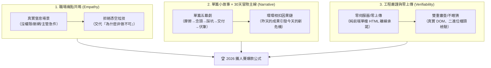
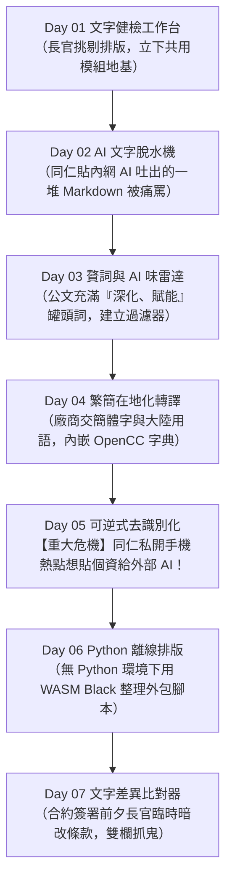
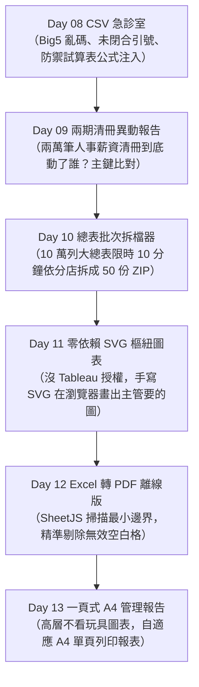
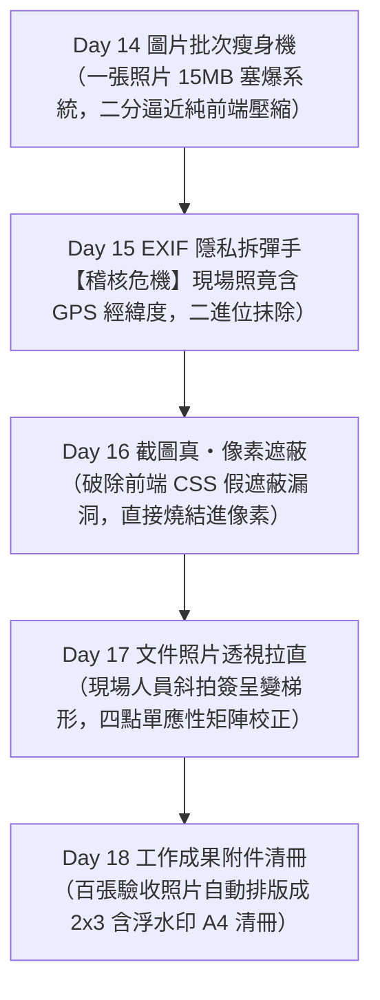
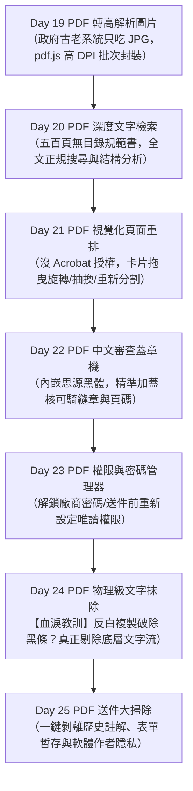
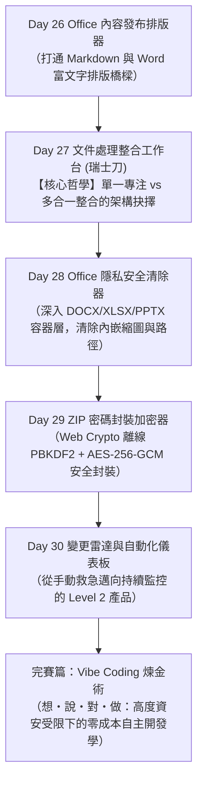

# 🏆 2026 iThome 鐵人賽故事型技術連載規劃書
## 《斷網辦公室的瑞士刀工匠：用 Vibe Coding 打造 31 款純前端離線救命神器》

---

## 一、 🎯 賽事調研與風格定位（iThome 2026 現場情報）

依據對 `2026 iThome 鐵人賽` 現場專區（包含 `Vibe Coding`、`ChatGPT & Codex`、`SideProject30` 等主題）的深度調研與歷屆得獎作品剖析，社群最受歡迎、完讀率最高且評審高度認可的寫作風格具備以下三大特質：



### 🚫 避坑指引（社群毒藥 vs 讀者買單）
* **❌ 讀者最排斥**：
  * 「今天我們來介紹什麼是 Canvas API...」（教科書式複製貼上）
  * 「AI 太神了，一下指令就全部寫好了」（神化 AI、毫無資訊增量的假爽文）
  * 毫無前後關聯的「工具大雜燴」（散落各處，讀者看不到成長與累積）。
* **✅ 讀者買單且會收藏轉發**：
  * **「這情境太真實了吧！我上週在辦公室也遇到過！」**（強烈職場共鳴）
  * **「單檔 HTML 下載就能用？而且資料完全不離開電腦？這拿去我們公司可以用！」**（實用度爆表）
  * **「從單一專注工具到最後的瑞士刀整合，架構思維進化的過程很精彩！」**（技術深度）。

---

## 二、 🗺️ 30 天中型主線故事全景地圖

### 🎭 主角設定與世界觀（嚴禁虛構真實性宣告）
> **真實性邊界**：故事角色「阿星」與特定機關單位名稱為保護商業與個人隱私之去識別化代稱；但文中所有的**業務摩擦、DLP 資安限制、資料髒亂慘狀與工程踩坑實錄，100% 來自真實職場血淚現場**。
>
> **阿星（Lanss）**：某大型高度資安管制企業（金融/公部門外包）的邊緣工程師。  
> 電腦**無 Admin 管理員權限**、內部網路受 DLP（資料防洩漏）系統嚴格監控、**禁止安裝 Python / Node.js**、外網連線全被防火牆擋下。  
> **物理前提補正（解開斷網矛盾）**：
> 1. 內部資安稽核僅放行審查過的**靜態 GitHub Pages 白名單網域**（供同仁查閱技術文件），阿星藉由白名單載入純前端工具，或於**下班後在家用個人電腦以 Vibe Coding 封裝為單檔 HTML**，經公司檔案攜入審核程序帶入辦公室使用。
> 2. 他在辦公室唯一的自由之窗，是**每台作業系統都內建、永遠不被禁止開啟的「瀏覽器」**。

> 📱 **載體發布降階律（依據 ITHELP_MARKDOWN.md & PERSONA 3.17 / 3.21）**：
> - **HackMD 衝刺筆記**：保留下方原生高清 `flowchart TD` 直式架構圖。
> - **iThome 連載文章**：因平台 SimpleMDE 不支援 Mermaid，發布時請降階為**寬度 ≤ 20 字元的簡約 ASCII / 文字清單**（見各階段附錄），杜絕代碼裸露。

---

### 階段一：手無寸鐵的雜役期【文字的整肅】（Day 01 - Day 07）
*核心主線：新人報到接下最繁瑣的公文與文件整理雜工，在嚴苛限制下建立第一批文字武器庫。*



> **iThome 發布用極簡 ASCII 地圖（寬度 ≤ 20 字元）**：
> ```text
> Day01 文字健檢 ── 長官挑公文格式
> Day02 AI文字脫水 ── 剝離Markdown符號
> Day03 贅詞雷達 ── 清理AI公文空話
> Day04 繁簡轉譯 ── 內嵌OpenCC字典
> Day05 去識別化 ── 阻斷外部AI洩密
> Day06 Python排版 ── 離線WASM Black
> Day07 文字比對 ── 抓出合約偷改條款
> ```

---

### 階段二：髒資料的泥淖【表格攻防戰】（Day 08 - Day 13）
*核心主線：文字過關後，財務與業務部門丟來幾萬筆編碼錯亂、欄位噴飛的機密報表，手動整理必然引發重大帳務錯誤與稽核缺失。*



> **iThome 發布用極簡 ASCII 地圖（寬度 ≤ 20 字元）**：
> ```text
> Day08 CSV急診室 ── 修復Big5與公式注入
> Day09 兩期異動 ── 萬筆清冊主鍵對照
> Day10 批次拆檔 ── 依分店瞬間打ZIP
> Day11 SVG圖表 ── 零依賴樞紐儀表板
> Day12 Excel轉PDF ── SheetJS邊界列印
> Day13 一頁報告 ── A4自適應主管報表
> ```

---

### 階段三：像素與現場的謊言【影像鑑識與隱私】（Day 14 - Day 18）
*核心主線：專案稽核查核降臨！外勤人員回傳的成果照片差點外洩機敏經緯度與客戶隱私。*



> **iThome 發布用極簡 ASCII 地圖（寬度 ≤ 20 字元）**：
> ```text
> Day14 圖片瘦身 ── 二分逼近本機壓縮
> Day15 EXIF拆彈 ── 二進位抹除GPS經緯
> Day16 截圖真遮蔽 ── 像素燒結杜絕反白
> Day17 透視拉直 ── 單應性矩陣校正
> Day18 成果清冊 ── 2x3含水印A4排版
> ```

---

### 階段四：最後防線【PDF 攻堅與送件大作戰】（Day 19 - Day 25）
*核心主線：投標與結案送件倒數 48 小時，面對格式各異的 PDF 檔案展開精密加工。*



> **iThome 發布用極簡 ASCII 地圖（寬度 ≤ 20 字元）**：
> ```text
> Day19 PDF轉圖 ── pdf.js逐頁高DPI
> Day20 深度檢索 ── 500頁結構正規搜尋
> Day21 視覺重排 ── 卡片拖曳旋轉抽換
> Day22 中文蓋章 ── 內嵌黑體騎縫章
> Day23 密碼管理 ── 權限解鎖與再加密
> Day24 物理文字抹除 ── 剔除底層文字流
> Day25 送件大掃除 ── 剝離歷史註解隱私
> ```

---

### 階段五：從單兵作戰到全能兵工廠【瑞士刀的誕生與收斂】（Day 26 - Day 31）
*核心主線：同仁桌面塞了 20 幾個 html 工具，切換頻繁引發嚴重摩擦。主角面臨「單一功能（直覺）vs 多功能（瑞士刀）」的架構抉擇。*



> **iThome 發布用極簡 ASCII 地圖（寬度 ≤ 20 字元）**：
> ```text
> Day26 內容發布 ── Markdown/Word排版
> Day27 瑞士刀工作台 ── 單一vs複合架構
> Day28 Office隱私 ── 容器層清縮圖路徑
> Day29 ZIP加密 ── WebCrypto安全封裝
> Day30 變更雷達 ── 下班SideProject排程
> Day31 完賽總結 ── VibeCoding方法論
> ```

> ⚖️ **雙軌座標誠實揭露（依據 PERSONA 3.7）**：
> `document-tools` 在原始企劃 `參考資料.md` 中其實是「PRD 01」，但在此連載中刻意安排在第 27 天揭露。這是**為服務讀者心智模型而做的「敘事重排」**——唯有先經歷前 26 天各司其職的單檔工具與繁瑣切換，讀者才能深切體會「多合一工作台」在狀態隔離與記憶體管理上的架構價值。同時，原始 PRD 僅規劃圖片/PDF/Markdown 三區，是在實際辦公室工作流中發現 PDF 處理嚴重缺乏文字搜尋，後續才補上第 20 天的文字檢索模組，非一次到位。

---

## 三、 📝 單篇五幕劇寫作標準模板（小說化技術連載）

每篇文章嚴格落實以下 **5 幕結構**，確保 3 分鐘內抓住讀者眼球，兼具情緒張力與硬核技術：

```text
┌────────────────────────────────────────────────────────┐
│ 第一幕：【職場警報】（The Friction）                  │
│ 具體時間點、令人啼笑皆非或冷汗直流的真實需求，引發危機。 │
├────────────────────────────────────────────────────────┤
│ 第二幕：【動念與心智模型】（The Spark & Blueprint）   │
│ 為什麼不用現成軟體（因為沒權限/不能上網）？            │
│ 如何用純前端瀏覽器 API（Canvas/WASM/DOM）解題？       │
├────────────────────────────────────────────────────────┤
│ 第三幕：【Vibe 碰撞與踩坑實錄】（The Battle & Pitfalls）│
│ 人與 AI 協作時的破綻。不是一帆風順，而是遇到了邊界地雷 │
│ （如：反白選取漏洞、字元編碼截斷、記憶體外洩）。      │
├────────────────────────────────────────────────────────┤
│ 第四幕：【交付與驗證成果】（The Deliverable）          │
│ 單檔 HTML 實體展示、零外部請求證明日誌、DOM 驗收。    │
├────────────────────────────────────────────────────────┤
│ 第五幕：【危機暫解，明日伏筆】（The Cliffhanger）      │
│ 今日工具交給同事，同事讚嘆後卻說：『欸等一下，那這個...』│
│ 順理成章引導讀者期待明天的下一款工具！                │
└────────────────────────────────────────────────────────┘
```

---

## 四、 🎬 前 3 天示範劇本與銜接因果鏈

### Day 01：《第一天沒有做工具，我先在無人荒島打了地基》
* **引發動念**：剛進這家神秘機關，被分配到一張連外網都被切斷的孤島電腦。長官丟來一份長達 20 頁的公告草稿，要求「10 分鐘內挑出所有格式錯誤、過長段落與連續空白」。
* **解題思路**：既然這 30 天要寫 30 個單檔 HTML 工具，如果第一天各自瞎寫，之後一定會 drift 到死！今天不只做文字健檢，先打造 `shared/` 契約模組與離線打包腳本。
* **踩坑實錄**：`buildCleanHtmlCopy()` 產出離線版時，竟然把動態注入的 toast 元素 id 留在 DOM 裡，若是機密文件轉發出去就會被看光！
* **明日伏筆**：公文格式過關了，長官很高興。下午隔壁座位的同仁跑來哭訴：「阿星，長官叫我用內網 AI 摘要會議紀錄，結果 AI 吐了一大堆 `###`、粗體、清單符號，我直接貼進簽呈，長官以為我在罵他！救我！」

### Day 02：《AI 吐出的不是公文，是符號地雷：文字脫水清洗器》
* **引發動念**：承接 Day 01 伏筆，同仁被 Markdown 語法整慘，手工刪除 `**`、`#` 和表格分隔線刪到眼花。
* **解題思路**：打造一鍵「脫水機」，利用正規表示式逐層剝離 Markdown 裝飾，保留最純粹乾淨的縮排與條列。
* **踩坑實錄**：程式碼區塊裡剛好有 `#` 註解，脫水機直接把它當成 Markdown 標題清掉，造成程式碼語意崩壞！緊急加入程式碼區塊保留邊界。
* **明日伏筆**：符號全拔掉了，同仁開心地貼上公文送出。半小時後長官把公文摔在桌上：「這寫的是人話嗎？什麼『全方位賦能、深化治理、構建新生態』？全部給我改掉！」

### Day 03：《公文裡的 AI 罐頭空話：贅詞與 AI 味雷達》
* **引發動念**：雖然文字格式乾淨了，但內文充斥著 AI 標誌性的對稱排比與空洞形容詞，長官一眼看穿是偷懶產物。
* **解題思路**：建立繁體中文「贅詞與 AI 腔特徵庫」，在瀏覽器端即時標註高空詞彙，並給出替代方案。
* **踩坑實錄**：一開始字典把「全面」誤殺成贅詞，導致「全面啟動資安演練」被圈紅字引發誤會。
* **明日伏筆**：AI 味去除了，公文看起來像專業人類寫的了。但此時外包廠商送來一批軟體手冊，打開一看……滿滿的「內存、高清、默認、項目」，長官下令：「下班前全部換成台灣用語，否則扣驗收款！」

---

## 五、 ⚖️ 產品演進哲學：從「單一專注」到「多功能瑞士刀」

在系列文章第 27 天前後，特別闢出專題探討：
1. **單一工具的優勢**：直覺、零載入負擔、打開就能用、心智模型極簡（做一件事做到極致）。
2. **多功能瑞士刀的誕生契機**：當同仁的工作流需要在「PDF 抽頁 → 轉圖 → 文字搜尋 → 排版」連續切換時，反覆開啟 4 個分頁會產生嚴重的切換摩擦（Context Switching）。
3. **整合架構的代價與防線**：
   - 如何在單一 HTML 內管理多個工具的狀態，避免全域變數污染？
   - 記憶體釋放：避免處理完 50MB PDF 後記憶體未釋放，導致瀏覽器分頁當掉。
   - 結論：**「單一專注利於即開即用，工作台整合利於連續作業」**。

---

## 六、 📋 31 款工具與篇章完整對應索引

| 篇章 | 檔案名稱 | 工具名稱 | 核心職場危機與技術亮點 |
|:---:|---|---|---|
| **Day 01** | [`text-health-check.html`](text-health-check.html) | 文字健檢工作台 | 長官挑剔公文格式，建立共用契約與打包基礎設施。 |
| **Day 02** | [`ai-text-cleaner.html`](ai-text-cleaner.html) | AI 回答文字清理器 | 內網 AI 吐出 Markdown 符號地雷，純前端正規剝離脫水。 |
| **Day 03** | [`filler-word-checker.html`](filler-word-checker.html) | 贅詞與 AI 味檢查器 | 標註「賦能/深化」等空洞空話，提升公文專業度。 |
| **Day 04** | [`zh-tw-localizer.html`](zh-tw-localizer.html) | 繁簡在地化轉換器 | 內嵌 OpenCC 繁簡詞典，批次清洗簡體字與大陸術語。 |
| **Day 05** | [`reversible-deidentifier.html`](reversible-deidentifier.html) | 可逆式去識別化工具 | 遮蔽客戶身分證與電話以送審，支援本機 100% 雙向還原。 |
| **Day 06** | [`python-code-formatter.html`](python-code-formatter.html) | Python 離線排版器 | 無 Python 環境下，利用 WASM (Pyodide+Black) 整理外包腳本。 |
| **Day 07** | [`text-diff.html`](text-diff.html) | 文字差異比對器 | 雙欄視覺化抓出合約臨時偷改條款，jsdiff 純前端比對。 |
| **Day 08** | [`csv-doctor.html`](csv-doctor.html) | CSV 健檢與修復器 | 解決 Big5 亂碼、未閉合引號與防禦 Excel 公式注入攻擊。 |
| **Day 09** | [`csv-period-diff.html`](csv-period-diff.html) | 兩期清冊異動報告 | 萬筆人事薪資清冊主鍵對照，精確抓出偷改資料。 |
| **Day 10** | [`csv-batch-splitter.html`](csv-batch-splitter.html) | 總表批次拆檔器 | 10 萬列大表限時 10 分鐘依分店拆檔，fflate 即時打 ZIP。 |
| **Day 11** | [`csv-pivot-dashboard.html`](csv-pivot-dashboard.html) | CSV 樞紐圖表儀表板 | 無 Tableau 授權下，純手寫 SVG 在瀏覽器畫出統計圖表。 |
| **Day 12** | [`xlsx-to-pdf-converter.html`](xlsx-to-pdf-converter.html) | Excel 轉 PDF 離線工具 | SheetJS 計算最小邊界矩陣，剔除無效空白格向量列印。 |
| **Day 13** | [`csv-one-page-report.html`](csv-one-page-report.html) | CSV 一頁式管理報告 | A4 自適應版型，將龐雜數據收斂為主管專用的 Summary。 |
| **Day 14** | [`image-batch-optimizer.html`](image-batch-optimizer.html) | 圖片批次最佳化工作台 | 現場照片 15MB 塞爆系統，二分逼近演算法純本機壓縮。 |
| **Day 15** | [`exif-privacy-cleaner.html`](exif-privacy-cleaner.html) | EXIF 隱私清除器 | 二進位層級拆解 JPEG/TIFF，徹底抹除機密大樓 GPS 與型號。 |
| **Day 16** | [`screenshot-sanitizer.html`](screenshot-sanitizer.html) | 截圖個資遮蔽工具 | 杜絕前端 CSS 假遮蔽，將馬賽克直接燒結（Rasterize）進像素。 |
| **Day 17** | [`document-perspective-corrector.html`](document-perspective-corrector.html) | 文件照片透視校正器 | 斜拍簽收單變梯形，四點單應性矩陣（Homography）拉直校正。 |
| **Day 18** | [`photo-evidence-sheet.html`](photo-evidence-sheet.html) | 工作成果附件產生器 | 百張施工現場照片自動排版為 2x3 含浮水印 A4 清冊。 |
| **Day 19** | [`pdf-to-jpg.html`](pdf-to-jpg.html) | PDF 轉圖工作台 | 應付古老系統只吃 JPG，pdf.js 高解析逐頁解碼並打 ZIP。 |
| **Day 20** | [`pdf-text-search.html`](pdf-text-search.html) | PDF 文字擷取與搜尋 | 500 頁無目錄規格書全文正規檢索與關鍵字結構化分析。 |
| **Day 21** | [`pdf-organizer.html`](pdf-organizer.html) | PDF 頁面重排與分割 | 無 Acrobat Pro 下，視覺化拖曳卡片旋轉、抽換與分割頁面。 |
| **Day 22** | [`pdf-review-stamper.html`](pdf-review-stamper.html) | PDF 審查章與浮水印 | 內嵌思源黑體，精準加蓋核可騎縫章與專案浮水印。 |
| **Day 23** | [`pdf-password-manager.html`](pdf-password-manager.html) | PDF 密碼管理器 | 解鎖已知密碼/送件前重新設定 User & Owner 權限密碼。 |
| **Day 24** | [`pdf-secure-redactor.html`](pdf-secure-redactor.html) | PDF 安全文字遮蔽 | 物理移除底層文字流物件，徹底杜絕「反白複製」洩密漏洞。 |
| **Day 25** | [`pdf-delivery-cleaner.html`](pdf-delivery-cleaner.html) | PDF 送件清理器 | 送件前一鍵剝離歷史註解、表單輸入暫存與作者隱私。 |
| **Day 26** | [`office-content-publisher.html`](office-content-publisher.html) | Office 內容發布排版器 | 打通 Markdown、CSV 與 Word 富文字格式之間的排版橋樑。 |
| **Day 27** | [`document-tools.html`](document-tools.html) | 文件處理整合工作台 | **【瑞士刀大合體】** 多合一工作台，探討單一 vs 複合架構權衡。 |
| **Day 28** | [`ooxml-privacy-cleaner.html`](ooxml-privacy-cleaner.html) | Office 文件隱私清除器 | 深入 DOCX/XLSX/PPTX 容器層，清除內嵌縮圖與本機路徑。 |
| **Day 29** | [`zip-encrypt-decrypt.html`](zip-encrypt-decrypt.html) | ZIP 密碼封裝加密器 | Web Crypto PBKDF2(百萬次) + AES-256-GCM 離線封裝。 |
| **Day 30** | [`scheduled-work-dashboard.html`](scheduled-work-dashboard.html)<br>[`public-data-snapshot.html`](public-data-snapshot.html) | 變更雷達與排程儀表板 | 從手動救急邁向持續監控的 Level 2 產品與自動化演繹。 |
| **Day 31** | 完賽總結 | Vibe Coding 煉金術 | 「想・說・對・做」人機協作方法論與零外洩自主開發學總結。 |
