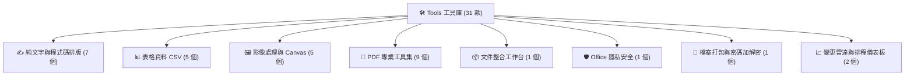

# 🛠️ Vibe Coding 獨立工具庫（Tools）

本目錄收錄 **2026 iThome 鐵人賽 — Vibe Coding** 系列所開發的 **31 款純前端單檔（SPA）實用工具**。

所有工具均遵循以下**核心工程原則**：
1. **零外部連線與伺服器依賴**：所有 JavaScript、CSS 與演算法皆內嵌於單一 HTML，離線或斷網環境下 100% 可正常運作。
2. **資料全程不離開瀏覽器**：所有文字、檔案、表格、圖片、程式碼與 PDF 皆於本機記憶體處理，絕不上傳至任何第三方伺服器。
3. **原檔永不覆寫**：永遠產出全新處理後的檔案供下載，確保原始資料完整安全。

---

## 📑 工具目錄索引

---

## 1. ✍️ 純文字與程式碼排版

| 檔案名稱 | 工具名稱 | 功能特色與適用情境 |
|---|---|---|
| [`text-health-check.html`](text-health-check.html) | **文字健檢工作台** | 即時統計字元數、全半形 CJK 字數、段落數與閱讀時間；檢查連續全半形空白、重複標點符號等排版問題，支援即時複製與匯出。 |
| [`ai-text-cleaner.html`](ai-text-cleaner.html) | **AI 回答文字清理器** | 將 ChatGPT / Claude 回答中的 Markdown 標題語法、粗體、清單標記、程式碼區塊圍欄清理為適合直接貼入 Word / PPT / Email 的純淨排版。 |
| [`filler-word-checker.html`](filler-word-checker.html) | **贅詞與 AI 味檢查器** | 內建繁體中文常見贅詞庫與 AI 慣用語法特徵庫，偵測段落開頭同構句型與高頻空泛詞彙，提供逐項高亮與建議。 |
| [`zh-tw-localizer.html`](zh-tw-localizer.html) | **繁簡在地化轉換器** | 內嵌 OpenCC 繁簡對照與台灣在地化詞典（如「內存→記憶體」、「高清→高畫質」），多階段轉換，支援逐項審查接受或取消替換。 |
| [`reversible-deidentifier.html`](reversible-deidentifier.html) | **可逆式去識別化工具** | 以正規表示式與規則自動偵測姓名、手機、身分證號、Email 與關鍵詞，以 Token 進行遮蔽，支援匯出/載入對照表並可 100% 雙向還原。 |
| [`text-diff.html`](text-diff.html) | **文字差異比對器** | 內嵌 jsdiff 引擎，支援按字元、詞彙、行進行雙欄或合併差異對照，中文標點斷句優化，自動摺疊大量未變動區塊。 |
| [`python-code-formatter.html`](python-code-formatter.html) | **Python 離線排版器** | 內嵌 Pyodide (WASM CPython) 與官方 Black 排版庫、Prism.js 高亮，所有套件 Base64 內嵌並覆寫 fetch，純本機零網路執行 AST 語法格式化。 |

---

## 2. 📊 表格資料 CSV

| 檔案名稱 | 工具名稱 | 功能特色與適用情境 |
|---|---|---|
| [`csv-doctor.html`](csv-doctor.html) | **CSV 健檢與修復器** | 自動偵測 UTF-8 / Big5 / UTF-16 編碼與 BOM 標記，自動修正欄位不對齊、未閉合引號，防禦試算表公式注入（Formula Injection）。 |
| [`csv-period-diff.html`](csv-period-diff.html) | **兩期清冊異動報告** | 匯入兩期 CSV 報表，指定唯一鍵值欄位（如員工編號、產品序號），自動產出新增、刪除、數值異動之詳細對照報告與摘要統計。 |
| [`csv-batch-splitter.html`](csv-batch-splitter.html) | **總表批次拆檔器** | 依據指定的分類欄位（如部門、分店、專案），將巨大總表 CSV 一鍵拆分為獨立子檔，並以 fflate 引擎在瀏覽器端即時打包為 ZIP 下載。 |
| [`csv-pivot-dashboard.html`](csv-pivot-dashboard.html) | **CSV 樞紐圖表儀表板** | 純手寫 SVG 圖表渲染引擎（長條圖、折線圖、圓餅圖），支援多欄 Group By 與 SUM/COUNT/AVG 樞紐彙總，可一鍵匯出靜態快照。 |
| [`csv-one-page-report.html`](csv-one-page-report.html) | **CSV 一頁式管理報告** | 內建專為 A4 直式/橫式列印優化之排版版型，將 CSV 數據自動收斂為適合主管審閱之單頁 Summary 報表，可直接列印或另存 PDF。 |

---

## 3. 🖼️ 影像處理與 Canvas

| 檔案名稱 | 工具名稱 | 功能特色與適用情境 |
|---|---|---|
| [`image-batch-optimizer.html`](image-batch-optimizer.html) | **圖片批次最佳化工作台** | 批次調整圖片尺寸、指定目標檔案大小（二分逼近演算法壓縮）、格式轉換（JPG/PNG/WebP），支援整批 ZIP 下載。 |
| [`exif-privacy-cleaner.html`](exif-privacy-cleaner.html) | **EXIF 隱私清除器** | 二進位層級解析 JPEG/TIFF 之 EXIF 與 XMP Metadata，檢視拍攝 GPS 經緯度、相機型號與時間，並於像素層級無失真抹除隱私資訊。 |
| [`screenshot-sanitizer.html`](screenshot-sanitizer.html) | **截圖個資遮蔽工具** | 提供馬賽克、黑條遮蔽、紅框標註畫布；遮蔽資訊直接**燒進像素（Rasterize）**，杜絕可被反向選取或復原的偽遮蔽漏洞。 |
| [`document-perspective-corrector.html`](document-perspective-corrector.html) | **文件照片透視校正器** | 針對斜拍、梯形變形的文件照片，以四點控制錨點計算單應性矩陣（Homography Matrix），拉直校正為端正清晰的平面文件。 |
| [`photo-evidence-sheet.html`](photo-evidence-sheet.html) | **工作成果附件產生器** | 匯入多張現場施工、勘查或工作照片，自動排版為標準 2x2 / 2x3 照片清冊，支援自訂圖說、拍攝日期與浮水印，支援 A4 列印輸出。 |

---

## 4. 📑 PDF 專業工具集

| 檔案名稱 | 工具名稱 | 功能特色與適用情境 |
|---|---|---|
| [`xlsx-to-pdf-converter.html`](xlsx-to-pdf-converter.html) | **Excel 轉 PDF 離線工具** | 內嵌 SheetJS 壓縮核心，支援動態掃描計算最小邊界矩陣（剔除 256 欄無效空白儲存格）、多工作表連續強制換頁，透過瀏覽器高畫質向量列印產出 PDF。 |
| [`pdf-to-jpg.html`](pdf-to-jpg.html) | **PDF 轉圖工作台** | 透過 pdf.js 逐頁解碼並渲染為高解析度圖片，可自訂 DPI 與品質，批次打包為 ZIP 下載。 |
| [`pdf-text-search.html`](pdf-text-search.html) | **PDF 文字擷取與搜尋** | 深入 PDF 文字層擷取純文字與結構，支援全文即時正則搜尋與關鍵字高亮，可匯出為 TXT 或 Markdown。 |
| [`pdf-organizer.html`](pdf-organizer.html) | **PDF 頁面重排與分割** | 以視覺化拖曳卡片即時重排頁碼、旋轉特定頁面（90°/180°/270°）、刪除頁面，或將指定範圍分割為多份全新 PDF。 |
| [`pdf-review-stamper.html`](pdf-review-stamper.html) | **PDF 審查章與浮水印** | 內嵌 Noto Sans TC 繁體中文字型，支援在指定頁次加蓋「核可/駁回/機密」審查印章、斜向文字浮水印與自訂頁碼。 |
| [`pdf-password-manager.html`](pdf-password-manager.html) | **PDF 密碼管理器** | 基於 `@cantoo/pdf-lib` 實作，支援設定開啟密碼（User Password）與權限密碼（Owner Password），亦支援已知密碼之解密解除保護。 |
| [`pdf-secure-redactor.html`](pdf-secure-redactor.html) | **PDF 安全文字遮蔽** | 真正的**像素級安全抹除**：將遮蔽區域底層文字物件與矢量流物理移除後重新 Flatten 封裝，杜絕反白選取複製洩漏個資。 |
| [`pdf-delivery-cleaner.html`](pdf-delivery-cleaner.html) | **PDF 送件清理器** | 掃描並一鍵移除 PDF 內的作者資訊、軟體名稱、歷史註解（Annotations）、表單輸入暫存、附件與外部動作（Actions）。 |
| [`office-content-publisher.html`](office-content-publisher.html) | **Office 內容發布排版器** | 將 Markdown 與 CSV 資料即時渲染為符合排版美學的 HTML 網頁文章或表格，支援一鍵複製富文字至 Word 或匯出獨立網頁。 |

---

## 5. 📦 文件整合工作台

| 檔案名稱 | 工具名稱 | 功能特色與適用情境 |
|---|---|---|
| [`document-tools.html`](document-tools.html) | **文件處理整合工作台** | 集成圖片處理、PDF 轉圖、文字搜尋與發布排版模組之全功能整合儀表板，提供多合一的分頁切換工作流。 |

---

## 6. 🛡️ Office 隱私安全專項

| 檔案名稱 | 工具名稱 | 功能特色與適用情境 |
|---|---|---|
| [`ooxml-privacy-cleaner.html`](ooxml-privacy-cleaner.html) | **Office 文件隱私清除器** | 解析 DOCX、XLSX、PPTX 之 OOXML 容器，徹底清除檔案屬性（作者、主管、公司、範本路徑）、內嵌縮圖、註解、樞紐分析表快取、投影片原圖殘留與本機路徑超連結。已通過雙重獨立審查理事會（Codex + Claude）黑箱安全驗收。 |

---

## 7. 🔐 檔案打包與密碼加解密

| 檔案名稱 | 工具名稱 | 功能特色與適用情境 |
|---|---|---|
| [`zip-encrypt-decrypt.html`](zip-encrypt-decrypt.html) | **ZIP 密碼封裝加密器** | 內嵌 JSZip 與 Web Crypto API，支援選取多檔案或整個資料夾，以 PBKDF2(SHA-256) 30萬~100萬次迭代導出金鑰，並以 AES-256-GCM 封裝為 `.enc` 加密檔；亦支援同一頁面反向解密還原為 ZIP。 |

---

## 8. 📈 變更雷達與排程儀表板

> ⚠️ 此兩款工具屬 Level 2 產品，本體為純前端展示儀表板，依賴 GitHub Actions 定期產出之資料檔：

| 檔案名稱 | 工具名稱 | 說明與資料相依性 |
|---|---|---|
| [`scheduled-work-dashboard.html`](scheduled-work-dashboard.html) | **信用卡詐欺通報趨勢儀表板** | 讀取聯合信用卡中心公開通報數據，以互動式圖表展示月度詐欺交易型態趨勢（需配合 `data/monthly-stats.csv`）。 |
| [`public-data-snapshot.html`](public-data-snapshot.html) | **公開資訊變更雷達** | 讀取 RSS 與公開頁面變更紀錄，展示重大資安與科技新聞之變更通知歷程（需配合 `data/seen.json` 與 `data/history.jsonl`）。 |

---

## 🚀 離線使用方式

1. 點擊任何 `.html` 檔案即可在任何現代瀏覽器（Chrome, Edge, Safari, Firefox）中直接打開使用。
2. 亦可直接將特定工具複製到隨身碟或內部隔離網路環境，完全無需安裝 Node.js、Python 或任何伺服器環境。
